# Illustrate field guide

1. Read the nearest guide and identify the question each section answers. Trace measurements to their study or source. Choose a shared or sensor-specific home using the guide index.
2. Browse `art/README.md`. Reuse a diagram when its subject and evidence match. Otherwise draw a small scene in `art/` using a labeled viewBox, title, description and a short sequence that shows what changes. Gate motion on the reader’s motion preference. Check the still frame and narrow-width rendering. Read the English and Arabic versions first, including the spoken measurements. Check right-to-left captions against the same field coordinates.
3. Open with the illustration, then the title. Pair each major idea with a diagram and write alt text that gives the takeaway. Keep the measured evidence beside the passage that interprets it.
4. Stage new assets for the Pages build. Run `node --test test/storybook.test.js` and inspect the rendered images. Follow `ci/README.md` for release checks.
