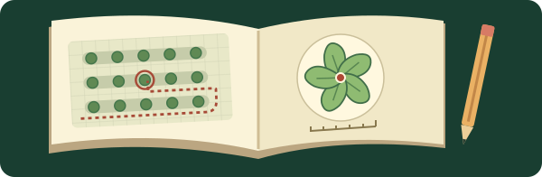

# Crop Trainer for GitHub Copilot

[Read the project guide](../AGENTS.md)

Start with the [field guide](../docs/README.md). Use the project skills `illustrate-field-guide` for documentation and `run-crop-experiment` for reproducible detector comparisons. Every Markdown title and major section needs an explanatory animated illustration. LiDAR is the working sensing method today. Camera vision is planned.
