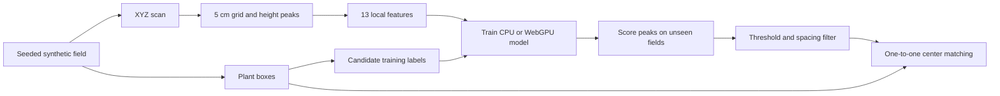
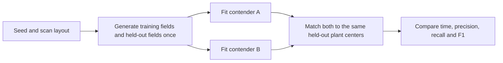

# Crop Trainer

Browser based synthetic data generation and model training for crop analysis.

Grow a virtual plot of lettuce, globe artichokes or young tomatoes, scan it with LiDAR, and train a small neural network to put one pin on each plant. Change the seed, add ground returns, or thin the scan to see where the detector struggles.

**[Play Crop Trainer](https://mvalancy.github.io/crop-trainer/) · [Run a benchmark](https://mvalancy.github.io/crop-trainer/benchmark/) · [Start locally](#local-play-and-agent-experiments) · [Download the app](https://github.com/mvalancy/crop-trainer/archive/refs/heads/main.zip) · [Agent quickstart](AGENTS.md)**

## First harvest

1. Open the farm and grow seed 27. Choose a crop and scanner. Drag the 3D scan to orbit, Shift-drag to pan, and scroll or pinch to zoom. The red rings mark the planted centers. Download the synthetic XYZ scan as a PLY file and its boxes as JSON.
2. Enter the training shed and choose **Generate, train & score**. The defaults train a small neural net on six fields and check it on three unseen fields. Each field is scanned with and without ground. Auto uses WebGPU when the browser finds an adapter. CPU works locally too.
3. Inspect the lowest-recall field. Switch the map between all height peaks, score-passing peaks and final detections. Green rings mark labels and red dots mark the selected detector stage.
4. Export the benchmark, then change one setting. Complete a mixed scan run and try another seed to earn all three farm journal stamps. Progress is stored in this browser.

## What the model learns

A LiDAR return is a 3D point. A cluster of tall returns might be lettuce, a weed or clutter. The generator knows where it planted each plant, so it can provide an answer key. Training adjusts numerical weights to give likely plant centers a higher score. One epoch is one pass over the balanced set of training candidates.



The neural model learns all weights in a four-unit tanh hidden layer and a sigmoid output. A logistic baseline uses the same inputs and validation split. Precision measures how many pins match plants. Recall measures how many plants received a pin. Mean F1 combines both over three matching distances. Each run learns a detector for the selected crop and estimates how well it locates whole plants on new synthetic fields.

## Crops and scanners

| Crop | Synthetic geometry | Starting peak height | Minimum distance between final pins |
| --- | --- | ---: | ---: |
| Lettuce | Compact overlapping leaves in paired rows | 3.5 cm | 12.5 cm |
| Globe artichoke | Large lobed leaves around a raised terminal bud | 6.5 cm | 40 cm |
| Young tomato | Compound foliage and an upright growing tip | 6.5 cm | 22 cm |

In **Data generation**, choose a scanner, ray budget, soil, noise and obstacles. Export the XYZ scan, bounding boxes and exact recipe. **Train this crop and layout** carries the crop and scanner into the training shed. Training generates its own split of fields with seeded point budgets, noise and clutter. The OS1 layouts reproduce selected channel and angular-column counts using a projected ring lattice. Real scanners also have beam angles, intensity response, timing and return-selection behavior. [Ouster sensor data reference](https://static.ouster.dev/sensor-docs/image_route1/image_route2/sensor_data/sensor-data.html)

## Benchmark

Open **Benchmark** to compare CPU and WebGPU on the same neural model, or compare logistic and neural models on CPU. Each benchmark runs both contenders on two seeds and reverses their order for the second seed. The results include generation, training and scoring time, F1, and precision and recall. Download JSON for per-tolerance counts and per-field stages. Expand the distance table to see exact matches, extra pins and missed plants. Each WebGPU row in the JSON includes the adapter information exposed by the browser. To repeat the benchmark on another device, use the same app revision, crop, scanner and first seed. [Open Benchmark](https://mvalancy.github.io/crop-trainer/benchmark/)



The crop-specific spacing filter was tested on seeds 61 and 62, with six training fields, three validation fields, mixed sampling, 40 neural epochs and 6.5 cm peaks. Increasing artichoke spacing from 12.5 to 40 cm raised mean F1 from 0.536 to 0.600 and from 0.673 to 0.779. On seed 61, 15 cm recall slipped from 85.4% to 84.3%. For young tomato, 22 cm spacing raised mean F1 from 0.730 to 0.757 and from 0.781 to 0.799. These are whole-plant center scores on procedural fields.

## Datasets and research

- **Lettuce.** Vázquez Gálvez and colleagues describe 387 RGB-D reconstructions and three augmentations of each, covering four lettuce varieties. The metadata lists CC BY 4.0. These individual-plant clouds can inform canopy shape. Keep all augmentations of an original together when splitting examples. [Dataset and license record](https://doi.org/10.21227/5xsx-hq86)
- **Tomato.** Pheno4D provides scans of seven tomato plants over 20 days, including 77 annotated point clouds. Its point labels and repeated plant identities support organ-geometry studies. Split by plant for an unseen-plant test, and confirm redistribution terms with the provider. The download page does not state a dataset license. [Dataset](https://www.ipb.uni-bonn.de/data/pheno4d/) · [Schunck et al., 2021](https://doi.org/10.1371/journal.pone.0256340)
- **Globe artichoke.** NC State Extension describes the fern-like leaves and unopened flower heads that informed the procedural silhouette. We have yet to verify a freely licensed field-scale artichoke point cloud with plant-center annotations. The starter scores one plant per rosette, including in the bud-bearing form. [Botanical reference](https://plants.ces.ncsu.edu/plants/cynara-cardunculus-scolymus-group/)
- **Learning from points.** PointNet demonstrates permutation-invariant learning directly from unordered point sets. A research comparison could train a local point-set encoder on the same candidates and seeds and compare it with the included 13-feature neural classifier. [Qi et al., CVPR 2017](https://arxiv.org/abs/1612.00593)

## Local play and agent experiments

Use Node.js 22 or newer. The browser app and CPU runner have no package dependencies.

```sh
git clone https://github.com/mvalancy/crop-trainer.git
cd crop-trainer
node run.mjs serve
```

Open **http://127.0.0.1:4173/**. For headless CPU experiments and tests, run:

```sh
node --test
node run.mjs train first-harvest.json
```

Use **Download run settings** in the training shed to replay a browser experiment on another computer. For example, a completed seed 27 run exports its settings as `crop-settings-27.json`. Put that file beside `run.mjs` and run `node run.mjs train replay.json crop-settings-27.json`. The model trains from scratch on the same synthetic fields.

A browser run can use WebGPU on a supported adapter over HTTPS or localhost. Generation and validation use the CPU. The agent guide includes the full settings schema, a paired experiment, and a prompt for Gemini or another local coding agent. [AGENTS.md](AGENTS.md)

## Data and license

Every field, label and point cloud in the app is generated procedurally on demand. All source code and the original SVG artwork are released under the [MIT License](LICENSE).
