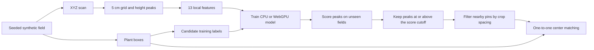
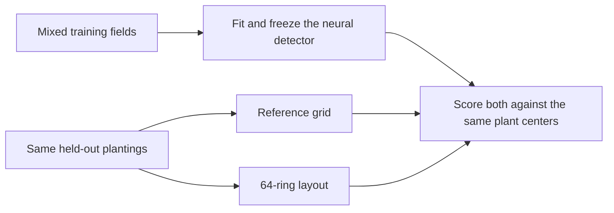
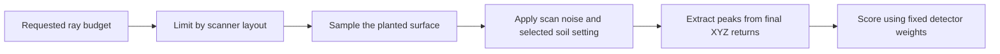
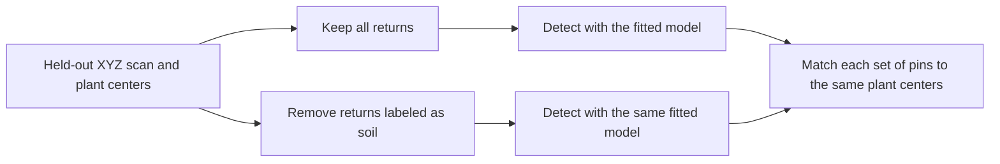
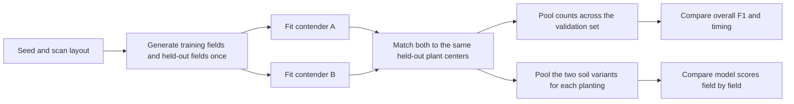
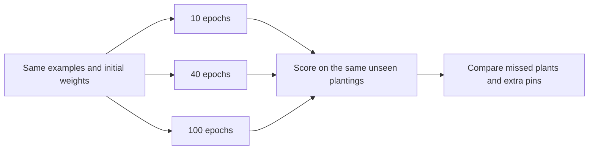
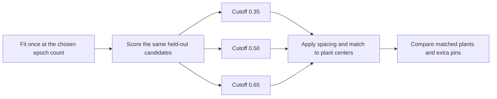

# Crop Trainer

Browser based synthetic data generation and model training for crop analysis.

Grow a virtual plot of lettuce, globe artichokes or young tomatoes, scan it with LiDAR, and train a small neural network to put one pin on each plant. Change the seed, add ground returns, or thin the scan to see where the detector struggles.

**[Play Crop Trainer](https://mvalancy.github.io/crop-trainer/) · [Run a benchmark](https://mvalancy.github.io/crop-trainer/benchmark/) · [Start locally](#local-play-and-agent-experiments) · [Download the app](https://github.com/mvalancy/crop-trainer/archive/refs/heads/main.zip) · [Agent quickstart](AGENTS.md)**

## First harvest

1. Open the farm and grow seed 27. Choose a crop and scanner. Drag the 3D scan to orbit, Shift-drag to pan, and scroll or pinch to zoom. The red rings mark the planted centers. Download the synthetic XYZ scan as a PLY file and its boxes as JSON.
2. Enter the training shed and choose **Generate, train & score**. The defaults train a small neural net on six fields and check it on three unseen fields. Each field is scanned with and without ground. Auto uses WebGPU when the browser finds an adapter. CPU works locally too.
3. Inspect the lowest-recall field. Switch the map between all height peaks, score-passing peaks and final detections. Green rings mark labels and red dots mark the selected detector stage.
4. Export the benchmark, then change one setting. Complete a mixed scan run, try another seed, and finish a cutoff benchmark to earn the four farm journal stamps. Progress is stored in this browser.

## What the model learns

A LiDAR return is a 3D point. A cluster of tall returns might be lettuce, a weed or clutter. The generator knows where it planted each plant, so it can provide an answer key. Training adjusts numerical weights to give likely plant centers a higher score. One epoch is one pass over the balanced set of training candidates.



The neural model learns all weights in a four-unit tanh hidden layer and a sigmoid output. A logistic baseline uses the same inputs and validation split. Precision measures how many pins match plants. Recall measures how many plants received a pin. Mean F1 combines both over three matching distances. Each run learns a detector for the selected crop and estimates how well it locates whole plants on new synthetic fields.

## Crops and scanners

| Crop | Synthetic geometry | Starting peak height | Minimum distance between final pins |
| --- | --- | ---: | ---: |
| Lettuce | Compact overlapping leaves in paired rows | 3.5 cm | 12.5 cm |
| Globe artichoke | Large lobed leaves around a raised terminal bud | 6.5 cm | 40 cm |
| Young tomato | Compound foliage and an upright growing tip | 6.5 cm | 22 cm |

In **Data generation**, choose a scanner, ray budget, soil, noise and obstacles. Export the XYZ scan, bounding boxes and exact recipe. **Train this crop and layout** carries the crop and scanner into the training shed. Training generates its own split of fields with seeded point budgets, noise and clutter. The OS1 layouts reproduce selected channel and angular-column counts using a projected ring lattice. Real scanners also have beam angles, intensity response, timing and return-selection behavior. [Ouster sensor data reference](https://static.ouster.dev/sensor-docs/image_route1/image_route2/sensor_data/sensor-data.html)

### Test a detector on a different scan layout

In the training shed, **Training LiDAR layout** determines the examples used to fit the detector. **Validation LiDAR layout** controls how the held-out plants are scanned. The default follows the training layout. To isolate a scanner change, keep the seed, crop, training layout, epochs and cutoffs fixed. The generator keeps the plant centers, clutter, ground variants and requested ray budgets paired. Layout capacity and simulated noise can change the number of returns. In the field audit, **Open this scan in the 3D viewer** opens the selected tile, including its ground setting. Check its tile ID against the exported report.



These paired mean F1 scores use six mixed training fields, three held-out fields with both ground variants, 40 CPU neural epochs and a 0.50 cutoff. Each row compares the same weights and training normalization.

| Crop | Run seed | Reference grid | Simulated OS1-64 |
| --- | ---: | ---: | ---: |
| Lettuce | 211 | 0.771 | 0.760 |
| Lettuce | 212 | 0.693 | 0.657 |
| Globe artichoke | 211 | 0.782 | 0.723 |
| Globe artichoke | 212 | 0.754 | 0.656 |
| Young tomato | 211 | 0.818 | 0.758 |
| Young tomato | 212 | 0.675 | 0.604 |

For tomato at seed 212, the ring scan had a candidate peak within 15 cm of 578 of 620 labeled plant instances across six tiles. The score cutoff retained matches for 311 and the spacing filter left 310. A second test trained exclusively on that same ring layout, holding validation scans fixed. Tomato mean F1 rose from 0.604 to 0.627 on seed 212 and fell from 0.758 to 0.726 on seed 211. These measurements describe the projected synthetic layouts. [Open the tomato ring test](https://mvalancy.github.io/crop-trainer/trainer/?crop=tomato&seed=212&sensor=mixed&validationSensor=os1-64) · [Open its grid control](https://mvalancy.github.io/crop-trainer/trainer/?crop=tomato&seed=212&sensor=mixed&validationSensor=reference)

### How many rays reach the field?

Set **Validation ray budget** in the Training Shed to vary scan density on held-out fields. The training fields keep their seeded budgets. Open a scored tile to see how many rays its layout sampled and how many returns survived noise and soil removal. The **Ray scout** farm challenge uses the same distinction. Two requests above the layout's capacity produce the same number of sampled rays.



On dataset seeds 721, 722, 751 and 752, increasing the simulated OS1-64 validation budget from 12,000 to 60,000 raised mean F1 on all four seeds for each of lettuce, artichoke and tomato. Each pair used six mixed-layout training fields, three held-out plantings, 40 neural epochs, identical CPU weights and identical plant labels. Changing the budget resamples the layout, so the two clouds can contain different ray positions. These projected layouts measure synthetic sampling effects. Physical scanner performance requires measured scans.

On tomato seed 721, more rays raised the number of labeled plant instances matched within 15 cm from 245 to 698 out of 734 across the six scans. Extra pins rose from 7 to 57. Times below are from the Node CPU runner and generation includes both splits. [Replay 12,000 rays](https://mvalancy.github.io/crop-trainer/trainer/?crop=tomato&seed=721&sensor=mixed&validationSensor=os1-64&validationRayBudget=12000&engine=cpu) · [Replay 60,000 rays](https://mvalancy.github.io/crop-trainer/trainer/?crop=tomato&seed=721&sensor=mixed&validationSensor=os1-64&validationRayBudget=60000&engine=cpu)

| Validation rays | Generation | Training | Validation | F1 at 7.5 cm | F1 at 10 cm | F1 at 15 cm |
| ---: | ---: | ---: | ---: | ---: | ---: | ---: |
| 12,000 | 1,746 ms | 78 ms | 30 ms | 0.4158 | 0.4929 | 0.4970 |
| 60,000 | 2,260 ms | 95 ms | 36 ms | 0.8865 | 0.9335 | 0.9375 |

### Does removing soil help the detector?

In the Training Shed, run a field and open **Compare scans with and without soil**. Choose recall to see how many plants were found, or precision to see how many pins landed on a plant. In the field audit, **Switch soil setting for this field** shows the other scan at the same detector stage.



On four fresh seeds (307, 308, 337 and 338), removing soil increased lettuce recall at 15 cm by 2.5 to 15.1 percentage points. Each run used mixed layouts, six training fields, three held-out plantings and 40 neural epochs. On artichoke seed 308, removing soil recovered four more plants (77 of 95 versus 73 of 95) and produced 50 additional false positives (54 versus 4). Precision fell from 94.8% to 58.8%. The generator knows which points are soil. A real ground filter must estimate that from measurements and can discard crop returns. [Repeat the artichoke experiment](https://mvalancy.github.io/crop-trainer/trainer/?crop=artichoke&seed=308) · [Zhang et al., cloth simulation for airborne LiDAR filtering](https://doi.org/10.3390/rs8060501)

## Benchmark

Open **Benchmark** to compare CPU and WebGPU on the same neural model, or compare logistic and neural models on CPU. Both comparisons use two seeds and reverse contender order for the second seed. Two more modes compare detection cutoffs on one fit or compare independent 10-, 40- and 100-epoch fits. The results include generation, training and scoring time, F1, and precision and recall. Download JSON for per-tolerance counts and per-field stages. Expand the distance table to see exact matches, extra pins and missed plants. Each WebGPU row in the JSON includes the adapter information exposed by the browser. To repeat the benchmark on another device, use the same app revision, crop, scanner and first seed. [Open Benchmark](https://mvalancy.github.io/crop-trainer/benchmark/)



On two fresh mixed-scan artichoke seeds, the neural model beat logistic on seed 81 (0.757 vs 0.734 mean F1), and logistic edged ahead on seed 82 (0.708 vs 0.701). On tomato, CPU and Chromium’s SwiftShader software WebGPU adapter matched at all three tolerances on both seeds. These runs check numerical agreement. Physical GPU speed requires a run on that device. [Repeat the artichoke model comparison](https://mvalancy.github.io/crop-trainer/benchmark/?comparison=models&crop=artichoke&sensor=mixed&seed=81) · [Repeat the tomato backend comparison](https://mvalancy.github.io/crop-trainer/benchmark/?comparison=backend&crop=tomato&sensor=mixed&seed=81)

The crop-specific spacing filter was tested on seeds 61 and 62, with six training fields, three validation fields, mixed sampling, 40 neural epochs and 6.5 cm peaks. Increasing artichoke spacing from 12.5 to 40 cm raised mean F1 from 0.536 to 0.600 and from 0.673 to 0.779. On seed 61, 15 cm recall slipped from 85.4% to 84.3%. For young tomato, 22 cm spacing raised mean F1 from 0.730 to 0.757 and from 0.781 to 0.799. These are whole-plant center scores on procedural fields.

### Does the same model win on every planting?

Run **Logistic vs neural · CPU**, then open **Compare contenders on each planting**. Each row pools the two scans of one field. Choose a match distance to inspect localization accuracy, or select a field seed to open its soil-present scan in 3D. The overall score pools counts across all fields, so a small lead can come from one planting.

Across dataset seeds 421, 422, 451 and 452, the neural model beat logistic on 9 of 12 lettuce plantings, 6 of 12 artichoke plantings (one tie), and 7 of 12 tomato plantings by field mean F1. All contenders used the same synthetic inputs, crop defaults and 40 epochs.

On artichoke seed 421 the neural model led overall, while logistic led on two of the three fields. Both used the same 1,424 ms field generation pass. These timings are from one Chromium CPU run and include browser overhead. [Replay this model comparison](https://mvalancy.github.io/crop-trainer/benchmark/?comparison=models&crop=artichoke&sensor=mixed&seed=421)

| CPU model | Training | Scoring | F1 at 7.5 cm | F1 at 10 cm | F1 at 15 cm | Mean F1 |
| --- | ---: | ---: | ---: | ---: | ---: | ---: |
| Logistic | 34 ms | 38 ms | 0.6580 | 0.8721 | 0.9661 | 0.8320 |
| Neural | 97 ms | 28 ms | 0.6528 | 0.8808 | 0.9741 | 0.8359 |

### How long should I train?

An epoch is one pass over the training examples. In **Benchmark → Training duration**, three CPU neural networks start from identical weights and train for 10, 40 or 100 epochs. Click an epoch count in the results to repeat that fit in the Training Shed. Training loss measures how well the network scores labeled training examples. Held-out F1 also depends on which candidate peaks pass the cutoff, their positions, and which pins survive spacing.



On mixed-layout seeds 521, 522, 551 and 552, training loss fell for every crop as training length increased. From 10 to 100 epochs, held-out mean F1 rose on all four lettuce seeds and all four tomato seeds. It fell on three of four artichoke seeds. Each seed used six training fields and three held-out plantings with both soil variants. [Replay the lettuce comparison](https://mvalancy.github.io/crop-trainer/benchmark/?comparison=epochs&crop=lettuce&seed=521) · [Replay the tomato comparison](https://mvalancy.github.io/crop-trainer/benchmark/?comparison=epochs&crop=tomato&seed=521)

On artichoke seed 552, the longer fit found three more plants within 15 cm while adding 50 false positives. The table shows one Chromium CPU run. Dataset generation took 1,143 ms once for all three fits. Times vary by device and browser load. [Replay the artichoke comparison](https://mvalancy.github.io/crop-trainer/benchmark/?comparison=epochs&crop=artichoke&seed=551)

| Epochs | Training | Validation | F1 at 7.5 cm | F1 at 10 cm | F1 at 15 cm | Extra pins at 15 cm |
| ---: | ---: | ---: | ---: | ---: | ---: | ---: |
| 10 | 15 ms | 35 ms | 0.4700 | 0.7386 | 0.9640 | 4 |
| 40 | 176 ms | 38 ms | 0.4342 | 0.6798 | 0.8947 | 40 |
| 100 | 211 ms | 38 ms | 0.4383 | 0.6511 | 0.8681 | 54 |

### How many candidate pins should pass?

The cutoff is the minimum model score a candidate needs before the spacing filter. The training shed starts at 0.50. In **Detection score cutoffs**, the benchmark reuses the fitted weights and field labels at 0.35, 0.50 and 0.65. Generation and training times repeat across those rows because each happens once per seed. Compare each cutoff’s precision and recall at the distance your task requires.

On mixed scans at seeds 103, 104, 137 and 138, moving from 0.50 to 0.65 increased artichoke mean F1 on all four seeds. Tomato lost mean F1 on all four. On tomato seed 137, lowering the cutoff from 0.50 to 0.35 recovered more plants. At 15 cm, recall rose from 75.1% to 83.2%, while precision fell from 89.6% to 82.4%. Lettuce changed direction across seeds. These synthetic comparisons use six training fields, three held-out fields and 40 epochs per seed. [Repeat the tomato comparison](https://mvalancy.github.io/crop-trainer/benchmark/?comparison=cutoffs&crop=tomato&sensor=mixed&seed=137) · [Repeat the artichoke comparison](https://mvalancy.github.io/crop-trainer/benchmark/?comparison=cutoffs&crop=artichoke&sensor=mixed&seed=103)

#### Does the same cutoff work after a longer fit?

Set **Epochs per fit** in the cutoff benchmark and open **What changes from the 0.50 cutoff?** after the run. Positive matched-plant counts mean the detector found more plants. Positive extra-pin counts mean it produced more false positives. Select a cutoff in the main table to inspect the fitted detector's stages in the Training Shed.



On artichoke seed 622, raising the cutoff from 0.50 to 0.65 at 10 epochs reduced the number of 15 cm matches from 160 to 132. At 100 epochs, it preserved all 162 matches and reduced extra pins from 38 to 28. Here are all three distances for that 100-epoch CPU fit. Generation took 1,030 ms and training took 162 ms once. [Repeat at 10 epochs](https://mvalancy.github.io/crop-trainer/benchmark/?comparison=cutoffs&crop=artichoke&seed=621&epochs=10) · [Repeat at 100 epochs](https://mvalancy.github.io/crop-trainer/benchmark/?comparison=cutoffs&crop=artichoke&seed=621&epochs=100)

| Cutoff | F1 at 7.5 cm | F1 at 10 cm | F1 at 15 cm | Validation time |
| ---: | ---: | ---: | ---: | ---: |
| 0.35 | 0.5362 | 0.6715 | 0.7826 | 28 ms |
| 0.50 | 0.5550 | 0.6950 | 0.8100 | 30 ms |
| 0.65 | 0.5692 | 0.7128 | 0.8308 | 27 ms |

Across fresh synthetic seeds 621, 622, 651 and 652 at 100 epochs, the higher cutoff increased mean F1 on two of four artichoke seeds and three of four lettuce seeds. Tomato mean F1 decreased on all four. Each comparison used the same held-out scans at every cutoff.

## Datasets and research

- **Lettuce.** Vázquez Gálvez and colleagues describe 387 RGB-D reconstructions and three augmentations of each, covering four lettuce varieties. The metadata lists CC BY 4.0. These individual-plant clouds can inform canopy shape. Keep all augmentations of an original together when splitting examples. [Dataset and license record](https://doi.org/10.21227/5xsx-hq86)
- **Tomato.** Pheno4D provides scans of seven tomato plants over 20 days, including 77 annotated point clouds. Its point labels and repeated plant identities support organ-geometry studies. Split by plant for an unseen-plant test, and confirm redistribution terms with the provider. The download page does not state a dataset license. [Dataset](https://www.ipb.uni-bonn.de/data/pheno4d/) · [Schunck et al., 2021](https://doi.org/10.1371/journal.pone.0256340)
- **Globe artichoke.** NC State Extension describes the fern-like leaves and unopened flower heads that informed the procedural silhouette. We have yet to verify a freely licensed field-scale artichoke point cloud with plant-center annotations. The starter scores one plant per rosette, including in the bud-bearing form. [Botanical reference](https://plants.ces.ncsu.edu/plants/cynara-cardunculus-scolymus-group/)
- **Changing LiDAR sensors.** Yi and colleagues studied changes in point-cloud segmentation across LiDAR sensors, including learning to reconstruct sparsely sampled surfaces. Crop Trainer can isolate the effect of a projected scan layout on plant-center detection. Comparisons with a physical scanner require measurements from that device. [Complete & Label, CVPR 2021](https://openaccess.thecvf.com/content/CVPR2021/html/Yi_Complete__Label_A_Domain_Adaptation_Approach_to_Semantic_Segmentation_CVPR_2021_paper.html)
- **Grouped evaluation.** Roberts and colleagues explain how spatial and hierarchical structure affects validation. Crop Trainer holds out entire field seeds and keeps the two soil variants together. Additional scans of one planting share its labels and geometry. [Roberts et al., Ecography, 2017](https://doi.org/10.1111/ecog.02881)
- **Training duration.** Prechelt compares validation-based stopping criteria and their tradeoff between training time and generalization. The epoch benchmark measures three fixed durations. To estimate performance after choosing a duration, repeat it on fresh field seeds. [Prechelt, Early Stopping — But When?](https://doi.org/10.1007/3-540-49430-8_3)
- **Choosing a cutoff.** Lipton and colleagues study how a classifier’s score distribution affects the decision threshold that maximizes F1. Crop Trainer measures the tradeoff on held-out fields after spacing and spatial matching. [Lipton et al., 2014](https://doi.org/10.1007/978-3-662-44851-9_15)
- **Evaluating detector cutoffs.** Saito and Rehmsmeier explain how precision and recall expose tradeoffs when positive and negative examples occur at different rates. Crop Trainer balances candidates for fitting, then measures extra pins and misses on whole synthetic fields. [PLOS ONE, 2015](https://doi.org/10.1371/journal.pone.0118432)
- **Encoding sparse returns.** PointPillars learns features from point sets within vertical columns. Crop Trainer's fixed 5 cm cells summarize height and occupancy before classification. Varying the validation ray budget tests how this simpler representation responds to sparse sampling. [Lang et al., CVPR 2019](https://openaccess.thecvf.com/content_CVPR_2019/html/Lang_PointPillars_Fast_Encoders_for_Object_Detection_From_Point_Clouds_CVPR_2019_paper.html)
- **Learning from points.** PointNet demonstrates permutation-invariant learning directly from unordered point sets. A research comparison could train a local point-set encoder on the same candidates and seeds and compare it with the included 13-feature neural classifier. [Qi et al., CVPR 2017](https://arxiv.org/abs/1612.00593)

## Local play and agent experiments

Use Node.js 22 or newer. The browser app and CPU runner have no package dependencies.

```sh
git clone https://github.com/mvalancy/crop-trainer.git
cd crop-trainer
node run.mjs serve
```

Open **http://127.0.0.1:4173/**. For headless CPU experiments and tests, run:

```sh
node --test
node run.mjs train first-harvest.json
```

Use **Download run settings** in the training shed to replay a browser experiment on another computer. For example, a completed seed 27 run exports its settings as `crop-settings-27.json`. Put that file beside `run.mjs` and run `node run.mjs train replay.json crop-settings-27.json`. The model trains from scratch on the same synthetic fields.

A browser run can use WebGPU on a supported adapter over HTTPS or localhost. Generation and validation use the CPU. The agent guide includes the full settings schema, a paired experiment, and a prompt for Gemini or another local coding agent. [AGENTS.md](AGENTS.md)

## Data and license

Every field, label and point cloud in the app is generated procedurally on demand. All source code and the original SVG artwork are released under the [MIT License](LICENSE).
