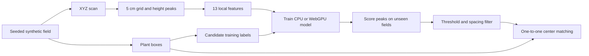

# Crop Trainer

Browser based synthetic data generation and model training for crop analysis.

Grow a virtual lettuce patch, scan it with LiDAR, and train a small neural network to put one pin on each plant. Change the seed, add ground returns, or thin the scan to see where the detector struggles.

**[Play Crop Trainer](https://mvalancy.github.io/crop-trainer/) · [Open the training shed](https://mvalancy.github.io/crop-trainer/trainer/) · [Agent quickstart](AGENTS.md)**

## First harvest

1. Open the farm and grow seed 27. The red marks are the centers of the generated plants. Download the synthetic XYZ scan as a PLY file and its boxes as JSON.
2. Enter the training shed and choose **Generate, train & score**. The defaults train a small neural net on six fields and check it on three unseen fields. Each field is scanned with and without ground. Auto uses WebGPU when the browser finds an adapter. CPU works locally too.
3. Inspect the lowest-recall field. Switch the map between all height peaks, score-passing peaks and final detections. Green rings mark labels and red dots mark the selected detector stage.
4. Export the benchmark, then change one setting. Complete a mixed scan run and try another seed to earn all three farm journal stamps. Progress is stored in this browser.

## What the model learns

A LiDAR return is a 3D point. A cluster of tall returns might be lettuce, a weed or clutter. The generator knows where it planted each head, so it can provide an answer key. Training adjusts numerical weights to give likely lettuce centers a higher score. One epoch is one pass over the balanced set of training candidates.



The neural model learns all weights in a four-unit tanh hidden layer and a sigmoid output. A logistic baseline uses the same inputs and validation split. Precision measures how many pins match plants. Recall measures how many plants received a pin. Mean F1 combines both over three matching distances. The benchmark measures synthetic lettuce detection.

## Local play and agent experiments

Use Node.js 22 or newer. The browser app and CPU runner have no package dependencies.

```sh
git clone https://github.com/mvalancy/crop-trainer.git
cd crop-trainer
node run.mjs serve
```

Open **http://127.0.0.1:4173/**. For headless CPU experiments and tests, run:

```sh
node --test
node run.mjs train first-harvest.json
```

A browser run can use WebGPU on a supported adapter over HTTPS or localhost. Generation and validation use the CPU. The agent guide includes the full settings schema, a paired experiment, and a prompt for Gemini or another local coding agent. [AGENTS.md](AGENTS.md)

## Data and license

Every field, label and point cloud in the app is generated procedurally on demand. All source code and the original SVG artwork are released under the [MIT License](LICENSE).
