# Crop Trainer

Grow a virtual plot of lettuce, globe artichokes or young tomatoes, scan it with LiDAR, and train a small neural network to put one pin on each plant. Change the seed, add ground returns, or thin the scan to see where the detector struggles.

**[Play Crop Trainer](https://mvalancy.github.io/crop-trainer/) · [Run a benchmark](https://mvalancy.github.io/crop-trainer/benchmark/) · [Start locally](#local-play-and-agent-experiments) · [Download the app](https://github.com/mvalancy/crop-trainer/archive/refs/heads/main.zip) · [Agent quickstart](AGENTS.md)**

## First harvest

1. Open the farm and grow seed 27. Choose a crop and scanner in **Scan settings**. On a phone, use **Settings ↓** next to the 3D viewer. Drag the 3D scan to orbit, Shift-drag to pan, and scroll or pinch to zoom. Coral rings mark plants with crop returns. Gold crosses mark plants with none. Download the synthetic XYZ scan as a PLY file and its boxes as JSON.
2. Enter the training shed and choose **Generate, train & score**. Open **Scanner and ray budgets** or **Detector settings** to adjust the experiment. The defaults train a small neural net on six fields and check it on three unseen fields. Each field is scanned with and without ground. Auto uses WebGPU when the browser finds an adapter. CPU works locally too.
3. Inspect the lowest-recall field. Switch the map between all height peaks, score-passing peaks and final detections. Green rings mark labels and red dots mark the selected detector stage.
4. Export the benchmark, then change one setting. Complete a mixed scan run, try another seed, and finish a cutoff benchmark to earn farm journal stamps. Progress is stored in this browser.

## What the model learns

A LiDAR return is a 3D point. A cluster of tall returns might be lettuce, a weed or clutter. The generator knows where it planted each plant, so it can provide an answer key. Training adjusts numerical weights to give likely plant centers a higher score. One epoch is one pass over the balanced set of training candidates.

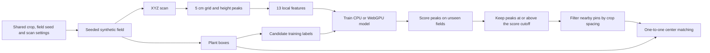

The neural model learns all weights in a four-unit tanh hidden layer and a sigmoid output. A logistic baseline uses the same inputs and validation split. Precision measures how many pins match plants. Recall measures how many plants received a pin. Mean F1 combines both over three matching distances. Each run learns a detector for the selected crop and estimates how well it locates whole plants on new synthetic fields.

## Crops and scanners

| Crop | Synthetic geometry | Starting peak height | Minimum distance between final pins |
| --- | --- | ---: | ---: |
| Lettuce | Compact overlapping leaves in paired rows | 3.5 cm | 12.5 cm |
| Globe artichoke | Large lobed leaves around a raised terminal bud | 6.5 cm | 40 cm |
| Young tomato | Compound foliage and an upright growing tip | 6.5 cm | 22 cm |

In the **Field generator**, choose a scanner, ray budget, soil, noise and obstacles. Export the XYZ scan, bounding boxes and exact recipe. **Train this crop and layout** carries the crop and scanner into the training shed. Training generates separate fields with seeded noise and clutter. A fixed generator budget carries into validation, and the training budget defaults to seeded variation. The OS1 layouts reproduce selected channel and angular-column counts using a projected ring lattice. Real scanners also have beam angles, intensity response, timing and return-selection behavior. [Ouster sensor data reference](https://static.ouster.dev/sensor-docs/image_route1/image_route2/sensor_data/sensor-data.html)

### Share one scan with another grower

Choose **Grow and scan**, then **Copy scan link** under the viewer. The link captures the displayed crop, field seed, scanner, ray budget, soil, noise and each obstacle setting. A teammate can open it and download the regenerated XYZ and labels without an account. Edits to the controls take effect on the next scan. On localhost, the link points to your own server. Use the public farm for a link anyone can open.

A shared link includes the expected tile ID. The viewer flags a mismatch if the generator produces a different ID. Keep the PLY and labels alongside the source revision for a long-lived dataset. [Open a sparse tomato scan from the benchmark](https://mvalancy.github.io/crop-trainer/?crop=tomato&sensor=os1-32&seed=854812180&budget=12000&ground=true&tile=e3a36b5c8e54f55d#field)

### Test a detector on a different scan layout

In the training shed, **Training LiDAR layout** determines the examples used to fit the detector. **Validation LiDAR layout** controls how the held-out plants are scanned. The default follows the training layout. To isolate a scanner change, keep the seed, crop, training layout, epochs and cutoffs fixed. The generator keeps the plant centers, clutter, ground variants and requested ray budgets paired. Layout capacity and simulated noise can change the number of returns. In the field audit, **Open this scan in the 3D viewer** opens the selected tile, including its ground setting. Check its tile ID against the exported report.

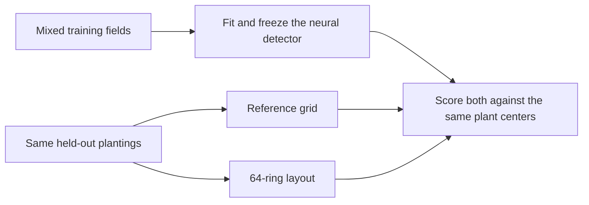

These paired mean F1 scores use six mixed training fields, three held-out fields with both ground variants, 40 CPU neural epochs and a 0.50 cutoff. Each row compares the same weights and training normalization.

| Crop | Run seed | Reference grid | Simulated OS1-64 |
| --- | ---: | ---: | ---: |
| Lettuce | 211 | 0.771 | 0.760 |
| Lettuce | 212 | 0.693 | 0.657 |
| Globe artichoke | 211 | 0.782 | 0.723 |
| Globe artichoke | 212 | 0.754 | 0.656 |
| Young tomato | 211 | 0.818 | 0.758 |
| Young tomato | 212 | 0.675 | 0.604 |

For tomato at seed 212, the ring scan had a candidate peak within 15 cm of 578 of 620 labeled plant instances across six tiles. The score cutoff retained matches for 311 and the spacing filter left 310. A second test trained exclusively on that same ring layout, holding validation scans fixed. Tomato mean F1 rose from 0.604 to 0.627 on seed 212 and fell from 0.758 to 0.726 on seed 211. These measurements describe the projected synthetic layouts. [Open the tomato ring test](https://mvalancy.github.io/crop-trainer/trainer/?crop=tomato&seed=212&sensor=mixed&validationSensor=os1-64) · [Open its grid control](https://mvalancy.github.io/crop-trainer/trainer/?crop=tomato&seed=212&sensor=mixed&validationSensor=reference)

### How many rays reach the field?

Set **Validation ray budget** in the Training Shed to vary scan density on held-out fields. Training uses the budget selected for its own split, which defaults to seeded variation. Open a scored tile to see how many rays its layout sampled and how many returns survived noise and soil removal. The **Ray scout** farm challenge uses the same distinction. Two requests above the layout's capacity produce the same number of sampled rays.


On dataset seeds 721, 722, 751 and 752, increasing the simulated OS1-64 validation budget from 12,000 to 60,000 raised mean F1 on all four seeds for each of lettuce, artichoke and tomato. Each pair used six mixed-layout training fields, three held-out plantings, 40 neural epochs, identical CPU weights and identical plant labels. Changing the budget resamples the layout, so the two clouds can contain different ray positions. These projected layouts measure synthetic sampling effects. Physical scanner performance requires measured scans.

On tomato seed 721, more rays raised the number of labeled plant instances matched within 15 cm from 245 to 698 out of 734 across the six scans. Extra pins rose from 7 to 57. Times below are from the Node CPU runner and generation includes both splits. [Replay 12,000 rays](https://mvalancy.github.io/crop-trainer/trainer/?crop=tomato&seed=721&sensor=mixed&validationSensor=os1-64&validationRayBudget=12000&engine=cpu) · [Replay 60,000 rays](https://mvalancy.github.io/crop-trainer/trainer/?crop=tomato&seed=721&sensor=mixed&validationSensor=os1-64&validationRayBudget=60000&engine=cpu)

| Validation rays | Generation | Training | Validation | F1 at 7.5 cm | F1 at 10 cm | F1 at 15 cm |
| ---: | ---: | ---: | ---: | ---: | ---: | ---: |
| 12,000 | 1,746 ms | 78 ms | 30 ms | 0.4158 | 0.4929 | 0.4970 |
| 60,000 | 2,260 ms | 95 ms | 36 ms | 0.8865 | 0.9335 | 0.9375 |

### Does matching training density help on sparse scans?

On two fresh seeds, training at 12,000 rays improved mean F1 for all three crops on held-out 12,000-ray OS1-64 scans. The comparison used six training fields, three held-out fields, both soil variants, 40 neural epochs and a 0.50 score cutoff. Each pair had identical validation scans and training plantings. Resampling the training scans changed their candidate peaks and the number of balanced examples.

| Crop | Seed 1221 · train 12k / 60k | Seed 1222 · train 12k / 60k |
| --- | ---: | ---: |
| Lettuce | 0.712 / 0.168 | 0.680 / 0.405 |
| Globe artichoke | 0.660 / 0.136 | 0.624 / 0.368 |
| Young tomato | 0.550 / 0.119 | 0.598 / 0.337 |

For lettuce seed 1221, F1 at 7.5, 10 and 15 cm was 0.642, 0.727 and 0.767 with 12k training rays, and 0.159, 0.167 and 0.178 with 60k. The Node CPU run spent 2.41 s generating, 0.09 s training and 0.07 s validating at 12k, compared with 3.52 s, 0.17 s and 0.03 s at 60k. These scores describe this simulated sparse layout. In the Training shed, open **Scanner and ray budgets** to set the two splits independently. [Replay lettuce at 12k training rays](https://mvalancy.github.io/crop-trainer/trainer/?crop=lettuce&seed=1221&sensor=os1-64&trainingRayBudget=12000&validationRayBudget=12000&engine=cpu) · [Replay the 60k control](https://mvalancy.github.io/crop-trainer/trainer/?crop=lettuce&seed=1221&sensor=os1-64&trainingRayBudget=60000&validationRayBudget=12000&engine=cpu)

### Does the same fit work on dense scans?

Choose **Training scan density** in the benchmark. The CPU fits the same neural architecture twice per seed, using 12,000 and 60,000 requested rays per training scan. Select a validation budget and compare the fits on identical held-out tiles. The results show the sampled rays and balanced examples that reached each fit. Select a contender to replay it in the Training shed. [Run the density benchmark](https://mvalancy.github.io/crop-trainer/benchmark/?comparison=density&sensor=os1-64&crop=lettuce&seed=1321&validationRayBudget=60000)

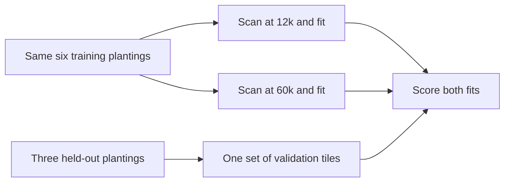

On seeds 1321 and 1322 we ran the benchmark twice on the simulated OS1-64, changing only the validation budget between runs. Each cell gives mean F1 for **12k / 60k training rays**. All fits used 40 epochs, a 0.50 cutoff and both soil variants. We verified that changing validation density preserved each fit’s weights and training manifest.

| Crop | Seed | Test at 12k | Test at 60k |
| --- | ---: | ---: | ---: |
| Lettuce | 1321 | 0.689 / 0.321 | 0.825 / 0.846 |
| Lettuce | 1322 | 0.743 / 0.323 | 0.798 / 0.803 |
| Globe artichoke | 1321 | 0.633 / 0.304 | 0.580 / 0.815 |
| Globe artichoke | 1322 | 0.762 / 0.312 | 0.825 / 0.854 |
| Young tomato | 1321 | 0.588 / 0.252 | 0.845 / 0.849 |
| Young tomato | 1322 | 0.630 / 0.223 | 0.794 / 0.809 |

Matching the budgets improved mean F1 in each pair. On dense artichoke scans at seed 1321 the gain was 0.235, while on dense tomato scans at the same seed it was 0.004. Even within one detector, matching distance matters. On dense lettuce seed 1322, denser training lowered 7.5 cm F1 from 0.776 to 0.772 and raised 15 cm F1 from 0.818 to 0.829. These results cover six held-out plantings per crop and one simulated layout. PointNet++ studies multi-scale features under varying sampling density. This experiment holds the feature extractor fixed while changing the training scans. [PointNet++](https://arxiv.org/abs/1706.02413) · [Replay sparse validation](https://mvalancy.github.io/crop-trainer/benchmark/?comparison=density&sensor=os1-64&seed=1321&validationRayBudget=12000)

On dense artichoke seed 1321, the 12k and 60k Node CPU runs spent 1.84 / 2.43 seconds generating, 71 / 85 ms training and 22 / 16 ms scoring. F1 at 7.5, 10 and 15 cm was 0.459, 0.574 and 0.707 for 12k training, and 0.663, 0.819 and 0.964 for 60k. Each fit includes its own normalization and balanced training examples.

### Can one detector handle both sparse and dense scans?

In **Benchmark → Training scan density**, select **Include a mixed-density fit** to add a third detector. It learns from three plantings scanned at 12,000 rays and three at 60,000. Run the benchmark at one validation budget, follow the repeat link in the same tab, and run it again. The new table shows each detector’s mean F1 at both densities. Read the lower of those two scores if your detector needs to handle either scan density. [Try the artichoke experiment](https://mvalancy.github.io/crop-trainer/benchmark/?comparison=density&crop=artichoke&sensor=os1-64&seed=1421&includeMixed=1&validationRayBudget=60000)

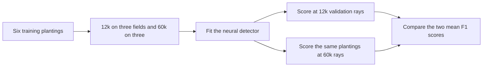

On the simulated OS1-64, sparse-only training had the best worst-case F1 on both lettuce seeds and both tomato seeds. For artichoke the advantage changed with the planting seed. Each entry below is the lower of the two validation scores. Every fit used 40 CPU epochs, a 0.50 cutoff and three held-out plantings with both soil variants. Changing validation density preserved the training tiles, feature scaling and fitted weights.

| Crop | Seed | Train at 12k | Alternate 12k and 60k | Train at 60k |
| --- | ---: | ---: | ---: | ---: |
| Lettuce | 1421 | **0.6702** | 0.6460 | 0.2365 |
| Lettuce | 1422 | **0.7246** | 0.6985 | 0.3526 |
| Globe artichoke | 1421 | 0.6042 | **0.6831** | 0.2787 |
| Globe artichoke | 1422 | 0.7134 | **0.7303** | 0.3618 |
| Globe artichoke | 1451 | **0.6512** | 0.5440 | 0.2173 |
| Globe artichoke | 1452 | **0.6699** | 0.6600 | 0.3097 |
| Young tomato | 1421 | **0.5687** | 0.5116 | 0.2219 |
| Young tomato | 1422 | **0.6275** | 0.5571 | 0.2242 |

On artichoke seed 1451, alternating training improved dense-scan mean F1 from 0.7015 to 0.7876 over sparse-only training, while sparse-scan mean F1 fell from 0.6512 to 0.5440. For the alternating fit on dense scans, F1 at 7.5, 10 and 15 cm was 0.685, 0.816 and 0.862. One Node CPU run spent 2.01 s generating, 52 ms training and 25 ms validating. Different ray budgets also produce different numbers of training examples. These measurements apply to this synthetic layout. Domain randomization has been studied for image-based object localization. Here the varied property is the number of simulated LiDAR rays. [Replay the repeat seeds](https://mvalancy.github.io/crop-trainer/benchmark/?comparison=density&crop=artichoke&sensor=os1-64&seed=1451&includeMixed=1&validationRayBudget=12000) · [Tobin et al., 2017](https://arxiv.org/abs/1703.06907)

## Which detector gives a better plant count?

Open **Compare contenders on each planting** in the benchmark and select **Count error · absolute**. A value of 4 means the predicted count differed from the label count by four plants per scan on average. Select **Count error · signed** to see the direction. For a single scan, the Training shed’s field audit shows the final pins, labeled plants, extra pins and misses together. [Try the artichoke count comparison](https://mvalancy.github.io/crop-trainer/benchmark/?comparison=models&crop=artichoke&seed=1551&sensor=mixed&validationSensor=os1-64&validationRayBudget=12000&fieldMetric=meanAbsolute)

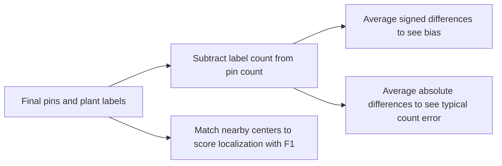

We compared logistic and neural CPU models on lettuce, globe artichoke and young tomato at dataset seeds 1521, 1522, 1551 and 1552. Both fits saw identical training examples from six mixed-layout fields and the same three held-out plantings, scanned with and without soil at 12,000 simulated OS1-64 rays. All fits used 40 epochs and a 0.50 cutoff. The higher-F1 model had lower mean absolute count error in 11 of 12 comparisons. The other pair tied on counting error.

| Crop and seed | Model | Mean F1 | Absolute error (plants/scan) | Signed error (plants/scan) |
| --- | --- | ---: | ---: | ---: |
| Lettuce 1551 | Logistic | 0.6263 | 78.50 | +40.50 |
| Lettuce 1551 | Neural | 0.6164 | 79.50 | +38.17 |
| Artichoke 1552 | Logistic | 0.6849 | 4.33 | +3.00 |
| Artichoke 1552 | Neural | 0.6748 | 4.33 | +4.00 |
| Tomato 1521 | Logistic | 0.5125 | 63.00 | −63.00 |
| Tomato 1521 | Neural | 0.3979 | 79.17 | −79.17 |

On artichoke seed 1552, logistic F1 at 7.5, 10 and 15 cm was 0.478, 0.677 and 0.900. Neural F1 was 0.466, 0.662 and 0.897. The separate Node CPU runs took 1,278 / 40 / 26 ms for logistic and 1,078 / 58 / 22 ms for neural to generate, train and validate. These absolute counts depend on field size and synthetic planting density.

The browser CPU and SwiftShader WebGPU neural fits produced identical counts and per-distance scores on both artichoke seeds 1551 and 1552. On seed 1552 they shared 755 ms of generation. CPU training and scoring took 86 and 28 ms, and software WebGPU took 954 and 14 ms. SwiftShader ran on the CPU. Physical GPU and DGX Spark timings require a run on the target hardware.

## Did the scan see the plants the detector missed?

The generator records which plant supplied each surviving crop return. In the 3D viewer, turn on **Label centers** to see gold crosses on plants with zero crop returns. The Training Shed shows the same coverage counts beside the detection stages for each field. A return can land on a leaf far from the center. Conversely, a nearby weed can produce a peak within the scoring distance of a plant that supplied no returns.

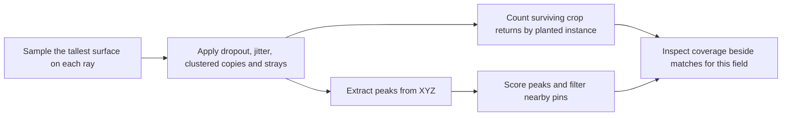

We grew three validation fields at each of two dataset seeds, 921 and 922, and scanned each planting at both ray budgets on the simulated OS1-64. The table counts each plant once using soil-present scans. Each crop and seed used the same mixed training fields and fitted weights at both budgets. Matches use the neural detector at 15 cm after 40 CPU epochs and a 0.50 cutoff.

| Crop | Planted | Plants with zero returns, 12k → 60k rays | Plants with 1–4 returns, 12k → 60k | Final matches, 12k → 60k |
| --- | ---: | ---: | ---: | ---: |
| Lettuce | 1,352 | 35 → 21 | 308 → 18 | 1,023 → 1,309 |
| Globe artichoke | 200 | 0 → 0 | 1 → 0 | 168 → 195 |
| Young tomato | 658 | 23 → 15 | 210 → 8 | 343 → 628 |

At 12,000 rays the tomato detector missed 315 plants. At least 292 of those misses had one or more crop returns. The score cutoff reduced matched plants from 580 candidate matches to 345, and spacing reduced that to 343. Coverage describes this synthetic overhead renderer. Pheno4D reports missing surface measurements from occlusion even when its operators scanned individual plants from several views. [Inspect tomato seed 921](https://mvalancy.github.io/crop-trainer/trainer/?crop=tomato&seed=921&sensor=mixed&validationSensor=os1-64&validationRayBudget=12000&engine=cpu) · [Pheno4D measurement study](https://doi.org/10.1371/journal.pone.0256340)

On seed 921 the browser CPU and software WebGPU backends produced the same tomato F1 scores across both soil settings at 12,000 rays. F1 was 0.5606 at 7.5 cm, 0.6655 at 10 cm and 0.7251 at 15 cm. Shared generation took 1,685 ms. CPU training and validation took 134 and 43 ms. SwiftShader training and CPU validation took 1,502 and 10 ms in this run. Physical GPU timing requires a hardware adapter. [Replay the backend comparison](https://mvalancy.github.io/crop-trainer/benchmark/?comparison=backend&crop=tomato&seed=921&sensor=mixed&validationSensor=os1-64&validationRayBudget=12000)

### Locate an individual missed plant

After training, choose **Missed plants** in the field map. Select 7.5, 10 or 15 cm and pick a box to highlight. Red rings show misses with crop returns and dark squares show misses with none. The box number matches the index in the generator’s label download. If a pin lies within range of several labels, several equally large matchings may exist. The overlay shows the assignment used to score that run. [Maximum bipartite matching and non-unique solutions](https://docs.scipy.org/doc/scipy/reference/generated/scipy.sparse.csgraph.maximum_bipartite_matching.html)


How many previously missed plants gain a pin if the score cutoff drops from 0.50 to 0.35? On fresh dataset seeds 1021 and 1022, each pair used the same 40-epoch neural weights, mixed training layouts and 12,000-ray simulated OS1-64 validation scans. These counts cover three soil-present fields per seed at 15 cm. No previously matched boxes lost their match in these six comparisons.

| Crop | Recovered boxes, seed 1021 | Increase in false positives | Recovered boxes, seed 1022 | Increase in false positives |
| --- | ---: | ---: | ---: | ---: |
| Lettuce | 181 | 50 | 85 | 125 |
| Globe artichoke | 16 | 0 | 5 | 0 |
| Young tomato | 59 | 9 | 91 | 17 |

For tomato seed 1021, 54 of the 59 recovered boxes had crop returns. The other five received a pin within 15 cm despite having zero returns from the plant itself. Across both soil settings, F1 at 7.5, 10 and 15 cm rose from 0.245 / 0.279 / 0.297 to 0.414 / 0.469 / 0.505. The 0.50 run took 1,896 ms to generate, 113 ms to train and 32 ms to validate on Node CPU. The 0.35 replay took 1,945 / 99 / 24 ms. [Open the field audit](https://mvalancy.github.io/crop-trainer/trainer/?crop=tomato&seed=1021&sensor=mixed&validationSensor=os1-64&validationRayBudget=12000&engine=cpu) · [Compare the cutoffs](https://mvalancy.github.io/crop-trainer/benchmark/?comparison=cutoffs&crop=tomato&seed=1021&sensor=mixed&validationSensor=os1-64&validationRayBudget=12000)

### Can shorter peaks recover a missed plant?

In Benchmark, choose **Minimum peak height** and run the comparison. A peak is a local high point on the smoothed height map of the simulated laser returns. Lowering the minimum from 6.5 to 3.5 cm lets more locations enter the detector. The **Matched using all peaks** column shows how many labeled plants could receive a distinct pin within 15 cm before the model filters the peaks. Compare it with **Final matches** and **Extra pins**, then answer the question to earn a Peak scout stamp. [Try the sparse tomato benchmark](https://mvalancy.github.io/crop-trainer/benchmark/?comparison=heights&crop=tomato&seed=2021&sensor=mixed&validationSensor=os1-64&validationRayBudget=12000)

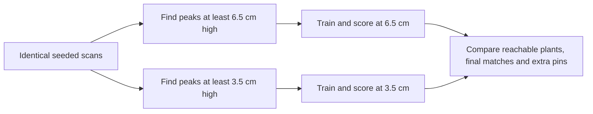

Each cell below shows **6.5 cm → 3.5 cm**. Each crop used 12 held-out soil-present synthetic fields, three from each dataset seed (2021, 2022, 2051 and 2052). Each neural fit used six mixed-layout training fields, 40 epochs and a score cutoff of 0.50. Validation used the simulated OS1-64 layout with 12,000 requested rays.

| Crop | Labeled plants | Matched using all peaks | Final matches | Extra pins |
| --- | ---: | ---: | ---: | ---: |
| Lettuce | 2,539 | 1,561 → 2,421 | 817 → 1,350 | 113 → 333 |
| Globe artichoke | 377 | 372 → 372 | 232 → 252 | 30 → 40 |
| Young tomato | 1,238 | 1,043 → 1,167 | 465 → 751 | 21 → 116 |

Of 195 tomato plants with no peak within 15 cm at 6.5 cm, 124 gained a nearby peak at 3.5 cm. Only six of those plants received a final matching pin. Most of the overall gain therefore came from plants that already had a nearby peak at the taller setting. A logistic fit on the same tomato fields also gained matches (517 → 726) and extra pins (27 → 119).

On tomato seed 2021 across both soil settings, neural F1 at 7.5 / 10 / 15 cm rose from 0.4264 / 0.5265 / 0.6326 to 0.4976 / 0.6455 / 0.7920. Generation, training and validation on Node CPU took 753 / 52 / 15 ms at 6.5 cm and 1,058 / 74 / 47 ms at 3.5 cm. These heights describe a filtered scan surface. Measuring physical crop height or scanner performance requires field observations. [Background on local peak detection](https://scikit-image.org/docs/stable/api/skimage.feature.html#skimage.feature.peak_local_max)

### Which plants change when the peak height drops?

A larger match count can hide plants the earlier fit found. In a **Minimum peak height** benchmark, open **Which plants changed match when the peak height dropped?** Choose a scan and matching distance. The table splits its labels into plants found by both fits, those unique to each height, and those missed by both. Pick a plant unique to either height, open it in 3D, then use **Focus plant** to orbit its center. The line above the table totals gains and losses across the six soil-present fields in that run. **Link to this inspection** lets someone rerun the benchmark and reopen your chosen scan, distance and plant. [Replay a lettuce plant found only by the shorter fit](https://mvalancy.github.io/crop-trainer/benchmark/?comparison=heights&crop=lettuce&seed=2121&sensor=mixed&validationSensor=os1-64&validationRayBudget=12000&pairSeed=2122&pairTile=39c12665d375fbb9&pairDistance=7.5&pairBox=1#modelBoxes)

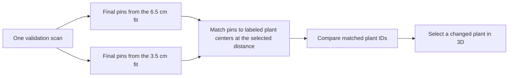

Across seeds 2121, 2122, 2151 and 2152, each crop contributed 12 soil-present held-out fields. Both heights used the same raw scans, six mixed-layout training fields per seed, 40 CPU neural epochs, a 0.50 score cutoff and 12,000 requested validation rays on the simulated OS1-64 layout. At 15 cm the lower height gave the following changes.

| Crop | Newly matched plants | Previously matched plants lost | Net change in matches | Change in extra pins |
| --- | ---: | ---: | ---: | ---: |
| Lettuce | 805 | 90 | +715 | +316 |
| Globe artichoke | 14 | 1 | +13 | +4 |
| Young tomato | 379 | 10 | +369 | +68 |

Lettuce seed 2121 lost 74 plant matches and gained 52. The other three seeds each gained more matches than they lost. The logistic fit on the same tomato fields gained 318 matches, lost 12 and added 73 extra pins. Each change describes the final one-to-one assignment after refitting at the new height. Several nearby pins can compete for a label.

For tomato seed 2121 across both soil settings, neural F1 at 7.5 / 10 / 15 cm changed from 0.3377 / 0.4132 / 0.4557 to 0.4096 / 0.5225 / 0.5747. Node CPU generation, training and validation took 995 / 42 / 21 ms at 6.5 cm and 944 / 113 / 14 ms at 3.5 cm. For research on analyzing the individual errors behind an aggregate detection score, see Bolya and colleagues. [TIDE, ECCV 2020](https://dbolya.com/tide/)

**Does the gain hold on denser scans?** Repeating the same synthetic plantings at 60,000 validation rays reduced the benefit of shorter peaks. At 15 cm the neural tomato fit gained 18 plant matches, lost 9 and added 71 extra pins. At 12,000 rays it had gained 379 and lost 10 with 68 extra pins. On dense lettuce the fits gained 109 and lost 56 (+159 extra pins), and on dense artichoke they gained 2 and lost 5 (+9 extra pins). Each comparison uses the same height-specific training examples at both ray budgets. Use the validation-ray links under the Peak scout question to repeat this check on other seeds. [Replay the dense tomato fields](https://mvalancy.github.io/crop-trainer/benchmark/?comparison=heights&crop=tomato&seed=2121&sensor=mixed&validationSensor=os1-64&validationRayBudget=60000)

### Could changing the cutoff help this missed plant?

In the Training Shed, run the detector, choose **Missed plants** and highlight a box. The close-up shows the height peaks, peaks that passed the score cutoff and final pins inside its matching circle. If no peak is inside the circle, changing the cutoff alone cannot recover the plant. If all nearby peaks fell below the cutoff, the highest nearby score tells you where at least one would enter the spacing filter. A retained pin may still match a neighboring plant. [Inspect tomato seed 1921](https://mvalancy.github.io/crop-trainer/trainer/?crop=tomato&seed=1921&sensor=mixed&validationSensor=os1-64&validationRayBudget=12000&engine=cpu&missBand=all)

We traced every 15 cm miss at a cutoff of 0.50, then rescored the same weights and scans at 0.35. Each cell gives **misses at 0.50 → boxes matched at 0.35 among those misses**. Each crop used 12 soil-present validation fields across dataset seeds 1921, 1922, 1951 and 1952. Both CPU models used six mixed-layout training fields per seed, 40 epochs and a simulated OS1-64 at 12,000 requested validation rays.

| Crop and model | No nearby peak | All nearby scores below cutoff | Spacing removed all nearby peaks that passed | Nearby final pin assigned elsewhere |
| --- | ---: | ---: | ---: | ---: |
| Lettuce · neural | 123 → 0 | 596 → 396 | 6 → 2 | 2 → 1 |
| Globe artichoke · neural | 11 → 0 | 70 → 28 | 7 → 0 | 0 → 0 |
| Young tomato · neural | 205 → 0 | 404 → 281 | 7 → 3 | 0 → 0 |
| Young tomato · logistic | 205 → 0 | 419 → 282 | 4 → 2 | 0 → 0 |

On tomato seed 1921, F1 across both soil settings at 7.5 / 10 / 15 cm was 0.529 / 0.647 / 0.732 for neural and 0.535 / 0.646 / 0.722 for logistic at 0.50. On Node CPU, shared generation took 912 ms. Neural fitting and validation took 44 and 17 ms, and logistic took 8 and 13 ms. The close-up uses horizontal distances in synthetic scans. For background on analyzing detector errors beyond the aggregate score, see Hoiem and colleagues. [Diagnosing Error in Object Detectors](https://doi.org/10.1007/978-3-642-33712-3_25)

### Which crops gain a match when the cutoff drops?

Run **Detection score cutoffs** in Benchmark and expand **What changes from the 0.50 cutoff?** The first table covers both soil settings. The return-count table uses the soil-present scan of each planting. Read across a row to see how many plants matched at each cutoff, then check the extra pins in the bottom row. [Try the tomato benchmark at 15 cm](https://mvalancy.github.io/crop-trainer/benchmark/?comparison=cutoffs&crop=tomato&seed=1821&sensor=mixed&validationSensor=os1-64&validationRayBudget=12000&cutoffDistance=15)

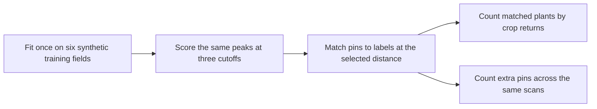

On dataset seeds 1821, 1822, 1851 and 1852, each CPU fit used 40 epochs, mixed training layouts and three held-out plantings scanned at 12,000 requested rays with the simulated OS1-64. Each crop below pools 12 soil-present scans. Counts show the change in the number matched at 15 cm when moving from 0.50 to 0.35.

| Crop and model | 1–4 returns | 5 or more returns | Change in extra pins |
| --- | ---: | ---: | ---: |
| Lettuce · neural | +267 of 873 plants | +278 of 1,799 | +348 |
| Globe artichoke · neural | 0 of 7 plants | +40 of 391 | +8 |
| Young tomato · neural | +152 of 521 plants | +169 of 749 | +55 |
| Young tomato · logistic | +126 of 521 plants | +156 of 749 | +62 |

The neural tomato detector gained 63, 30, 19 and 40 net matches in the one-to-four-return group on the four dataset seeds, respectively. On seed 1821 its F1 across both soil settings rose from 0.387 / 0.475 / 0.516 to 0.548 / 0.710 / 0.797 at 7.5 / 10 / 15 cm. Generation and fitting took 1,030 ms and 44 ms on Node CPU. Scoring took 10 ms at 0.50 and 16 ms at 0.35. Choosing a cutoff changes the tradeoff between false positives and missed detections. Use fresh plantings to evaluate a choice made on these synthetic fields. [Decision threshold guide](https://scikit-learn.org/stable/modules/classification_threshold.html)

### Does the detector miss plants that have several returns?

In the Training Shed, select **Missed plants** and filter **Crop returns per plant**. The map shows how many plants the detector missed out of all plants in the selected group. Pick a box, open it in 3D and choose **Focus plant** to orbit it up close. With the canvas focused, **F** centers the highlighted plant and **R** returns to the whole field. [Inspect a young tomato field](https://mvalancy.github.io/crop-trainer/trainer/?crop=tomato&seed=1721&sensor=mixed&validationSensor=os1-64&validationRayBudget=12000&engine=cpu&missBand=fiveOrMore)

Each cell below gives missed plants / labeled plants at 15 cm. Both CPU models used the same fields, mixed training layouts, 40 epochs and a 0.50 score cutoff. Dataset seeds 1721, 1722, 1751 and 1752 each supplied six training and three validation plantings per crop. Each held-out planting appears once here, scanned with soil present on the simulated OS1-64 layout at 12,000 requested rays.

| Crop | Detector | 0 crop returns | 1–4 returns | 5 or more returns |
| --- | --- | ---: | ---: | ---: |
| Lettuce | Logistic | 50 / 72 | 430 / 564 | 625 / 2,084 |
| Lettuce | Neural | 47 / 72 | 440 / 564 | 662 / 2,084 |
| Globe artichoke | Logistic | No plants | 5 / 6 | 126 / 386 |
| Globe artichoke | Neural | No plants | 5 / 6 | 111 / 386 |
| Young tomato | Logistic | 51 / 54 | 349 / 403 | 349 / 862 |
| Young tomato | Neural | 53 / 54 | 377 / 403 | 428 / 862 |

The neural model missed 93.5% of young tomatoes with one to four returns and 49.7% of those with five or more. The better-covered group still accounted for more missed plants because it was larger. Only six globe artichokes fell in the one-to-four group. These counts describe the simulated plantings. A leaf can produce several returns far from its plant center.

On tomato seed 1721, across both soil settings, logistic F1 was 0.511, 0.649 and 0.704 at 7.5, 10 and 15 cm. Neural F1 was 0.481, 0.598 and 0.636. Node CPU generation, training and validation took 2,235 / 49 / 45 ms for logistic and 2,398 / 61 / 24 ms for neural. The nuScenes detection evaluator excludes ground-truth boxes with zero LiDAR and radar points. Crop Trainer keeps every planted label and counts returns by which synthetic plant supplied them. The choice of denominator matters when interpreting recall. [Replay both models](https://mvalancy.github.io/crop-trainer/benchmark/?comparison=models&crop=tomato&seed=1721&sensor=mixed&validationSensor=os1-64&validationRayBudget=12000) · [nuScenes detection evaluation](https://github.com/nutonomy/nuscenes-devkit/blob/master/python-sdk/nuscenes/eval/detection/README.md)

### Which model finds plants in a sparse scan?

With 12,000 requested rays on the simulated OS1-32 layout, the neural model scored higher than logistic on each of two dataset seeds for all three crops. Both saw identical examples and held-out scans, with six mixed-layout training fields, three validation plantings per seed, 40 CPU epochs and a 0.50 cutoff. Each cell gives mean F1 for logistic → neural. [Replay the sparse model benchmark](https://mvalancy.github.io/crop-trainer/benchmark/?comparison=models&crop=tomato&seed=821&sensor=mixed&validationSensor=os1-32&validationRayBudget=12000)

| Dataset seed | Lettuce | Globe artichoke | Young tomato |
| ---: | ---: | ---: | ---: |
| 821 | 0.549 → 0.599 | 0.667 → 0.701 | 0.450 → 0.481 |
| 822 | 0.461 → 0.518 | 0.584 → 0.692 | 0.240 → 0.248 |

Tomato seed 822 illustrates a failure that the model average hides. On field 854812180 with soil, candidate peaks matched 81 of 116 plants within 15 cm. Only ten still had a match after the score cutoff. Across all six scans, lowering the cutoff to 0.35 recovered 83 matches at 15 cm with zero extra pins at that distance. At 7.5 cm, extra pins rose from 12 to 35. The looser cutoff also improved mean F1 on seeds 821, 851 and 852, where it added 52, 31 and 43 extra pins at 15 cm. [Inspect the planting](https://mvalancy.github.io/crop-trainer/?crop=tomato&sensor=os1-32&seed=854812180&budget=12000&ground=true&tile=e3a36b5c8e54f55d#field) · [Run the cutoff comparison](https://mvalancy.github.io/crop-trainer/benchmark/?comparison=cutoffs&crop=tomato&seed=822&sensor=mixed&validationSensor=os1-32&validationRayBudget=12000)

| Tomato seed 822, Node CPU | Generation | Training | Validation | F1 at 7.5 cm | F1 at 10 cm | F1 at 15 cm |
| --- | ---: | ---: | ---: | ---: | ---: | ---: |
| Logistic | 1,390 ms | 36 ms | 24 ms | 0.2234 | 0.2465 | 0.2490 |
| Neural | 1,443 ms | 65 ms | 16 ms | 0.2296 | 0.2551 | 0.2602 |

### Does removing soil help the detector?

In the Training Shed, run a field and open **Compare scans with and without soil**. Choose recall to see how many plants were found, or precision to see how many pins landed on a plant. In the field audit, **Switch soil setting for this field** shows the other scan at the same detector stage.

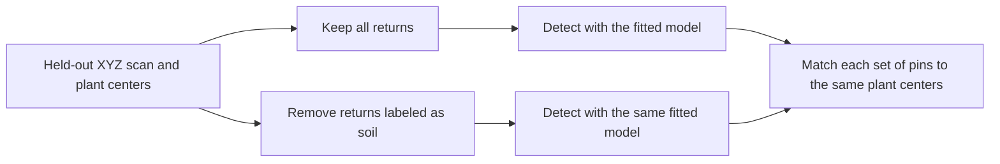

On four fresh seeds (307, 308, 337 and 338), removing soil increased lettuce recall at 15 cm by 2.5 to 15.1 percentage points. Each run used mixed layouts, six training fields, three held-out plantings and 40 neural epochs. On artichoke seed 308, removing soil recovered four more plants (77 of 95 versus 73 of 95) and produced 50 additional false positives (54 versus 4). Precision fell from 94.8% to 58.8%. The generator knows which points are soil. A real ground filter must estimate that from measurements and can discard crop returns. [Repeat the artichoke experiment](https://mvalancy.github.io/crop-trainer/trainer/?crop=artichoke&seed=308) · [Zhang et al., cloth simulation for airborne LiDAR filtering](https://doi.org/10.3390/rs8060501)

#### Does soil removal improve the plant count?

Choose **Plant count · absolute error** in the Training Shed’s soil comparison. Each row compares final pin counts against the same planting’s labels with soil present and removed. Select a field seed, then use **View without soil** or **View with soil** in the 3D viewer. The camera and highlighted plant stay in place. The scan link, PLY, labels and recipe follow the displayed version. [Replay the lettuce count comparison](https://mvalancy.github.io/crop-trainer/trainer/?crop=lettuce&seed=1652&sensor=mixed&validationSensor=os1-64&validationRayBudget=12000&engine=cpu&soilMetric=meanAbsolute)

With simulated OS1-64 validation scans at 12,000 rays, removing soil reduced mean absolute counting error in 19 of 24 comparisons. Each crop used four dataset seeds (1621, 1622, 1651 and 1652), six mixed-layout training fields, three held-out plantings per seed, and both logistic and neural CPU fits at 40 epochs and cutoff 0.50. Each fit scored both soil variants. The two models share the same fields, so each crop contributes 12 distinct validation plantings.

| Crop | Comparisons with lower count error after soil removal | Comparisons with higher error |
| --- | ---: | ---: |
| Lettuce | 5 | 3 |
| Globe artichoke | 6 | 2 |
| Young tomato | 8 | 0 |

On lettuce seed 1652, neural counting error rose from **35.3 to 92.3 plants per scan**. In the first planting, removing soil recovered 17 additional matches at 15 cm and added 50 extra pins. F1 across the three plantings at 7.5, 10 and 15 cm was 0.573, 0.697 and 0.767 with soil, and 0.574, 0.709 and 0.763 without soil. The CPU run spent 2,955 ms generating, 100 ms fitting and 71 ms validating both variants. The simulator drops points with known soil labels. A field scanner would need an estimated ground surface. [Inspect this planting](https://mvalancy.github.io/crop-trainer/?crop=lettuce&sensor=os1-64&budget=12000&seed=3334967749&ground=true&tile=643c5ba37dabe474#field)

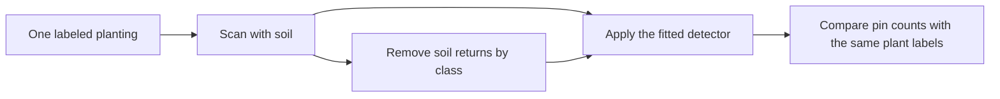

## Benchmark

Open **Benchmark** to compare CPU and WebGPU on the same neural model, or compare logistic and neural models on CPU. Both comparisons use two seeds and reverse contender order for the second seed. Other modes compare score cutoffs on one fit, training duration, training ray density or minimum peak height. The results include generation, training and scoring time, F1, and precision and recall. Download JSON for per-tolerance counts and per-field stages. Expand the distance table to see exact matches, extra pins and missed plants. Each WebGPU row in the JSON includes the adapter information exposed by the browser. To repeat the benchmark on another device, use the same app revision, crop, scanner and first seed. [Open Benchmark](https://mvalancy.github.io/crop-trainer/benchmark/)

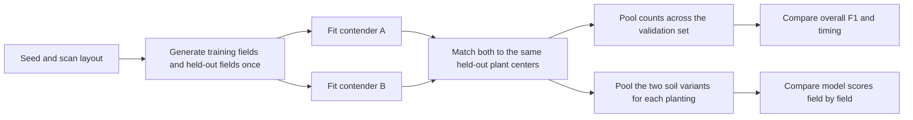

On two fresh mixed-scan artichoke seeds, the neural model beat logistic on seed 81 (0.757 vs 0.734 mean F1), and logistic edged ahead on seed 82 (0.708 vs 0.701). On tomato, CPU and Chromium’s SwiftShader software WebGPU adapter matched at all three tolerances on both seeds. These runs check numerical agreement. Physical GPU speed requires a run on that device. [Repeat the artichoke model comparison](https://mvalancy.github.io/crop-trainer/benchmark/?comparison=models&crop=artichoke&sensor=mixed&seed=81) · [Repeat the tomato backend comparison](https://mvalancy.github.io/crop-trainer/benchmark/?comparison=backend&crop=tomato&sensor=mixed&seed=81)

The crop-specific spacing filter was tested on seeds 61 and 62, with six training fields, three validation fields, mixed sampling, 40 neural epochs and 6.5 cm peaks. Increasing artichoke spacing from 12.5 to 40 cm raised mean F1 from 0.536 to 0.600 and from 0.673 to 0.779. On seed 61, 15 cm recall slipped from 85.4% to 84.3%. For young tomato, 22 cm spacing raised mean F1 from 0.730 to 0.757 and from 0.781 to 0.799. These are whole-plant center scores on procedural fields.

### Which plants did only one model find?

Run **Logistic vs neural · CPU**, then expand **Which plants did each model find?** Choose a scan and a matching distance. The table counts every labeled plant once. Select a box found by just one model to open its center in the 3D viewer and earn the **Model scout** stamp. A cyan ring tracks the highlighted plant as you orbit or zoom. **Copy scan link** preserves the box selection. In the Training Shed, you can also open a highlighted missed plant in 3D.

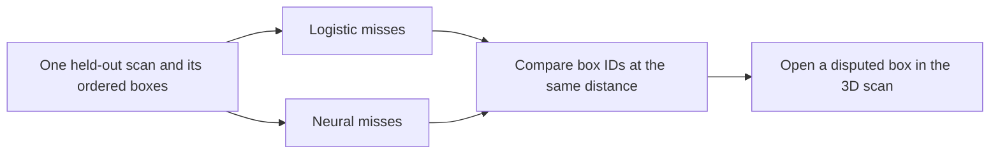

In this experiment we used 40 CPU epochs, mixed training layouts and 12,000 rays on the simulated OS1-64 validation layout. Each model used identical examples and normalization. The table pools the three soil-present scans for each dataset seed at 15 cm. Each cell lists plants found **only by logistic / only by neural**.

| Dataset seed | Lettuce | Globe artichoke | Young tomato |
| ---: | ---: | ---: | ---: |
| 1121 | 60 / 8 | 0 / 2 | 16 / 0 |
| 1122 | 0 / 45 | 0 / 13 | 2 / 13 |

On lettuce seed 1121, both models found another 260 plants, and both missed 329. Logistic produced 32 extra pins and neural produced 30. In the first soil-present field, logistic alone matched box 6 and neural alone matched box 112. A match indicates a pin within the chosen horizontal distance. Plant identity follows the scorer’s one-to-one assignment when neighboring labels compete. Plants from one field share a layout and noise, so these counts describe the six synthetic plantings. [Replay the comparison](https://mvalancy.github.io/crop-trainer/benchmark/?comparison=models&crop=lettuce&seed=1121&sensor=mixed&validationSensor=os1-64&validationRayBudget=12000) · [Inspect box 6](https://mvalancy.github.io/crop-trainer/?crop=lettuce&sensor=os1-64&budget=12000&seed=1510546355&ground=true&tile=09a268cecce4eadb&box=6#field) · [Inspect box 112](https://mvalancy.github.io/crop-trainer/?crop=lettuce&sensor=os1-64&budget=12000&seed=1510546355&ground=true&tile=09a268cecce4eadb&box=112#field)

Across both soil settings for lettuce seed 1121, Node CPU logistic F1 was 0.5772 / 0.6630 / 0.6989 at 7.5 / 10 / 15 cm. Neural F1 was 0.5205 / 0.5916 / 0.6106. Generation, training and validation took 2,563 / 32 / 41 ms for logistic and 2,335 / 130 / 42 ms for neural in separate CLI runs. The browser benchmark shares generation across both fits. For background on comparing models on paired examples and accounting for training-set variation, see [Dietterich, 1998](https://doi.org/10.1162/089976698300017197).

### Does the same model win on every planting?

Run **Logistic vs neural · CPU**, then open **Compare contenders on each planting**. Each row pools the two scans of one field. Choose a match distance to inspect localization accuracy, or select a field seed to open its soil-present scan in 3D. The overall score pools counts across all fields, so a small lead can come from one planting.

Across dataset seeds 421, 422, 451 and 452, the neural model beat logistic on 9 of 12 lettuce plantings, 6 of 12 artichoke plantings (one tie), and 7 of 12 tomato plantings by field mean F1. All contenders used the same synthetic inputs, crop defaults and 40 epochs.

On artichoke seed 421 the neural model led overall, while logistic led on two of the three fields. Both used the same 1,424 ms field generation pass. These timings are from one Chromium CPU run and include browser overhead. [Replay this model comparison](https://mvalancy.github.io/crop-trainer/benchmark/?comparison=models&crop=artichoke&sensor=mixed&seed=421)

| CPU model | Training | Scoring | F1 at 7.5 cm | F1 at 10 cm | F1 at 15 cm | Mean F1 |
| --- | ---: | ---: | ---: | ---: | ---: | ---: |
| Logistic | 34 ms | 38 ms | 0.6580 | 0.8721 | 0.9661 | 0.8320 |
| Neural | 97 ms | 28 ms | 0.6528 | 0.8808 | 0.9741 | 0.8359 |

### How long should I train?

An epoch is one pass over the training examples. In **Benchmark → Training duration**, three CPU neural networks start from identical weights and train for 10, 40 or 100 epochs. Click an epoch count in the results to repeat that fit in the Training Shed. Training loss measures how well the network scores labeled training examples. Held-out F1 also depends on which candidate peaks pass the cutoff, their positions, and which pins survive spacing.

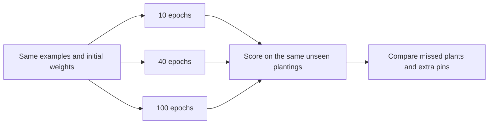

On mixed-layout seeds 521, 522, 551 and 552, training loss fell for every crop as training length increased. From 10 to 100 epochs, held-out mean F1 rose on all four lettuce seeds and all four tomato seeds. It fell on three of four artichoke seeds. Each seed used six training fields and three held-out plantings with both soil variants. [Replay the lettuce comparison](https://mvalancy.github.io/crop-trainer/benchmark/?comparison=epochs&crop=lettuce&seed=521) · [Replay the tomato comparison](https://mvalancy.github.io/crop-trainer/benchmark/?comparison=epochs&crop=tomato&seed=521)

On artichoke seed 552, the longer fit found three more plants within 15 cm while adding 50 false positives. The table shows one Chromium CPU run. Dataset generation took 1,143 ms once for all three fits. Times vary by device and browser load. [Replay the artichoke comparison](https://mvalancy.github.io/crop-trainer/benchmark/?comparison=epochs&crop=artichoke&seed=551)

| Epochs | Training | Validation | F1 at 7.5 cm | F1 at 10 cm | F1 at 15 cm | Extra pins at 15 cm |
| ---: | ---: | ---: | ---: | ---: | ---: | ---: |
| 10 | 15 ms | 35 ms | 0.4700 | 0.7386 | 0.9640 | 4 |
| 40 | 176 ms | 38 ms | 0.4342 | 0.6798 | 0.8947 | 40 |
| 100 | 211 ms | 38 ms | 0.4383 | 0.6511 | 0.8681 | 54 |

### How many candidate pins should pass?

The cutoff is the minimum model score a candidate needs before the spacing filter. The training shed starts at 0.50. In **Detection score cutoffs**, the benchmark reuses the fitted weights and field labels at 0.35, 0.50 and 0.65. Generation and training times repeat across those rows because each happens once per seed. Compare each cutoff’s precision and recall at the distance your task requires.

On mixed scans at seeds 103, 104, 137 and 138, moving from 0.50 to 0.65 increased artichoke mean F1 on all four seeds. Tomato lost mean F1 on all four. On tomato seed 137, lowering the cutoff from 0.50 to 0.35 recovered more plants. At 15 cm, recall rose from 75.1% to 83.2%, while precision fell from 89.6% to 82.4%. Lettuce changed direction across seeds. These synthetic comparisons use six training fields, three held-out fields and 40 epochs per seed. [Repeat the tomato comparison](https://mvalancy.github.io/crop-trainer/benchmark/?comparison=cutoffs&crop=tomato&sensor=mixed&seed=137) · [Repeat the artichoke comparison](https://mvalancy.github.io/crop-trainer/benchmark/?comparison=cutoffs&crop=artichoke&sensor=mixed&seed=103)

#### Does the same cutoff work after a longer fit?

Set **Epochs per fit** in the cutoff benchmark and open **What changes from the 0.50 cutoff?** after the run. Positive matched-plant counts mean the detector found more plants. Positive extra-pin counts mean it produced more false positives. Select a cutoff in the main table to inspect the fitted detector's stages in the Training Shed.

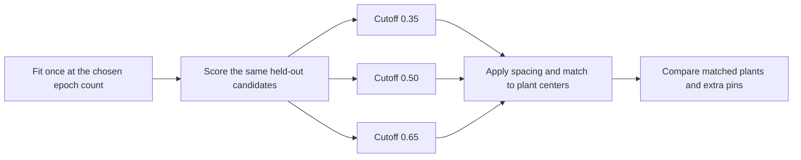

On artichoke seed 622, raising the cutoff from 0.50 to 0.65 at 10 epochs reduced the number of 15 cm matches from 160 to 132. At 100 epochs, it preserved all 162 matches and reduced extra pins from 38 to 28. Here are all three distances for that 100-epoch CPU fit. Generation took 1,030 ms and training took 162 ms once. [Repeat at 10 epochs](https://mvalancy.github.io/crop-trainer/benchmark/?comparison=cutoffs&crop=artichoke&seed=621&epochs=10) · [Repeat at 100 epochs](https://mvalancy.github.io/crop-trainer/benchmark/?comparison=cutoffs&crop=artichoke&seed=621&epochs=100)

| Cutoff | F1 at 7.5 cm | F1 at 10 cm | F1 at 15 cm | Validation time |
| ---: | ---: | ---: | ---: | ---: |
| 0.35 | 0.5362 | 0.6715 | 0.7826 | 28 ms |
| 0.50 | 0.5550 | 0.6950 | 0.8100 | 30 ms |
| 0.65 | 0.5692 | 0.7128 | 0.8308 | 27 ms |

Across fresh synthetic seeds 621, 622, 651 and 652 at 100 epochs, the higher cutoff increased mean F1 on two of four artichoke seeds and three of four lettuce seeds. Tomato mean F1 decreased on all four. Each comparison used the same held-out scans at every cutoff.

## Datasets and research

- **Lettuce.** Vázquez Gálvez and colleagues describe 387 RGB-D reconstructions and three augmentations of each, covering four lettuce varieties. The metadata lists CC BY 4.0. These individual-plant clouds can inform canopy shape. Keep all augmentations of an original together when splitting examples. [Dataset and license record](https://doi.org/10.21227/5xsx-hq86) · [Machine-readable license](https://api.datacite.org/dois/10.21227/5xsx-hq86)
- **Tomato.** Pheno4D provides scans of seven tomato plants over 20 days, including 77 annotated point clouds. Its point labels and repeated plant identities support organ-geometry studies. Split by plant for an unseen-plant test, and confirm redistribution terms with the provider. The download page does not state a dataset license. [Dataset](https://www.ipb.uni-bonn.de/data/pheno4d/) · [Schunck et al., 2021](https://doi.org/10.1371/journal.pone.0256340)
- **Globe artichoke.** NC State Extension describes the fern-like leaves and unopened flower heads that informed the procedural silhouette. We have yet to verify a freely licensed field-scale artichoke point cloud with plant-center annotations. The starter scores one plant per rosette, including in the bud-bearing form. [Botanical reference](https://plants.ces.ncsu.edu/plants/cynara-cardunculus-scolymus-group/)
- **Changing LiDAR sensors.** Yi and colleagues studied changes in point-cloud segmentation across LiDAR sensors, including learning to reconstruct sparsely sampled surfaces. Crop Trainer can isolate the effect of a projected scan layout on plant-center detection. Comparisons with a physical scanner require measurements from that device. [Complete & Label, CVPR 2021](https://openaccess.thecvf.com/content/CVPR2021/html/Yi_Complete__Label_A_Domain_Adaptation_Approach_to_Semantic_Segmentation_CVPR_2021_paper.html)
- **Counting objects.** Lempitsky and Zisserman learn an image density whose integral estimates an object count. Crop Trainer counts discrete plant-center predictions, which also lets you inspect individual misses and extra pins. [Oxford Visual Geometry Group](https://www.robots.ox.ac.uk/~vgg/research/counting/)
- **Grouped evaluation.** Roberts and colleagues explain how spatial and hierarchical structure affects validation. Crop Trainer holds out entire field seeds and keeps the two soil variants together. Additional scans of one planting share its labels and geometry. [Roberts et al., Ecography, 2017](https://doi.org/10.1111/ecog.02881)
- **Training duration.** Prechelt compares validation-based stopping criteria and their tradeoff between training time and generalization. The epoch benchmark measures three fixed durations. To estimate performance after choosing a duration, repeat it on fresh field seeds. [Prechelt, Early Stopping — But When?](https://doi.org/10.1007/3-540-49430-8_3)
- **Choosing a cutoff.** Lipton and colleagues study how a classifier’s score distribution affects the decision threshold that maximizes F1. Crop Trainer measures the tradeoff on held-out fields after spacing and spatial matching. [Lipton et al., 2014](https://doi.org/10.1007/978-3-662-44851-9_15)
- **Evaluating detector cutoffs.** Saito and Rehmsmeier explain how precision and recall expose tradeoffs when positive and negative examples occur at different rates. Crop Trainer balances candidates for fitting, then measures extra pins and misses on whole synthetic fields. [PLOS ONE, 2015](https://doi.org/10.1371/journal.pone.0118432)
- **Encoding sparse returns.** PointPillars learns features from point sets within vertical columns. Crop Trainer's fixed 5 cm cells summarize height and occupancy before classification. Varying the validation ray budget tests how this simpler representation responds to sparse sampling. [Lang et al., CVPR 2019](https://openaccess.thecvf.com/content_CVPR_2019/html/Lang_PointPillars_Fast_Encoders_for_Object_Detection_From_Point_Clouds_CVPR_2019_paper.html)
- **Sampling density.** PointNet++ learns local features at multiple scales to handle varying point density. The sparse scan experiment above keeps the feature extractor fixed and measures how much changing the classifier or cutoff recovers. [Qi et al., PointNet++, 2017](https://arxiv.org/abs/1706.02413)
- **Learning from points.** PointNet demonstrates permutation-invariant learning directly from unordered point sets. A research comparison could train a local point-set encoder on the same candidates and seeds and compare it with the included 13-feature neural classifier. [Qi et al., CVPR 2017](https://arxiv.org/abs/1612.00593)

## Local play and agent experiments

Use Node.js 22 or newer. The browser app and CPU runner have no package dependencies.

```sh
git clone https://github.com/mvalancy/crop-trainer.git
cd crop-trainer
node run.mjs serve
```

Open **http://127.0.0.1:4173/**. For headless CPU experiments and tests, run:

```sh
node --test
node run.mjs train first-harvest.json
```

Use **Download run settings** in the training shed to replay a browser experiment on another computer. For example, a completed seed 27 run exports its settings as `crop-settings-27.json`. Put that file beside `run.mjs` and run `node run.mjs train replay.json crop-settings-27.json`. The model trains from scratch on the same synthetic fields.

A browser run can use WebGPU on a supported adapter over HTTPS or localhost. Generation and validation use the CPU. The agent guide includes the full settings schema, a paired experiment, and a prompt for Gemini or another local coding agent. [AGENTS.md](AGENTS.md)

## Data and license

Every field, label and point cloud in the app is generated procedurally on demand. All source code and the original SVG artwork are released under the [MIT License](LICENSE).
