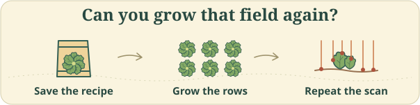

# Inside the field generator

Grow a field, zoom in on a single plant and see which leaves the laser reached. Open the paired scan comparison to find out what changes when the same planting receives fewer rays. [Open the field generator](https://mvalancy.github.io/crop-trainer/#field)

| To change… | Start here |
| --- | --- |
| Field controls, scan downloads and share links | [Generator page](../index.html) and [field controls](farm.js) |
| Paired scans, tree pins and board placement | [Scan comparison code and controls](../trainer/study/README.md) · [Illustrated orchard experiment](../docs/orchard-boards.md) |
| Orbit, pan, zoom and point colors | [3D viewer](viewer.js) |
| The interactive first lesson | [Beginner exercises](first-steps.js), [scan patch exercise](field-lesson.js) and [animated weight update](weight-lesson.js) |
| Generator layout with every section open | [Viewer, recipe and scan summary](scan-workspace.css) · [Plant controls and portraits](advanced-scan.css) · [Comparison maps and scores](scan-comparison.css) · [Field lessons and journal](field-guide.css) |
| Navigation, buttons and layouts across the three pages | [Shared stylesheet](farm.css) |
| Help for controls and results | Give the actual button, stat or table-column heading a `data-help` explanation. Use `data-help-label` to name a changing number. The [shared help](help.js) handles hover, keyboard focus and touch. |
| How the plants grow and how a ray hits a leaf | [Plant architecture guide](../trainer/plants/README.md) and [field generator](../trainer/generator/field.js) |

The site runs directly from these browser modules. To make a change and try it on your computer, follow the [local setup](../docs/local-setup.md).
