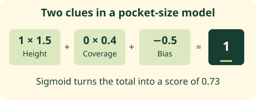

# The illustration patch

The little farm on the front page lives here. Open an SVG to see it move or open its source to see how it works. The diagrams use simple shapes and CSS animation. Each has a still frame for readers who prefer reduced motion.

| Illustration | Where you’ll see it |
| --- | --- |
| [One plant seen in dots and pixels](two-views.svg) | [Sensing methods](../docs/README.md#choose-a-sensing-method) |
| [Six pins and a missed lettuce](count-and-locate.svg) | [Inspecting detections](../docs/field-inspection.md) |
| [A little leaf between rays](ray-budget.svg) | [Scan density](../docs/scanners.md) |
| [Stacked dots along a vine stem](vine-column.svg) | [Physical vineyard studies](../docs/field-datasets.md) |
| [Opening the tested farm](check-the-build.svg) | [Release checks](../ci/README.md) |
| [Crop Trainer leaf and LiDAR returns](crop-mark.svg) | Browser tab, mobile home screen and app navigation |
| [Lettuce and weed at the same height](height-clues.svg) | [Watch one model update](https://mvalancy.github.io/crop-trainer/#learnWeight) |
| [Lettuce under a scanning beam](title.svg) | [Repository welcome](../README.md) |
| [From laser dots to lettuce pins](scan-learn-find.svg) | [Training shed guide](../trainer/README.md) |
| [Two detectors, one planting](paired-field.svg) | [Benchmark guide](../benchmark/README.md) |
| [From a surveyed plot to a local detector](field-deployment.svg) | [Field deployment guide](../docs/edge-deployment.md) |
| [How a survey shift changes a match](survey-alignment.svg) | [Checking field coordinates](../docs/field-validation.md#how-close-are-the-scan-and-the-survey) |
| [A longer fit on two tomato growth stages](tomato-epochs.svg) | [Training-duration experiment](../docs/tomato-training-duration.md) |
| [Learn from difficult background examples](tomato-hard-negatives.svg) | [Tomato and weed study](../docs/tomato-hard-negatives.md) |
| [One return from Box 77](tomato-one-return.svg) | [Why did the detector place this pin?](../docs/tomato-hard-negatives.md#why-did-box-77-get-a-pin) |
| [One peak, two training scales](tomato-feature-scaling.svg) | [Read one measured height as a model input](../docs/tomato-feature-scaling.md) |
| [Fit, calibrate and test](tomato-calibration.svg) · [Which fields chose which cutoff?](tomato-calibration-panels.svg) | [Three tomato detectors on separate calibration and test plantings](../docs/tomato-calibration.md) |
| [Two fits score the same 405 peaks](tomato-score-cutoff.svg) | [How a fixed cutoff changes which plants get pins](../docs/tomato-training-duration.md#was-it-the-planting-or-the-trained-model) |
| [Two training draws on one set of tomatoes](tomato-training-draw.svg) | [Soil-present seedling study](../docs/tomato-soil-sampling.md) |
| [Two peaks, both about 5 cm](tomato-local-ground.svg) | [A measured seedling and a soil bump](../docs/tomato-local-ground.md) |
| [How empty cells affect peak height](seedling-peak-window.svg) | [Seedling peaks and false alarms](../docs/seedling-peaks.md) |
| [Which seedlings received a pin?](seedling-density.svg) | [Paired density experiment](../docs/seedling-density.md) |
| [One seedling on a grid and a ring layout](seedling-layouts.svg) | [How a ray layout samples a leaf](../docs/scanners.md#why-can-the-same-ray-budget-miss-a-seedling) |
| [What the scanner sees of an apple trunk](orchard-bases.svg) | [Apple base experiment](../docs/orchard-bases.md) |
| [Canopies, branches and stems](plant-architecture.svg) | [Illustrated crop guide index](plants/README.md) |
| [A notebook for exploring a field](field-notebook.svg) | [Field guide](../docs/README.md) |
| [Two rows from the same seed](seed-replay.svg) | [Test plot](../test/README.md) |
| [The sprout animation strip](sprout-strip.svg) | This illustration patch |

The [illustrated beginner course](../docs/first-steps/README.md) adds ten diagrams, including a [weighted sum you can work out by hand](lesson-weights.svg), the [measured training loss](lesson-loss.svg) and a [pin-matching puzzle](lesson-matches.svg).

The [lettuce study](lettuce-study.webp) is the still image used on the field generator’s welcome screen. For a new diagram, give the SVG a title, describe what changes, and make its still frame readable. [Crop Trainer home](../README.md)
