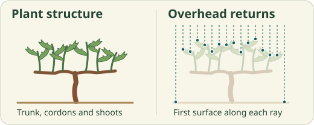

# Crop sketches

These original schematics show how organs connect, where a plant is anchored and why a laser can miss that anchor. Open a crop guide for the horticultural photographs and assumptions behind each drawing. A still frame carries the same information when your device requests reduced motion.

| Crop | Illustration | Field notes |
| --- | --- | --- |
| Field lettuce | [Lettuce SVG](lettuce.svg) | [Rosette and market types](../../trainer/plants/lettuce.md) |
| Greenhouse bench lettuce | [Bench lettuce SVG](bench-lettuce.svg) | [Leaf cover over a fixed support](../../trainer/plants/bench-lettuce.md) |
| Globe artichoke | [Artichoke SVG](artichoke.svg) | [Leaf rosette and flowering heads](../../trainer/plants/artichoke.md) |
| Young tomato | [Young tomato SVG](young-tomato.svg) | [Seed leaves, leaflets and side shoots](../../trainer/plants/young-tomato.md) |
| Apple orchard | [Tree structure](apple.svg) · [Canopy and base pins](apple-base-pins.svg) · [How guesses survive spacing](apple-pin-spacing.svg) · [How low returns change rank](apple-low-returns.svg) · [Where boards land](apple-board-placement.svg) · [Branch calipers](apple-calipers.svg) | [Architecture and branch measurements](../../trainer/plants/apple.md) |
| Trellised grapevine | [Grapevine SVG](grapevine.svg) | [Trunk, cordons and row structure](../../trainer/plants/grapevine.md) |
| High-wire tomato | [High-wire tomato SVG](high-wire-tomato.svg) | [Leaders, trusses and one shared base](../../trainer/plants/high-wire-tomato.md) |
