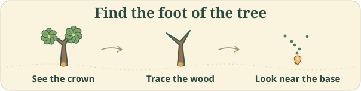

[](https://mvalancy.github.io/crop-trainer/benchmark/)

# Repeat a field experiment

Does a denser scan see more seedlings? Can a detector still find an apple trunk after a limb breaks? Each study keeps the planting seeds fixed so the two versions can be compared. You can [try a comparison in the browser](https://mvalancy.github.io/crop-trainer/benchmark/) or run a study with Node.js 22 or later.



From the repository root, run this short check to see how often an overhead scan catches wood near a known tree base. It prints JSON with the counts and scan settings.

```sh
node benchmark/studies/orchard-visibility.mjs
```

| Question | Code | How to read the result |
| --- | --- | --- |
| How often do real weeds appear next to a tomato? | [Read crop and weed boxes from the authors’ local COCO files](tomato-field-boxes.mjs) | [Outdoor tomato photos across two seasons](../../docs/field-datasets.md#how-often-do-weeds-share-a-photo-with-a-young-tomato) |
| Does vertical structure locate vines at a second site? | [B7 drone captures](vineyard-b7.mjs) · [Shared frozen column rules](vineyard-columns.mjs) | [Spanish survey, sensor comparison and alignment check](../../docs/field-datasets.md#can-the-same-rule-find-trunks-at-a-second-vineyard) |
| Does the B7 result hold at harvest on the neighboring block? | [Locate and score the B9 survey](vineyard-b9.mjs) · [Align the laser scan to checkerboards](vineyard-b9-checkpoints.mjs) | [Matched and missed survey records in B9](../../docs/field-datasets.md#does-the-b7-result-hold-in-the-neighboring-vineyard) |
| Can two flight heights be aligned to the same surveyed vines? | [Check B9’s 30 m or 50 m flight independently](vineyard-b9-checkpoints.mjs) | [What the 50 m markers could resolve](../../docs/field-datasets.md#can-we-compare-the-30-m-and-50-m-vineyard-scans) |
| What happens when lettuce leaves lose some of their returns? | [Paired scattered and clustered gaps](lettuce-return-gaps.mjs) | [Outdoor depth observations and synthetic test](../../docs/field-datasets.md#how-much-of-a-lettuce-plant-has-measured-depth) |
| Does training improve on simple height peaks? | [Paired detectors](paired-evidence.mjs) | [Detector comparisons](../../docs/evidence.md) |
| Which plants disappear as scan spacing or crop size changes? | [Seedling density](seedling-density.mjs) · [Canopy size](canopy-size.mjs) · [Plant forms](plant-forms.mjs) | [Sampling gaps](../../docs/seedling-density.md) |
| Where does the detector lose young tomatoes? | [Detection stages](seedling-stages.mjs) · [Peak rules](seedling-peaks.mjs) · [Trained peak rules](seedling-peak-fit.mjs) · [Training by growth stage](tomato-stage-training.mjs) | [Tomato results](../../docs/tomato-stage-training.md) |
| Can nearby heights distinguish a seedling from soil? | [Compare local and absolute heights](tomato-local-ground.mjs) · [Select a cutoff on separate fields](tomato-terrain-cutoffs.mjs) | [Seedling matches and branching-plant precision](../../docs/tomato-local-ground.md) |
| Can hard background examples help tell weeds from seedlings? | [Freeze the training draws and confirm on fresh fields](tomato-hard-negatives.mjs) · [Compare ranked pins at the same visit count](tomato-hard-negative-ranking.mjs) · [Identify the seedlings each fit gained and lost](tomato-mining-match-changes.mjs) | [Field results and visual replay](../../docs/tomato-hard-negatives.md) |
| What changes if the examples stay fixed and their feature scale changes? | [Cross two draws with two scales on fresh plantings](tomato-scaler-cross.mjs) · [Move the first layer between scales](tomato-scaler-transport.mjs) | [Tomato results and browser experiment](../../docs/tomato-feature-scaling.md) · [Replay the same raw-input predictions](../../docs/tomato-scaler-transport.md) |
| Does matching the distance of the background peaks help? | [Keep the ordinary draw’s near and far counts on fresh training seeds](tomato-distance-mining.mjs) | [Weedy ring results and training surfaces](../../docs/tomato-hard-negatives.md#does-it-help-to-keep-the-same-mix-of-near-and-far-peaks) |
| Can each trained detector choose its own cutoff? | [Freeze on calibration fields and test on fresh plantings](tomato-fit-calibration.mjs) · [Compare 70 four-planting panels](tomato-calibration-panels.mjs) | [Cutoff choice and held-out results](../../docs/tomato-calibration.md) |
| How long should the tomato network train? | [Select an epoch count](tomato-training-duration.mjs) · [Check candidate ranking before spacing](tomato-epoch-ranking.mjs) · [Select a cutoff for the longer fit](tomato-duration-cutoffs.mjs) | [Seedling gains and extra pins on older plants](../../docs/tomato-training-duration.md) |
| Does changing the training draw rescue seedlings? | [Paired sampler and stage-only control](tomato-soil-sampling.mjs) · [Sample-budget follow-up](tomato-soil-budget.mjs) · [Trace the plant hit by each peak](tomato-label-support.mjs) | [Scores and frozen-weight field replay](../../docs/tomato-soil-sampling.md) |
| Can a second model pick up short seedlings when soil is visible? | [Training and scoring on lower peaks](tomato-peak-floor.mjs) · [Adding low peaks after the usual detector runs](tomato-low-fallback.mjs) | [Model settings and results](../../docs/tomato-stage-training.md#can-a-second-detector-fill-the-gaps-between-standard-pins) |
| How much can the orchard detector see? | [Trunk visibility](orchard-visibility.mjs) · [Base detection](orchard-bases.mjs) · [Broken scaffolds](orchard-damage.mjs) · [Near-base support](orchard-support.mjs) · [Spacing sweep](orchard-spacing.mjs) · [Low-return ranking and ray density](orchard-ranking.mjs) · [Clutter origins](orchard-ranking-clutter.mjs) · [Board placement and damage](orchard-board-placement.mjs) | [Tree-base results](../../docs/orchard-bases.md) · [Low-return field replays](../../docs/orchard-ranking.md) |
| Do the simulated branches vary enough within a tree? | [Branch measurements](orchard-branch-caliber.mjs) · [Version comparison](orchard-architecture.mjs) · [Shared measurement code](orchard-measurements.mjs) | [Apple dimensions and source measurements](../../trainer/plants/apple.md) |
| How does an incorrect ground height affect a detector? | [Ground-reference test](ground-reference.mjs) | [Field validation guide](../../docs/field-validation.md) |


To replay the near/far tomato comparison, run these commands from the repository root. The last command looks up the surface under each selected training peak after the models have been frozen.

```sh
node benchmark/studies/tomato-distance-mining.mjs fit > bands-fit.json
node benchmark/studies/tomato-distance-mining.mjs confirm bands-fit.json > bands-confirmation.json
node benchmark/studies/tomato-distance-mining.mjs surfaces bands-fit.json > bands-surfaces.json
```

For a physical scan, the [vineyard preparation script](prepare-vineyard.mjs) takes a separately downloaded survey and prepares a local test strip. The field dataset guide links to the source, license and measured results. [Replay the vineyard test](../../docs/field-datasets.md#replay-the-vineyard-test) · [Measure low returns on the surveyed rows](vineyard-low-band.mjs) · [Count vertically stacked returns across three visits](vineyard-vertical-support.mjs)
