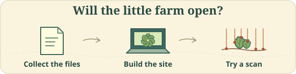

# Release checks

Use the same generated site that GitHub Pages will serve when testing a layout or moving a module. The build uses the current contents of Git-tracked files. Stage newly added public assets before running a local build.

```sh
npm ci
npm run build:pages -- /tmp/crop-trainer-pages
npx --no-install playwright install --only-shell chromium
npm run test:pages -- /tmp/crop-trainer-pages
```

| File | What it checks |
| --- | --- |
| [build-pages.mjs](build-pages.mjs) | Copies the public app and reading material into an empty directory and generates the compatibility paths used by earlier releases. |
| [smoke-pages.mjs](smoke-pages.mjs) | Serves that directory at `/crop-trainer/` and exercises the generator, viewer, training and paired benchmark in Chromium. |

For the full CPU and browser checks, deployment permissions and an Actions rerun, see the [deployment guide](../docs/deployment.md).
