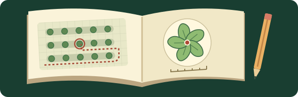

# Crop Trainer field guide

## New to machine learning?

**[Start the illustrated tour · Follow one lettuce from scan to score →](first-steps/README.md)**

See what a laser measures, try a two-clue model by hand, and check whether a pin landed on a plant. Five short lessons use one recorded starter run and end with a real vineyard test.

[What is a model?](first-steps/models.md) · [How does it learn?](first-steps/learning.md) · [Was the pin any good?](first-steps/scoring.md) · [Would it work on a farm?](first-steps/fieldwork.md)

## Guides for your own experiments

| I want to… | Open |
| --- | --- |
| Understand how dots become predictions | [How training works](training.md) |
| Grow, scan, share or export a field | [Fields and scanners](scanners.md) |
| Find out why a plant was missed | [Inspecting detections](field-inspection.md) |
| Compare two detectors on the same fields | [Benchmarks](benchmarks.md) |
| See when training beats picking tall peaks | [Held-out crop experiments](evidence.md) |
| Score a local PLY against surveyed centers | [Browser field test](training.md#test-a-plot-of-your-own) · [Local command](scan-cli.md) |
| Run saved weights on a Raspberry Pi or Jetson Orin Nano | [Take a detector to the field](edge-deployment.md) |
| See how far synthetic training has worked on real plants | [What the research supports](research-evidence.md) |
| Find real field data or replay the vineyard test | [Public field datasets](field-datasets.md) |
| Design a test on real farms | [Field validation](field-validation.md) |
| Read the papers and check dataset licenses | [Datasets and research](research.md) |
| Run locally or replay a browser experiment | [Local setup](local-setup.md) |

## Pick a question

Open a question and select **Run benchmark**. Each preset fills in the crop, scanner, seed and comparison. All three run on a local CPU.

| Question | What to inspect |
| --- | --- |
| [Do shorter peaks find more tomatoes in a sparse scan?](https://mvalancy.github.io/crop-trainer/benchmark/?comparison=heights&crop=tomato&seed=2221&sensor=mixed&validationSensor=os1-64&validationRayBudget=12000) | Compare matches and extra pins. Repeat at 60,000 validation rays in the same tab to see the F1 scores side by side. |
| [Which lettuce plant changed match?](https://mvalancy.github.io/crop-trainer/benchmark/?comparison=heights&crop=lettuce&seed=2121&sensor=mixed&validationSensor=os1-64&validationRayBudget=12000&pairSeed=2122&pairTile=39c12665d375fbb9&pairDistance=7.5&pairBox=1#modelBoxes) | Open the selected box in 3D and use **Focus plant** to orbit its center. |
| [Which model counted the artichokes more accurately?](https://mvalancy.github.io/crop-trainer/benchmark/?comparison=models&crop=artichoke&seed=1551&sensor=mixed&validationSensor=os1-64&validationRayBudget=12000&fieldMetric=meanAbsolute) | Compare absolute count error per planting, then check whether pins landed near the labeled centers. |

[Crop Trainer home](../README.md) · [Agent quickstart](../AGENTS.md)
