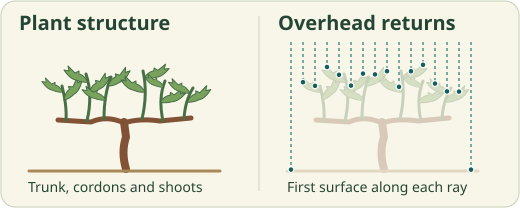

# What shape is one plant?

A lettuce head can have one obvious center when viewed from above. A grapevine can share a continuous wall of leaves with its neighbors. Both have one planting position. They present very different detection problems.

## Seven crops and growing systems

These links open photographs at their original sources. The observations describe the pictured growth stage or training system. The generator uses approximate geometry and seeded variation. Its lengths, angles and frequencies are simulation settings.

| Crop Trainer selection | Look at the photograph | What to represent and test |
| --- | --- | --- |
| **Field lettuce** | In “rows of lettuces,” soil separates the planting rows. In “Butterhead lettuce,” broad outer leaves overlap around a denser center. [NC State Extension photos](https://plants.ces.ncsu.edu/plants/lactuca-sativa/) | Build outward-spreading leaves around a short stem, with more upright inner leaves. Test touching outer leaves and small plants with few returns. Loose leaf, heading and bolted plants have different silhouettes. |
| **Globe artichoke** | Lucy Bradley’s leaf photograph shows an open rosette of long, deeply divided blades. Her mature plant photograph shows several buds above the leaves. [NC State Extension photos](https://plants.ces.ncsu.edu/plants/cynara-cardunculus-scolymus-group/) | The single-bud form grows divided leaves and one closed terminal head with overlapping bracts. Real flowering plants can carry several bud peaks, which still belong to one planting. |
| **Young tomato** | The “seedling” image shows long, narrow seed leaves beside the first emerging true leaves. The “leaves” photo shows separate leaflets carried along a central stalk. [NC State Extension photos](https://plants.ces.ncsu.edu/plants/solanum-lycopersicum/) | Model a stem with leaves attached at successive nodes. A true leaf has several leaflets. A cotyledon-stage seedling offers much less surface for a scanner than a transplant with several true leaves. |
| **Apple orchard** | In “Form in bloom” and “Tree,” visible trunks divide into spreading branches with gaps through the crown. The pruning guide shows how a central leader and scaffold branches shape a trained tree. [NC State tree photos](https://plants.ces.ncsu.edu/plants/malus-domestica/) · [Utah State pruning guide](https://extension.usu.edu/yardandgarden/research/training-and-pruning-apple-trees) | Use trunk, scaffold branches and groups of foliage. Count each planted tree once. A broad orchard crown and a narrow trellised fruit wall need separate tests. Individual blossoms and apples are outside the detection target. |
| **Trellised grapevine** | In Texas A&M’s figure 2, a single trunk divides into low horizontal arms, or cordons. Shoots rise from them into a band of foliage. Iowa State’s figure 9 shows a different, high-wire vine after pruning. [Texas A&M AgriLife, figure 2](https://aggie-horticulture.tamu.edu/wp-content/uploads/sites/13/2020/05/Grapevine-Trellis-Systems-for-Winegrapes-in-Texas-EHT121.pdf#page=2) · [Iowa State, figure 9](https://yardandgarden.extension.iastate.edu/how-to/how-prune-grapevines-home-garden) | The leafy bilateral form follows vertical shoot positioning on two low cordons. Keep rising shoots, short spurs and support hardware distinct. Neighboring vines can share a canopy silhouette. The target is one base per vine. |
| **Greenhouse bench lettuce** | The opening photo shows regularly spaced rosettes above the support surface. Figure 10 shows narrow growing channels with exposed edges near the aisle and foliage covering channels farther back. [Alabama Extension, figure 10](https://www.aces.edu/blog/topics/crop-production/greenhouse-lettuce-production/) | Place each rosette above a bench. Exposed bench area changes as plants grow. Bench edges can generate peaks, and one raised support can carry many plants. The synthetic bench simplifies individual channel profiles. |
| **High-wire tomato** | Figure 2 shows a stem clipped to twine. Figures 1a and 5a show plants along an aisle with pots below and support hardware above. The guide explains how growers lower and lean stems as growth continues. [Alabama Extension photos](https://www.aces.edu/blog/topics/crop-production/greenhouse-tomato-production/) | The single-leader form grows one leaning leader with a pruned lower stem, compound leaves and hanging fruit trusses. The canopy peak can be displaced along the row from the labeled base. [Burusa greenhouse photograph](https://github.com/akshaykburusa/tomato_greenhouse_dataset/blob/main/images/1000-60-120_color.jpg) |

## Choose a plant form

A form can describe a market type, a growth stage or a grower’s pruning decision. Holding the form fixed lets you test one of those differences. A seeded mix picks forms within the planting to stress a detector. It supplies no estimate of how often neighboring plants on a farm have different cultivars, ages or management.

| Selection | Form choices and what they test |
| --- | --- |
| **Field or bench lettuce** | `looseleaf` spreads blades outward, `butterhead` cups them into a rounded soft head, and `romaine` holds longer leaves more upright. Each type can grow above a field bed or a raised bench. Hold the support surface fixed when testing the effect of leaf habit. [Illinois Extension, lettuce types](https://extension.illinois.edu/gardening/lettuce) |
| **Globe artichoke** | `rosette` represents foliage before visible buds, `single-bud` adds a closed terminal head, and `branched-buds` adds lateral heads. One flowering stalk can bear a main terminal bud and smaller secondary buds. Several local height peaks can belong to a single plant. [University of Maine Extension, growing globe artichokes](https://extension.umaine.edu/publications/2075e/) |
| **Young tomato** | `seedling` emphasizes seed leaves and early true leaves, `transplant` carries several compound leaves on a main stem, and `branching` adds side growth. Tomato side shoots arise at leaf axils, where a leaf meets the stem. These presets represent different snapshots. The simulator does not predict days since germination. [NC State seedling and foliage photos](https://plants.ces.ncsu.edu/plants/solanum-lycopersicum/) · [New Hampshire Extension, location of side shoots](https://extension.unh.edu/resource/pruning-tomato-plants-fact-sheet) |
| **Apple orchard** | `central-leader` keeps an upright main axis with tiers of branches. `open-vase` represents spreading scaffolds around an open center, a form also seen in heritage orchards. Central and modified leaders are common apple systems. Compare both at the same leaf state to isolate crown architecture. [UC IPM, apple training](https://ipm.ucanr.edu/home-and-landscape/apple-training/) · [Montana State heritage orchard guide](https://agresearch.montana.edu/warc/guides/apples/heritage_orchard_management_guide/caring-for-heritage-trees/pruning.html) |
| **Trellised grapevine** | `bilateral-cordon` carries shoots on arms extending in two directions from the trunk, `unilateral-cordon` places the arm on one side, and `pruned-cordon` exposes woody arms and spurs. Preserve one base per vine when shoots extend into a neighbor’s space. [Colorado Grape Growers’ Guide, figure 12](https://coloradowine.com/wp-content/uploads/2016/10/CO-Grape-Growers-Guide.pdf#page=27) · [Iowa State pruning photographs](https://yardandgarden.extension.iastate.edu/how-to/how-prune-grapevines-home-garden) |
| **High-wire tomato** | `young-leader` represents early vegetative growth. `single-leader` carries one trained shoot. `twin-leader` carries two shoots on one plant. Growers can train a vigorous grafted plant to two leaders. Count its shared planting base once. [Alberta greenhouse propagation guide](https://www.alberta.ca/tomato-plant-propagation-in-commercial-greenhouse-tomato-production) · [Ontario greenhouse guide, two-leader transplant photograph on page 12](https://www.publications.gov.on.ca/store/20170501121/Free_Download_Files/302001.pdf#page=12) |

Photographs establish which organs connect and which shapes are plausible. The generator’s leaf counts, dimensions and mix frequencies are modeling assumptions. To calibrate one form for a site, measure several representative plants at the stated stage, record their training system, and compare held-out scans from matching viewpoints.

## Replay geometry by version

Fresh browser scans, training runs and benchmarks use **Connected plants · v3**. Version 3 joins each retained lettuce blade to its own stem with a short stalk. Vegetative artichokes grow from a stem rooted in the soil, and each bud bract meets the core at its own collar height. Greenhouse lettuce meets the 0.73 m bench, including its ends. High-wire tomato meets the 0.19 m trough. Vines, apple trees and young field tomatoes share their v2 organ shapes. Use the version recorded in a saved recipe or run to reproduce its geometry, tile IDs and scores. [Generator versions](../trainer/generator/plant-version.js) · [Replay and attachment tests](../test/plant-attachments.test.js)

The vineyard fixture represents one catch wire and posts. The greenhouse fixture represents the overhead cable, posts and trough. A real grower also uses a fruiting wire or twine to hold plants in position. Those finer supports are simplified out of the fixture layer and can be absent from a side view. [Vineyard growing guide](../trainer/plants/grapevine.md) · [Greenhouse tomato growing guide](../trainer/plants/high-wire-tomato.md)

## Which position gets scored?

For apple, grapevine, greenhouse bench lettuce and high-wire tomato, the reference pin is the planting base recorded by the generator. Field lettuce, artichoke and young tomato use the horizontal midpoint of the full plant’s bounding box. A one-sided loss of leaves can shift that midpoint even though the underlying planting stayed in place. Use the same target definition when comparing detectors. [Reference positions in the scorer](../trainer/models/data.js)

## What the scanner can see

The standard field scan samples horizontal positions and keeps the upper surface at each position. An overhead ray landing on a lettuce leaf cannot also describe the bare soil underneath. A vine trunk or tomato base can be present in the scene with no direct return. Turning the 3D viewer shows the same measured points from another angle. A new acquisition from the aisle would encounter different surfaces and different occlusions. A denser overhead pattern still observes the plot from above. [Scan implementation](../trainer/generator/field.js) · [Scanner layouts](scanners.md)

The structure overlay draws the generator’s centerlines, including wood hidden behind foliage. Keep it separate from sensor input. For apple, switch the same planting between leaf-on and dormant views. The woody skeleton stays fixed as leaf cover changes. This isolates foliage occlusion in a controlled comparison. Real dormant orchards may also have been pruned or trained differently.

For a paired test, keep planting identities, crop stage, fixtures and noise seed fixed. Record achieved returns, the number of plants with zero returns, and how many targets have a candidate peak before classification. Then compare final count error and location scores. For a physical side-scan study, record the actual viewpoint and label the same bases independently. The earlier vineyard pilot illustrates the distinction. The detector counted 21 plants on a registered strip with 18 surveyed trunks, yet just one pin fell within 15 cm of a trunk. The same test can check a new generator or detector. [Vineyard replay and data terms](field-datasets.md#replay-the-vineyard-test) · [Field validation guide](field-validation.md)

## How procedural rules relate to research

L-systems use repeated rules to describe growth and branching. One useful idea for a small generator is that two leaves on a shoot share a parent axis. Generating each leaf independently loses that relationship. In the implementation, the crop registry selects an organ-building function. Shared surface routines turn tapered stems, arched or lobed leaves, and ellipsoids into geometry. [Prusinkiewicz and Lindenmayer, *The Algorithmic Beauty of Plants*, chapter 1](https://algorithmicbotany.org/papers/abop/abop-ch1.pdf) · [Guide to adding a crop](../trainer/plants/README.md) · [Shared surfaces](../trainer/plants/surfaces.js)

Sarlikioti and colleagues measured tomato leaf lengths, widths, orientations and attachment angles to construct a 3D canopy for light-interception studies. The same kinds of measurements could constrain a future scanner model. Simulating photosynthesis, development over time or sensor accuracy would require additional measurements and validation for those tasks. [Sarlikioti, Marcelis and de Visser, 2011](https://www.actahort.org/books/893/893_77.htm)

Compare one named form against another on matched plantings and see how many proposed peaks survive the detector. [Seven-crop form and damage benchmark](crop-form-benchmark.md)
