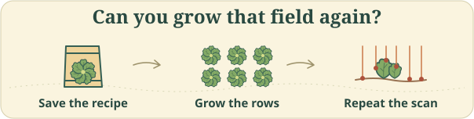
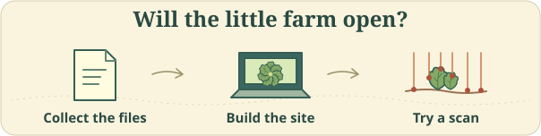
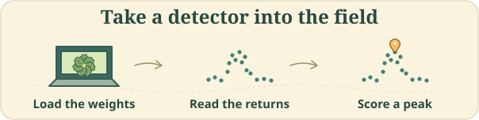

# Testing and publishing Crop Trainer

A pull request to `main` runs the CPU regression suite, the synthetic field preflight and a Chromium test on the built website. Once a change lands on `main` and all three pass, a separate job publishes that same artifact to GitHub Pages. Open the workflow run to see which check failed or follow its deployment link to the published app. [Workflow runs](https://github.com/mvalancy/crop-trainer/actions/workflows/pages.yml) · [Public app](https://mvalancy.github.io/crop-trainer/)

## Run the release checks locally



Use Node.js 22 or later. The workflow uses Node.js 24 on Ubuntu. Playwright is a development dependency for these release checks. Opening Crop Trainer in a browser or running its CPU trainer requires no npm packages.

```sh
npm ci
npm test
npm run preflight
npm run build:pages -- /tmp/crop-trainer-pages
npx --no-install playwright install --only-shell chromium
npm run test:pages -- /tmp/crop-trainer-pages
```

The build renders each public Markdown file into an HTML chapter under `guide/`. The local server uses the same Markdown renderer and chapter links. Edit the source Markdown and its SVGs to update the reader. Restart the local server to reload its chapter inventory.

Choose an empty output directory for the build. On a Linux machine that needs Chromium’s system libraries, use `npx --no-install playwright install --with-deps --only-shell chromium`. To use an existing Chromium installation, set `CHROMIUM_PATH` to its executable when running the browser test.

The test serves the built site at `/crop-trainer/`. It grows a field, downloads a recipe, teaches the height lesson and checks help, apple foliage, scrolling and fullscreen. In the Training shed it switches model families, checks the diagram at phone and laptop widths, traces layers with reduced motion enabled and fits a model on CPU. In Field test it downloads the example files and scores their scan with both reference formats. The two-seed benchmark also checks the exported scores at three cutoffs. A physical WebGPU timing requires a run on the target device.

## Publish a tested revision



Set **Settings → Pages → Build and deployment → Source** to **GitHub Actions**. A push to `main` starts the release. To rerun the current revision, select **Actions → Test and deploy Crop Trainer → Run workflow** and choose `main`. Pull requests and manual runs on other branches execute the checks with read-only repository access. The deployment job receives the Pages and OIDC permissions after verification succeeds.

A failed check leaves the last successful deployment serving. To restore an earlier version, revert the relevant change on `main` so the same checks cover the revision being republished. [Workflow definition](https://github.com/mvalancy/crop-trainer/blob/main/.github/workflows/pages.yml) · [Pages build script](https://github.com/mvalancy/crop-trainer/blob/main/ci/build-pages.mjs) · [Browser checks](https://github.com/mvalancy/crop-trainer/blob/main/ci/smoke-pages.mjs)
