# Take a detector to the field

Start with **one saved scan of one measured plot**. Train a lettuce detector on your laptop, carry its weights to a Raspberry Pi or Jetson Orin Nano, and ask the board to put a pin on each plant. A survey taken before you look at the pins tells you which plants it found. You can practice the entire scoring step at your desk.

## 1. Pack the detector

In the Training shed, choose your crop, run **Generate, train & score**, then select **Download model weights**. Save the download as `weights.json`. It carries the network, the scale of each input, the cutoff and the minimum pin spacing. **Download run settings** saves the recipe for repeating the fit. [Open the Training shed](https://mvalancy.github.io/crop-trainer/trainer/)

## 2. Prepare the field computer

| Board | A good starting point |
| --- | --- |
| Raspberry Pi 4 or 5 | Use 64-bit Raspberry Pi OS. Lite works over SSH. Desktop also lets you inspect the map in a browser on the Pi. [Raspberry Pi OS guide](https://www.raspberrypi.com/documentation/computers/os.html) |
| Jetson Orin Nano developer kit | Use a working Jetson Linux installation. For a fresh kit, select the setup path that matches the kit’s firmware and JetPack release. [NVIDIA developer kit quick start](https://docs.nvidia.com/jetson/orin-nano-devkit/user-guide/quick_start.html) |

Install a supported **Linux ARM64 Node.js LTS, version 22 or later**, on the board. While you have a network connection, get the source and try a practice run. If the workstation uses a specific Crop Trainer commit, check out that revision on the board too. [Node.js downloads](https://nodejs.org/en/download)

```sh
git clone https://github.com/mvalancy/crop-trainer.git
cd crop-trainer
node -p "process.version + ' / ' + process.platform + ' / ' + process.arch"
git rev-parse HEAD
node run.mjs preflight
```

On the board, Node should report `linux / arm64`. Look for `"passed": true` in the preflight result. It trains a small synthetic detector, saves its weights and scores six held-out scans from three plantings. It checks the matches at all three distances and the identities of the missed plants at 15 cm. Run it before connecting a sensor. After setup, scoring works offline and has no npm or Python dependencies.

**Which processor am I using?** The command-line scorer runs on the board’s **CPU**, including on Jetson. Browser training can use WebGPU when the browser supplies an adapter. If you open a board-hosted page on a laptop, the browser computation runs on the laptop. Sensor capture, live ROS topics, registration of moving scans and Jetson CUDA/TensorRT inference each require separate software.

## 3. Capture one plot you can check

1. **Mark the plot.** Start with one crop and a stationary scanner. Mark a lower-left corner and two horizontal axes, then measure the soil elevation there. Record the units, scanner pose and date. For accuracy testing, independently survey every in-scope plant’s center in that same frame. Start `centers.csv` with the header `x,y`, then add one XY pair per plant in the original scan units.
2. **Make a Z-up cloud.** Record a scan using the sensor’s capture software. Export Cartesian XYZ points. If the scanner is tilted, apply the measured rotation and translation so Z points up. If you merge views, register them into one measured frame first. Keep the original capture. [CloudCompare’s transform tool](https://www.cloudcompare.org/doc/wiki/index.php/Apply_Transformation)
3. **Crop and export.** Use a clipping box to extract a single plot up to **10 × 10 m**. Keep its soil and canopy. Save the points as ASCII or binary little-endian PLY with `x`, `y`, `z`, up to **1 million points and 32 MiB**. Check a known distance and soil elevation in the saved coordinates. Record any thinning or coordinate shift and use the same frame for the survey. [CloudCompare’s clipping box](https://www.cloudcompare.org/doc/wiki/index.php/Cross_Section) · [File and coordinate examples](scan-cli.md)

## 4. Place pins on the board

Copy `weights.json`, `plot.ply` and, if surveyed, `centers.csv` to a private directory on the board. With SSH enabled, for example, run the following **on the workstation**. Replace `grower@fieldpi.local` with your board’s login and address.

```sh
ssh grower@fieldpi.local 'mkdir -p ~/crop-run'
scp weights.json plot.ply centers.csv grower@fieldpi.local:crop-run/
```

**On the board**, run the scorer from the repository directory. This example assumes a level plot in metres with its lower-left corner and soil at `(0,0,0)`. Substitute your measured origin and signed X/Y grades for a physical plot.

```sh
time node score-scan.mjs ~/crop-run/weights.json ~/crop-run/plot.ply \
  ~/crop-run/plot-01-result.json --unit m --origin 0,0,0 \
  --grade-percent 0,0 --labels ~/crop-run/centers.csv
```

Use a fresh report filename for each run. With no survey, omit `--labels` to get predictions. The report gives the original XY and plot-local metres for each pin, the model score, and pins from a simple rule that picks the tallest peaks. With a survey it also gives matches, misses and extra pins for both methods at 7.5, 10 and 15 cm. To see the map, load the **same weights, PLY, labels and frame** in [Field test](https://mvalancy.github.io/crop-trainer/trainer/#field-test).

**A portability check you can replay.** We ran the same surveyed vineyard strip through Linux Node.js 24.22.1 on native x64 and on ARM64 under QEMU. Both wrote a byte-identical JSON report for 16,685 returns, including pin coordinates, scores and survey matches. This checks the ARM64 scoring path. Physical Pi and Jetson memory use, sustained throughput and sensor capture still need measurement on the kit. [Vineyard files, settings and command](field-datasets.md#replay-the-vineyard-test)

## 5. Decide what the field trial showed

- **Did the model travel correctly?** Score the *same files* on your workstation and the board. Compare `files` (input hashes), `frame`, pin locations and per-distance match counts. If they disagree, check the revision, weights, units and origin before interpreting model quality.
- **Is the board fast enough for your job?** Time several representative plots on the board. The `real` time above includes Node startup, file reading, both detectors, optional matching and writing the report. Time acquisition and registration separately. Record the board, OS, Node version and point count beside the timings. A laptop training time cannot tell you how fast the board processes a field scan.
- **Did it find the right plants?** Compare against the height-only rule on a new row or site. Examine extra pins and misses as well as the total count. If a surveyed plant has no nearby height peak, giving the classifier more training epochs cannot recover it. On our measured vineyard strip the learned detector placed 21 pins for 18 trunks, but just one pin was within 15 cm of a trunk. [Replay that field test](field-datasets.md#replay-the-vineyard-test) · [Design a field trial](field-validation.md) · [What the research supports](research-evidence.md)
