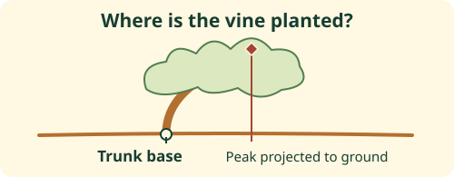
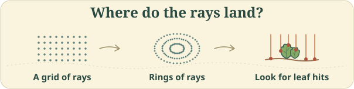
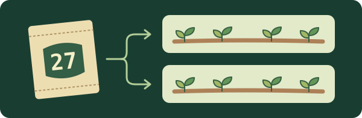

# Does training help find crop centers?

On these held-out synthetic fields, a trained detector placed better pins for lettuce and globe artichoke than a rule that kept the tallest peaks. Young tomato exposed a failure. When we trained on a grid and tested on rings, the default neural model discarded too many true plants. A separate experiment tested whether changing the cutoff could recover them.

## Comparing four detectors on the same fields


Every detector received the same peaks from the same XYZ scan. The **peak rule** kept peaks in height order, skipping any too close to an existing pin. **Height only** learned a logistic score from one feature, the smoothed height. **Logistic** used all 13 local features. **Neural** used the same 13 features and a hidden layer of four tanh units. All four used the same minimum pin spacing for a given crop.

| Crop | Test layout | Peak rule | Height only | Logistic | Neural | Fields where neural beat the peak rule |
| --- | --- | ---: | ---: | ---: | ---: | ---: |
| Lettuce | Reference grid | .665 | .741 | **.799** | .785 | 23/24 |
| Lettuce | OS1-64 rings | .706 | .697 | **.793** | .777 | 21/24 |
| Globe artichoke | Reference grid | .523 | .711 | .754 | **.760** | 23/24 |
| Globe artichoke | OS1-64 rings | .555 | .663 | .729 | **.737** | 18/24 |
| Young tomato | Reference grid | .770 | .623 | .792 | .792 | 15/24 |
| Young tomato | OS1-64 rings | **.761** | .526 | .747 | .747 | 10/24 |

Scores are mean F1. We matched each predicted pin to at most one planted center, pooled the counts across scans at **7.5, 10 and 15 cm**, then averaged the three F1 scores. The field tally combines the soil-on and soil-off scans of each planting before comparing methods.

The lettuce results favor the 13-feature logistic model on both layouts. On artichoke rings the peak rule found 96.0% of plants at 15 cm, but only 52.0% of its pins matched a plant. The neural model raised precision to 97.3% while retaining 78.6% recall. Its mean absolute count error fell from 28.0 to 6.3 plants per scan.

On tomato rings the neural model improved mean absolute count error from 26.6 to 21.9 plants per scan while **losing** localization F1. A missed plant and an extra pin can cancel in the count. Checking both metrics matters if the next task needs individual plant locations.

## A fresh test of the tomato cutoff



At 15 cm, 94.6% of tomato centers on the first ring cohort had a match among the raw proposals. The default neural model reached only 75.1% after scoring and spacing. We tested a specific possibility on new fields. Could a lower score cutoff retain more of those proposals and still beat the peak rule?

We trained three new models on reference grids. For each fit, we chose a cutoff on four separate labeled ring plantings, maximizing mean F1 across the three distances. All three selected **0.30** from the nine cutoffs 0.10 through 0.90. We froze each choice, then scored the other eight ring plantings from that fit. The table pools those 24 test plantings.

| Detector on fresh tomato rings | F1 at 7.5 cm | F1 at 10 cm | F1 at 15 cm | Mean F1 | Precision at 15 cm | Recall at 15 cm | Count error per scan |
| --- | ---: | ---: | ---: | ---: | ---: | ---: | ---: |
| Peak rule | .648 | .766 | .827 | .747 | .739 | .939 | 28.2 |
| Neural at 0.50 | .656 | .757 | .803 | .739 | .868 | .746 | 16.5 |
| Neural at calibrated cutoff | **.678** | **.792** | **.849** | **.773** | .802 | .903 | 16.0 |

Calibration recovered recall at the cost of precision. This used labeled examples from the target layout. The result supports calibrating a crop and scan setup on separate fields before trusting its operating point.

## What did longer training change for tomatoes?


On six new synthetic plantings, the same four-unit network trained for 40, 160 or 640 passes over 600 examples. At 15 cm on ring scans it found **2, 62 and 260 of 657 seedlings** respectively. On branching plants, the corresponding runs placed 115, 167 and 263 extra pins. Grid seedlings remained harder even after 640 passes (58 of 657). A useful duration depends on the crop stage, scanner and acceptable cost of a wrong pin. [Study, settings and field replay](tomato-training-duration.md)

## Did practicing on difficult backgrounds help?


On six fresh weedy ring plantings, one fit removed 64 extra pins and missed 79 additional seedlings. Its practice model had selected many tomato leaf tips as background because they lay too far from a planted center. A second seed changed the tradeoff. Before choosing a training recipe, compare both the plants it finds and those it loses. The saved pair in Field Test lets you open either kind of change in 3D. [Background selection and plant-by-plant replay](tomato-hard-negatives.md)

Changing the examples also changes the scale of the measurements going into the network. We trained four combinations to separate those effects. With the same difficult examples, switching the feature scale cost one fit 137 seedling matches and gained another fit 51 on the same 678 tomatoes. No combination met the recall, false-alarm and branching-precision goals on all three training seeds. [Try the four fits](tomato-feature-scaling.md)

## What held up in a physical vineyard?



On a Spanish vineyard block, the geometric column rule matched 32 of 138 surveyed trunk records within 15 cm. A model trained on simulated vines matched 11, at the same pin budget. On a second block the column rule matched two of 121 and the trained model matched 11. Only 64 survey records had a nearby laser return in the height band the rule searched. Both surveys covered selected rows, so an unmatched pin could fall on an unsurveyed vine. [Independent vineyard checks and alignment limits](field-datasets.md#does-the-b7-result-hold-in-the-neighboring-vineyard)

## Does a grid-trained artichoke detector transfer to rings?



In a smaller browser test at **12,000 sampled rays per scan**, the CPU and WebGPU fits agreed on every tile’s match counts. Changing the held-out scan from a reference grid to simulated OS1-64 rings reduced pooled mean F1 from **.455 to .422**. At 15 cm the rings produced 43 fewer matches and nine fewer extra pins. The difference varied by fit. For seed `14512693`, mean F1 went from .490 to .424. For `14512694` it went from .417 to .420.

| Held-out layout | Match distance | Matched pins | Extra pins | Missed centers | F1 |
| --- | ---: | ---: | ---: | ---: | ---: |
| Reference grid | 7.5 cm | 110 | 198 | 304 | .305 |
| Reference grid | 10 cm | 154 | 154 | 260 | .427 |
| Reference grid | 15 cm | 229 | 79 | 185 | .634 |
| OS1-64 rings | 7.5 cm | 99 | 157 | 315 | .296 |
| OS1-64 rings | 10 cm | 139 | 117 | 275 | .415 |
| OS1-64 rings | 15 cm | 186 | 70 | 228 | .555 |

Each seed trained on six synthetic reference-grid plantings and held out three. Both layouts used the same **six independent held-out plantings** across the two seeds. Each planting had a soil-on and soil-off scan, giving 12 scans and 414 labeled center appearances per layout. The training recipes matched exactly. In the held-out recipes only the sampling layout changed. The table counts each scan once.

**Replay in Benchmark.** Use healthy globe artichoke, plant architecture v3 and mixed forms. With a 6.5 cm peak floor, class balancing retained 584 and 604 training examples in seed order. Both fits used 13 inputs, four tanh hidden units, one output, initialization seed `12345`, full-batch SGD for 40 epochs at learning rate 0.25, a score cutoff of 0.50 and 40 cm pin spacing. Open each preset and run the CPU/WebGPU comparison. [Test on grids](https://mvalancy.github.io/crop-trainer/benchmark/?comparison=backend&crop=artichoke&plantArchitecture=3&plantForm=mixed&plantCondition=healthy&sensor=reference&seed=14512693&trainingRayBudget=12000&validationRayBudget=12000&validationSensor=reference&epochs=40&minimumHeight=0.065) · [Test on rings](https://mvalancy.github.io/crop-trainer/benchmark/?comparison=backend&crop=artichoke&plantArchitecture=3&plantForm=mixed&plantCondition=healthy&sensor=reference&seed=14512693&trainingRayBudget=12000&validationRayBudget=12000&validationSensor=os1-64&epochs=40&minimumHeight=0.065)

With live preview on, generation took 0.62–2.44 s per dataset. Fitting took 39–77 ms on CPU and 5.22–8.19 s through Chromium’s SwiftShader software WebGPU adapter. Scoring took 15–51 ms per fit. These are single-run wall times on small datasets. Physical GPU throughput and performance on real artichoke scans remain unmeasured.

## Reproduce the tests



To repeat the four-detector comparison and tomato cutoff test, run this command from the repository root with Node.js 22 or later.

```sh
node benchmark/studies/paired-evidence.mjs > evidence.ndjson
```

Each output line is JSON. The six crop/layout rows and tomato follow-up include per-distance match counts, precision, recall, F1 and count error. The last line records elapsed generation, fitting and validation time on the local CPU, including the calibration sweep. In one replay on Node 24.22.1, these phases took 51.1 s, 1.6 s and 10.0 s respectively. Generation includes rebuilding the training inputs to verify that they are identical across layouts.

- Main experiment dataset seeds were `40217`, `41371` and `49727`. Each fit used eight training plantings and eight different test plantings, with both soil variants kept together. Each layout used the same planting seeds and reference labels. The script verifies identical training inputs and identical paired test labels.
- Follow-up dataset seeds were `70271`, `71549` and `73403`. Within each, eight training, four calibration and eight test plantings served distinct roles.
- Each scan requested 30,000 rays. The OS1-64 layout is a simulated ring pattern. Models used the crop’s default peak floor, full-batch CPU training for 40 epochs at learning rate 0.25 and a cutoff of 0.50 unless calibrated. The neural network used a fixed initialization seed of 12345.

These experiments measure how well a **known crop** can be located inside one procedural generator. A species-recognition task would require multiple crop classes and separate labels. Measuring accuracy on a farm requires independently labeled scans from the intended crop, growth stage and acquisition setup. [Field validation protocol](field-validation.md)
