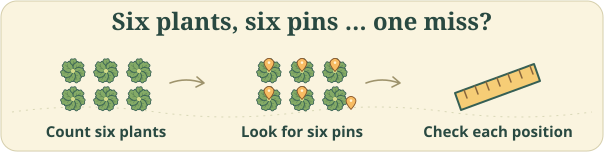
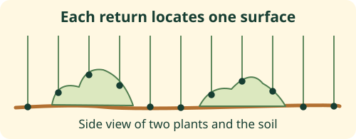
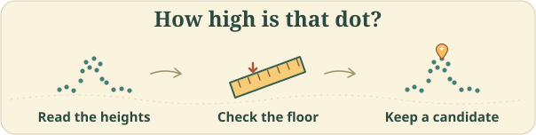
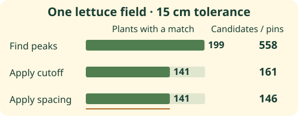
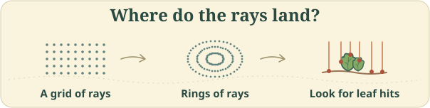
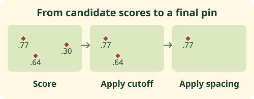
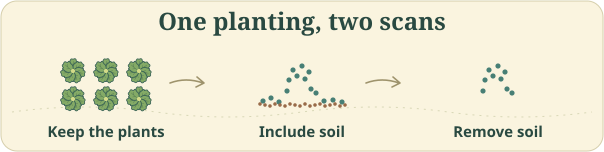

# Counting plants and investigating misses

## Which detector gives a better plant count?

Open **Compare contenders on each planting** in the benchmark and select **Count error · absolute**. A value of 4 means the predicted count differed from the label count by four plants per scan on average. Select **Count error · signed** to see the direction. For a single scan, the Training shed’s field audit shows the final pins, labeled plants, extra pins and misses together. [Try the artichoke count comparison](https://mvalancy.github.io/crop-trainer/benchmark/?comparison=models&crop=artichoke&seed=1551&sensor=mixed&validationSensor=os1-64&validationRayBudget=12000&fieldMetric=meanAbsolute)

We compared logistic and neural CPU models on lettuce, globe artichoke and young tomato at dataset seeds 1521, 1522, 1551 and 1552. Both fits saw identical training examples from six mixed-layout fields and the same three held-out plantings, scanned with and without soil at 12,000 simulated OS1-64 rays. All fits used 40 epochs and a 0.50 cutoff. The higher-F1 model had lower mean absolute count error in 11 of 12 comparisons. The other pair tied on counting error.

| Crop and seed | Model | Mean F1 | Absolute error (plants/scan) | Signed error (plants/scan) |
| --- | --- | ---: | ---: | ---: |
| Lettuce 1551 | Logistic | 0.6263 | 78.50 | +40.50 |
| Lettuce 1551 | Neural | 0.6164 | 79.50 | +38.17 |
| Artichoke 1552 | Logistic | 0.6849 | 4.33 | +3.00 |
| Artichoke 1552 | Neural | 0.6748 | 4.33 | +4.00 |
| Tomato 1521 | Logistic | 0.5125 | 63.00 | −63.00 |
| Tomato 1521 | Neural | 0.3979 | 79.17 | −79.17 |

On artichoke seed 1552, logistic F1 at 7.5, 10 and 15 cm was 0.478, 0.677 and 0.900. Neural F1 was 0.466, 0.662 and 0.897. The separate Node CPU runs took 1,278 / 40 / 26 ms for logistic and 1,078 / 58 / 22 ms for neural to generate, train and validate. These absolute counts depend on field size and synthetic planting density.

The browser CPU and SwiftShader WebGPU neural fits produced identical counts and per-distance scores on both artichoke seeds 1551 and 1552. On seed 1552 they shared 755 ms of generation. CPU training and scoring took 86 and 28 ms, and software WebGPU took 954 and 14 ms. SwiftShader ran on the CPU. Physical GPU and DGX Spark timings require a run on the target hardware.

## Did the scan see the plants the detector missed?

The generator records which plant supplied each surviving crop return. In the 3D viewer, turn on **Label centers** to see gold crosses on plants with zero crop returns. The Training Shed shows the same coverage counts beside the detection stages for each field. A return can land on a leaf far from the center. Conversely, a nearby weed can produce a peak within the scoring distance of a plant that supplied no returns.

We grew three validation fields at each of two dataset seeds, 921 and 922, and scanned each planting at both ray budgets on the simulated OS1-64. The table counts each plant once using soil-present scans. Each crop and seed used the same mixed training fields and fitted weights at both budgets. Matches use the neural detector at 15 cm after 40 CPU epochs and a 0.50 cutoff.

| Crop | Planted | Plants with zero returns, 12k → 60k rays | Plants with 1–4 returns, 12k → 60k | Final matches, 12k → 60k |
| --- | ---: | ---: | ---: | ---: |
| Lettuce | 1,352 | 35 → 21 | 308 → 18 | 1,023 → 1,309 |
| Globe artichoke | 200 | 0 → 0 | 1 → 0 | 168 → 195 |
| Young tomato | 658 | 23 → 15 | 210 → 8 | 343 → 628 |

At 12,000 rays the tomato detector missed 315 plants. At least 292 of those misses had one or more crop returns. The score cutoff reduced matched plants from 580 candidate matches to 345, and spacing reduced that to 343. Coverage describes this synthetic overhead renderer. Pheno4D reports missing surface measurements from occlusion even when its operators scanned individual plants from several views. [Inspect tomato seed 921](https://mvalancy.github.io/crop-trainer/trainer/?crop=tomato&seed=921&sensor=mixed&validationSensor=os1-64&validationRayBudget=12000&engine=cpu) · [Pheno4D measurement study](https://doi.org/10.1371/journal.pone.0256340)

On seed 921 the browser CPU and software WebGPU backends produced the same tomato F1 scores across both soil settings at 12,000 rays. F1 was 0.5606 at 7.5 cm, 0.6655 at 10 cm and 0.7251 at 15 cm. Shared generation took 1,685 ms. CPU training and validation took 134 and 43 ms. SwiftShader training and CPU validation took 1,502 and 10 ms in this run. Physical GPU timing requires a hardware adapter. [Replay the backend comparison](https://mvalancy.github.io/crop-trainer/benchmark/?comparison=backend&crop=tomato&seed=921&sensor=mixed&validationSensor=os1-64&validationRayBudget=12000)

### Locate an individual missed plant

After training, choose **Missed plants** in the field map. Select 7.5, 10 or 15 cm and pick a box to highlight. Red rings show misses with crop returns and dark squares show misses with none. The box number matches the index in the generator’s label download. If a pin lies within range of several labels, several equally large matchings may exist. The overlay shows the assignment used to score that run. [Maximum bipartite matching and non-unique solutions](https://docs.scipy.org/doc/scipy/reference/generated/scipy.sparse.csgraph.maximum_bipartite_matching.html)

How many previously missed plants gain a pin if the score cutoff drops from 0.50 to 0.35? On fresh dataset seeds 1021 and 1022, each pair used the same 40-epoch neural weights, mixed training layouts and 12,000-ray simulated OS1-64 validation scans. These counts cover three soil-present fields per seed at 15 cm. No previously matched boxes lost their match in these six comparisons.

| Crop | Recovered boxes, seed 1021 | Increase in false positives | Recovered boxes, seed 1022 | Increase in false positives |
| --- | ---: | ---: | ---: | ---: |
| Lettuce | 181 | 50 | 85 | 125 |
| Globe artichoke | 16 | 0 | 5 | 0 |
| Young tomato | 59 | 9 | 91 | 17 |

For tomato seed 1021, 54 of the 59 recovered boxes had crop returns. The other five received a pin within 15 cm despite having zero returns from the plant itself. Across both soil settings, F1 at 7.5, 10 and 15 cm rose from 0.245 / 0.279 / 0.297 to 0.414 / 0.469 / 0.505. The 0.50 run took 1,896 ms to generate, 113 ms to train and 32 ms to validate on Node CPU. The 0.35 replay took 1,945 / 99 / 24 ms. [Open the field audit](https://mvalancy.github.io/crop-trainer/trainer/?crop=tomato&seed=1021&sensor=mixed&validationSensor=os1-64&validationRayBudget=12000&engine=cpu) · [Compare the cutoffs](https://mvalancy.github.io/crop-trainer/benchmark/?comparison=cutoffs&crop=tomato&seed=1021&sensor=mixed&validationSensor=os1-64&validationRayBudget=12000)

### Can shorter peaks recover a missed plant?

In Benchmark, choose **Minimum peak height** and run the comparison. A peak is a local high point on the smoothed height map of the simulated laser returns. Lowering the minimum from 6.5 to 3.5 cm lets more locations enter the detector. The **Matched using all peaks** column shows how many labeled plants could receive a distinct pin within 15 cm before the model filters the peaks. Compare it with **Final matches** and **Extra pins**, then answer the question to earn a Peak scout stamp. [Try the sparse tomato benchmark](https://mvalancy.github.io/crop-trainer/benchmark/?comparison=heights&crop=tomato&seed=2021&sensor=mixed&validationSensor=os1-64&validationRayBudget=12000)

Each cell below shows **6.5 cm → 3.5 cm**. Each crop used 12 held-out soil-present synthetic fields, three from each dataset seed (2021, 2022, 2051 and 2052). Each neural fit used six mixed-layout training fields, 40 epochs and a score cutoff of 0.50. Validation used the simulated OS1-64 layout with 12,000 requested rays.

| Crop | Labeled plants | Matched using all peaks | Final matches | Extra pins |
| --- | ---: | ---: | ---: | ---: |
| Lettuce | 2,539 | 1,561 → 2,421 | 817 → 1,350 | 113 → 333 |
| Globe artichoke | 377 | 372 → 372 | 232 → 252 | 30 → 40 |
| Young tomato | 1,238 | 1,043 → 1,167 | 465 → 751 | 21 → 116 |

Of 195 tomato plants with no peak within 15 cm at 6.5 cm, 124 gained a nearby peak at 3.5 cm. Only six of those plants received a final matching pin. Most of the overall gain therefore came from plants that already had a nearby peak at the taller setting. A logistic fit on the same tomato fields also gained matches (517 → 726) and extra pins (27 → 119).

On tomato seed 2021 across both soil settings, neural F1 at 7.5 / 10 / 15 cm rose from 0.4264 / 0.5265 / 0.6326 to 0.4976 / 0.6455 / 0.7920. Generation, training and validation on Node CPU took 753 / 52 / 15 ms at 6.5 cm and 1,058 / 74 / 47 ms at 3.5 cm. These heights describe a filtered scan surface. Measuring physical crop height or scanner performance requires field observations. [Background on local peak detection](https://scikit-image.org/docs/stable/api/skimage.feature.html#skimage.feature.peak_local_max)

### Which plants change when the peak height drops?

A larger match count can hide plants the earlier fit found. In a **Minimum peak height** benchmark, open **Which plants changed match when the peak height dropped?** Choose a scan and matching distance. The table splits its labels into plants found by both fits, those unique to each height, and those missed by both. Pick a plant unique to either height, open it in 3D, then use **Focus plant** to orbit its center. The line above the table totals gains and losses across the six soil-present fields in that run. **Link to this inspection** lets someone rerun the benchmark and reopen your chosen scan, distance and plant. [Replay a lettuce plant found only by the shorter fit](https://mvalancy.github.io/crop-trainer/benchmark/?comparison=heights&crop=lettuce&seed=2121&sensor=mixed&validationSensor=os1-64&validationRayBudget=12000&pairSeed=2122&pairTile=39c12665d375fbb9&pairDistance=7.5&pairBox=1#modelBoxes)

Across seeds 2121, 2122, 2151 and 2152, each crop contributed 12 soil-present held-out fields. Both heights used the same raw scans, six mixed-layout training fields per seed, 40 CPU neural epochs, a 0.50 score cutoff and 12,000 requested validation rays on the simulated OS1-64 layout. At 15 cm the lower height gave the following changes.

| Crop | Newly matched plants | Previously matched plants lost | Net change in matches | Change in extra pins |
| --- | ---: | ---: | ---: | ---: |
| Lettuce | 805 | 90 | +715 | +316 |
| Globe artichoke | 14 | 1 | +13 | +4 |
| Young tomato | 379 | 10 | +369 | +68 |

Lettuce seed 2121 lost 74 plant matches and gained 52. The other three seeds each gained more matches than they lost. The logistic fit on the same tomato fields gained 318 matches, lost 12 and added 73 extra pins. Each change describes the final one-to-one assignment after refitting at the new height. Several nearby pins can compete for a label.

For tomato seed 2121 across both soil settings, neural F1 at 7.5 / 10 / 15 cm changed from 0.3377 / 0.4132 / 0.4557 to 0.4096 / 0.5225 / 0.5747. Node CPU generation, training and validation took 995 / 42 / 21 ms at 6.5 cm and 944 / 113 / 14 ms at 3.5 cm. For research on analyzing the individual errors behind an aggregate detection score, see Bolya and colleagues. [TIDE, ECCV 2020](https://dbolya.com/tide/)

**Does the gain hold on denser scans?** Repeating the same synthetic plantings at 60,000 validation rays reduced the benefit of shorter peaks. At 15 cm the neural tomato fit gained 18 plant matches, lost 9 and added 71 extra pins. At 12,000 rays it had gained 379 and lost 10 with 68 extra pins. On dense lettuce the fits gained 109 and lost 56 (+159 extra pins), and on dense artichoke they gained 2 and lost 5 (+9 extra pins). Each comparison uses the same height-specific training examples at both ray budgets. Use the validation-ray links under the Peak scout question to repeat this check on other seeds. [Replay the dense tomato fields](https://mvalancy.github.io/crop-trainer/benchmark/?comparison=heights&crop=tomato&seed=2121&sensor=mixed&validationSensor=os1-64&validationRayBudget=60000)

#### Repeat the peak-height test at both ray budgets

In the peak-height benchmark, follow **Repeat with 60,000 validation rays** after a 12,000-ray run and run the benchmark again in the same tab. **How well did each fit handle both densities?** shows mean F1 at each requested budget and the lower score for each fit. The JSON download includes these paired values. The comparison uses the same training scans and held-out plantings at both budgets.

On fresh dataset seeds 2221 and 2222, lowering the peak height from 6.5 to 3.5 cm improved sparse-scan neural mean F1 on both seeds for all three crops. At 60,000 validation rays, the lower height reduced mean F1 on both lettuce and both tomato seeds. Artichoke mean F1 rose slightly on both. Each fit used six mixed-layout training fields, three held-out OS1-64 plantings per seed, 40 epochs and a 0.50 detection cutoff. Qi and colleagues found that uneven point density can change the performance of point-cloud networks. This experiment measures that sensitivity for Crop Trainer’s local height features. [PointNet++, 2017](https://arxiv.org/abs/1706.02413)

| Tomato seed | Peak height | Mean F1 at 12k rays | Mean F1 at 60k rays | Lower mean F1 |
| --- | ---: | ---: | ---: | ---: |
| 2221 | 6.5 cm | 0.4935 | 0.8541 | 0.4935 |
| 2221 | 3.5 cm | 0.7409 | 0.7998 | 0.7409 |
| 2222 | 6.5 cm | 0.4668 | 0.8091 | 0.4668 |
| 2222 | 3.5 cm | 0.6026 | 0.7719 | 0.6026 |

For the 3.5 cm tomato fit on seed 2221, F1 at 7.5 / 10 / 15 cm was 0.6187 / 0.7594 / 0.8445 on sparse scans and 0.7378 / 0.8177 / 0.8439 on dense scans. Node CPU generation, training and validation took 671 / 81 / 28 ms and 906 / 78 / 25 ms respectively. Timings describe these runs. [Replay both budgets](https://mvalancy.github.io/crop-trainer/benchmark/?comparison=heights&crop=tomato&seed=2221&sensor=mixed&validationSensor=os1-64&validationRayBudget=12000)

### Could changing the cutoff help this missed plant?

In the Training Shed, run the detector, choose **Missed plants** and highlight a box. The close-up shows the height peaks, peaks that passed the score cutoff and final pins inside its matching circle. If no peak is inside the circle, changing the cutoff alone cannot recover the plant. If all nearby peaks fell below the cutoff, the highest nearby score tells you where at least one would enter the spacing filter. A retained pin may still match a neighboring plant. [Inspect tomato seed 1921](https://mvalancy.github.io/crop-trainer/trainer/?crop=tomato&seed=1921&sensor=mixed&validationSensor=os1-64&validationRayBudget=12000&engine=cpu&missBand=all)

We traced every 15 cm miss at a cutoff of 0.50, then rescored the same weights and scans at 0.35. Each cell gives **misses at 0.50 → boxes matched at 0.35 among those misses**. Each crop used 12 soil-present validation fields across dataset seeds 1921, 1922, 1951 and 1952. Both CPU models used six mixed-layout training fields per seed, 40 epochs and a simulated OS1-64 at 12,000 requested validation rays.

| Crop and model | No nearby peak | All nearby scores below cutoff | Spacing removed all nearby peaks that passed | Nearby final pin assigned elsewhere |
| --- | ---: | ---: | ---: | ---: |
| Lettuce · neural | 123 → 0 | 596 → 396 | 6 → 2 | 2 → 1 |
| Globe artichoke · neural | 11 → 0 | 70 → 28 | 7 → 0 | 0 → 0 |
| Young tomato · neural | 205 → 0 | 404 → 281 | 7 → 3 | 0 → 0 |
| Young tomato · logistic | 205 → 0 | 419 → 282 | 4 → 2 | 0 → 0 |

On tomato seed 1921, F1 across both soil settings at 7.5 / 10 / 15 cm was 0.529 / 0.647 / 0.732 for neural and 0.535 / 0.646 / 0.722 for logistic at 0.50. On Node CPU, shared generation took 912 ms. Neural fitting and validation took 44 and 17 ms, and logistic took 8 and 13 ms. The close-up uses horizontal distances in synthetic scans. For background on analyzing detector errors beyond the aggregate score, see Hoiem and colleagues. [Diagnosing Error in Object Detectors](https://doi.org/10.1007/978-3-642-33712-3_25)

### Which crops gain a match when the cutoff drops?

Run **Detection score cutoffs** in Benchmark and expand **What changes from the 0.50 cutoff?** The first table covers both soil settings. The return-count table uses the soil-present scan of each planting. Read across a row to see how many plants matched at each cutoff, then check the extra pins in the bottom row. [Try the tomato benchmark at 15 cm](https://mvalancy.github.io/crop-trainer/benchmark/?comparison=cutoffs&crop=tomato&seed=1821&sensor=mixed&validationSensor=os1-64&validationRayBudget=12000&cutoffDistance=15)

On dataset seeds 1821, 1822, 1851 and 1852, each CPU fit used 40 epochs, mixed training layouts and three held-out plantings scanned at 12,000 requested rays with the simulated OS1-64. Each crop below pools 12 soil-present scans. Counts show the change in the number matched at 15 cm when moving from 0.50 to 0.35.

| Crop and model | 1–4 returns | 5 or more returns | Change in extra pins |
| --- | ---: | ---: | ---: |
| Lettuce · neural | +267 of 873 plants | +278 of 1,799 | +348 |
| Globe artichoke · neural | 0 of 7 plants | +40 of 391 | +8 |
| Young tomato · neural | +152 of 521 plants | +169 of 749 | +55 |
| Young tomato · logistic | +126 of 521 plants | +156 of 749 | +62 |

The neural tomato detector gained 63, 30, 19 and 40 net matches in the one-to-four-return group on the four dataset seeds, respectively. On seed 1821 its F1 across both soil settings rose from 0.387 / 0.475 / 0.516 to 0.548 / 0.710 / 0.797 at 7.5 / 10 / 15 cm. Generation and fitting took 1,030 ms and 44 ms on Node CPU. Scoring took 10 ms at 0.50 and 16 ms at 0.35. Choosing a cutoff changes the tradeoff between false positives and missed detections. Use fresh plantings to evaluate a choice made on these synthetic fields. [Decision threshold guide](https://scikit-learn.org/stable/modules/classification_threshold.html)

### Does the detector miss plants that have several returns?

In the Training Shed, select **Missed plants** and filter **Crop returns per plant**. The map shows how many plants the detector missed out of all plants in the selected group. Pick a box, open it in 3D and choose **Focus plant** to orbit it up close. With the canvas focused, **F** centers the highlighted plant and **R** returns to the whole field. [Inspect a young tomato field](https://mvalancy.github.io/crop-trainer/trainer/?crop=tomato&seed=1721&sensor=mixed&validationSensor=os1-64&validationRayBudget=12000&engine=cpu&missBand=fiveOrMore)

Each cell below gives missed plants / labeled plants at 15 cm. Both CPU models used the same fields, mixed training layouts, 40 epochs and a 0.50 score cutoff. Dataset seeds 1721, 1722, 1751 and 1752 each supplied six training and three validation plantings per crop. Each held-out planting appears once here, scanned with soil present on the simulated OS1-64 layout at 12,000 requested rays.

| Crop | Detector | 0 crop returns | 1–4 returns | 5 or more returns |
| --- | --- | ---: | ---: | ---: |
| Lettuce | Logistic | 50 / 72 | 430 / 564 | 625 / 2,084 |
| Lettuce | Neural | 47 / 72 | 440 / 564 | 662 / 2,084 |
| Globe artichoke | Logistic | No plants | 5 / 6 | 126 / 386 |
| Globe artichoke | Neural | No plants | 5 / 6 | 111 / 386 |
| Young tomato | Logistic | 51 / 54 | 349 / 403 | 349 / 862 |
| Young tomato | Neural | 53 / 54 | 377 / 403 | 428 / 862 |

The neural model missed 93.5% of young tomatoes with one to four returns and 49.7% of those with five or more. The better-covered group still accounted for more missed plants because it was larger. Only six globe artichokes fell in the one-to-four group. These counts describe the simulated plantings. A leaf can produce several returns far from its plant center.

On tomato seed 1721, across both soil settings, logistic F1 was 0.511, 0.649 and 0.704 at 7.5, 10 and 15 cm. Neural F1 was 0.481, 0.598 and 0.636. Node CPU generation, training and validation took 2,235 / 49 / 45 ms for logistic and 2,398 / 61 / 24 ms for neural. The nuScenes detection evaluator excludes ground-truth boxes with zero LiDAR and radar points. Crop Trainer keeps every planted label and counts returns by which synthetic plant supplied them. The choice of denominator matters when interpreting recall. [Replay both models](https://mvalancy.github.io/crop-trainer/benchmark/?comparison=models&crop=tomato&seed=1721&sensor=mixed&validationSensor=os1-64&validationRayBudget=12000) · [nuScenes detection evaluation](https://github.com/nutonomy/nuscenes-devkit/blob/master/python-sdk/nuscenes/eval/detection/README.md)

### Which model finds plants in a sparse scan?

With 12,000 requested rays on the simulated OS1-32 layout, the neural model scored higher than logistic on each of two dataset seeds for all three crops. Both saw identical examples and held-out scans, with six mixed-layout training fields, three validation plantings per seed, 40 CPU epochs and a 0.50 cutoff. Each cell gives mean F1 for logistic → neural. [Replay the sparse model benchmark](https://mvalancy.github.io/crop-trainer/benchmark/?comparison=models&crop=tomato&seed=821&sensor=mixed&validationSensor=os1-32&validationRayBudget=12000)

| Dataset seed | Lettuce | Globe artichoke | Young tomato |
| ---: | ---: | ---: | ---: |
| 821 | 0.549 → 0.599 | 0.667 → 0.701 | 0.450 → 0.481 |
| 822 | 0.461 → 0.518 | 0.584 → 0.692 | 0.240 → 0.248 |

Tomato seed 822 illustrates a failure that the model average hides. On field 854812180 with soil, candidate peaks matched 81 of 116 plants within 15 cm. Only ten still had a match after the score cutoff. Across all six scans, lowering the cutoff to 0.35 recovered 83 matches at 15 cm with zero extra pins at that distance. At 7.5 cm, extra pins rose from 12 to 35. The looser cutoff also improved mean F1 on seeds 821, 851 and 852, where it added 52, 31 and 43 extra pins at 15 cm. [Inspect the planting](https://mvalancy.github.io/crop-trainer/?crop=tomato&sensor=os1-32&seed=854812180&budget=12000&ground=true&tile=e3a36b5c8e54f55d#field) · [Run the cutoff comparison](https://mvalancy.github.io/crop-trainer/benchmark/?comparison=cutoffs&crop=tomato&seed=822&sensor=mixed&validationSensor=os1-32&validationRayBudget=12000)

| Tomato seed 822, Node CPU | Generation | Training | Validation | F1 at 7.5 cm | F1 at 10 cm | F1 at 15 cm |
| --- | ---: | ---: | ---: | ---: | ---: | ---: |
| Logistic | 1,390 ms | 36 ms | 24 ms | 0.2234 | 0.2465 | 0.2490 |
| Neural | 1,443 ms | 65 ms | 16 ms | 0.2296 | 0.2551 | 0.2602 |

### Does removing soil help the detector?

In the Training Shed, run a field and open **Compare scans with and without soil**. Choose recall to see how many plants were found, or precision to see how many pins landed on a plant. In the field audit, **Switch soil setting for this field** shows the other scan at the same detector stage.

On four fresh seeds (307, 308, 337 and 338), removing soil increased lettuce recall at 15 cm by 2.5 to 15.1 percentage points. Each run used mixed layouts, six training fields, three held-out plantings and 40 neural epochs. On artichoke seed 308, removing soil recovered four more plants (77 of 95 versus 73 of 95) and produced 50 additional false positives (54 versus 4). Precision fell from 94.8% to 58.8%. The generator knows which points are soil. A real ground filter must estimate that from measurements and can discard crop returns. [Repeat the artichoke experiment](https://mvalancy.github.io/crop-trainer/trainer/?crop=artichoke&seed=308) · [Zhang et al., cloth simulation for airborne LiDAR filtering](https://doi.org/10.3390/rs8060501)

#### Does soil removal improve the plant count?

Choose **Plant count · absolute error** in the Training Shed’s soil comparison. Each row compares final pin counts against the same planting’s labels with soil present and removed. Select a field seed, then use **View without soil** or **View with soil** in the 3D viewer. The camera and highlighted plant stay in place. The scan link, PLY, labels and recipe follow the displayed version. [Replay the lettuce count comparison](https://mvalancy.github.io/crop-trainer/trainer/?crop=lettuce&seed=1652&sensor=mixed&validationSensor=os1-64&validationRayBudget=12000&engine=cpu&soilMetric=meanAbsolute)

With simulated OS1-64 validation scans at 12,000 rays, removing soil reduced mean absolute counting error in 19 of 24 comparisons. Each crop used four dataset seeds (1621, 1622, 1651 and 1652), six mixed-layout training fields, three held-out plantings per seed, and both logistic and neural CPU fits at 40 epochs and cutoff 0.50. Each fit scored both soil variants. The two models share the same fields, so each crop contributes 12 distinct validation plantings.

| Crop | Comparisons with lower count error after soil removal | Comparisons with higher error |
| --- | ---: | ---: |
| Lettuce | 5 | 3 |
| Globe artichoke | 6 | 2 |
| Young tomato | 8 | 0 |

On lettuce seed 1652, neural counting error rose from **35.3 to 92.3 plants per scan**. In the first planting, removing soil recovered 17 additional matches at 15 cm and added 50 extra pins. F1 across the three plantings at 7.5, 10 and 15 cm was 0.573, 0.697 and 0.767 with soil, and 0.574, 0.709 and 0.763 without soil. The CPU run spent 2,955 ms generating, 100 ms fitting and 71 ms validating both variants. The simulator drops points with known soil labels. A field scanner would need an estimated ground surface. [Inspect this planting](https://mvalancy.github.io/crop-trainer/?crop=lettuce&sensor=os1-64&budget=12000&seed=3334967749&ground=true&tile=643c5ba37dabe474#field)

[Back to the field guide](README.md)
