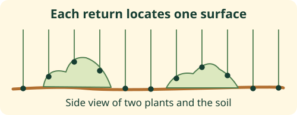
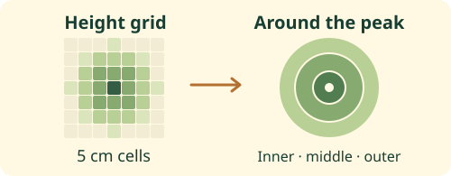

# How does a browser learn to spot lettuce?

Imagine walking a row with a clipboard. Someone hands you a map covered in dots and asks you to put one pin on each lettuce. Where would you look? What would you count as a good guess? Crop Trainer lets you do that by hand, then train a detector to place its own pins on fresh fields. You choose the crop. The detector’s job is to locate its plants.

**Try the field lesson first.** In **Scan a row**, switch from 7 rays to 28 and watch the small seedling. In **Place a pin**, guess a plant’s center from the dots and check the distance. In **Train a model**, predict what will happen to the weed’s score when you teach the model about a plant of the same height. [Open the hands-on field lesson](https://mvalancy.github.io/crop-trainer/#guide)

| Question | What you’ll do |
| --- | --- |
| **1 · What can a scanner see?** | Explore a 3D scan and find the same example plant used throughout the tour. |
| [2 · What is a model?](models.md) | Follow one peak through a weighted sum and a neural network. |
| [3 · How does it learn?](learning.md) | Give the model an answer key for practice, then set a field aside. |
| [4 · Was the pin any good?](scoring.md) | Count good pins, extra pins and missed plants yourself. |
| [5 · Would it work on a farm?](fieldwork.md) | Compare a synthetic lettuce plot with a real vineyard trial. |

You can do the whole tour in a browser. Each chapter has a small experiment, and the pictures also make sense as stills.

## What can a scanner see?

A LiDAR instrument sends out light and times its return. With the direction of the beam and that distance, it can place a dot in space. A **point cloud** is a collection of those dots. Each has three coordinates. On our level plot, X and Y tell you where to walk and Z tells you how high the surface was. A return can come from a leaf, the soil, or a board across the row.

The browser makes a pretend field from a **seed**, a number you can share to grow the same layout again. Its projected scanner samples the top surface at a series of XY positions. A leaf between sample positions can be missed entirely. Rotating the viewer lets you see the recorded heights from the side. Getting new measurements would require another scan.

**Try it.** Open the lettuce field below, turn off **Label centers** and set **Color by** to **Elevation**. The default return-class colors tell you which surface the generator sampled. Elevation gives you a height clue you could also get from the XYZ scan. Pick a cluster of dots you think belongs to a plant. Orbit the field and turn the labels back on. Did you pick the center, the edge of a leaf, or something between two plants? The planting labels are the answer key. The detector only receives the scan coordinates. [Explore seed 27 in the field generator](https://mvalancy.github.io/crop-trainer/?crop=lettuce&seed=27#field)

## How does a pile of dots become a possible plant?

The app divides a 10 m square into 5 cm cells. It keeps the highest return in each cell and smooths nearby heights so a single sharp spike has less influence. A local high point above a minimum height becomes a **candidate**. That word matters. A stick can qualify, and a small lettuce with no peak can disappear at this first step.

**Follow one simulated lettuce.** The starter CPU run used dataset seed 27. One of its held-out fields was planting 627223796. Near the lettuce marked **Box 3**, the highest return in the candidate’s cell was 17.3 cm. Its smoothed peak was 14.6 cm. The average cell heights in the inner, middle and outer bands were 14.1, 4.4 and 2.8 cm. The center rises above its surroundings. That gives the model evidence, even if a weed could make a similar shape. To see this plant, open its scan and choose **Focus plant**. [Inspect Box 3 in the 3D viewer](https://mvalancy.github.io/crop-trainer/?crop=lettuce&seed=627223796&sensor=even-sweep&ground=true&tile=1947da1f756d90e1&box=3#scan-viewer)

These measurements are **features**. The app collects 13 per peak, including how many surrounding cells contain returns and how unevenly the heights spread across the two horizontal directions. The model gets those 13 numbers for each candidate. The app keeps the candidate’s XY coordinates separately so it can draw a pin there later.

**Think it through.** A tall board and a lettuce have the same center height. Which other measurement could distinguish them? A flat board might keep the outer cells high. A lettuce like ours falls away toward the edges. A measurement can help without being a foolproof rule.

[Next · How does a model use those numbers?](models.md) · [Field guide](../README.md)
