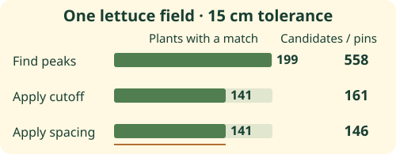
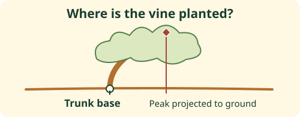

# Would it work on my farm?

Start with a missed lettuce. Did the scanner get any points on it? Did those points make a peak? Did the model reject that peak? Did a neighboring pin take its place? Each answer suggests a different experiment.

This is the same seed-27 validation tile from the scoring lesson. At 15 cm, all 199 plants could be matched to distinct initial peaks, although there were 558 peaks altogether. After the score cutoff, 161 candidates remained and 141 plants could still be matched. Spacing reduced the candidates to 146 pins while preserving the matched **count**. Here, inspecting the model scores or changing the cutoff makes sense. On another tile the first stage might already have lost most plants. A classifier can only rank the peaks it receives.

**Try it in the shed.** Use the starter setup below and select **Generate, train & score**. In **Where centers disappear**, choose field 627223796 with soil. Compare the three stage rows, then switch to the soil-removed scan of the same planting. The measured example used the CPU, mixed scan layouts, six training fields, three validation fields, 40 epochs and the default four-unit neural model. The dataset seed is 27. [Replay the lettuce fit](https://mvalancy.github.io/crop-trainer/trainer/?crop=lettuce&seed=27&sensor=mixed&engine=cpu&minimumHeight=0.035)

## A real vineyard asks a harder question

Imagine surveying the base of a vine whose leaves lean across a wire. A real laser scan can give you a strong peak over those leaves, well away from the trunk. Changing from simulated overhead plant surfaces to physical scans also changes density, coverage and the effects of ground slope. A change in the kinds of examples a detector sees is called **distribution shift**.

We tested a different model trained on synthetic vines on one physical strip with **18 surveyed trunks**. Its 21 final pins sound close as a count, yet just **one** landed within 15 cm. Picking tall peaks with the same spacing rule matched **two**. The plant sketch is a possible explanation to investigate. The measured result establishes how many matched on this strip. Learning why requires inspecting the points, reference locations and ground alignment. [Field data, credit and reproducible vineyard test](../field-datasets.md#replay-the-vineyard-test)

## Take a detector out of the lesson

1. After a fit, choose **Download model weights**. This saves the learned calculation, input scaling and detection settings. **Download run settings** saves the instructions for fitting again.
2. Try **Field test** with the examples beside the file pickers. Choose the example weights, the lettuce scan (PLY) and its answer key (CSV or JSON), then press **Find plants**. Which pins move when you switch to the height-only rule? Try again with your own fitted weights and a fresh scan from the generator. [Open Field test](https://mvalancy.github.io/crop-trainer/trainer/#field-test)
3. For a real evaluation, choose a new physical plot with a measured ground reference and a location for every target plant. Reserve independent rows or sites for the final test before adjusting settings. If you have only the scan, you can inspect the pins. Measuring recall also requires knowing which plants were missed. [Prepare your own survey](../training.md#test-a-plot-of-your-own) · [Plan a field validation](../field-validation.md)

Curious how other teams did? [Explore the research on real plants](../research-evidence.md). Ready to try a plot? [Take the detector to a Raspberry Pi or Jetson](../edge-deployment.md).

[Back · Scoring the pins](scoring.md) · [Explore the full field guide](../README.md)
