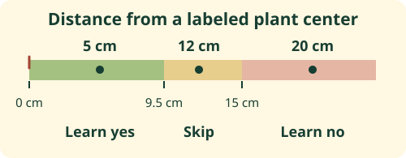
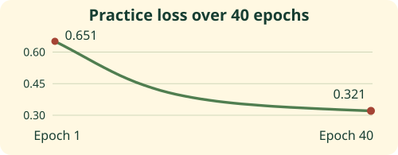

# How does the model learn from a mistake?

Suppose a peak receives a low score and the planting map puts it right on a lettuce. During practice the model can compare its answer with a **label**, the answer we want it to learn. Which peaks should count as practice examples in the first place?

For every practice peak, the app finds the nearest labeled center. Under 9.5 cm away earns a positive label (1). Over 15 cm earns a negative label (0). It skips the distances in between, including the two boundaries. That avoids teaching a firm answer from a borderline peak. It draws equal numbers of positive and negative examples and uses the training examples to set each feature’s average and scale.

## One update, then another

Teach the model that one lettuce is a crop. Watch the height dial turn, then see what score the model gives a weed of the same height. Use **Replay update** to follow the signal a second time. [Play the illustrated lesson](https://mvalancy.github.io/crop-trainer/#learnWeight)

The model makes a score using its current weights. **Loss** measures how much those scores disagree with the practice labels. For a positive example, giving 0.10 incurs more loss than giving 0.80. A confidently wrong answer costs more than a close call. The app averages this penalty over a group of examples.

To update a weight, the trainer works out which direction would reduce the loss nearby. In a neural network it traces the influence of the output backward through the layers, a calculation called **backpropagation**. The **learning rate** controls the size of the step. A very small step can be slow. A very large one can overshoot. The next set of predictions uses the updated weights.

Work through one weight update with a pencil

Imagine a one-clue logistic model, with its bias held at zero for this exercise. The clue has value 1, its starting weight is 0, and the label says “yes” (1). The weighted total starts at 0, so the sigmoid gives a score of 0.50.

For this model and loss, the slope for that weight is **(score − label) × clue**. Here that is (0.50 − 1) × 1 = −0.50. With a learning rate of 0.25, subtract the scaled slope from the old weight. The new weight is 0 − 0.25 × (−0.50) = **0.125**. The next score for this clue rises to about **0.531**. The field lesson starts with the same clue and uses a learning rate of 1. Its weight moves to 0.50 in one step and the score reaches 0.62. The weed gets exactly the same score because it has the same input.

What would a “no” label do at the same starting point? The slope becomes +0.50, the weight falls to −0.125, and the score drops to about 0.469. In the shed, many examples contribute to each update, and the biases can move too.

An **epoch** is one pass through the practice examples. The recorded seed-27 Quick check used 3,052 balanced candidates, six practice fields and 40 epochs. With full-batch updates, all candidates contribute to one update per epoch. Mini-batches update the weights several times during the pass. The starter chart records loss just before each full-batch update. With mini-batches, each batch contributes its loss just before its own update. Final validation uses the weights after the last update.

## Give the detector a fair exam

A **validation field** is an unseen planting kept out of fitting. The app holds out whole field seeds, since two scans of the same row can show the same lettuce. The starter uses three validation fields, each scanned with soil and with soil removed. Those six scans represent three plantings. Compare the pins with the hidden centers to find out whether a lower practice loss also helped on these plantings. If you use their scores to choose an epoch count or a cutoff, save that choice and try it once on new field seeds. That gives you a fresh test of the choice you made.

**Try it.** Run the duration benchmark. For the same seed, compare 10, 40 and 100 epochs. Find the lowest practice loss, then find the highest mean validation F1 (the pin score explained next). Do they belong to the same run? Keep the crop and fields fixed while testing duration. In Training Shed you can move the loss-chart slider to see how often the model has revisited its examples. CPU and WebGPU are two ways your browser can do the arithmetic. The backend, runtime and validation results are separate entries in the report. [Compare training durations](https://mvalancy.github.io/crop-trainer/benchmark/?comparison=epochs&crop=lettuce&seed=27)

[Back · What a model calculates](models.md) · [Next · How do you score its pins?](scoring.md)
