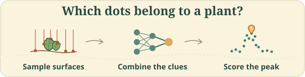
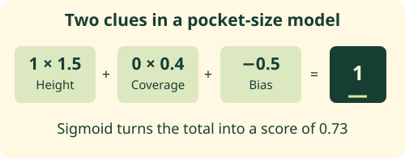
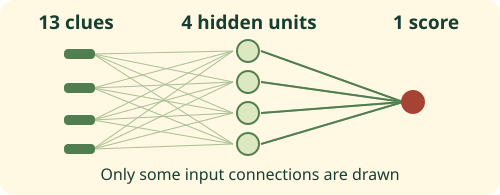

# What is a model?

A model here is a calculation with adjustable numbers. Give it the 13 measurements around one peak and it returns a score between 0 and 1. Training chooses the adjustable numbers. Using those numbers later on another scan is called **inference**. For the crop you selected, it estimates how strongly each peak resembles a plant center.

## A model you can calculate by hand

Imagine using just two clues, height above the surrounding cells and the fraction of nearby cells filled with returns. Put each on a scale measured relative to the training examples. Now “1” means one typical unit of variation above the training average, and “0” means average. This lets the model combine measurements originally expressed in different units.

You can inspect this calculation on a real model from the sandbox. A 9.50 cm tomato-scan peak is below the training average for both saved detectors. See how far below when you choose a different set of weights. [Try the illustrated feature-scaling lesson](../tomato-feature-scaling.md#try-it-with-one-peak)

In this **invented two-clue example**, the first clue is 1 and its weight is 1.5. The second clue is 0 and its weight is 0.4. Add a starting offset, called the **bias**, of −0.5. The total is 1 × 1.5 + 0 × 0.4 − 0.5 = **1**. A smooth S-shaped function called the **sigmoid** converts that total into a score of about **0.73**. A total of zero would give 0.50.

A **weight** determines how much its input pushes the total up or down. A positive weight increases the total as that clue grows, holding other clues fixed. A negative weight decreases it. Logistic regression, one of the two model families in the shed, does this with all 13 clues. Its 13 weights plus one bias give it 14 adjustable numbers.

## What changes inside a neural network?

A hidden **unit** makes its own weighted sum, adds a bias, and applies a bend in the calculation called an **activation**. Several units looking at the same clues can learn different combinations. The next layer mixes their outputs. This can express patterns where a clue matters more in one kind of neighborhood than another. The units acquire their roles during training.

The starter has one **hidden layer** of four units. Each gets 13 weights and a bias. The output gets four weights and a bias. That makes **61 adjustable numbers**. Its hidden activation is tanh, which squeezes values between −1 and 1. You can also try ReLU, which passes positive values and turns negative ones into zero. A larger network can express more combinations, including ones peculiar to the practice fields.

For the lettuce from chapter one, the trained starter combined the measurements into a score of **0.772**. The cutoff was 0.50, so the peak advanced. A score of 0.772 ranks this candidate above one scoring 0.60. To claim that 77.2% of similar pins land on real plants would require checking that claim against labeled fields.

**Try it.** In the shed, use **Model family** to switch between **Logistic regression** and **Dense neural network**. With the neural network selected, open **Design the model** and change **Number of hidden layers** to two. Watch which connections appear. Before fitting either shape, can you tell which will do better? You need results on fresh fields to answer that. [Open the training shed](https://mvalancy.github.io/crop-trainer/trainer/) · [Run a paired model comparison](https://mvalancy.github.io/crop-trainer/benchmark/?comparison=models&crop=lettuce&seed=27)

[Back · Reading a scan](README.md) · [Next · How does training choose the weights?](learning.md)
