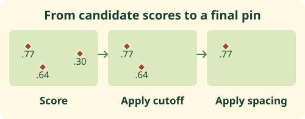

# Was the pin any good?

Our lettuce scored 0.772 and passed the 0.50 **cutoff**. Other peaks can pass too. Suppose two leaves on one plant both look convincing. Counting both would turn one lettuce into two. The app considers higher-scoring peaks first and suppresses a nearby duplicate using a minimum spacing for the chosen crop.

A cutoff is a score. A matching tolerance is a distance. After pin selection, the app checks how close the final pins are to labeled centers in the horizontal plane. Our example pin was **4.46 cm** from its assigned lettuce, close enough at each of the app’s three tolerances (7.5, 10 and 15 cm). The reference is used to grade that pin after prediction.

## Score a tiny harvest yourself

In this sketch, each circle is a labeled plant and each diamond is a final pin. A pin inside the matching distance can pair with one plant. Each plant can receive at most one match.

**How many did the detector get right?** Two matches, one extra pin, and two missed plants. The extra pin counts against the detector even though its total of three is close to the true count of four.

| Measure | Question | In the sketch |
| --- | --- | --- |
| Precision | Of all the pins, how many matched a plant? | 2 out of 3, or 67% |
| Recall | Of all the plants, how many got a matching pin? | 2 out of 4, or 50% |
| F1 | How well did it do on both together? | Twice the matches divided by twice the matches plus extras and misses, or 4/7 ≈ 57% |

The app pools matches, extras and misses across the validation scans at each distance. It calculates F1 three times, then averages those values for **mean F1**. Widening the matching distance can admit a less accurately located pin. The pin positions themselves stay fixed.

## Read one real validation tile

For the soil-present seed **627223796** in the starter CPU run, the detector placed **146 pins** among **199 labeled lettuces**. At 7.5 cm, 136 matched. At 10 cm, 141 matched. At 15 cm, the same 141 matched, leaving five extras and 58 misses. The extra 5 cm of tolerance rescued no more plants on this particular tile.

**Try it.** Run the cutoff comparison. Choose one seed, find two rows with different score cutoffs, then read the extra and missed pins at the **same** distance. Which would you choose if a grower had to visit every pin? Would you make the same choice if the priority were visiting every plant? [Compare cutoffs on the same fields](https://mvalancy.github.io/crop-trainer/benchmark/?comparison=cutoffs&crop=lettuce&seed=27)

[Back · Learning from examples](learning.md) · [Next · Would it work on a farm?](fieldwork.md)
