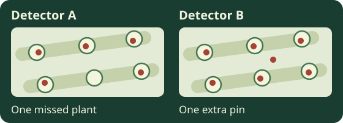
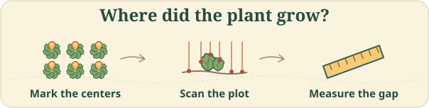
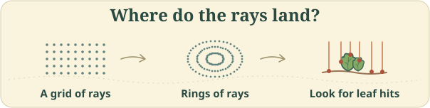
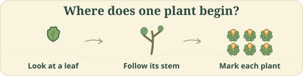

# What can a browser trainer learn from agricultural technology teams?

Crop Trainer knows which crop you planted. It searches an overhead height map for peaks, measures 13 clues around each peak, and learns whether to keep a pin there. A commercial camera system may have to recognize both crop and weeds in the same image, distinguish touching plants and make a decision as the machine moves. The right experiment depends on that job.

## Three gaps worth testing first

| Priority | What teams have demonstrated | What is missing here | A comparison that would answer a question |
| --- | --- | --- | --- |
| **1 · Real labels across fields and growth stages** | A Blue River Technology coauthored study trained crop/weed models with different mixes of rendered and real soybean images. Carbon Robotics describes asking operators for local field photos. | The shed fits on simulated labels. A physical PLY and surveyed centers can evaluate saved weights. There is no workflow for training on several labeled physical plots, or reserving a farm, date or variety as a group. | Give all contenders the same real training plots and freeze a separate farm or acquisition date for testing. Compare real-only, synthetic-only and synthetic plus real. Record results by plant size, weed pressure and site. |
| **2 · Models that see more than a height peak** | The soybean team compared a convolutional segmentation network and a transformer. Bosch researchers combined a random forest with neighboring predictions in a carrot field. | Our logistic regression and dense networks score the same candidate peaks. They cannot put a pin where no peak was proposed. Weed-looking clutter is a negative example, with no separate output for weed species or crop masks. | Try a model that predicts a center probability for every cell in a height-and-occupancy image. Compare it with the current height rule and learned detector on identical scans. Measure recovery of plants missed by the proposal stage, extra pins and time per plot. |
| **3 · Optimization and the cost of a wrong decision** | Blue River’s vision lead reported comparing Adam with momentum SGD on crop segmentation. Ecorobotix exposes plant size and a crop-protection zone to operators. | The shed exposes layer width, activation, learning rate, SGD or momentum, batch size, seed, run length and score cutoff. Missing experiments include Adam, a learning-rate schedule, validation-based checkpoint selection, and measuring errors near valuable plants. | First compare optimizers with the same architecture, initialization seeds, labeled fields and update budget. Tune each learning rate on development plots. Then freeze weights and choose a cutoff using an explicit cost for a miss or an extra pin. Score once on reserved plots. |

Training Shed users can change the cutoff and choose between the two supported peak floors. Minimum pin spacing comes from the crop profile. A model’s score cutoff, the distance between retained pins and an operator’s protection zone each answer a different question.

## What the sources actually tested

**Synthetic data and real labels.** Cieslak and colleagues procedurally varied soybean and weed geometry, growth and scene appearance. With SegFormer, weed-mask intersection-over-union on real field photos was **0.059** with 12,000 rendered training images, **0.352** with 12,000 real images, and **0.367** with 12,000 real plus 12,000 rendered. The last comparison holds the real labels fixed and increases the total training set. This is RGB segmentation research coauthored by Blue River Technology. See & Spray’s public product page describes real-time plant-level decisions. Its current production model and training schedule are separate questions. [Cieslak et al., CVPR Workshops 2024, Table 1](https://openaccess.thecvf.com/content/CVPR2024W/Vision4Ag/papers/Cieslak_Generating_Diverse_Agricultural_Data_for_Vision-Based_Farming_Applications_CVPRW_2024_paper.pdf) · [Blue River product description](https://www.bluerivertechnology.com/products/)

**Context and optimizer choice.** Bosch’s carrot-field study used a 100-tree random forest with local shape features. Adding spatial smoothing increased macro F-score from 86.6% to 90.2% in leave-one-image-out testing. Holding out an entire farm is a harder test. Separately, Blue River’s Chris Padwick reported that Adam gave a slightly higher mean crop-class F1 and a tighter spread than the momentum settings tested on his team’s segmentation task. Those results motivate experiments with row context and optimization. They do not establish which method will win on XYZ data. [Haug et al., WACV 2014, Table 4](https://www.cse.unr.edu/~bebis/CS479/PaperPresentations/PlantClassificationWACV2014.pdf) · [Padwick’s engineering account, 2020](https://medium.com/pytorch/ai-for-ag-production-machine-learning-for-agriculture-e8cfdb9849a1) · [Optimizer comparison](https://forge.coreweave.com/wandb/blueriver/blog-post/reports/AI-For-AG-Production-ML-for-Agriculture-Using-Weights-Biases--VmlldzoxNTA1MDg)

**Adapting to a specific field.** Carbon Robotics says a grower can select two or three photos for a local Plant Profile. The company leaves the adaptation algorithm unspecified. The Ecorobotix ARA operator manual documents a crop-protection zone and target-size filtering. Avent and colleagues measured how often marked weeds of different sizes were actually treated at three sensitivity settings on Blue River research equipment across five states. A camera’s confidence, a physical treatment and a correctly localized crop are three distinct outcomes. Crop Trainer can measure the last one using a survey. [Carbon Robotics Plant Profiles](https://carbonrobotics.com/carbon-ai) · [Ecorobotix operator manual](https://help.ecorobotix.com/en/ara/user-manual/620_s_g2-ts4-2/surface-treatment) · [Avent et al., Weed Technology, 2025](https://doi.org/10.1017/wet.2025.36)

## Which variations belong in a LiDAR simulator?

Today's generator already varies crop radius and spacing, weeds, sticks, boards, terrain, scan layout, ray budget, coordinate noise and missing returns. Both soil variants of a planting stay in the same data split. Changing a seed gives you another sample of those assumptions.

For a physical pilot, record the cultivar and growth stage, canopy overlap, weed type and density, row gaps, scanner height and tilt, travel direction, and any repeated views of the same plants. These observations can guide new simulation settings. A smaller procedural radius is a size test. A growth-stage model needs measurements of changes in leaf shape, posture and overlap too. For XYZ-only models, variation in viewing angle and occlusion changes what geometry reaches the detector. Brightness or color augmentation belongs to an image pipeline. Real multi-pass LiDAR would also need pose, timestamps and registration before combining returns.

[What published crop studies measured](research-evidence.md) · [Design a field trial](field-validation.md) · [Training controls and timing](training.md)

## One growth-size experiment you can repeat

How much can training variation help with a smaller plant? On 16 held-out synthetic lettuce plantings (3,536 targets), we scaled the original v1 canopy radius to 60% while keeping each pair's ray XY locations fixed. At 15 cm, candidate coverage fell from 96.9% to 86.2%. A network can only select from the candidates it receives.

On the smaller plants, three networks trained at the nominal size had final recall of **8.2%, 12.8% and 10.1%**. Replacing half the training plantings with the smaller size raised recall to **41.9%, 28.3% and 33.1%** on exactly the same holdouts. This isolates size sensitivity in the original generator. Smaller real lettuces also change leaf arrangement and stage, which calls for labeled physical plots. To reproduce all three training seeds and all matching distances, run `node benchmark/studies/canopy-size.mjs`. [Experiment implementation](../benchmark/studies/canopy-size.mjs) · [Structured plant forms and damage](crop-architecture.md)
