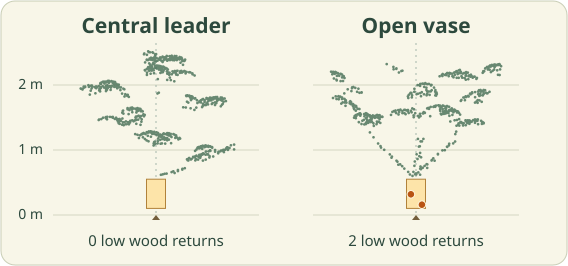

# Can a scan locate the base of an apple tree?



Stand at the foot of a tree and its base is easy to define. The highest branch can be well off to one side. A detector that pins that branch can get the tree count right and miss the surveyed location. Crop Trainer’s apple target is the horizontal position where the tree was planted. A pin must fall close enough to that position to count as a match. [Apple generator and reference photographs](../trainer/plants/apple.md)

## How much of the low trunk did the scanner see?

The figure shows the third tree from synthetic plot `876019`, rendered with two healthy, leafy tree shapes and 60,000 overhead reference rays. Each panel projects crop returns within 90 cm horizontally of the same base onto a side view. The height reference is the bottom of that tree’s modeled bounding box. The shaded strip marks the height and horizontal extent of the search below. The calculation also limits distance along the depth axis that disappears in this projection.

We counted how many trees had **at least one woody return** within 10 cm horizontally of the labeled base and 10–55 cm above the box bottom. This diagnostic uses the simulator’s wood labels to check visibility. A scanner in a physical orchard would need its own way to distinguish a stem from a stake or a weed.

| Rays per 10 m × 10 m plot | Leafy central leader | Dormant central leader | Leafy open vase | Dormant open vase |
| --- | ---: | ---: | ---: | ---: |
| 12,000 | 3 / 38 | 7 / 38 | 9 / 38 | 9 / 38 |
| 60,000 | 10 / 38 | 15 / 38 | 26 / 38 | 26 / 38 |

The comparisons use the same 38 planting positions across three seeds, `876019`, `876137` and `876437`. Ground was present. Added weeds, sticks, boards and scan noise were disabled. At 60,000 rays the leafy open-vase plots had more direct evidence near the low trunk, but 12 bases still had none. A visible crown gives a detector another cue. A guess from the crown still needs an independent base label to establish its accuracy.

Run `node benchmark/studies/orchard-visibility.mjs` from the repository root for the table totals and the number of nearby woody returns at each planting position. [Visibility experiment](../benchmark/studies/orchard-visibility.mjs)

## How the detectors place a pin

The height-only detector ranks high spots on a smoothed height map. The starter network scores those candidate peaks using 13 features. Both approaches filter nearby pins. An apple tree can have several high spots, each over a different branch. To see how far a crown peak can be from the planted base, follow one dormant tree from its side view to its top view. [Read the illustrated apple example](../trainer/plants/apple.md#what-does-a-dot-above-the-tree-tell-you) · [How the network works](training.md)

The geometric challenger reads metric XYZ in a ground-referenced 10 m square. It marks occupied 5 cm cells in five height bands starting at 0.48, 0.78, 1.12, 1.55 and 2.04 m. A candidate gets support from several heights nearby and from canopy on multiple sides. Candidates with an index of at least 4 compete for a pin, at a nominal minimum spacing of 1.05 m before final position refinement. The score is a geometric index. Regions with too little support receive no pin. This method needs no stem classifications, tree count, planting grid or surveyed bases at prediction time. Its lowest band starts above most of the region in the visibility audit. [Locator implementation](../trainer/models/orchard.js)

A missing pin can have different causes. The scan may supply too little evidence for any nearby cell to reach the cutoff. Or a cell can qualify and a higher-scoring neighbor can take its place during spacing. Each surviving pin then moves toward the strongest cells immediately around it. The scorer uses those final locations for one-to-one matching against the independently known bases.

## What changed on held-out synthetic trees?

On six new plots the geometric locator matched **1,113 of 2,112 tree appearances** within 15 cm, with 483 extra pins. That gives 69.7% precision and 52.7% recall. A four-unit network trained on both leafy and dormant examples matched 227. Even the geometric locator missed nearly half the appearances. [Reproducible benchmark](../benchmark/studies/orchard-bases.mjs)

| Method | F1 at 7.5 cm | F1 at 10 cm | F1 at 15 cm | Mean absolute count error per scan |
| --- | ---: | ---: | ---: | ---: |
| Spaced height peaks | 0.056 | 0.072 | 0.097 | 19.69 trees |
| Starter network, leafy training | 0.008 | 0.011 | 0.026 | 20.11 trees |
| Same network, broader training | 0.031 | 0.039 | 0.056 | 19.99 trees |
| Geometric orchard locator | 0.349 | 0.464 | 0.600 | 2.84 trees |

F1 pools one-to-one matches over the 192 scans. Count error is the average absolute difference between predicted and planted totals. A misplaced pin can cancel a missed tree in the count while still failing to locate either base accurately.

Both networks used the same 13 inputs, four tanh units and 40 training epochs. The starter used six healthy, leafy fields with a grid scan. The second used 12 fresh fields with both canopy states, mixed damage and different layouts. Several training conditions changed together. The locator’s geometry and cutoff were chosen on three separate development seeds. Every method then received exactly the same XYZ from six new seeds. Those plots contained **66 distinct trees**. The 32 variants per planting crossed two forms, two canopy states, two damage states and four capture conditions.

The locator’s 15 cm F1 fell from **0.631 to 0.297** when the noisy, cluttered ring layout went from 30,000 to 12,000 rays. With the clean 30,000-ray reference grid it reached 0.735. These layouts sample the highest visible surface from overhead. A hardware-inspired ring pattern changes where those samples land. A scanner traveling beside a row sees the tree from a different angle.

In the generator, compare 12,000 and 60,000 rays on the leafy central-leader plot in the figure. Choose **Compare scans** and inspect plant 2. Switch between **At least one crop return** and **Orchard base pin · 15 cm** to see whether visible foliage led to an accurate base estimate. [Compare both ray budgets on the same orchard](https://mvalancy.github.io/crop-trainer/?crop=apple&sensor=reference&seed=876019&plantArchitecture=2&plantForm=central-leader&plantCondition=healthy&appleCanopy=leafy&noise=clean&weeds=off&sticks=off&boards=off&studyLow=12000&studyHigh=60000&studyMetric=orchard&studyBox=2#scan-study)

To try your own scan, choose apple weights in the Training shed’s **Field test**, load a ground-referenced PLY and run **Find plants**. Switch **Show pins from** to **Orchard base locator**. Add surveyed centers to compare all three methods available in the browser. [Open the Field test](https://mvalancy.github.io/crop-trainer/trainer/#field-test)

To replay all four benchmark methods, run the following command from the repository root. The JSON includes seeds, recipe settings, timings and per-scan counts at all three distances.

```sh
node benchmark/studies/orchard-bases.mjs > orchard-bases.json
```

## What happens when a tree loses one scaffold?

Breaking one major limb left many predictions close to a tree but outside the 15 cm matching distance. On eight fresh synthetic plots the orchard locator matched **599 of 736 tree appearances** when limbs were intact and **500** after damage. Of the 132 previously matched appearances that lost their match, **112 still had a pin within 40 cm** of the same base. The other 20 had no pin that close. Another 33 previously missed appearances gained a 15 cm match. The 40 cm check describes where predictions went. The scoring distances stayed fixed.

| Detector and tree condition | F1 at 7.5 cm | F1 at 10 cm | F1 at 15 cm | Mean absolute count error per scan |
| --- | ---: | ---: | ---: | ---: |
| Orchard locator, intact | 0.522 | 0.665 | 0.809 | 0.19 trees |
| Orchard locator, damaged | 0.410 | 0.551 | 0.684 | 0.39 trees |
| Spaced height peaks, intact | 0.091 | 0.113 | 0.139 | 13.09 trees |
| Spaced height peaks, damaged | 0.099 | 0.123 | 0.153 | 10.27 trees |

Tree shape mattered. For open-vase trees, the locator’s 15 cm F1 fell from **0.791 to 0.544**. These trees accounted for 112 of the 132 lost matches. For central leaders it moved from **0.828 to 0.820**. A vase here has three or four main limbs, and a central leader has seven to nine scaffolds on a continuous trunk. Removing one limb takes away a different fraction of the structure. [Apple geometry](../trainer/plants/apple.js)

Open field `7412177` below and choose **Compare scans**. The maps start on tree 0. Its nearest orchard pin is 6.7 cm from the intact base and 37.9 cm from the same base after a scaffold breaks. The first map marks the tree as matched at 15 cm and the second marks it as missed. Each scan produced 11 pins for 11 trees, but only nine intact bases and four damaged bases matched. Select another tree to inspect its distances, or open **Plant form and condition → Damage close-up** to see the first tree’s intact and broken geometry. [Compare scaffold damage in the browser](https://mvalancy.github.io/crop-trainer/?crop=apple&plantArchitecture=2&plantForm=open-vase&plantCondition=healthy&appleCanopy=leafy&seed=7412177&sensor=reference&budget=60000&ground=true&noise=clean&weeds=off&sticks=off&boards=off&studyMode=damage&studyBox=0#scan-study) · [Open the intact and damaged portraits](https://mvalancy.github.io/crop-trainer/?crop=apple&plantArchitecture=2&plantForm=open-vase&plantCondition=healthy&appleCanopy=leafy&seed=7412177&sensor=reference&budget=60000&ground=true&noise=clean&weeds=off&sticks=off&boards=off&box=0&tile=2ebd71591d8c0c2e#specimenCard)

<details>
<summary>Experiment settings, match counts and replay</summary>

Eight independent plantings contained 92 distinct bases. Each planting was rendered with both tree forms, both canopy states, and both reference-grid and OS1-64-inspired layouts at 60,000 sampled rays. Those combinations gave 64 intact/damaged pairs, or 128 scans. Every damaged tree lost one scaffold. The program checks that every pair shares the same planting positions, sampled XY and soil heights at points where both scans hit soil. There was no added clutter or scan noise. Both detectors used their existing settings. The 40 cm diagnostic circles around adjacent trees were disjoint. The test covers one simulator’s version of a broken limb and a fixed ray budget.

Each cell lists matched trees, extra pins and missed trees, in that order. The JSON includes the individual pairs and nearest-pin distances.

| Detector and tree condition | 7.5 cm | 10 cm | 15 cm |
| --- | --- | --- | --- |
| Orchard locator, intact | 386 / 358 / 350 | 492 / 252 / 244 | 599 / 145 / 137 |
| Orchard locator, damaged | 300 / 427 / 436 | 403 / 324 / 333 | 500 / 227 / 236 |
| Spaced height peaks, intact | 105 / 1,469 / 631 | 131 / 1,443 / 605 | 160 / 1,414 / 576 |
| Spaced height peaks, damaged | 105 / 1,288 / 631 | 131 / 1,262 / 605 | 163 / 1,230 / 573 |

Run `node benchmark/studies/orchard-damage.mjs > orchard-damage.json` from the project root. One Node 24 CPU replay took 3.27 s to generate the scans, 1.02 s for the orchard locator, 0.45 s for the height baseline and 0.035 s to score them. A second replay reproduced the tile IDs, counts and distances. [Experiment code and fixed seeds](../benchmark/studies/orchard-damage.mjs)

</details>

## Where did a v4 base pin go?

On six fresh synthetic plantings, the orchard locator found **409 of 512 tree appearances** within 15 cm using the v3 scaffold widths and **402** using v4’s variable widths. That net loss of seven hides 36 lost matches and 29 new ones. Of the 36 losses, **31 still had a grid cell within 15 cm with enough height-band support**. The spacing rule retained cells elsewhere first. Four bases had no qualifying cell nearby, and one still had a nearby cell after spacing but lost its match during final centering. These counts identify the stage where nearby candidates disappeared. Establishing whether a different spacing distance would improve accuracy requires a separate comparison. The simulator kept the trunk bases, branch centerlines and sampled XY coordinates identical within every pair.

For example, tree 2 on field `14151223` had 20 qualifying cells near its base in v3. One survived spacing and the final pin landed 7.7 cm from the base. In v4 three cells still qualified but none survived spacing. The nearest final pin was 79.2 cm away. Both scans used 60,000 grid rays on healthy, leafy central leaders. Open each version and inspect the same labeled base. [Open v3](https://mvalancy.github.io/crop-trainer/?crop=apple&plantArchitecture=3&plantForm=central-leader&plantCondition=healthy&appleCanopy=leafy&seed=14151223&sensor=reference&budget=60000&ground=true&noise=clean&weeds=off&sticks=off&boards=off&box=2&tile=ac90cc2ee71a50fe#field) · [Open v4](https://mvalancy.github.io/crop-trainer/?crop=apple&plantArchitecture=4&plantForm=central-leader&plantCondition=healthy&appleCanopy=leafy&seed=14151223&sensor=reference&budget=60000&ground=true&noise=clean&weeds=off&sticks=off&boards=off&box=2&tile=c1222bdf0546d761#field)

To isolate where the changed returns mattered, we replaced v4 return heights with the corresponding v3 heights in two separate tests. Restoring heights only **within 40 cm of the surveyed bases** recovered six net matches. Restoring only the outer region lost one more. These hybrid scans use the simulator’s known bases and the other version’s measurements. Restoring those points can change both height-band support and the ranking between competing cells. The result identifies a sensitive region in this simulator. Constructing equivalent scans in the field would require paired measurements.

| Confirmation scans and detector | F1 at 7.5 cm | F1 at 10 cm | F1 at 15 cm | Matched / extra / missed at 15 cm |
| --- | ---: | ---: | ---: | ---: |
| V3, orchard locator | .462 | .609 | .793 | 409 / 110 / 103 |
| V4, orchard locator | .448 | .578 | .780 | 402 / 117 / 110 |
| V4 with v3 heights inside 40 cm, orchard locator | .464 | .617 | .791 | 408 / 111 / 104 |
| V4 with v3 heights outside 40 cm, orchard locator | .454 | .580 | .778 | 401 / 118 / 111 |
| V3, spaced height peaks | .074 | .100 | .126 | 107 / 1,083 / 405 |
| V4, spaced height peaks | .092 | .122 | .148 | 124 / 1,035 / 388 |

Four development plantings gave 305/352 v3 and 291/352 v4 matches. All detector settings and both seed lists were fixed before scoring. Each independent planting was rendered eight ways by crossing central-leader/open-vase form, leafy/dormant foliage and grid/OS1-64-inspired sampling. The confirmation split therefore contains 64 distinct bases seen eight times. V4’s 15 cm F1 decreased on four confirmation plantings and increased on two. The result measures simulated healthy trees at one ray budget with soil present and no added clutter or scan noise.

Run `node benchmark/studies/orchard-support.mjs confirmation > orchard-support.json` from the project root. Omit `confirmation` to include the development split. The JSON records all three tolerances, per-field counts, tile IDs, distances and the stage reached for each tree. One Node 24 CPU confirmation took 3.73 s, including 1.97 s for generating scans, 1.18 s for the locator, 0.25 s for the height rule, 0.052 s for stage diagnostics and 0.008 s for matching. Both detectors use fixed rules, so there was no fitting phase. A second run reproduced all counts and distances. Enabling the stage trace preserved the original locator’s pins and scores on all 320 original and hybrid scan inputs. [Replay code and fixed seeds](../benchmark/studies/orchard-support.mjs)

## What a field test would have to establish

AppleQSM used terrestrial laser scans and processed individual apple trees to extract trunk and branch characteristics. The study covered 84 trees from two cultivars. It motivates looking for woody structure when the application needs a trunk location. Its scan geometry, task and evaluation differ from locating all bases in a single overhead plot. [Qiu and colleagues, AppleQSM](https://pubmed.ncbi.nlm.nih.gov/38721548/)

For a physical trial, survey every base in held-out rows independently of predicted pins. Record ground reference, acquisition viewpoint, foliage state, training system and spacing. Test trellis posts, weeds and adjacent crowns as possible sources of extra or misplaced pins. Report precision, recall and F1 at the required distance alongside count error. A row-side scan can reveal wood behind the crown and can lose the far side of a trunk behind a post. Register it to the same survey before comparing it to an overhead scan. [Field validation protocol](field-validation.md) · [Orchard data and licensing](field-datasets.md)
