# Does the orchard detector find the tree or the board?

On six held-out synthetic apple plantings, the low-return rule matched **78 of 120 tree appearances** within 15 cm on clear plots. Adding nine boards centered on randomly selected trees raised that to **83**. Placing the same nine shapes independently raised it to **79**. On a second set of plantings, scattered boards cost matches. Where the generator places an obstacle can change which detector looks better.

## See it on one tree

On the first planted tree (Tree 0 in the viewer) of field `22153127`, the closest low-return pin landed **42.2 cm** from the base in the clear grid scan. Boards centered on the trees produced 22 low board returns within 15 cm of this base. The pin moved to **8.5 cm**. Independently placed boards produced zero low board returns near this base, and the nearest pin was again **42.2 cm** away. The usual support rule placed the same pin in all three scans. Open **Inspect a plant** and compare Tree 0. Its board-return count uses all recorded heights and points. The orange squares in each map show a sample. [Compare these board placements in the generator](https://mvalancy.github.io/crop-trainer/?crop=apple&plantArchitecture=4&plantForm=central-leader&plantCondition=healthy&appleCanopy=leafy&seed=22153127&sensor=reference&budget=60000&ground=true&noise=clean&weeds=off&sticks=off&boards=off&tile=f774a2e45499c6ab&studyMode=boards&studyMetric=orchard&studyCloud=on&studyBox=0&studyZoom=tree#scan-study)

## What changed on the held-out fields?

The six plantings contained 60 distinct trees. We scanned each on a reference grid and simulated OS1-64 rings. Every cell below gives **matched pins / extra pins / missed trees**, pooled over the same 12 scans per placement. Each method used only XYZ to predict. The height rule kept spaced peaks taller than 6.5 cm. The orchard rules shared candidate selection, 1.05 m spacing and final pin refinement. The low-return rule also used nearby occupied cells from 15 cm to just under 48 cm above the plot’s zero-height plane to rank candidates. [How the ranking works](orchard-ranking.md)

| Rule | Board placement | 7.5 cm | 10 cm | 15 cm | F1 at 15 cm |
| --- | --- | ---: | ---: | ---: | ---: |
| Height peaks | Clear or centered on trees | 5 / 240 / 115 | 6 / 239 / 114 | 7 / 238 / 113 | .038 |
| Height peaks | Independent | 5 / 292 / 115 | 6 / 291 / 114 | 7 / 290 / 113 | .034 |
| Usual orchard support | All three | 52 / 80 / 68 | 67 / 65 / 53 | 77 / 55 / 43 | .611 |
| Low-return ranking | Clear | 54 / 78 / 66 | 68 / 64 / 52 | 78 / 54 / 42 | .619 |
| Low-return ranking | Centered on trees | 55 / 77 / 65 | 72 / 60 / 48 | 83 / 49 / 37 | .659 |
| Low-return ranking | Independent | 55 / 76 / 65 | 69 / 62 / 51 | 79 / 52 / 41 | .629 |

Boards centered on the trees gained two matches on field `22153127`, one on `22375361` and two on `22597597` at 15 cm compared with clear plots. Independent boards gained one match on `22597597`. All other tree assignments kept their matched or missed status. Both layouts observe the same planting, so the six fields are the independent replicates.

**Did board returns drive the change?** After the blind predictions, we counted low returns tagged as boards by the generator. Centered boards put **1,072 of 4,807** within 15 cm of a tree, reaching 74 of 120 tree appearances. Independent boards put **36 of 12,607** there, reaching eight appearances. Removing just those boards’ low returns from the ranking input across the entire scan cost six matches on the centered layout and one on the independent layout. The masked results were 77 and 78 matches. A mask cannot restore surfaces hidden by a board. The number of low crop returns fell from 48 in the clear scans to 23 with centered boards and 46 with independent boards.

## What happened on four more plantings?

We repeated the placement test on four fresh seeds and changed the same 39 trees from healthy to damaged, keeping their bases fixed. At 15 cm the low-return rule recorded the following counts over 78 appearances per row.

| Crown condition | Clear | Centered on trees | Independent |
| --- | ---: | ---: | ---: |
| Healthy | 46 / 36 / 32 | 51 / 31 / 27 | 44 / 39 / 34 |
| Damaged | 45 / 36 / 33 | 47 / 34 / 31 | 44 / 38 / 34 |

On field `23484467`, independent boards moved the closest pin to the second healthy tree (Tree 1) from 7.9 to 46.4 cm on the grid and from 1.0 to 45.3 cm on rings. Masking low board returns recovered the match in each layout. Those are two views of one tree. The paired results show how this overhead generator can reward a location clue. Accuracy in a physical orchard still needs surveyed tree bases and measured scan geometry. In a separate handheld avocado study, the same low band contained both woody and leafy returns. One tree had no focal-tree returns there on the second date. [Field observations and replay](field-datasets.md#how-often-does-a-low-return-actually-hit-wood)

## Repeat the study

From the repository root, run the following command with Node.js 22 or later. The JSON includes seeds, tile IDs, per-field and per-distance counts, retained pins, board-return attribution and phase timings. For a single cohort, append `development`, `confirmation` or `damage` before redirecting the output. [Study source](../benchmark/studies/orchard-board-placement.mjs)

```sh
node benchmark/studies/orchard-board-placement.mjs > orchard-board-placement.json
```

We fixed all three seed lists and the detector settings before scoring. The four development plantings yielded 65, 68 and 65 low-return matches at 15 cm on clear, centered and independently scattered plots. Each 10 m plot used v4 leafy central-leader apples, soil, 60,000 sampled rays per layout, and zero added weeds, sticks or scan noise. The script checks matching ray XY coordinates, tree geometry and board dimensions and angles across placement arms. The independent sampler draws nine board centers uniformly over the plot, including its edges. Visible board area can change with foliage, overlapping boards and plot boundaries.

On one Node 24.22.1 CPU run (AMD EPYC 7763), generating the 36 confirmation scans took 1.46 s. The height, usual orchard and low-return detectors took 0.22, 0.38 and 0.36 s. The board attribution check took 0.32 s and scoring took 0.016 s. These timings cover small synthetic plots on one host.
