# Can a few low returns help find an orchard trunk?

On an overhead scan, several spots under a crown can look like the base. The order in which a detector tries them matters. Once it keeps a spot, it sets aside other candidates within 1.05 m. On six new synthetic plantings, giving a small bonus to spots near low returns recovered 32 tree matches at 15 cm. A board lying near the base could earn that bonus too.

## Try it on one tree

Open the field and choose **Compare ranking rules**. Both maps show exactly the same scan. The white circle marks 15 cm around the planted base. Follow the gold line to the nearest predicted pin. Cyan squares show every 5 cm cell where the scan recorded a return between 15 cm inclusive and 48 cm exclusive in plot Z. The green background is a sample of up to 9,000 returns. Below the maps, the magnified nine-cell grid shows exactly which low cells contributed to the best nearby candidate. The detector used the full scan.

- **A tree that moved inside the circle.** Tree 9 on held-out field `19105417` had 13 qualifying cells near its base. Under the usual rule none survived spacing. One low cell lifted the priority of a candidate from 5.570 to 6.570, ahead of a nearby candidate at 6.139. Its final pin moved from 50.4 cm to 4.6 cm from the base. [Open the ring scan](https://mvalancy.github.io/crop-trainer/?crop=apple&plantArchitecture=4&plantForm=central-leader&plantCondition=healthy&appleCanopy=leafy&seed=19105417&sensor=os1-64&budget=60000&ground=true&noise=clean&weeds=off&sticks=off&boards=off&tile=9bf8d00c2d9b6d4b&studyMode=ranking&studyMetric=orchard&studyCloud=on&studyZoom=tree&studyBox=9#scan-study)
- **A board that looks useful.** On field `20440475` both rules found three of nine trees in the clear grid scan. Adding boards gave the low-return rule five matches. The usual rule still found three. Turn **Show scan points** off and on to inspect the colored cells near tree 8. [Open the board scan](https://mvalancy.github.io/crop-trainer/?crop=apple&plantArchitecture=4&plantForm=central-leader&plantCondition=healthy&appleCanopy=leafy&seed=20440475&sensor=reference&budget=60000&ground=true&noise=clean&weeds=off&sticks=off&boards=on&tile=95d83c2fe5d4520a&studyMode=ranking&studyMetric=orchard&studyCloud=on&studyZoom=tree&studyBox=8#scan-study) · [Open the same tree without boards](https://mvalancy.github.io/crop-trainer/?crop=apple&plantArchitecture=4&plantForm=central-leader&plantCondition=healthy&appleCanopy=leafy&seed=20440475&sensor=reference&budget=60000&ground=true&noise=clean&weeds=off&sticks=off&boards=off&tile=3338b735b47952f9&studyMode=ranking&studyMetric=orchard&studyCloud=on&studyZoom=tree&studyBox=8#scan-study)

## What changed inside the locator?

Both rules qualify a candidate using the same distribution of higher returns. For each qualifying candidate, the trial checks a 15 × 15 cm square centered on it. It adds one priority point per distinct low occupied cell in that square, up to two points. Repeated returns in one cell count once. The original score still sets eligibility and centers the final pin. Both rules place pins from XYZ alone. The simulator supplies reference bases afterward for scoring. [Illustrated apple guide](../trainer/plants/apple.md#can-a-low-return-give-the-trunk-a-head-start) · [Earlier spacing experiment](orchard-bases.md#does-shorter-pin-spacing-recover-the-missed-bases)

## What held up on fresh plantings?

Four development seeds and six confirmation seeds were set before scoring. The confirmation plantings contained **67 distinct trees**. Each was observed in 16 combinations of tree form, damage, foliage and scan layout, giving 1,072 tree appearances on 96 scans. Each rule received identical XYZ from 60,000 rays per scan with soil included, no added scan noise and no added obstacles. The simple height baseline placed pins on spaced height peaks. F1 balances matches, extra pins and missed trees.

| Detector | F1 at 7.5 cm | F1 at 10 cm | F1 at 15 cm | Matched / extra / missed at 15 cm |
| --- | ---: | ---: | ---: | ---: |
| Height peaks | .121 | .140 | .161 | 253 / 1,825 / 819 |
| Usual orchard rule | .516 | .658 | .777 | 827 / 230 / 245 |
| Low-return ranking | .563 | .696 | .807 | 859 / 197 / 213 |

The 32 recovered appearances belonged to 24 distinct trees. All six held-out plantings gained matches at 15 cm. The gain included 21 appearances on simulated OS1-64 rings and 11 on reference grids, with 26 leafy and six dormant appearances. All 32 gains were among the 380 appearances whose best nearby trial candidate earned a low-return bonus. In 81 appearances, no nearby candidate qualified for either rule. Changing candidate order cannot create the missing candidate.

## What if the scan has fewer rays?

On four more held-out plantings, both rules found exactly the same **131 of 736 tree appearances** within 15 cm at 12,000 rays. At 60,000 rays the low-return rule found **510 of 736**, up from 482. These were the same 46 trees at both budgets. Each planting appeared in 16 combinations of tree form, damage, foliage and scan layout. The 12,000-ray scan sampled the plot again at its own budget.

| Sampled rays | Ranking | F1 at 7.5 cm | F1 at 10 cm | F1 at 15 cm | Matches / extra pins / misses at 15 cm |
| ---: | --- | ---: | ---: | ---: | ---: |
| 12,000 | Usual support | .167 | .209 | .266 | 131 / 117 / 605 |
| 12,000 | Low returns | .171 | .213 | .266 | 131 / 117 / 605 |
| 60,000 | Usual support | .378 | .481 | .651 | 482 / 262 / 254 |
| 60,000 | Low returns | .423 | .527 | .689 | 510 / 234 / 226 |

At the lower budget, **582 of 736** appearances had no qualifying spot within 15 cm of the planted base. This fell to 54 at the higher budget. The best nearby candidate earned a low-return bonus in just 22 appearances at 12,000 rays and in 233 at 60,000. These clean overhead scans suggest checking candidate coverage before adjusting the ranking on sparse data. The spaced height-peak baseline scored .109 and .157 at 15 cm at the two budgets.

Run `node benchmark/studies/orchard-ranking.mjs density` to repeat this comparison. One Node 24 CPU run took 4.63 s for the 128 scans, including 2.02 s for generation, 0.47 s for height peaks, 0.91 s for the usual locator and 1.06 s for low-return ranking. Actual returns and visibility will depend on the scanner’s viewpoint and the orchard. [Study, seed lists and per-distance scores](../benchmark/studies/orchard-ranking.mjs)

## Can ground clutter fool this check?

We held out another four plantings with 42 distinct healthy, leafy central-leader trees. Each was scanned on the reference grid and simulated OS1-64 rings. We grew each planting clear, with weeds, and with boards, leaving the ray XY samples, geometry and base positions paired. There were 84 tree appearances per condition.

| Scan contents | Low returns from crop / clutter | Usual rule matches / extra pins | Low-return matches / extra pins | After masking low clutter, matches / extra pins |
| --- | ---: | ---: | ---: | ---: |
| Clear | 48 / 0 | 51 / 43 | 52 / 42 | 52 / 42 |
| Weeds | 48 / 1,460 | 51 / 43 | 51 / 44 | 52 / 42 |
| Boards | 22 / 3,701 | 51 / 43 | 55 / 37 | 52 / 42 |

The counts are at 15 cm. For the final column only, we used the simulator’s return classes **after blind scoring**. We moved low weed or board returns below the bonus band and verified that every usual-rule pin stayed in place. Masking low board returns lost five matched tree appearances and regained two, leaving 52 matches. The generator centers its boards on selected planting positions. That makes a board a clue to the label in this particular scene. A detector in a real orchard only has the XYZ. The field generator keeps the low-return rule available as an experiment.

## Repeat the comparisons

Run these commands from the repository root with Node 22 or newer. The first prints field IDs, scores at all three distances, per-tree traces and timings. The second prints the paired clutter controls with their masked results. Neither command downloads a dataset.

```sh
node benchmark/studies/orchard-ranking.mjs confirmation > orchard-ranking.json
node benchmark/studies/orchard-ranking-clutter.mjs > orchard-clutter.json
```

In one Node 24 CPU run, the 96 confirmation scans took 2.11 s to generate. The height baseline took 0.29 s, the usual rule 0.59 s and low-return ranking 0.68 s. Matching took 0.03 s. The 24 clutter scans took 1.03 s to generate, with 0.28 s for the usual rule and 0.24 s for the trial. These are wall times for small 10 m plots. [Ranking study](../benchmark/studies/orchard-ranking.mjs) · [Clutter study](../benchmark/studies/orchard-ranking-clutter.mjs)

## What did physical apple scans show?

The lower-height, fan-off east and west views of 11 Fuji trees let us check whether a pin stays in the same place as the scanner moves. With an east-derived common frame, median pin displacement was 10.08 cm for the usual rule and 11.89 cm for the low-return rule. Seven of 11 single-tree pairs stayed within 15 cm with either rule. Repeating the calculation with a west-derived ground level changed that count to seven for the usual rule and nine for the trial. This sensitivity matters when scanner passes disagree about the height of the soil. An independent survey of the soil-line bases is still needed to measure accuracy under occlusion. [Physical scans, source terms and replay protocol](field-datasets.md#what-changes-when-the-scanner-moves-to-the-other-side-of-the-row)
