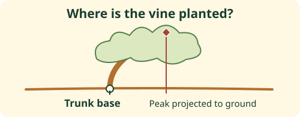

# What can a model learn from a crop scan?

Given a scan of a known crop, where should we put one pin per plant? Crop Trainer’s models learn which local height peaks resemble plant centers. Published studies have located individual crops on farms and shown that synthetic pretraining can help with a small real training set. Whether this particular detector beats a simple height rule still depends on the crop, the scanner and what counts as a correct pin.

## What researchers have measured

### Can a model find individual plants in a field?

- **Counting field lettuce with one dot per plant.** Ruan and colleagues trained LettuceNet on aerial photographs. On 384 test patches cut from 24 held-out images, the counts were off by 2.45 lettuce plants per patch on average. They reported a localization F-score of 0.979 using a hit whenever a predicted region contained an annotated plant point. They tested one variety at harvest on one field. This is a precedent for inexpensive point labels. Testing our pins requires positions measured in centimetres. [Ruan et al., Agriculture, 2024, Tables 1 and 3](https://doi.org/10.3390/agriculture14081412) · [Open paper and matching rule](https://mdpi-res.com/d_attachment/agriculture/agriculture-14-01412/article_deploy/agriculture-14-01412.pdf)
- **Locating artichokes from above.** Sassu and colleagues marked individual artichokes in aerial RGB images of a Sardinian field. On the October 15 survey, YOLOv5 found 543 plants, missed 58 and added seven false detections. For matched plants the mean distance between the predicted and hand-marked box centers was 4.66 cm. They also ran their image detector offline on the original Jetson Nano. This is evidence that individual plants can be mapped on a working farm. Their camera images, reference centers and embedded model differ from our LiDAR workflow. [Sassu et al., Computers and Electronics in Agriculture, 2023](https://doi.org/10.1016/j.compag.2023.108185) · [Authors’ full text, Tables 5 and 7](https://iris.uniss.it/bitstream/11388/319309/5/1-s2.0-S0168169923005732-main%20%284%29.pdf)
- **Finding broccoli heads in real fields.** Le Louedec and colleagues trained a neural network on depth-camera points and surface normals. Trained on their UK1 collection and tested in Spain, it achieved 0.79 mean average precision for head masks. A clustering and support-vector classifier reached 0.56. Reversing the collections gave 0.76 for the network and 0.94 for the simpler pipeline. Which method worked best depended on the field. The authors evaluated overlap with the visible head. Crop Trainer scores the distance to a center. [Le Louedec et al., CVPR Workshops 2020, Table 2](https://openaccess.thecvf.com/content_CVPRW_2020/papers/w5/Le_Louedec_Segmentation_and_Detection_From_Organised_3D_Point_Clouds_A_Case_CVPRW_2020_paper.pdf)
- **Separating apple trees in LiDAR.** Sodano and colleagues trained on 90 terrestrial laser-scan tiles in the HOPS orchard dataset. They grouped each trunk with its apples. Tree-instance panoptic quality, a score for finding and delineating those groups, was 55.4 on terrestrial test scans and 42.1 on ground-vehicle test scans. The test collections also differ in scene content, so the scores describe whole acquisition conditions. Comparing two simulated scan layouts is a first experiment along this path. [Sodano et al., IROS 2025](https://doi.org/10.1109/IROS60139.2025.11246899) · [Authors’ conference paper, Tables I and II](https://www.ipb.uni-bonn.de/wp-content/papercite-data/pdf/sodano2025iros.pdf)

### Can synthetic examples help on real plants?

These studies scored segmentation by measuring how much a predicted mask overlapped a hand-labeled mask. A higher score means better overlap.

- **Learning from synthetic plants before measuring real ones.** Turgut and colleagues compared PointNet++ training recipes on the same eight held-out real rosebushes. Training on synthetic plants alone yielded 27.29% mean intersection-over-union for flowers, leaves and stems. Training on three real plants yielded 81.53%. Synthetic pretraining followed by fitting on those same three real plants reached 86.19%. This supports testing whether synthetic training can reduce labeling effort. Eight individual rosebushes leave performance across fields, crops and sensors open. [Turgut et al., Plant Methods 2022, Table 6](https://europepmc.org/articles/PMC8858499)
- **Rendering sugar beet and weeds.** Di Cicco and colleagues trained Basic SegNet on 1,300 rendered RGB images. It scored 59.8% and 61.1% mean intersection-over-union for crop, weed and soil pixels on two real field tests four weeks apart. Adding 100 labeled field images from each growth stage raised those scores to 74.1% and 76.2%. The real-only control trained on each corresponding stage reached 80.3% and 83.1%. This measured pixel classification in photographs. A LiDAR detector needs its own test of plant positions. [Di Cicco et al., IROS 2017](https://doi.org/10.1109/IROS.2017.8206408) · [Authors’ paper, Table I](https://arxiv.org/pdf/1612.03019#page=6)

## What Crop Trainer has measured

On 24 held-out synthetic lettuce plantings with simulated ring scans, the 13-feature logistic model scored 0.793 mean F1 and the height rule scored 0.706. On young tomato, the default neural detector scored 0.747 and the height rule scored 0.761. These comparisons use identical proposals and average F1 across the 7.5, 10 and 15 cm matching distances. [Reproducible crop and scan comparisons](evidence.md)

On one physical vineyard strip, the frozen vine model placed 21 pins among 18 surveyed trunks. **Only one pin matched a trunk within 15 cm.** Even before classification, the height peaks could reach only eight trunks. The overhead view discards side returns that might identify a trunk beneath the canopy. More epochs can change how existing peaks are scored. Finding the other ten trunks requires new candidate positions or a different view of the plants. [Vineyard results and replay](field-datasets.md#replay-the-vineyard-test)

The Training shed fits model weights using generated field labels. In Field test, an imported PLY and its surveyed XY centers are used only to score a frozen model. [Score a scan](scan-cli.md)

For a lettuce pilot, survey centers before viewing predictions and reserve entire plots for the final test. Use development plots to choose the peak settings and score cutoff. On the reserved plots, run the frozen model and the height rule against the same survey. Report missed plants, extra pins and count error for each plot. That comparison can tell a grower whether the learned rule is worth using with their scanner. [Field validation protocol](field-validation.md) · [How agricultural technology teams train models](industry-practice.md)
