# Fields, scanners and ray budgets

Choose a crop in **Scan settings**. Drag with a mouse or swipe sideways to orbit the scan. Swipe vertically to move down the page, or use the + and − buttons to zoom in on a plant. In full screen you can also zoom with the wheel or pinch. Coral rings mark plants with crop returns. Gold crosses mark plants with none. [Open the field generator](https://mvalancy.github.io/crop-trainer/)

| Crop | Synthetic geometry | Starting peak height | Minimum distance between final pins |
| --- | --- | ---: | ---: |
| Lettuce | Compact overlapping leaves in paired rows | 3.5 cm | 12.5 cm |
| Globe artichoke | Divided blades in a vegetative rosette, or a stem bearing one or several buds | 6.5 cm | 40 cm |
| Young tomato | Compound foliage and an upright growing tip | 6.5 cm | 22 cm |
| Apple orchard | Central leaders or open-vase trees with connected woody scaffolds and shoots | 6.5 cm | 105 cm |
| Trellised vineyard | One or two cordon arms with rising shoots, or dormant pruned spurs | 6.5 cm | 65 cm |
| Greenhouse bench lettuce | Rosettes on raised benches over a level floor | 6.5 cm | 16 cm |
| Greenhouse high-wire tomato | One or two fruiting leaders, or a younger plant before fruit set, over a trough | 6.5 cm | 31 cm |

Open **Plant form and condition** for the named forms, seeded mix and damage settings. Each crop has a growing guide with a photographic reference and an animated diagram. With structured plants, choose **Plant tissue** to color the first returns or enable **Model stem lines** to inspect hidden centerlines. Only XYZ coordinates enter the detector. [Illustrated generator guides](../trainer/plants/README.md) · [Paired tests across all seven crops](crop-form-benchmark.md)

For the orchard, vineyard, bench and high-wire systems, each label includes the planted base in metres (`base_xy_m`). The viewer, trainer and scorer use that XY position even when the canopy leans. The three original crops retain their bounding-box center targets. Toggle **Include growing-system fixtures** for two scans with identical plants. Benches, posts, wires and troughs count as fixtures with no plant ID. The soil toggle controls ground returns separately.

Try the [vineyard](https://mvalancy.github.io/crop-trainer/?crop=grapevine&seed=32137#field) or [high-wire greenhouse](https://mvalancy.github.io/crop-trainer/?crop=high-wire-tomato&seed=32137#field). Each projected ray samples the highest surface at its XY location. Orbiting the viewer rotates those returns. Physical side views, glass reflections, fruit counts and yield require additional measurements. See the [field dataset guide](field-datasets.md) for sources to compare against.

During generation, each completed canopy row appears in the viewer. The preview samples up to 9,000 current returns. The completed scan includes the selected clutter, noise and soil settings. You can orbit it and download every surviving return.

In the **Field generator**, choose a scanner, ray budget, soil, noise and obstacles. Export the XYZ scan, bounding boxes and exact recipe. **Train this crop and layout** carries the crop and scanner into the training shed. Training generates separate fields with seeded noise and clutter. A fixed generator budget carries into validation, and the training budget defaults to seeded variation. The OS1 layouts reproduce selected channel and angular-column counts using a projected ring lattice. Real scanners also have beam angles, intensity response, timing and return-selection behavior. [Ouster sensor data reference](https://static.ouster.dev/sensor-docs/image_route1/image_route2/sensor_data/sensor-data.html)

## Why can the same ray budget miss a seedling?

The diagram shows every simulated return in a 52 cm square around plant 6 on field `1370561`. The gold rectangle is the horizontal bounding box of the same healthy tomato seedling in both panels. Leaves occupy only part of that box. The grid placed 163 rays in the patch and three struck foliage. The ring layout placed 123 rays there and all struck soil. Each layout used exactly 60,000 rays across the full 10 m square. [Compare the layouts on this planting](https://mvalancy.github.io/crop-trainer/?crop=tomato&plantArchitecture=2&plantForm=seedling&plantCondition=healthy&sensor=reference&seed=1370561&budget=60000&ground=true&noise=clean&weeds=off&sticks=off&boards=off&studyMode=layouts&studyMetric=returns&studyBox=6#scan-study)

Across all 110 plants on this field, the rings returned **519 crop points from 101 plants**. The grid returned **347 crop points from 105 plants**. More points can come from repeatedly sampling a few leaves. A grower counting plants also needs to know how many distinct plants the scanner reached. Turn on **Plant tissue** in the 3D viewer and focus plant 6 to explore this example. Both scans include the same generated soil, with added noise and obstacles switched off. [Open the reference scan](https://mvalancy.github.io/crop-trainer/?crop=tomato&plantArchitecture=2&plantForm=seedling&plantCondition=healthy&sensor=reference&seed=1370561&budget=60000&ground=true&noise=clean&weeds=off&sticks=off&boards=off&tile=ea701d00b16c2676&box=6#scan-viewer) · [Open the OS1-64-inspired scan](https://mvalancy.github.io/crop-trainer/?crop=tomato&plantArchitecture=2&plantForm=seedling&plantCondition=healthy&sensor=os1-64&seed=1370561&budget=60000&ground=true&noise=clean&weeds=off&sticks=off&boards=off&tile=cb233b1e0e3f65f8&box=6#scan-viewer)

## How fine can I scan a leaf?

For the densest scan, choose **Reference** under **Scanner layout**, set **Ray budget** to **1,000,000**, and select **Grow and scan**. Zoom in on one plant using **Focus plant**. For a first visit the generator opens at 262,144 rays. Shared scans keep their original budget. [Open the one-million-ray lettuce scan](https://mvalancy.github.io/crop-trainer/?crop=lettuce&seed=43571&sensor=reference&budget=1000000&noise=clean#field)

| Reference budget | Approximate grid pitch on a 10 m square | Clean XYZ payload with soil |
| ---: | ---: | ---: |
| 100,000 | 3.15 cm | 1.2 MB |
| 262,144 | 1.95 cm | 3.15 MB |
| 500,000 | 1.41 cm | 6 MB |
| 1,000,000 | 1.00 cm | 12 MB |

Pitch is the width of one grid cell. Each selected cell gets a jittered ray, so exact distances between points vary. The table uses three 32-bit coordinates per return and excludes the short PLY header. Gaps and soil removal can reduce the number of exported points. Stray returns can add points up to the one-million-return import limit.

Check **rays requested**, **sampled**, and **returns** under the viewer. The OS1-32, OS1-64 and OS1-128 presets can sample at most 16,384, 65,536 and 262,144 positions per scan, respectively. Requesting more leaves the same projected ring lattice. The detector still measures peaks in 5 cm cells. Denser input supplies more observations inside those cells.

On two fresh lettuce plantings (seeds 43571 and 43572), the clean reference grid produced 9,563 and 17,017 crop returns at 100,000 rays. At one million it produced 95,772 and 170,378. Plant labels stayed identical within each pair. On the same fields the OS1-128 preset gave exactly the same crop-return counts at 262,144, 500,000 and one million requested rays.

**Does more detail improve this detector?** We held the CPU neural weights fixed within each seed and rescanned the same two validation plantings at two budgets. Training used four mixed-layout fields at their seeded budgets, 40 epochs, the lettuce peak floor of 3.5 cm and the 0.50 score cutoff. Validation used the reference grid with seeded noise and both soil settings.

| Dataset seed | Validation rays | F1 at 7.5 / 10 / 15 cm | Generation / training / validation (ms) |
| ---: | ---: | --- | --- |
| 43571 | 100,000 | .9013 / .9116 / .9116 | 2,083 / 96 / 125 |
| 43571 | 1,000,000 | .8932 / .8932 / .8952 | 6,383 / 65 / 36 |
| 43572 | 100,000 | .9104 / .9259 / .9259 | 1,710 / 107 / 41 |
| 43572 | 1,000,000 | .8837 / .8856 / .8874 | 6,131 / 102 / 42 |

Both fits scored slightly lower on the denser scans. This detector uses local height and density measurements, and these fits practiced on sparser fields. To test a fit for dense scans, set its training and validation budgets independently and reserve fresh validation plantings. These times are from Node on a hosted CPU. Generation includes all training and validation scans in the run.

Dense scans generate in a background worker on supported browsers. During drag or spin, the viewer draws a sample to keep the camera responsive. At rest it uses every return. Exports always contain the full generated scan.

## Share one scan with another grower

Choose **Grow and scan**, then **Copy scan link** under the viewer. The link captures the displayed crop, field seed, scanner, ray budget, soil, noise and each obstacle setting. A teammate can open it and download the regenerated XYZ and labels without an account. Edits to the controls take effect on the next scan. On localhost, the link points to your own server. Use the public farm for a link anyone can open.

A shared link includes the expected tile ID. The viewer flags a mismatch if the generator produces a different ID. Keep the PLY and labels alongside the source revision for a long-lived dataset. [Open a sparse tomato scan from the benchmark](https://mvalancy.github.io/crop-trainer/?crop=tomato&sensor=os1-32&seed=854812180&budget=12000&ground=true&tile=e3a36b5c8e54f55d#field)

## Test a detector on a different scan layout

In the training shed, **Training LiDAR layout** determines the examples used to fit the detector. **Validation LiDAR layout** controls how the held-out plants are scanned. The default follows the training layout. To isolate a scanner change, keep the seed, crop, training layout, epochs and cutoffs fixed. The generator keeps the plant centers, clutter, ground variants and requested ray budgets paired. Layout capacity and simulated noise can change the number of returns. In the field audit, **Open this scan in the 3D viewer** opens the selected tile, including its ground setting. Check its tile ID against the exported report.

These paired mean F1 scores use six mixed training fields, three held-out fields with both ground variants, 40 CPU neural epochs and a 0.50 cutoff. Each row compares the same weights and training normalization.

| Crop | Run seed | Reference grid | Simulated OS1-64 |
| --- | ---: | ---: | ---: |
| Lettuce | 211 | 0.771 | 0.760 |
| Lettuce | 212 | 0.693 | 0.657 |
| Globe artichoke | 211 | 0.782 | 0.723 |
| Globe artichoke | 212 | 0.754 | 0.656 |
| Young tomato | 211 | 0.818 | 0.758 |
| Young tomato | 212 | 0.675 | 0.604 |

For tomato at seed 212, the ring scan had a candidate peak within 15 cm of 578 of 620 labeled plant instances across six tiles. The score cutoff retained matches for 311 and the spacing filter left 310. A second test trained exclusively on that same ring layout, holding validation scans fixed. Tomato mean F1 rose from 0.604 to 0.627 on seed 212 and fell from 0.758 to 0.726 on seed 211. These measurements describe the projected synthetic layouts. [Open the tomato ring test](https://mvalancy.github.io/crop-trainer/trainer/?crop=tomato&seed=212&sensor=mixed&validationSensor=os1-64) · [Open its grid control](https://mvalancy.github.io/crop-trainer/trainer/?crop=tomato&seed=212&sensor=mixed&validationSensor=reference)

## How many rays reach the field?

Set **Validation ray budget** in the Training Shed to vary scan density on held-out fields. Training uses the budget selected for its own split, which defaults to seeded variation. Open a scored tile to see how many rays its layout sampled and how many returns survived noise and soil removal. The **Ray scout** farm challenge uses the same distinction. Two requests above the layout's capacity produce the same number of sampled rays.

On dataset seeds 721, 722, 751 and 752, increasing the simulated OS1-64 validation budget from 12,000 to 60,000 raised mean F1 on all four seeds for each of lettuce, artichoke and tomato. Each pair used six mixed-layout training fields, three held-out plantings, 40 neural epochs, identical CPU weights and identical plant labels. Changing the budget resamples the layout, so the two clouds can contain different ray positions. These projected layouts measure synthetic sampling effects. Physical scanner performance requires measured scans.

On tomato seed 721, more rays raised the number of labeled plant instances matched within 15 cm from 245 to 698 out of 734 across the six scans. Extra pins rose from 7 to 57. Times below are from the Node CPU runner and generation includes both splits. [Replay 12,000 rays](https://mvalancy.github.io/crop-trainer/trainer/?crop=tomato&seed=721&sensor=mixed&validationSensor=os1-64&validationRayBudget=12000&engine=cpu) · [Replay 60,000 rays](https://mvalancy.github.io/crop-trainer/trainer/?crop=tomato&seed=721&sensor=mixed&validationSensor=os1-64&validationRayBudget=60000&engine=cpu)

| Validation rays | Generation | Training | Validation | F1 at 7.5 cm | F1 at 10 cm | F1 at 15 cm |
| ---: | ---: | ---: | ---: | ---: | ---: | ---: |
| 12,000 | 1,746 ms | 78 ms | 30 ms | 0.4158 | 0.4929 | 0.4970 |
| 60,000 | 2,260 ms | 95 ms | 36 ms | 0.8865 | 0.9335 | 0.9375 |

## Does matching training density help on sparse scans?

On two fresh seeds, training at 12,000 rays improved mean F1 for all three crops on held-out 12,000-ray OS1-64 scans. The comparison used six training fields, three held-out fields, both soil variants, 40 neural epochs and a 0.50 score cutoff. Each pair had identical validation scans and training plantings. Resampling the training scans changed their candidate peaks and the number of balanced examples.

| Crop | Seed 1221 · train 12k / 60k | Seed 1222 · train 12k / 60k |
| --- | ---: | ---: |
| Lettuce | 0.712 / 0.168 | 0.680 / 0.405 |
| Globe artichoke | 0.660 / 0.136 | 0.624 / 0.368 |
| Young tomato | 0.550 / 0.119 | 0.598 / 0.337 |

For lettuce seed 1221, F1 at 7.5, 10 and 15 cm was 0.642, 0.727 and 0.767 with 12k training rays, and 0.159, 0.167 and 0.178 with 60k. The Node CPU run spent 2.41 s generating, 0.09 s training and 0.07 s validating at 12k, compared with 3.52 s, 0.17 s and 0.03 s at 60k. These scores describe this simulated sparse layout. In the Training shed, open **Scanner and ray budgets** to set the two splits independently. [Replay lettuce at 12k training rays](https://mvalancy.github.io/crop-trainer/trainer/?crop=lettuce&seed=1221&sensor=os1-64&trainingRayBudget=12000&validationRayBudget=12000&engine=cpu) · [Replay the 60k control](https://mvalancy.github.io/crop-trainer/trainer/?crop=lettuce&seed=1221&sensor=os1-64&trainingRayBudget=60000&validationRayBudget=12000&engine=cpu)

## Does the same fit work on dense scans?

Choose **Training scan density** in the benchmark. The CPU fits the same neural architecture twice per seed, using 12,000 and 60,000 requested rays per training scan. Select a validation budget and compare the fits on identical held-out tiles. The results show the sampled rays and balanced examples that reached each fit. Select a contender to replay it in the Training shed. [Run the density benchmark](https://mvalancy.github.io/crop-trainer/benchmark/?comparison=density&sensor=os1-64&crop=lettuce&seed=1321&validationRayBudget=60000)

On seeds 1321 and 1322 we ran the benchmark twice on the simulated OS1-64, changing only the validation budget between runs. Each cell gives mean F1 for **12k / 60k training rays**. All fits used 40 epochs, a 0.50 cutoff and both soil variants. We verified that changing validation density preserved each fit’s weights and training manifest.

| Crop | Seed | Test at 12k | Test at 60k |
| --- | ---: | ---: | ---: |
| Lettuce | 1321 | 0.689 / 0.321 | 0.825 / 0.846 |
| Lettuce | 1322 | 0.743 / 0.323 | 0.798 / 0.803 |
| Globe artichoke | 1321 | 0.633 / 0.304 | 0.580 / 0.815 |
| Globe artichoke | 1322 | 0.762 / 0.312 | 0.825 / 0.854 |
| Young tomato | 1321 | 0.588 / 0.252 | 0.845 / 0.849 |
| Young tomato | 1322 | 0.630 / 0.223 | 0.794 / 0.809 |

Matching the budgets improved mean F1 in each pair. On dense artichoke scans at seed 1321 the gain was 0.235, while on dense tomato scans at the same seed it was 0.004. Even within one detector, matching distance matters. On dense lettuce seed 1322, denser training lowered 7.5 cm F1 from 0.776 to 0.772 and raised 15 cm F1 from 0.818 to 0.829. These results cover six held-out plantings per crop and one simulated layout. PointNet++ studies multi-scale features under varying sampling density. This experiment holds the feature extractor fixed while changing the training scans. [PointNet++](https://arxiv.org/abs/1706.02413) · [Replay sparse validation](https://mvalancy.github.io/crop-trainer/benchmark/?comparison=density&sensor=os1-64&seed=1321&validationRayBudget=12000)

On dense artichoke seed 1321, the 12k and 60k Node CPU runs spent 1.84 / 2.43 seconds generating, 71 / 85 ms training and 22 / 16 ms scoring. F1 at 7.5, 10 and 15 cm was 0.459, 0.574 and 0.707 for 12k training, and 0.663, 0.819 and 0.964 for 60k. Each fit includes its own normalization and balanced training examples.

## Can one detector handle both sparse and dense scans?

In **Benchmark → Training scan density**, select **Include a mixed-density fit** to add a third detector. It learns from three plantings scanned at 12,000 rays and three at 60,000. Run the benchmark at one validation budget, follow the repeat link in the same tab, and run it again. The new table shows each detector’s mean F1 at both densities. Read the lower of those two scores if your detector needs to handle either scan density. [Try the artichoke experiment](https://mvalancy.github.io/crop-trainer/benchmark/?comparison=density&crop=artichoke&sensor=os1-64&seed=1421&includeMixed=1&validationRayBudget=60000)

On the simulated OS1-64, sparse-only training had the best worst-case F1 on both lettuce seeds and both tomato seeds. For artichoke the advantage changed with the planting seed. Each entry below is the lower of the two validation scores. Every fit used 40 CPU epochs, a 0.50 cutoff and three held-out plantings with both soil variants. Changing validation density preserved the training tiles, feature scaling and fitted weights.

| Crop | Seed | Train at 12k | Alternate 12k and 60k | Train at 60k |
| --- | ---: | ---: | ---: | ---: |
| Lettuce | 1421 | **0.6702** | 0.6460 | 0.2365 |
| Lettuce | 1422 | **0.7246** | 0.6985 | 0.3526 |
| Globe artichoke | 1421 | 0.6042 | **0.6831** | 0.2787 |
| Globe artichoke | 1422 | 0.7134 | **0.7303** | 0.3618 |
| Globe artichoke | 1451 | **0.6512** | 0.5440 | 0.2173 |
| Globe artichoke | 1452 | **0.6699** | 0.6600 | 0.3097 |
| Young tomato | 1421 | **0.5687** | 0.5116 | 0.2219 |
| Young tomato | 1422 | **0.6275** | 0.5571 | 0.2242 |

On artichoke seed 1451, alternating training improved dense-scan mean F1 from 0.7015 to 0.7876 over sparse-only training, while sparse-scan mean F1 fell from 0.6512 to 0.5440. For the alternating fit on dense scans, F1 at 7.5, 10 and 15 cm was 0.685, 0.816 and 0.862. One Node CPU run spent 2.01 s generating, 52 ms training and 25 ms validating. Different ray budgets also produce different numbers of training examples. These measurements apply to this synthetic layout. Domain randomization has been studied for image-based object localization. Here the varied property is the number of simulated LiDAR rays. [Replay the repeat seeds](https://mvalancy.github.io/crop-trainer/benchmark/?comparison=density&crop=artichoke&sensor=os1-64&seed=1451&includeMixed=1&validationRayBudget=12000) · [Tobin et al., 2017](https://arxiv.org/abs/1703.06907)

[Back to the field guide](README.md)
