# How many rays does a young tomato need?

Six synthetic plantings contained 635 young tomatoes. With the standard tomato detector and 30,000 overhead rays per plot, the scanner missed 138 seedlings completely and the model found zero within 15 cm. At one million rays, every seedling returned at least one point and the two trained models located 399 and 421 of them. A simple height-ranked detector scored higher than either model at that density.

**Try one of the six plots.** Open seed `216917` and run the ray budget comparison. It contains 105 seedlings. At 30,000 rays, 12 had zero returns and 15 were in reach of the default peak detector. At one million rays every plant returned points and 103 were in reach. The height baseline scored 0.242 and 0.892 at 15 cm. [Open this paired field in the browser](https://mvalancy.github.io/crop-trainer/?crop=tomato&plantArchitecture=2&plantForm=seedling&sensor=reference&seed=216917&noise=clean&weeds=off&sticks=off&boards=off&studyLow=30000&studyHigh=1000000#scan-study)

## Where the seedlings disappeared

Each row scores the same 635 planting positions and seedling shapes. The detector proposes peaks in a smoothed 5 cm height grid, accepts those above its learned score cutoff, then removes crowded pins. **Proposed**, **accepted** and **final** count distinct plants that can be matched to at least one remaining pin within 15 cm. Ranges show the two training seeds. The proposed count is identical for both fits.

| Rays per 10 × 10 m plot | Plants with zero returns | Proposed | Accepted | Final | Model F1 at 15 cm | Height baseline F1 at 15 cm |
| ---: | ---: | ---: | ---: | ---: | ---: | ---: |
| 12,000 | 354 | 3 | 0 | 0 | 0.000 | 0.009 |
| 30,000 | 138 | 36 | 0 | 0 | 0.000 | 0.104 |
| 100,000 | 5 | 247 | 3–23 | 3–23 | 0.009–0.063 | 0.475 |
| 1,000,000 | 0 | 583 | 401–422 | 399–421 | 0.705–0.724 | 0.842 |

At 100,000 rays nearly every seedling generated a crop return. Only 247 had a usable peak nearby, and only a handful survived classification. At one million rays, the first model produced 399 correct pins, 98 extra pins and 236 misses. Its F1 was 0.701 at 7.5 cm, 0.705 at 10 cm and 0.705 at 15 cm. The second model produced 421 correct pins, 107 extra pins and 214 misses at 15 cm. The height baseline ranks those same proposed peaks by height and applies the same 22 cm pin spacing. [Field Test scorer](../trainer/score-scan.js)

**Plant stage mattered at the same scan density.** On the paired leafy transplants at 30,000 rays, just one plant had zero returns, 607 had a candidate peak, and 351–393 matched the final pins. Model F1 at 15 cm was 0.682–0.716. At one million rays it reached 0.905–0.918. The two forms use the exact same XY rays at each budget. Their scored box midpoints can differ because the leaves change shape. [Young tomato growing guide](../trainer/plants/young-tomato.md)

## Does lowering the peak gate help?

The default gate admits a smoothed height of at least 6.5 cm. We reran both fits with the supported 3.5 cm gate and the same training plantings and epoch count. The lower gate changes both which peaks exist and which examples become available for training.

At one million rays, lowering the gate raised the number of seedlings in reach from 583 to 631. The models accepted and kept just 68 and 167 of those plants. Their final F1 at 15 cm was 0.173 and 0.375. The lower gate worked better for the leafy transplant at 30,000 rays, where F1 rose from 0.682–0.716 to 0.781–0.802.

A candidate can also sit close to a planting position by chance. We removed every simulator-labeled crop return and recalculated the peaks using the remaining soil points. At one million rays the lower gate still had soil peaks within 15 cm of 77 of the original 635 planting positions. The standard gate had 17. This check preserves gaps where foliage obscured the soil. Its matches count coincidences and cannot identify which full-scan peaks came from a plant.

## Can matching the training density improve the detector?

On four new fields containing **434 seedlings**, both networks trained on one million rays per plot beat their counterparts trained on 30,000 rays. They also beat the height baseline on these fields. We kept the seedling form, planting positions, scan layout, learner, 6.5 cm peak gate and epoch count fixed. Only the training ray budget changed. Every evaluation used the same one-million-ray scan for all methods.

| Held-out fields | Training seed | F1 with 30k training rays | F1 with 1M training rays | Height baseline F1 |
| --- | ---: | ---: | ---: | ---: |
| Original six, 635 seedlings | 82173 | 0.491 | 0.894 | 0.842 |
| Original six, 635 seedlings | 379331 | 0.835 | 0.888 | 0.842 |
| Four new fields, 434 seedlings | 82173 | 0.487 | 0.861 | 0.802 |
| Four new fields, 434 seedlings | 379331 | 0.801 | 0.856 | 0.802 |

All scores use a 15 cm matching radius. On the four new fields, the height baseline found 369 plants and placed 117 extra pins. Both dense-trained networks found 365 plants, with 49 and 54 extra pins respectively. Each dense-trained network improved on its paired sparse-trained fit on every one of the four new fields.

Changing the ray budget also changed the number of usable training examples. The same six plantings produced 148 versus 2,006 balanced examples for seed `82173`, and 90 versus 2,112 for seed `379331`. Both denser observations and a larger candidate set may have contributed. The comparison establishes a synthetic benefit for this seedling form and evaluation density. Other stages, physical scanners and other viewpoints need their own tests.

In the browser, compare the two training densities with healthy seedlings and a fixed one-million-ray validation budget. The browser uses its first seed and the following seed, and generates its own validation plantings with seeded clutter, scan noise and soil variants. For the exact six-field and four-field confirmation scores above, use the Node command. [Run the paired density benchmark in the browser](https://mvalancy.github.io/crop-trainer/benchmark/?comparison=density&trainingPair=30k-1m&crop=tomato&plantArchitecture=2&plantForm=seedling&plantCondition=healthy&sensor=reference&validationRayBudget=1000000&seed=82173)

The linked browser preset runs 40 epochs per fit. With its own held-out scans, mean F1 across 7.5, 10 and 15 cm rose from **0.240 to 0.598** for seed 82173 and from **0.297 to 0.431** for seed 82174. The paired fits shared all six validation tile IDs within each seed. This is the score to look for when you open the browser preset.

To repeat the comparison, run the optional mode below. It trains four seedling-only networks. The JSON keeps the original six fields and the four confirmation seeds (`793803`, `901213`, `1047581`, `1200833`) in separate result groups.

```sh
node benchmark/seedling-density.mjs --match-training-density > seedling-training-density.json
```

## Do those seedling models transfer to a different layout?

We froze the four reference-trained seedling detectors from the training-density comparison. On **eight new plantings with 877 seedlings**, each detector scored the same plant boxes using the reference grid and an OS1-64-inspired ring layout. At 60,000 sampled rays, the ring layout recorded more crop points (3,262 versus 2,375), yet left more plants with zero returns. The 6.5 cm peak detector reached 96 plants on rings and 195 on the grid.

| Layout | Actual rays per plot | Plants with zero returns | Plants in reach at 15 cm | F1, 30k-trained | F1, 1M-trained | F1, height only |
| --- | ---: | ---: | ---: | ---: | ---: | ---: |
| Reference grid | 30,000 | 184 | 51 | 0.018–0.071 | 0.100 | 0.106 |
| OS1-inspired rings | 30,000 | 283 | 43 | 0.002–0.049 | 0.093 | 0.093 |
| Reference grid | 60,000 | 44 | 195 | 0.198–0.274 | 0.303–0.307 | 0.314 |
| OS1-inspired rings | 60,000 | 119 | 96 | 0.031–0.136 | 0.192–0.193 | 0.197 |
| Reference grid | 65,536 | 55 | 226 | 0.241–0.315 | 0.340–0.341 | 0.353 |
| OS1-inspired rings | 65,536 | 110 | 107 | 0.038–0.152 | 0.214–0.215 | 0.217 |
| Reference grid | 1,000,000 | 0 | 799 | 0.485–0.833 | 0.898–0.904 | 0.846 |

For a single-plant replay, open box 6 of field `1370561` and switch between its two 60,000-ray scans. [Inspect the matched scans](https://mvalancy.github.io/crop-trainer/?crop=tomato&plantArchitecture=2&plantForm=seedling&plantCondition=healthy&sensor=reference&budget=60000&seed=1370561&noise=clean&weeds=off&sticks=off&boards=off&studyMode=layouts&studyBox=6#scan-study) · [Compare the recorded returns in this patch](../art/seedling-layouts.svg)

The table pools counts at 15 cm across the eight fields. Each range covers the two independent training seeds. At 60,000 rays the first dense-trained model’s F1 at **7.5, 10 and 15 cm** was **0.280, 0.299 and 0.307** on the grid and **0.171, 0.187 and 0.193** on rings. The ring scan had only 99 candidate peaks across all eight fields. The model placed 95 pins, of which 94 matched a plant at 15 cm. It missed 783 seedlings. Per-field F1 at 15 cm ranged from 0.194 to 0.451 on the grid and 0.057 to 0.340 on the rings, with lower ring F1 on every paired field for both dense-trained fits.

The synthetic ring lattice has 1,024 columns and 64 rings. Asking it for one million rays yields 65,536, so we generated a grid with **exactly 65,536** samples for that pair. The one-million-ray grid shows what dense reference coverage can do on those same plants. The simulator redraws each grid density, so an individual plant reached at 60,000 rays can fall between rays at 65,536. This is a comparison of two overhead sampling patterns. Performance on a mounted spinning scanner requires a physical test. [Scan layouts and limitations](scanners.md)

```sh
node benchmark/seedling-density.mjs --layout-transfer > seedling-layout.json
```

For an interactive run, use the browser benchmark to train on dense reference scans and compare layouts at 60,000 validation rays. It generates separate validation plantings with seeded noise and both soil settings. The Node command above replays the fixed clean fields in the table. [Run the layout comparison](https://mvalancy.github.io/crop-trainer/benchmark/?comparison=layouts&crop=tomato&plantArchitecture=2&plantForm=seedling&plantCondition=healthy&sensor=reference&trainingRayBudget=1000000&validationRayBudget=60000&seed=82173)

The report includes the four fitted model fingerprints, per-field tile IDs, actual ray counts, stage counts, baseline scores and scores at all three distances. The held-out seeds are `1370561`, `1481707`, `1592011`, `1703069`, `1814201`, `1925237`, `2036279` and `2147411`. The benchmark asserts exact equality of plant boxes across every scan of each field, and verifies the sampled-ray and return counts. Each scan keeps soil and uses the original clean evaluation conditions above.

## Does training on the ring layout recover the misses?

We trained on either the reference grid or OS1-inspired rings at **60,000 sampled rays per scan**, then tested both models on each layout. Each training seed kept the same six plantings, both soil settings, seeded clutter and noise, network settings and 40 epochs. We fixed four new test seeds (`2268523`, `2379659`, `2490781`, `2601907`) before fitting. They contained 422 healthy seedlings, scored with the same clean conditions on both layouts.

| Held-out layout | Plants with a candidate at 15 cm | Grid-trained F1 at 15 cm | Ring-trained F1 at 15 cm | Height-only F1 at 15 cm |
| --- | ---: | ---: | ---: | ---: |
| Reference grid | 95 | 0.303 / 0.310 | 0.303 / 0.302 | 0.313 |
| OS1-inspired rings | 38 | 0.165 / 0.161 | 0.165 / 0.165 | 0.165 |

Each pair lists results for training seeds `82173` and `379331`, in that order. On rings, switching the training layout recovered zero additional seedlings for the first fit and one for the second. Both ring-trained fits and the height baseline found all 38 reachable plants, placed zero extra pins and missed 384. Of those misses, **334 plants had a crop return**. Per-plot ring-trained F1 ranged from 0.052 to 0.359. On these plots, finding more seedlings requires generating candidate positions near more plants.

```sh
node benchmark/seedling-density.mjs --match-training-layout > seedling-trained-layouts.json
```

## Reproduce the original scan-density sweep

Run this from the repository root with Node.js 22 or later.

```sh
node benchmark/seedling-density.mjs > seedling-density.json
```

- Train four small CPU networks on v2 healthy young tomato plants drawn from the seeded mix of seedling, transplant and branching forms. Use dataset seeds `82173` and `379331`, six training plantings per seed (both soil variants), 30,000 reference rays, both peak gates and unchanged initialization. Each fit uses four tanh hidden units, full-batch SGD, learning rate 0.25, 40 epochs and a 0.5 detection cutoff.
- Freeze the weights, feature scaling and spacing for the entire survey. Generate fresh plantings from seeds `110821`, `216917`, `337013`, `449047`, `551099` and `669073`. Score healthy seedling and transplant forms with soil present. Disable extra weeds, boards, sticks and scan-noise controls. The standard terrain and generator jitter still apply. Within a form, the target boxes are identical across ray budgets. Changing density redraws the reference sampling grid.
- Read the per-field IDs, counts, stages and scores in `fields`. Read the counts pooled across six plantings in `pooled`. The 48 scans reuse those plantings. The two training fits evaluate the same targets. No validation plot contributes to fitting, and the simulator’s organ and return labels are reserved for measurement and the soil-only diagnostic.

On Linux x64 with Node.js 24.22.1 and an AMD EPYC 7763 CPU, preparing the four training sets took 2.21 s and fitting took 0.27 s. Drawing the held-out scans took 3.97 s, scoring all four detectors took 2.93 s, and the soil control took another 0.67 s. These rates apply to this CPU run. The density sweep models overhead coverage under synthetic conditions. Actual acquisition time, viewpoint, terrain and target visibility require field measurements. [Benchmark code](../benchmark/seedling-density.mjs) · [Seven-crop form comparison](crop-form-benchmark.md)
