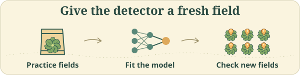

# When the scanner misses the cell beside a seedling

In one clean synthetic ring scan, the standard height filter found 10 of 93 tomato seedlings within 15 cm, with zero extra pins. Changing how the filter handled gaps found **30 of 93**, with **30 extra pins**. Select plant 5 and switch between **Height-only pin** and **Height pin · sampled cells only**. Five ring-scan returns hit that plant, but only the sampled-cell method placed a matching pin. [Explore this 60,000-ray field](https://mvalancy.github.io/crop-trainer/?crop=tomato&plantArchitecture=2&plantForm=seedling&plantCondition=healthy&sensor=reference&budget=60000&seed=3398269&noise=clean&weeds=off&sticks=off&boards=off&studyMode=layouts&studyMetric=sampledPins&studyBox=5#scan-study)

## What changed?


Both methods take the highest XYZ return in each 5 cm cell, smooth a three-by-three neighborhood, then keep local peaks at or above 6.5 cm. They rank the peaks by height and require 22 cm between selected pins. The standard filter divides by the full kernel weight of 16. The experimental filter divides by the weights of cells that received a return and requires a measured center cell. In both filters a measured soil return at zero height counts as a genuine measurement. These height rules rank peaks without fitting weights. The Training Shed also lets you train a neural detector on either set of peaks under **Peak detection and scoring → Average height across**. A weight export records which rule to use when scoring a new scan. [Peak extraction](../trainer/models/data.js) · [Scanner geometry](scanners.md)

The illustration uses two neighborhoods from a 60,000-ray synthetic ring scan at seed `1370561`. The center bin weighs four, each side neighbor two and each corner one. Near plant 8, at XY (5.475, 0.675) m, the computed height rose from 5.06 to 8.99 cm. A soil patch at (5.875, 1.025) m also crossed the gate, from 4.60 to 6.70 cm, over 36 cm from the nearest label. [Replay plant 8 on the paired scans](https://mvalancy.github.io/crop-trainer/?crop=tomato&plantArchitecture=2&plantForm=seedling&plantCondition=healthy&sensor=reference&budget=60000&seed=1370561&noise=clean&weeds=off&sticks=off&boards=off&studyMode=layouts&studyMetric=sampledPins&studyBox=8#scan-study)

We generated six fresh healthy seedling plots and then repeated the fixed 6.5 cm comparison on four more. Each planting had four scans at 60,000 sampled rays, with identical plant boxes across scans. The clean grid and OS1-64-inspired rings included soil. The cluttered variants added weeds, sticks, boards, seeded range and position noise, gaps, stray points and clustered returns. Each detector saw only XYZ. The scorer matched centers to modeled plant-box midpoints one to one.

## What improved on fresh plantings?



These are pooled F1 scores at **7.5 / 10 / 15 cm**, in that order. The primary group contains 620 seedlings. The independent confirmation contains 411.

| Scan | Standard, six plots | Sampled cells, six plots | Standard, four new plots | Sampled cells, four new plots |
| --- | --- | --- | --- | --- |
| Clean grid | .211 / .236 / .255 | .286 / .323 / .337 | .206 / .247 / .258 | .257 / .303 / .313 |
| Cluttered, noisy grid | .117 / .148 / .201 | .147 / .179 / .233 | .105 / .136 / .196 | .122 / .164 / .212 |
| Clean rings | .158 / .173 / .184 | .325 / .372 / .395 | .143 / .152 / .165 | .307 / .371 / .393 |
| Cluttered, noisy rings | .096 / .133 / .186 | .149 / .190 / .244 | .072 / .103 / .177 | .148 / .188 / .246 |

At 15 cm the sampled-cell method improved F1 on every clean and cluttered ring planting. Two of the four new cluttered grid plantings lost F1. With the lower 3.5 cm height floor in the original six plots, ring F1 fell from .334 to .327 on clean scans and from .227 to .225 with clutter. The choice of gate matters.

## Can soil alone make a peak?


Yes. We used the generator's point classes to remove every return except soil, then passed the remaining XYZ through the same two filters. Every resulting pin is false. Removing crop returns leaves gaps where the canopy hid the soil. These are partial scans of the original terrain.

| Soil-only input, 6.5 cm gate | Standard false pins | Sampled-cell false pins |
| --- | ---: | ---: |
| Clean rings, six plots | 1 | 166 |
| Noisy rings, six plots | 25 | 261 |
| Clean rings, four new plots | 0 | 104 |
| Noisy rings, four new plots | 20 | 179 |

On the four new clean ring plots, five soil-only pins fell within 15 cm of an original plant center by chance. On the noisy ring plots, keeping all noncrop returns produced **456** standard pins and **673** sampled-cell pins. A nearby peak can come from terrain or clutter.

## Can training reject the extra soil peaks?


On eight new synthetic plantings, a small neural net rejected some soil peaks while retaining many of the newly visible seedlings on clean ring scans. The sampled-cell height rule still scored higher. On clean grid scans, both sampled-cell nets found only **19 of 821** plants and missed the other 802.

We froze the settings before scoring. For each layout and averaging rule we trained two four-unit tanh nets, one per training seed (`82173`, `379331`), with 40 full-batch SGD epochs, learning rate 0.25 and initialization seed `12345`. Each fit used six plantings, both soil variants, and its own normalization fitted on the retained training examples. Every layout sampled exactly 60,000 rays. We checked the plant boxes across layouts and reused the same XYZ for both rules. The test repeated the same 821 seedlings across the four conditions below. The primary height gate was 6.5 cm, the neural score cutoff 0.5 and the minimum pin spacing 22 cm.

| Held-out scan | Standard height F1 | Standard net F1 | Sampled-cell height F1 | Sampled-cell net F1 | Soil-only false pins, sampled-cell height → nets |
| --- | ---: | ---: | ---: | ---: | ---: |
| Clean grid | .356 | .339 / .349 | .410 | .045 / .045 | 199 → 1 / 2 |
| Noisy grid with clutter | .224 | .223 / .211 | .264 | .088 / .094 | 340 → 30 / 56 |
| Clean rings | .234 | .234 / .234 | .457 | .389 / .326 | 217 → 128 / 96 |
| Noisy rings with clutter | .214 | .180 / .213 | .266 | .209 / .154 | 349 → 186 / 154 |

F1 uses one-to-one matches within 15 cm. Paired numbers follow the training seeds in the order listed. Soil-only counts come from separate scans filtered down to soil returns. They can differ from false pin counts on the full scan.

On clean rings the sampled-cell height rule matched 301 plants, including 192 that standard height missed. The two sampled-cell nets matched 226 and 175 plants overall, keeping 174 and 150 of those 192 extra matches. They placed 114 and 77 false pins on the full scans, down from 196 for sampled-cell height. Against their respective standard nets, their 15 cm F1 improved on seven and six of the eight clean ring plantings. Neither fit surpassed sampled-cell height on any of the eight. On the clean grid, the same reduction in soil pins came with a loss of 238 true matches relative to sampled-cell height.


Raising the neural cutoff to 0.75 removed every true detection from the 6.5 cm sampled-cell fits. Lowering the gate to 3.5 cm and refitting gave a different result for standard averaging. On clean rings, both standard nets beat standard height at that gate (F1 .428 and .516 versus .383). These measurements cover one simulator, one growth stage and one network shape. Physical seedling accuracy remains an open question. [Try a paired training benchmark](https://mvalancy.github.io/crop-trainer/benchmark/?comparison=averaging&crop=tomato&plantArchitecture=2&plantForm=seedling&plantCondition=healthy&sensor=os1-64&trainingRayBudget=60000&validationRayBudget=60000&seed=82173)

## Reproduce the comparison


```sh
node benchmark/studies/seedling-peaks.mjs > seedling-peaks.json
```

The JSON contains the recipe settings and seeds, scan IDs, proposal coverage before spacing, final true/false/missed counts at every tolerance, and accidental matches on negative controls. One Node.js 24.22.1 CPU run on an AMD EPYC 7763 used 1.91 s for generation, 0.06 s to extract controls, 0.55 s for the standard filter and spacing, 0.75 s for the sampled-cell method, and 0.65 s for matching. These timings include scoring the control clouds and lower-gate variants. [Benchmark source](../benchmark/studies/seedling-peaks.mjs) · [Why scan density matters for seedlings](seedling-density.md)


Run the separate classifier experiment on the eight held-out fields with Node.js 22 or later.

```sh
node benchmark/studies/seedling-peak-fit.mjs > seedling-peak-fit.json
```

The report includes the test seeds and scan IDs, fit hashes, 7.5 / 10 / 15 cm counts, matched box IDs at 15 cm, soil and noncrop controls, and both sensitivity checks. For the first clean field on each layout it checks each fitted weight export against the app’s Field Test scorer. One Node.js 24.22.1 CPU run on an AMD EPYC 7763 took 5.07 s to prepare training data, 0.70 s to fit the 16 networks, 1.43 s to generate the held-out scans and 2.52 s to score them and the controls. The browser benchmark uses its own validation planting recipe. Use the command above to reproduce this table. [Classifier experiment source](../benchmark/studies/seedling-peak-fit.mjs)
