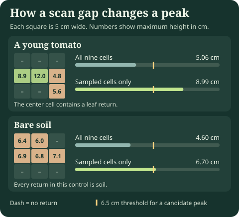

# When the scanner misses the cell beside a seedling

In one clean synthetic ring scan, the standard height filter found 10 of 93 tomato seedlings within 15 cm, with zero extra pins. Changing how the filter handled gaps found **30 of 93**, with **30 extra pins**. Select plant 5 and switch between **Height-only pin** and **Height pin · sampled cells only**. Five ring-scan returns hit that plant, but only the sampled-cell method placed a matching pin. [Explore this 60,000-ray field](https://mvalancy.github.io/crop-trainer/?crop=tomato&plantArchitecture=2&plantForm=seedling&plantCondition=healthy&sensor=reference&budget=60000&seed=3398269&noise=clean&weeds=off&sticks=off&boards=off&studyMode=layouts&studyMetric=sampledPins&studyBox=5#scan-study)

## What changed?

Both methods take the highest XYZ return in each 5 cm cell, smooth a three-by-three neighborhood, then keep local peaks at or above 6.5 cm. They rank the peaks by height and require 22 cm between selected pins. The standard filter divides by the full kernel weight of 16. The experimental filter divides by the weights of cells that received a return and requires a measured center cell. In both filters a measured soil return at zero height counts as a genuine measurement. Neither method fits weights. Saved neural models use their original feature extraction. [Peak extraction](../trainer/data.js) · [Scanner geometry](scanners.md)

The illustration uses two neighborhoods from a 60,000-ray synthetic ring scan at seed `1370561`. The center bin weighs four, each side neighbor two and each corner one. Near plant 8, at XY (5.475, 0.675) m, the computed height rose from 5.06 to 8.99 cm. A soil patch at (5.875, 1.025) m also crossed the gate, from 4.60 to 6.70 cm, over 36 cm from the nearest label. [Replay plant 8 on the paired scans](https://mvalancy.github.io/crop-trainer/?crop=tomato&plantArchitecture=2&plantForm=seedling&plantCondition=healthy&sensor=reference&budget=60000&seed=1370561&noise=clean&weeds=off&sticks=off&boards=off&studyMode=layouts&studyMetric=sampledPins&studyBox=8#scan-study)

We generated six fresh healthy seedling plots and then repeated the fixed 6.5 cm comparison on four more. Each planting had four scans at 60,000 sampled rays, with identical plant boxes across scans. The clean grid and OS1-64-inspired rings included soil. The cluttered variants added weeds, sticks, boards, seeded range and position noise, gaps, stray points and clustered returns. Each detector saw only XYZ. The scorer matched centers to modeled plant-box midpoints one to one.

## What improved on fresh plantings?

These are pooled F1 scores at **7.5 / 10 / 15 cm**, in that order. The primary group contains 620 seedlings. The independent confirmation contains 411.

| Scan | Standard, six plots | Sampled cells, six plots | Standard, four new plots | Sampled cells, four new plots |
| --- | --- | --- | --- | --- |
| Clean grid | .211 / .236 / .255 | .286 / .323 / .337 | .206 / .247 / .258 | .257 / .303 / .313 |
| Cluttered, noisy grid | .117 / .148 / .201 | .147 / .179 / .233 | .105 / .136 / .196 | .122 / .164 / .212 |
| Clean rings | .158 / .173 / .184 | .325 / .372 / .395 | .143 / .152 / .165 | .307 / .371 / .393 |
| Cluttered, noisy rings | .096 / .133 / .186 | .149 / .190 / .244 | .072 / .103 / .177 | .148 / .188 / .246 |

At 15 cm the sampled-cell method improved F1 on every clean and cluttered ring planting. Two of the four new cluttered grid plantings lost F1. With the lower 3.5 cm height floor in the original six plots, ring F1 fell from .334 to .327 on clean scans and from .227 to .225 with clutter. The choice of gate matters.

## Can soil alone make a peak?

Yes. We used the generator's point classes to remove every return except soil, then passed the remaining XYZ through the same two filters. Every resulting pin is false. Removing crop returns leaves gaps where the canopy hid the soil. These are partial scans of the original terrain.

| Soil-only input, 6.5 cm gate | Standard false pins | Sampled-cell false pins |
| --- | ---: | ---: |
| Clean rings, six plots | 1 | 166 |
| Noisy rings, six plots | 25 | 261 |
| Clean rings, four new plots | 0 | 104 |
| Noisy rings, four new plots | 20 | 179 |

On the four new clean ring plots, five soil-only pins fell within 15 cm of an original plant center by chance. On the noisy ring plots, keeping all noncrop returns produced **456** standard pins and **673** sampled-cell pins. A nearby peak can come from terrain or clutter. Using this filter to seed a classifier would require fitting and testing a classifier on those new proposals. Its physical field accuracy is unmeasured.

## Reproduce the comparison

```sh
node benchmark/seedling-peaks.mjs > seedling-peaks.json
```

The JSON contains the recipe settings and seeds, scan IDs, proposal coverage before spacing, final true/false/missed counts at every tolerance, and accidental matches on negative controls. One Node.js 24.22.1 CPU run on an AMD EPYC 7763 used 1.91 s for generation, 0.06 s to extract controls, 0.55 s for the standard filter and spacing, 0.75 s for the sampled-cell method, and 0.65 s for matching. These timings include scoring the control clouds and lower-gate variants. [Benchmark source](../benchmark/seedling-peaks.mjs) · [Why scan density matters for seedlings](seedling-density.md)
