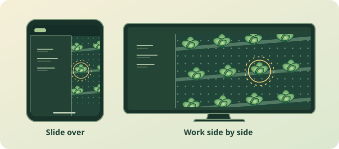
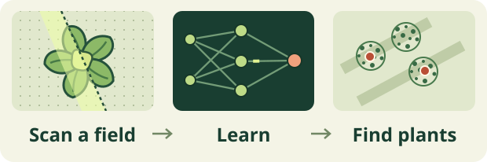
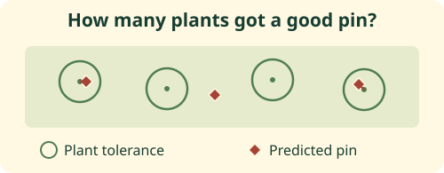
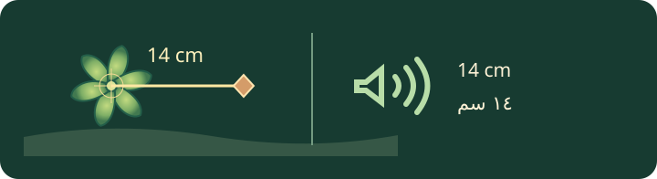

# Keeping the field in view

Try turning a scan until you can see between two leaves. Now change the scan noise. When you come back, those leaves are a landmark. In the learning studio, keeping that spot in view matters as much as giving every control a home. [Open the studio](../studio/?view=scan)

## Where does a control belong?

QField lets a field worker move around the map and open a side dashboard for layers. That distinction fits a scan you can orbit. Android’s supporting-pane guidance describes how two related views can share a wide window. Windows’ split-view guidance explains what changes when a pane overlays the content or occupies its own column. These are published design patterns. The choices below apply them to Crop Trainer. [QField map interaction](https://docs.qfield.org/fieldwork/qfield-interface/map-interaction/) · [Android supporting panes](https://developer.android.com/develop/adaptive-apps/guides/build-a-supporting-pane-layout) · [Windows split views](https://learn.microsoft.com/en-us/windows/apps/develop/ui/controls/split-view)

| Activity | What stays in view | What opens alongside it |
| --- | --- | --- |
| Learn | A scene about one lettuce, with playback and a way to try the idea | Practice and journal are separate destinations |
| Scan | The point cloud, scan status and Scan field | Planting, 3D view, plant and scanner settings, findings and downloads |
| Train | The live fit, progress, Start training or Cancel, then View scores | Setup, model diagram, training plan and run notes |
| Compare | Both detectors’ run progress and the Compare or Cancel button | The experiment setup, presets and live scoreboard. Completed results have their own page |
| Field test | The plot, detection status and action for the chosen input | Example planting, local files and findings |
| Docs | A whole illustrated chapter | The chapter list takes the reader through the guide |

## How much room does the field need?

On a phone, **Settings** opens a left sheet with one full-width choice per row. Choose **3D view** to change the viewpoint, or **Plant & scanner** to change what the sensor measures. Close the sheet to use the full field again. A wide desktop keeps a collapsible panel on the left so you can see a model diagram or read the scoreboard beside the live view. The primary action has its own space throughout a run.

The modal has a visible close control. Escape dismisses it, browser Back retraces opening it, and focus returns to Settings. An explicitly opened help hint takes the first Escape. These details let someone edit a recipe and return to the same task with a keyboard. [W3C modal dialog pattern](https://www.w3.org/WAI/ARIA/apg/patterns/dialog-modal/)

## When does a nearby pin count?

Open **Field test → Explore** and watch the lower-right lettuce. Its predicted pin lies 14 cm from the center in this illustrated plot. At 10 cm it counts as an extra pin and the lettuce counts as missed. At 15 cm the two form one match. Try the same question in a scored field test using its **Match distance** control. The real report uses the references supplied for that scan. [Try the match-distance experiment](../trainer/#explore-test)

## How can you hear what the scanner found?

Choose a language beside Theme. The list begins with English and العربية, followed by Español, 简体中文 and Français. Play starts the film. Its narrator names the objects, describes their movement and reads the change in score. The visible caption tells the same story. You can select any scene with a keyboard.

Listen opens a transcript and reads the current activity or chapter. Choose a heading, replay a passage or adjust the speed. Escape closes the player and returns focus to Listen. Screen readers also have access to the headings, labels, image descriptions and live results with narration closed. A recording plays where available. For new text and run results the browser downloads the selected neural voice on demand and speaks locally. [W3C guidance on accessible audio and video](https://www.w3.org/WAI/media/av/)

## What should survive an edit?

Try setting a field seed, closing Settings, orbiting the scan and reopening the same section. The seed should still be there. Try reading the scoreboard while a comparison runs. The worker should continue, and opening the phone drawer should leave the canvas and Cancel button at the same coordinates. These are repeatable browser checks. How readily a first-time learner finds the scanner and explains a missed plant still needs observation with learners.

The studio groups work by the learner’s question. Today a scan supplies XYZ returns. A future camera exercise can share learning, field references and scoring while using its own image controls and measurements. **3D view** names how you look at today’s point cloud. [LiDAR and camera inputs in the field guide](README.md#choose-a-sensing-method)
