# Can four fields tell us where to set the cutoff?

Four calibration plantings helped two of three freshly trained detectors find more seedlings on both scan layouts while keeping branching-plant precision within the agreed limit. The third kept its starter. A shared cutoff of 0.70 also succeeded on two of the three.

A tomato detector gives each candidate peak a score. A peak at 0.58 clears a cutoff of 0.50 and drops out at 0.70. Its laser returns, its score and the model’s weights stay the same. What changes is whether that peak can become a pin.

Why choose a cutoff separately for each fitted model? In an earlier experiment, two models scored the same 405 peaks near synthetic seedlings. At 0.70, one accepted 122 peaks and the other accepted six. A cutoff that worked for one set of weights could behave very differently for another. [See both score distributions](tomato-training-duration.md#was-it-the-planting-or-the-trained-model)

## How did we keep the test fair?

1. **Train.** From six mixed-stage tomato plantings we drew 300 plant examples and 300 background examples. The 40-epoch starter and 640-epoch model used the same rows, scaling and initial weights. An epoch is one pass over those 600 examples. We repeated this pair with three different training seeds.
2. **Calibrate.** We took four other plantings, scanned seedlings and branching plants on both layouts, and tried 19 cutoffs from 0.05 to 0.95 on each 640-epoch model. Calibration here means choosing a decision cutoff. Each model kept one cutoff for both plant stages and both scan layouts. We repeated the choice using four different calibration plantings to see how sensitive it was to the choice of fields.
3. **Test.** We saved the models and their decisions before scoring six more plantings. Each contender faced the same soil-present grid and ring scans. The controls included the 40-epoch starter at 0.50, the longer fit at shared cutoffs of 0.50 and 0.70, and a rule that picks high peaks. [Guide to tuning decision thresholds on separate data](https://scikit-learn.org/stable/modules/classification_threshold.html#post-tuning-the-decision-threshold)

On the four calibration plantings, a longer fit had to improve seedling **F1** on both scan layouts. F1 rewards finding real plants while limiting extra pins. On branching plants, **precision**, the share of pins that match a plant, could fall by at most one percentage point on each layout. We compared each fit with its own 40-epoch starter at a 15 cm matching distance.

Among cutoffs that passed, we chose the one with the largest seedling F1 improvement on the weaker layout. Ties favored the cutoff closest to 0.50 and then the higher cutoff. If none passed, the rule kept that fit’s starter. These choices were fixed before scoring the test fields. On the reserved fields, the detector had to find more seedlings and improve seedling F1 on both layouts while keeping branching precision within the same limit.

## What happened on the six reserved plantings?

Each layout saw the same **618 plants per stage**. The table compares each 40-epoch starter at 0.50 with the choice made on its four calibration plantings. Seedling counts show **matched plants / extra pins** within 15 cm. For example, the first grid detector found 88 of 618 seedlings and missed 530.

| Training seed and choice | Seedling matches / extras, starter → choice | Branching precision | Branching plants missed |
| --- | --- | --- | --- |
| 1403129 · grid · 0.65 | 24 / 3 → 88 / 0 | 75.8% → 77.2% | 6 → 13 |
| 1403129 · rings · 0.65 | 94 / 7 → 138 / 2 | 68.5% → 69.1% | 29 → 37 |
| 1514021 · grid · 0.75 | 1 / 39 → 9 / 7 | 75.5% → 84.0% | 10 → 14 |
| 1514021 · rings · 0.75 | 4 / 20 → 37 / 0 | 73.9% → 76.3% | 28 → 40 |
| 1687553 · grid · kept starter | 3 / 21 | 76.2% | 6 |
| 1687553 · rings · kept starter | 9 / 12 | 72.6% | 24 |

The increased precision on branching plants came with more misses on all four rows where the chosen detector changed. For seed 1403129, the long fit found more seedlings on **every** test planting, gaining 4–17 on individual grids and 1–16 on individual ring scans. Seed 1514021 gained 1–5 on four grids and tied on two. It gained 1–9 on all six ring scans. These are paired changes on the same plantings.

### How does that compare with a shared cutoff?

At 640 epochs and 0.50, all three models lost too much precision on branching ring scans. A shared **0.70** met both the precision and seedling recovery requirements for the same two training seeds as individual calibration. For seed 1403129, its individually chosen 0.65 found 88 grid and 138 ring seedlings, compared with 50 and 107 at 0.70. For seed 1514021, the individually chosen 0.75 found **fewer** than 0.70 on both layouts (9 and 37 versus 14 and 51).

Simply keeping high peaks found 465 grid seedlings with 1,426 extra pins and 402 ring seedlings with 832 extras. The comparison illustrates the cost of accepting soil peaks. Even the best of the individually chosen models found fewer than a quarter of the seedlings on either layout.

For a closer look, here are seed 1403129’s **matched ring seedlings / extra pins** for three allowed distances. All three rows score the same predicted pin coordinates for each model.

| Maximum distance | Starter · 0.50 | 640 epochs · shared 0.70 | 640 epochs · chosen 0.65 |
| --- | --- | --- | --- |
| 7.5 cm | 81 / 20 | 87 / 21 | 115 / 25 |
| 10 cm | 89 / 12 | 100 / 8 | 131 / 9 |
| 15 cm | 94 / 7 | 107 / 1 | 138 / 2 |

The matching distance also changes the precision tradeoff. At 7.5 cm the first and second upgraded models lost 2.78 and 2.26 percentage points of branching precision on rings. At 10 cm they lost 1.50 and 1.84 points. Both qualified under the original 15 cm rule. A job that needs closer pins should define that distance before choosing a cutoff.

## How much does the choice of four fields matter?

Using the second group of four fields changed **all three decisions**. Its choices were 0.70, 0.80 and 0.70, all with the 640-epoch fit. On the reserved plantings only the first found additional seedlings and met the branching precision requirement on both layouts. For the second fit, grid seedling matches stayed at one. For the third they fell from three to one.

Why did the second group recommend the third fit? At 0.70, its grid seedling matches on those four calibration fields stayed at one, but extra pins fell from 13 to zero. That improved F1 just enough to qualify. On the first four calibration grids, neither model found a seedling, so their F1 scores tied at zero. Counting the plants recovered on the reserved fields exposed the difference.

We also reran the selection rule on all 70 ways of drawing four fields from those eight calibration plantings. The third detector kept its starter on **35 of 70** selections. The first and second kept theirs on 18 and nine respectively. Using all eight calibration fields selected 0.65, 0.70 and 0.70. These overlapping selections describe sensitivity to the choice of fields. They share the same fitted models and frequently the same plantings.



## What happens when weeds fill the gaps?

We kept the same models and cutoffs and planted six fresh fields, with **655 tomatoes per stage and layout**. We scanned each field twice, once as planted and once with 64 synthetic weeds. Each pair used identical tomato positions and horizontal beam coordinates. Even on the fresh clean fields, only one of the three individually calibrated models met the full recovery and precision goal. With weeds, none did. The shared 0.70 cutoff met the same goal for one of the three fits on clean fields and two of three with weeds.

The first fit shows why matching counts need context. At 0.65 it found **98 ring-scanned seedlings with two extra pins** on clean fields. With weeds it found **113 with 217 extra pins**. A pin on a weed can land within 15 cm of a real seedling. A nearby match alone cannot establish which plant produced the peak. Branching precision for that fit also fell below its starter by 2.42 points on grids and 1.28 points on rings with weeds.

Where did those extra pins land? After scoring, we looked up the highest raw laser return in the 5 cm square under each unmatched seedling pin. With weeds and the 0.65 cutoff, a weed was highest under **214 of 221 extra grid pins** and **188 of 217 extra ring pins**. Of the other 29 ring pins, five landed over soil and 24 landed in squares with no returns. On clean ring scans both extra pins landed over soil. With the second model at 0.75, weeds were highest under 105 of 115 extra grid pins and 121 of 133 extra ring pins. The generator supplies these surface labels after prediction. They describe what occupied each pin’s final square. The detector also uses surrounding heights to score a peak and refine its position.

These measurements cover synthetic young tomatoes in soil on reference-grid and simulated OS1-64 ring scans. Whether these cutoffs work in a field requires independently measured plant positions on physical scans.

The follow-up experiment trained the detector on the weeds it was most likely to mistake for tomatoes. On fresh fields it sometimes reduced false alarms at the cost of missing more seedlings. [Compare the two training draws and inspect their pins](tomato-hard-negatives.md)

## Try one cutoff in Field Test

Open the saved 640-epoch detector, click **Run example**, then **Try 0.70 on this planting**. At 15 cm, **What changed with this cutoff?** shows 53 → 26 matches, 23 → 5 extra pins and 57 → 84 missed seedlings. Choose **Changed matches** under **Map view** to see the 27 seedlings that lost a match. To try your own value, open **Try a different model cutoff**, set **Score cutoff** and choose **Find plants**. This practice plot comes from the earlier study. It is separate from the six test plantings used here. [Try the saved tomato detector](https://mvalancy.github.io/crop-trainer/trainer/?fieldExample=tomato-640#field-test)

## Reproduce the comparison

The three CPU training pairs used six healthy mixed-stage plantings each, a 60,000-ray reference grid, local-ground features and a 3.5 cm minimum peak height. Each four-unit tanh network started at initialization seed 12345 and used full-batch gradient descent at a learning rate of 0.25. Test fields included soil and used 60,000 rays on each layout.

In one CPU run, preparing all three training sets took 5.48 s. Fitting each starter took 0.034–0.093 s and each longer model took 0.36–0.42 s. Scoring the 19 candidate cutoffs and starter controls took 23.42 s on the first calibration group and 20.90 s on the second. Generating the 24 final scans took 0.92 s, and scoring the frozen models on them took 7.11 s.

Run these commands in order from the repository root with Node.js 22 or later.

```sh
node benchmark/studies/tomato-fit-calibration.mjs calibrate > tomato-calibration.json
node benchmark/studies/tomato-fit-calibration.mjs confirm tomato-calibration.json > tomato-confirmation.json
node benchmark/studies/tomato-calibration-panels.mjs tomato-calibration.json > tomato-panels.json
node benchmark/studies/tomato-fit-calibration.mjs weeds tomato-calibration.json > tomato-weeds.json
```

The first command saves the training seeds, models, calibration scan IDs, scores and selected cutoffs. The second verifies the freeze hash before generating any test scan. Its report includes per-planting and pooled counts at all three distances. The third command uses the calibration file alone to examine the 70 four-field selections. The fourth replays the frozen choices on the six fresh fields with and without weeds. Each learned model’s `extraSurfaces15` counts identify the surfaces under its unmatched pins at 15 cm. In one CPU run those 48 scans took 3.59 s to generate and 14.16 s to score. The recorded freeze hash is `8c02442f42733a3b6f69d3036ff7998b0424fe7a37b594436befa5616f9380ff`. [Per-fit experiment](../benchmark/studies/tomato-fit-calibration.mjs) · [Four-field sensitivity check](../benchmark/studies/tomato-calibration-panels.mjs)
