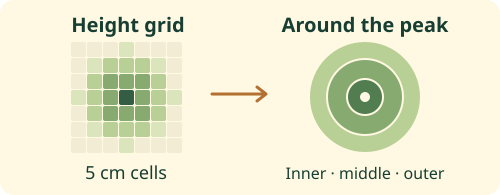
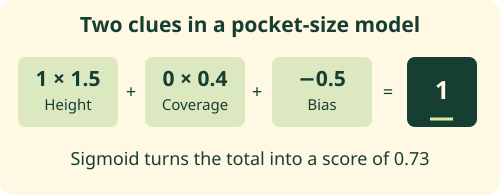

# How tall is a peak compared with the ones the model practiced on?

A 9.50 cm peak in a tomato scan became an input of **−0.44** in one trained detector and **−0.76** in another. The scan was identical. The training examples supplied different reference heights. In twelve controlled fits, changing that reference sometimes helped find seedlings and sometimes cost matches.

A model gets 13 measurements around each candidate plant center. Some describe height in metres. Others describe the fraction of surrounding cells that have laser returns. Before training, Crop Trainer puts each measurement on a common scale. It subtracts the **training mean** and divides by the **training standard deviation**, a measure of spread. A value of 0 means “at the training average.” A value of −1 means “one training spread below average.” [How standardization works](https://scikit-learn.org/stable/modules/generated/sklearn.preprocessing.StandardScaler.html)

## Try it with one peak


Open the saved weedy tomato example and choose **Run example**. Under **How are scan measurements scaled?**, select **Smoothed peak height**. A diamond on the trained-model map marks the candidate nearest the center of the plot. Both saved detectors see the same 0.09497 m peak at about (5.02 m, 5.02 m). The diagram above shows the same heights in centimetres. [Inspect the saved detector in Field Test](https://mvalancy.github.io/crop-trainer/trainer/?fieldExample=tomato-weed-hard#field-test)

| Training examples | Training mean | Training spread | Scaled height for this peak |
| --- | ---: | ---: | ---: |
| Ordinary backgrounds | 13.97 cm | 10.16 cm | (9.50 − 13.97) ÷ 10.16 ≈ **−0.44** |
| Half difficult backgrounds | 16.91 cm | 9.71 cm | (9.50 − 16.91) ÷ 9.71 ≈ **−0.76** |

Choose **Try the other fit** to repeat the measurement. Both the scaling and the learned weights differ between these saved detectors. To see what scaling alone changes during training, we need a comparison that holds the practice examples fixed.

## Train four models on the same plantings


We took an ordinary shuffled draw of 300 background peaks. For a second draw, we reserved half of those 300 places for peaks a 40-epoch starter scored highly. The second draw kept the ordinary counts of background peaks near and far from a tomato center. Both draws included the **same 300 positive examples**. We calculated a set of 13 means and spreads from each draw’s full 600 training rows. [How the distance rule selects difficult backgrounds](tomato-hard-negatives.md#does-it-help-to-keep-the-same-mix-of-near-and-far-peaks)

| Practice examples for the final fit | Use means and spreads from |
| --- | --- |
| Ordinary | Ordinary examples |
| Ordinary | Difficult examples |
| Difficult | Ordinary examples |
| Difficult | Difficult examples |

Each row trains a new four-unit network for 640 epochs, starting with identical weights. For a **scaling comparison**, keep the practice examples fixed and read the two fits across scales. For a **sampling comparison**, keep the scale fixed and compare the fits trained on different examples. Each exported detector carries the scale it used in training, so Field Test can apply it to a new scan.

We repeated the four fits on three fresh training seeds. Before looking at six reserved plantings, we froze the models and the operating cutoff of 0.65. At a matching distance of 15 cm, success meant fewer extra seedling pins on both weedy layouts than ordinary examples with ordinary scaling. Seedling recall and branching-plant precision also had to stay within one percentage point of that fit, or improve, on each layout under both clean and weedy conditions. Grid and ring scans covered the same planted centers. Only training examples supplied the means and spreads.

## Which seedlings did the detectors find?



Each column shows the same **678 seedlings on six weedy ring scans**. The first number in each cell counts matched seedlings at 15 cm. The second counts extra pins. The seed at the top tells you which training plantings made those weights.

| Practice examples · scale source | Seed 3301907 | Seed 3413033 | Seed 3524159 |
| --- | ---: | ---: | ---: |
| Ordinary · ordinary | 2 / 9 | 166 / 181 | 25 / 91 |
| Ordinary · difficult | 1 / 8 | 169 / 179 | 13 / 70 |
| Difficult · ordinary | 4 / 1 | 184 / 151 | 65 / 77 |
| Difficult · difficult | 2 / 1 | 47 / 50 | 116 / 111 |

For seed **3413033**, using the difficult-example scale found three more seedlings with ordinary practice (166 → 169). With difficult practice, that same scale change lost **137** seedlings (184 → 47). Every one of the six ring plantings lost matches, ranging from 16 to 29 per planting. The difference persisted at tighter distances. The two fits with difficult examples found 149 versus 37 at 7.5 cm and 168 versus 42 at 10 cm.

Seed **3524159** went the other way. With difficult practice, switching to the difficult scale **gained 51** seedlings (65 → 116) and added 34 extra pins. All six plantings gained matches, from four to 13 each. For comparison, simply picking tall peaks on these same fields found 348 seedlings with 1,045 extra pins.

Across both scan layouts, both weed conditions and both growth stages, **difficult examples with ordinary scaling met the agreed test for two of the three training seeds**. Each of the other changes met it on just one seed. For seed 3301907, all three changes passed, yet even its best fit found only four of the 678 weedy ring seedlings.

Branching precision measured the share of pins that matched an older plant. A detector could pass while placing fewer pins there. On weedy rings, the two qualifying fits with difficult examples and ordinary scaling raised branching misses from **65 to 170** and from **30 to 99** compared with their ordinary controls. These measurements cover simulated fields. Measuring performance on a farm would require physical scans and independently surveyed plant centers.

### Could an existing detector read either scale?



Yes, if we also convert the weights and biases that read the 13 inputs. Think of rewriting a calculation in centimetres when it originally accepted metres. The numbers entering the calculation change, and the conversion preserves what the calculation predicts. We tested this on 48 more scans containing 25,787 candidate peaks. For every tested fit, changing the scale **and** converting the first layer preserved every peak’s decision at 0.65 and every final pin location. Dropping another fit’s scale into the file without converting that layer changed decisions. [How to change a scale while preserving the detector’s calculation](tomato-scaler-transport.md)

## Try your own four fits in Benchmark


Choose **Does feature scaling matter?** in Benchmark. The tomato preset pairs grid training scans with ring validation scans, using the same four combinations of examples and scales. Select **Run benchmark**, choose a training seed in the results, then **Save weights** for the combination you want to try in Field Test. Its first training seed matches the study. Benchmark generates its own validation plantings. To score the six reserved plantings in the table, use the commands below. [Train the four combinations in Benchmark](https://mvalancy.github.io/crop-trainer/benchmark/?comparison=scaling&crop=tomato&plantArchitecture=2&plantForm=mixed&plantCondition=healthy&validationPlantForm=seedling&sensor=reference&validationSensor=os1-64&trainingRayBudget=60000&validationRayBudget=60000&minimumHeight=0.035&featureMode=local-ground&sampleLimit=600&epochs=640&seed=3301907&scoreGround=present)

## Reproduce the held-out experiment


Run from the repository root with Node.js 22 or later.

```sh
node benchmark/studies/tomato-scaler-cross.mjs plan > scale-plan.json
node benchmark/studies/tomato-scaler-cross.mjs fit > scale-fits.json
node benchmark/studies/tomato-scaler-cross.mjs confirm scale-fits.json > scale-test.json
```

The fit file records each model, its scale, the raw training-row hashes and the hash of its scaled inputs. Confirmation verifies the weights and their scales before scoring the clean and weedy versions of each planting. The `contrasts` in the report show the change in matches and extra pins when you vary one factor at a time. The `guard` entries list the conditions each fit passed. [Experiment and frozen settings](../benchmark/studies/tomato-scaler-cross.mjs)

In one CPU run, generating the three sets of training scans took 2.48 s in total. Each final 640-epoch fit took 0.25–0.62 s. The 48 confirmation scans took 2.03 s to generate and 13.31 s to score. The twelve frozen models and their training records are identified by `896cd41880301f12a17903a70e11285628d1686d184f647814ac37c5593ef0fb`.
