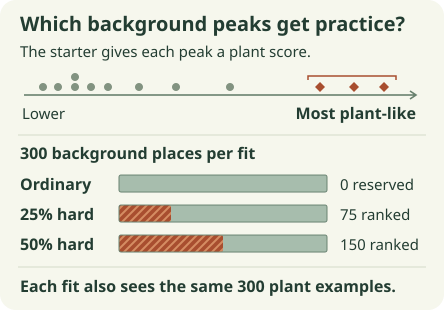
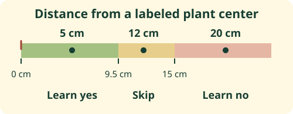
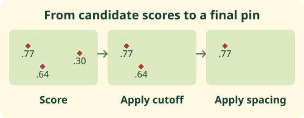

# Can a tomato detector learn from its most convincing mistakes?

A weed can make a small hill in a laser scan, just like a tomato seedling. In an earlier test, a detector placed 217 extra pins on weedy ring scans. A weed was the tallest return in the square under 188 of them. Could we teach the detector to pass over more of these peaks while keeping the real seedlings? [What was under the extra pins?](tomato-calibration.md#what-happens-when-weeds-fill-the-gaps)

**Both training mixes fell short.** One model cut its extra pins from 209 to 145 on weedy ring scans, but also missed 79 more seedlings. Another lowered extra pins on every weedy ring scan and came within three seedlings of the agreed limit. The same training recipe behaved differently across the three training seeds.

## How do you find a difficult example?



Imagine highlighting a peak more than 15 cm from every planted center. It belongs in the background training group for this experiment. If a starter model still gives it a high plant score, that's a **hard negative**. We can give the next model more practice on peaks like this. A weed, a soil mound or the outer leaf of a tomato can all qualify.

1. **Label the training peaks.** Within 9.5 cm of a planted center, a peak counts as a plant example. Beyond 15 cm from every center, it counts as background. Set aside the strip in between, where the label is ambiguous.
2. **Rank the background once.** For each training seed, fit a starter for 40 passes on a shuffled mix of 300 plant and 300 background examples. It scores every eligible background peak on its training fields using measurements from the XYZ scan. The highest plant scores identify the peaks to practice.
3. **Train three new detectors.** Each starts from the same initial weights, sees the same 300 plant examples and gets 300 background examples. Each fits its own feature scaling on the rows it uses. The three mixes differ in how many background places they reserve for high-scoring peaks.

| Background mix | Highest-scoring peaks reserved | Drawn in shuffled order from the rest |
| --- | ---: | ---: |
| Ordinary | 0 | 300 |
| 25% hard | 75 | 225 |
| 50% hard | 150 | 150 |

The ordinary draw can include difficult peaks by chance. For example, the first seed produced 3,419 eligible background peaks. Its 50% mix kept 168 of the 300 ordinary background rows. Their average plant score, measured by the starter across the selected background set, rose from 0.27 to 0.52.

This borrows an idea from image detection. Dalal and Triggs ran an initial pedestrian detector on background images, collected false alarms and used them to retrain it. Shrivastava, Gupta and Girshick later studied choosing difficult examples repeatedly *during* training. Here we rank the synthetic background once and keep the example budget fixed. [Dalal and Triggs, CVPR 2005, §4](https://lear.inrialpes.fr/people/triggs/pubs/Dalal-cvpr05.pdf) · [Training Region-Based Object Detectors With Online Hard Example Mining, CVPR 2016](https://openaccess.thecvf.com/content_cvpr_2016/html/Shrivastava_Training_Region-Based_Object_CVPR_2016_paper.html)

## What was under the hardest background peaks?


**Most were on tomato tissue.** After training, we replayed the fields and looked up the tallest laser return in the original grid cell for each of the 150 highest-scoring background peaks per training seed. Among those 450 cells, **276 had tomato tissue on top, 170 had a weed, zero had soil and four had no return**. A peak can occur in an empty cell because the detector estimates local height from neighboring cells.

The model is learning where to put one pin per tomato. A leaf tip more than 15 cm from every planted center qualifies as background for that job, even when the leaf belongs to a healthy tomato. Of the 276 tomato-topped cells, 273 peaks lay between 15 and 30 cm from the nearest center. Practicing on those peaks may teach the model to reject shapes it also sees near seedlings. The replay shows which examples were selected. Isolating their effect would require changing which surfaces enter the mix while keeping its size fixed. The surface labels were read only after the starter and final fits were frozen. [Training-surface audit](../benchmark/studies/tomato-hard-negative-surfaces.mjs)

Weeds beside tomatoes are also common in physical fields. In one Spanish field-photo collection, 620 of 626 images with a labeled tomato also contained a named weed. Those overhead photos show plant footprints in pixels. Testing LiDAR pin locations in centimeters requires surveyed centers and physical scan coordinates. [Photo measurements, sources and license](field-datasets.md#how-often-do-weeds-share-a-photo-with-a-young-tomato)

## What would count as an improvement?


We fixed 50% hard as the main comparison and 25% hard as a second comparison. Each was judged against its ordinary fit at the same **0.65 score cutoff**. On six reserved plantings, both grid and simulated OS1-64 ring scans had to show fewer extra seedling pins with weeds. At the same time, seedling recall and branching-plant precision could each fall by at most one percentage point on either layout, on clean scans and on their weedy twins. The matching distance for this decision was **15 cm**.

Think of a **miss** as a planted tomato without a pin and an **extra** as a pin without a tomato. Recall asks how many of the planted tomatoes got a match. Precision asks how many of the detector's pins got a match. A model can improve precision simply by placing fewer pins, so the test also counts the tomatoes it missed.

Each starter and each final model had access only to training rows for fitting. The test fields supplied their reference centers only after predictions, to match pins and count errors. Synthetic surface labels helped identify which peaks were over weeds after scoring. A detector used solely from the weight file sees XYZ returns.

## What changed on the six test plantings?


There were **618 plants per layout and stage**. Each cell below shows the change from ordinary training in **matched seedlings / extra pins** on weedy fields at 15 cm. A positive first number means more tomatoes found. A negative second number means fewer false alarms.

| Training seed | Background mix | Grid · matches / extras | Rings · matches / extras |
| --- | --- | ---: | ---: |
| 2103181 | 25% hard | −5 / −12 | +17 / +22 |
| 2103181 | 50% hard | −34 / −47 | −79 / −64 |
| 2204207 | 25% hard | −2 / +1 | −3 / +5 |
| 2204207 | 50% hard | +23 / +22 | +48 / +20 |
| 2305237 | 25% hard | +2 / −47 | +59 / +40 |
| 2305237 | 50% hard | +22 / −66 | −9 / −41 |

For seed **2103181**, the 50% mix lost matches on every weedy ring planting, ranging from eight to 23 fewer seedlings. It also reduced extras on every planting. The number of extra pins in squares where a weed was the tallest return fell from 191 to 126. On clean rings, branching precision dropped from 81.8% to 79.7%. For seed **2204207**, the ordinary fit found only four ring seedlings with weeds. The 50% mix recovered 48 more, but also added 20 extra pins.

Seed **2305237** came closest. With 50% hard examples it reduced extras on every weedy ring scan and improved branching precision by 11.27 points on weedy grids and 6.43 points on weedy rings. Its nine lost ring seedlings cost 1.46 percentage points of recall. With 618 plants, the agreed limit allowed at most six additional misses. For all three fits, the 25% mix increased extra pins on weedy rings.

The simple height-only rule found 403 seedlings with 1,679 extra pins on weedy grids and 338 with 1,055 extras on weedy rings. These results describe simulated tomatoes, weeds and scan patterns. Measuring performance on a farm would take physical scans with independently surveyed tomato positions.

### If you visit the same number of pins, which detector finds more tomatoes?



We grew four more plantings and kept the trained weights frozen. On each scan, the ordinary detector at 0.65 set the number of stops. We gave every detector exactly that many visits to its highest-ranked pins after applying the same spacing rule. This lets us compare the locations each model would send a grower.

On weedy seedlings, the first 50% hard fit found 82 grid tomatoes in 124 stops, compared with 78 for ordinary training. On rings it found 160 in 304 stops, compared with 168. The third fit improved on both layouts, with 76 versus 45 grid matches and 122 versus 115 ring matches. On branching plants, the 50% hard fit found **fewer tomatoes at equal visit counts in all 12 comparisons** across training seeds, layouts and weed settings at 15 cm. Its lower false-alarm counts at a fixed cutoff therefore tell only part of the story. [Equal-visit ranking experiment](../benchmark/studies/tomato-hard-negative-ranking.mjs)

## Does it help to keep the same mix of near and far peaks?


The first experiment gave extra practice to peaks on tomato leaves near a center. To test whether that mattered, we fixed a new rule before growing **six new test plantings**. For each of three fresh training seeds we fit models using ordinary sampling, unrestricted 50% hard sampling and 50% hard sampling with a distance rule. We froze all nine before scoring them.

The new rule copies the ordinary draw’s **number of near and far background peaks**. A near peak lies more than 15 cm and less than 30 cm from the nearest planted center. A far peak lies at least 30 cm away. If the ordinary draw has 100 near and 200 far examples, 50 of the 150 hard places go to near peaks and 100 to far peaks. The remaining places are drawn in shuffled order within each group. Training centers determine the groups. A saved detector can run on XYZ alone.

The rule changed which surfaces the models practiced on. Across these three fits, **267 of 450** deliberately selected hard peaks had tomato tissue as their highest return under unrestricted sampling. With the distance rule that fell to **107 of 450**. Weed-topped peaks rose from **182 to 342**. Each set had one empty cell. This audit uses the new training seeds and reads surface labels only after fitting.

Each layout had **655 test tomatoes per stage**. The table gives **matched seedlings / extra pins** on the same six weedy ring scans at 15 cm.

| Training seed | Ordinary | 50% hard | 50% hard with distance rule |
| --- | ---: | ---: | ---: |
| 2805643 | 286 / 463 | 256 / 457 | 148 / 154 |
| 2916761 | 11 / 33 | 272 / 363 | 31 / 14 |
| 3027871 | 61 / 101 | 146 / 193 | 97 / 100 |

For every training seed, the distance rule cut both extra pins and real seedling matches on **each of the six weedy ring plantings** relative to unrestricted sampling. For seed 2916761, each field lost 29–53 matches and shed 54–63 extra pins. This fit still found more seedlings with fewer extras than the ordinary fit, but its branching-plant precision on weedy rings fell 8.38 percentage points below ordinary.

Neither form of hard sampling met the original 15 cm goal for any of the three training seeds. Keeping the same distance mix moved training examples off tomato tissue and onto weeds. That change alone did not reliably preserve seedling recall and branching precision at the fixed 0.65 cutoff.


Changing the background examples also changed the training means and spreads used to scale all 13 inputs. A follow-up trains on the same examples with each scale in turn. [Read one measurement and compare the four fits](tomato-feature-scaling.md)

From the repository root, reproduce this separate cohort with its own saved fits.

```sh
node benchmark/studies/tomato-distance-mining.mjs fit > bands-fit.json
node benchmark/studies/tomato-distance-mining.mjs confirm bands-fit.json > bands-confirmation.json
node benchmark/studies/tomato-distance-mining.mjs surfaces bands-fit.json > bands-surfaces.json
```

In one CPU run, generating the three training sets’ scans took 2.13 s in total and each final 640-epoch fit took 0.27–0.46 s. The 48 confirmation scans took 2.01 s to generate and 9.69 s to score. The frozen fit hash was `b52894fefe4b1cdea45a7df973b6f284afdebad483c220f9db8fa2deacd77b28`. [Distance rules, seeds and study design](../benchmark/studies/tomato-distance-mining.mjs)

## Look at one planting in Field Test


Open the ordinary fit and choose **Run example**. Look at the map of planting **51112017** and its 114 seedlings, then choose **Try the other fit**. Both use the same returned points, the same 0.65 cutoff and the same matching distance. Turn on **Inspect extra pins** to examine where each unmatched prediction landed. [Open ordinary training](https://mvalancy.github.io/crop-trainer/trainer/?fieldExample=tomato-weed-random#field-test) · [Open 50% hard training](https://mvalancy.github.io/crop-trainer/trainer/?fieldExample=tomato-weed-hard#field-test)

| Match distance | Ordinary · matches / extras / misses | 50% hard · matches / extras / misses |
| --- | ---: | ---: |
| 7.5 cm | 35 / 42 / 79 | 23 / 29 / 91 |
| 10 cm | 41 / 36 / 73 | 28 / 24 / 86 |
| 15 cm | 44 / 33 / 70 | 30 / 22 / 84 |

Try switching from 15 cm to 7.5 cm. The map keeps the model’s predicted positions. A pin farther than 7.5 cm from a planted center may now count as an extra and leave a tomato missed.

### Why did Box 77 get a pin?

At 15 cm, 29 seedlings matched with both training mixes, 15 matched only with ordinary training, and **Box 77** matched only with the difficult examples. The scanner returned just one point from that plant, at a height of 10.9 cm in the scan. Its 5 cm grid square also held one soil return. The surrounding three-by-three squares contained no weed returns. The trained model scored the peak **0.65105**, just above the 0.65 cutoff, and placed its pin 11.2 cm from the plant center. Open the scan and choose **Focus plant** under **View controls** to see its return in 3D. [Inspect Box 77 in the generator](https://mvalancy.github.io/crop-trainer/?crop=tomato&plantArchitecture=2&plantForm=seedling&plantCondition=healthy&sensor=os1-64&budget=60000&seed=51112017&ground=true&weeds=on&sticks=off&boards=off&noise=clean&tile=3b07cf65952362c6&box=77#scan-viewer)



We replayed the same weights after deleting just that tomato point from the original XYZ scan. The peak finder stopped proposing that square, so the model had nothing there to score. The plot went from **30 matches, 22 extra pins and 84 misses** to **29 matches, 22 extras and 85 misses**. This test measures what one recorded return contributed to one detection. A new physical scan might reveal soil behind the plant. The replay retained the other 59,999 measurements exactly as captured. [One-return replay code](../benchmark/studies/tomato-one-return.mjs)

Across the six weedy ring plantings, the third fit went from 168 matched seedlings to 159. That nine-plant difference hid **62 newly matched seedlings and 71 lost matches**. The replay records each affected reference at all three distances, and checks every count against the original saved confirmation. [Plant-by-plant replay](../benchmark/studies/tomato-mining-match-changes.mjs)

To train your own pair, open **Do difficult backgrounds help?** in Benchmark. It fits ordinary and 50% hard backgrounds on two training seeds. Inspect the count of difficult examples, then download either fit’s weights. Benchmark grows its own validation plots. The commands below replay the published six-planting test and its clean and weedy pairs. [Train both models in your browser](https://mvalancy.github.io/crop-trainer/benchmark/?comparison=negatives&crop=tomato&plantArchitecture=2&plantForm=mixed&plantCondition=healthy&validationPlantForm=seedling&sensor=reference&validationSensor=os1-64&trainingRayBudget=60000&validationRayBudget=60000&minimumHeight=0.035&featureMode=local-ground&sampleLimit=600&epochs=640&seed=2103181&scoreGround=present)

## Reproduce the experiment


Run from the repository root with Node.js 22 or later.

```sh
node benchmark/studies/tomato-hard-negatives.mjs plan > hard-plan.json
node benchmark/studies/tomato-hard-negatives.mjs fit > hard-fits.json
node benchmark/studies/tomato-hard-negatives.mjs confirm hard-fits.json > hard-confirmation.json
node benchmark/studies/tomato-mining-match-changes.mjs hard-fits.json hard-confirmation.json > changed-plants.json
node benchmark/studies/tomato-one-return.mjs > box-77.json
node benchmark/studies/tomato-hard-negative-ranking.mjs hard-fits.json > hard-ranking.json
node benchmark/studies/tomato-hard-negatives.mjs surfaces hard-fits.json > hard-surfaces.json
```

**Plan** lists the seeds, rules and settings. **Fit** generates six mixed-stage tomato training plantings per seed, with weeds and 60,000 grid rays per scan. It saves the starter, selected-row hashes, final models and the combined freeze hash. Each final detector uses local ground features, a 3.5 cm minimum peak height, four tanh units and full-batch gradient descent at a learning rate of 0.25. **Confirm** verifies the saved models before scoring them on the six reserved plantings. The clean and weedy versions share the same tomato boxes and horizontal beam coordinates. Read `comparisons` for the predefined decision and `clean.fields` or `weedy.fields` for individual planting counts at all three match distances. [Experiment code](../benchmark/studies/tomato-hard-negatives.mjs)

In one Node CPU run, each preliminary fit took **15–71 ms**, scoring its full background pool took **7–13 ms**, and each final 640-epoch fit took **0.25–0.35 s**. Together the 48 confirmation scans took **1.68 s** to generate and **9.06 s** to score. The study used freeze hash `848a33231abb6ab64c99bc0fe1a90a548a7b93f182e2163957f2664285aba3d0`.

We also refit the ordinary and 50% mixes for seed 2103181 in a browser. WebKit CPU and Chromium’s Google SwiftShader software WebGPU adapter gave identical pin locations on all eight versions of planting 51112017. Each version combined one growth stage, one layout and one weed setting. The two CPU fits took 1.20 and 0.95 seconds. The software WebGPU fits took 35.70 and 20.11 seconds. These single runs shared a machine with other tests. A physical GPU speed comparison still needs measurements on that device.
