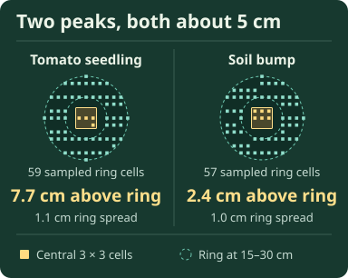
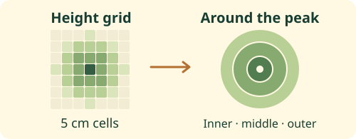
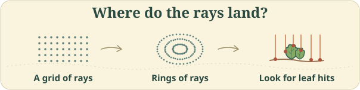

# Can nearby heights help a detector recognize tomato seedlings?

**Only on some scans.** On six fresh reference-grid plantings, a detector using nearby heights matched **143 of 607 seedlings** after soil returns were removed. Its otherwise identical model using the original features matched 80. A simple height rule matched 215. When the same scans included soil, the nearby-height model found **one seedling**. This mixed-stage model is much more reliable at finding branching tomatoes than seedlings inside the generator.

## What changed in the model?



Both models see the same crop candidates. On a grid of 5 cm cells, a 3.5 cm minimum smoothed height admits a local peak. The original model includes the center cell’s height and its contrast with a surrounding background estimate. The trial replaces those two measurements with the following features, keeping the other 11 and every candidate position identical.

- Find the minimum measured height in each occupied cell 15–30 cm from the peak. Take the 20th percentile of those minima as the local reference. Subtract it from the highest measured return in the central 3 × 3 cells.
- Subtract the 20th percentile from the 80th percentile of those same minima to describe nearby height variation. With fewer than three occupied surrounding cells, both new features are zero.

The illustration uses two measured peaks on ring scan `1370561`, outside the study cohorts. Both have smoothed heights close to 5 cm. At the peak over plant 8, the central return rises 7.7 cm above the nearby low surface. At a peak over 38 cm from any target, it rises 2.4 cm. The surrounding spreads are similar (1.1 and 1.0 cm). [Open the illustrated ring scan](https://mvalancy.github.io/crop-trainer/?crop=tomato&plantArchitecture=2&plantForm=seedling&plantCondition=healthy&sensor=os1-64&seed=1370561&budget=60000&ground=true&weeds=off&sticks=off&boards=off&noise=clean&tile=cb233b1e0e3f65f8)

A low nearby return can come from soil or a plant. The detector receives only XYZ. The experiment uses the generator’s classes to build the soil-removed control by dropping every soil return and preserving each remaining XYZ exactly. Each feature set gets its own training scale and weights. In five outdoor maize scans, the surrounding heights spread much farther apart when leaves and soil both contributed. [Measured maize surfaces and licensing](field-datasets.md#can-a-ring-of-returns-estimate-the-soil-height-near-a-seedling)

## Where did the models put pins?


Each row contains the same 607 planting positions across six independent held-out fields, rendered at the indicated stage. The **reachable** column is the most plants any selection of the raw peaks could match at 15 cm. The height rule keeps peaks in descending height order at least 22 cm apart. The last three columns show **matched / extra pins** at 15 cm. The model columns use training seed `181381`.

| Stage | Layout | Soil | Reachable | Height rule | Original features | Local-ground features |
| --- | --- | --- | ---: | ---: | ---: | ---: |
| Seedling | Grid | Present | 383 | 375 / 1,470 | 0 / 4 | 1 / 1 |
| Seedling | Grid | Removed | 215 | 215 / 0 | 80 / 0 | 143 / 1 |
| Seedling | Rings | Present | 306 | 298 / 788 | 7 / 1 | 21 / 0 |
| Seedling | Rings | Removed | 181 | 181 / 0 | 104 / 0 | 153 / 0 |
| Branching | Grid | Present | 607 | 604 / 1,398 | 599 / 67 | 603 / 67 |
| Branching | Grid | Removed | 607 | 604 / 86 | 599 / 99 | 604 / 68 |
| Branching | Rings | Present | 590 | 589 / 842 | 588 / 89 | 588 / 104 |
| Branching | Rings | Removed | 590 | 588 / 128 | 587 / 121 | 588 / 96 |

The second training seed, `293497`, also improved on soil-removed seedlings. The grid count went from 50 to 75, and the ring count from 52 to 102, with zero extra pins in all four cases. On soil-present grids it found one seedling using local-ground features. On soil-present branching rings, the first fit kept the same 588 matches and added 15 extra pins, while the second gained five matches and added six extra pins.


**Distance matters.** For grid seedlings with soil removed, the first fit gave the following pooled scores. Recall is the share of all 607 plants matched, including plants with no candidate. Precision is the share of predicted pins matched.

| Match distance | Original precision / recall / F1 | Local-ground precision / recall / F1 | Height precision / recall / F1 |
| --- | ---: | ---: | ---: |
| 7.5 cm | .863 / .114 / .201 | .882 / .209 / .338 | .921 / .326 / .482 |
| 10 cm | .988 / .130 / .230 | .979 / .232 / .375 | .991 / .351 / .518 |
| 15 cm | 1.000 / .132 / .233 | .993 / .236 / .381 | 1.000 / .354 / .523 |

**Where the soil-present grid lost seedlings.** The 3,354 candidate peaks could reach 383 of the 607 plants. For training seed `181381`, only two peaks cleared the local-ground model’s 0.50 cutoff. Both survived spacing, and one matched. The original model passed four, kept all four and matched none. Looking at features shared by both models, 387 peaks within 9.5 cm of a label had a median of 86 nearby returns (middle half 84–87), versus 85 (83–87) for 2,895 peaks beyond 15 cm. Their median outer-ring heights were 2.99 and 4.07 cm. Removing soil left 213 near peaks with a median of four returns and zero outer-ring height, and just one far peak. Soil removal changed the input distribution as well as the candidate ceiling. These feature summaries alone cannot identify which input drove the learned scores.


**Inspect one field.** On planting `25895543`, the soil-present grid contained 114 seedlings. Among 578 candidate peaks, 81 plants were reachable. The first trained pair matched zero and one. Removing the soil left 65 candidates and 62 reachable plants. The same pair now matched 33 and 46. Removing soil changed which peaks existed even though all plant returns remained identical. [Open the soil-present scan](https://mvalancy.github.io/crop-trainer/?crop=tomato&plantArchitecture=2&plantForm=seedling&plantCondition=healthy&sensor=reference&seed=25895543&budget=60000&ground=true&weeds=off&sticks=off&boards=off&noise=clean&tile=81cc6e7787152a33) · [Open its soil-removed twin](https://mvalancy.github.io/crop-trainer/?crop=tomato&plantArchitecture=2&plantForm=seedling&plantCondition=healthy&sensor=reference&seed=25895543&budget=60000&ground=false&weeds=off&sticks=off&boards=off&noise=clean&tile=f648f96b828e0a9b)

**A browser replay with clutter and scan noise.** A separate CPU benchmark trained on mixed-stage grids and validated on seedlings on OS1-64 rings. Each seed used the browser’s three held-out plantings with both soil variants. At 15 cm, local-ground features raised matches from 80 to 106 on seed `23671943` while extras rose from 325 to 370 (F1 .161 to .199). On `23671944` they raised matches from 34 to 36 and extras from 208 to 261 (F1 .0738 to .0737). Each seed changed both the training fields and the test plantings. [Replay both seed pairs in Benchmark](https://mvalancy.github.io/crop-trainer/benchmark/?comparison=features&crop=tomato&plantArchitecture=2&plantForm=mixed&plantCondition=healthy&sensor=reference&seed=23671943&validationPlantForm=seedling&live=off&minimumHeight=0.035&trainingRayBudget=60000&validationRayBudget=60000&validationSensor=os1-64&epochs=40)

## What if the scan has fewer rays?



We froze both pairs of weights and used four more plantings containing 446 targets per stage. On soil-present seedling grids, moving from **12,000 to 60,000 rays** raised the number of plants reachable by a raw peak from **50 to 279**. The height rule improved from 50 matches with 55 extras to 273 with 955 extras. The first local-ground model went from **19 matches to one**, with zero extras at both budgets. The second went from six to one. Higher proposal coverage coincided with lower model recall on these soil-present grids. The grids sampled fresh positions at each budget.

On soil-removed seedling grids the first local-ground model matched 26 of 26 reachable seedlings at 12,000 rays and 111 of 148 at 60,000. On soil-removed rings it matched 25 of 25 and 104 of 129. The plain height rule matched every reachable seedling in these four pooled controls. This result relies on perfect removal of simulator-labeled soil and synthetic, healthy plants. A real ground filter can remove plant points or leave soil behind.

## Repeat the comparison


The models trained on six mixed-stage v2 tomato reference-grid plantings per training seed, with 60,000 rays per scan, both soil variants and the generator’s seeded clutter and noise. Feature pairs received the same class-balanced training examples (2,378 and 2,438 rows for the two seeds). Each model used four tanh hidden units, full-batch SGD for 40 epochs at learning rate 0.25, initialization seed `12345` and cutoff 0.50. Four development, six confirmation and four density field seeds were fixed before scoring. Tests used clean, obstacle-free overhead grids and simulated OS1-64 rings. Both stages use the center of the modeled plant box as the target. All three match distances, precision, recall, F1, per-field candidate ceilings and separate CPU timings are in the JSON.

On one AMD EPYC 7763 CPU with Node 24.22.1, preparing four training datasets took 4.95 s and the four fits took 0.40 s. For the 48 confirmation scans, generation took 1.07 s, feature extraction 0.33 s, scoring all models and applying spacing 0.20 s, and matching against labels 0.10 s.

```sh
node benchmark/studies/tomato-local-ground.mjs > tomato-local-ground.json
```

Pass `development`, `confirmation` or `density` as the optional argument to score one cohort. To replay the grid diagnostic from a completed report, run `node benchmark/studies/tomato-local-ground.mjs diagnose tomato-local-ground.json`. A separate cutoff study asks whether a lower acceptance threshold can recover seedlings while preserving branching-plant performance. [Cutoff comparison on fresh plantings](tomato-terrain-cutoffs.md)

The browser preset compares the same feature modes with its own seeded validation recipes. The command reproduces the independent fields in this guide. [Study source](../benchmark/studies/tomato-local-ground.mjs) · [Open the browser comparison](https://mvalancy.github.io/crop-trainer/benchmark/?comparison=features&crop=tomato&plantArchitecture=2&plantForm=mixed&validationPlantForm=seedling&plantCondition=healthy&seed=181381&sensor=reference&validationSensor=reference&trainingRayBudget=60000&validationRayBudget=60000&minimumHeight=0.035&epochs=40&plan=quick)

We also kept the features and height cutoff fixed and changed which plant examples the model saw during training. [Compare training draws](tomato-soil-sampling.md)
