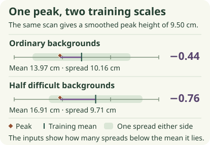

# What happens if you change a detector’s measuring scale?

**Keep the training averages and spreads with the exported weights.** In one tomato detector, replacing those numbers after training cut the number of seedlings it found from 63 to 31. Fitting a new detector on the same examples with that replacement scale raised the count to 114. Both changes measured the same 622 synthetic seedlings.

A *scaler* expresses each of the 13 peak measurements in units of its spread across the training examples. With the original first-layer weights, changing those units changes the calculation. We tested both directions between two scales. One came from ordinarily sampled backgrounds. The other came from a sample that reserved half its background places for peaks a pilot detector found difficult. All the fitted detectors below practiced on the same difficult-background rows within each training seed. [How measurements are scaled in the browser](tomato-feature-scaling.md)

## What changed on the field?

Six additional planting seeds produced the same plants for each detector. Each planting contributed grid and 64-ring captures, with and without weeds, for both seedling and branching tomatoes. All 48 soil-present scans used 60,000 rays. We kept the cutoff at 0.65 and checked all 25,787 candidate peaks for each training seed.

These results show **matches / extra pins** at 15 cm for the six weedy seedling ring scans together. Misses are the 622 surveyed seedlings minus the matches.

| Training seed | Ordinary scale during fitting and replay | Same weights, difficult-background scale at replay | Refit for 640 epochs with difficult-background scale |
| --- | ---: | ---: | ---: |
| 3301907 | 1 / 3 | 0 / 0 | 1 / 0 |
| 3413033 | 186 / 158 | 161 / 150 | 37 / 56 |
| 3524159 | 63 / 79 | 31 / 48 | 114 / 130 |

On seed 3524159 the replay swap lost matches on **all six plantings**, while refitting gained matches on all six. The same ordering held at 7.5 cm (51 → 25 → 95 matches) and 10 cm (59 → 29 → 105). The height-only baseline found 343 seedlings at 15 cm and placed 1,037 extra pins. Most seedlings still went undetected by all three learned fits on this group.

Across the full 48 scans, changing the scale before the **first** training update moved the average candidate score by 0.0069–0.0074 in absolute value. Zero candidates crossed the 0.65 cutoff. After fitting, the same scale replacement changed which side of the cutoff 402, 679 and 568 candidates landed on for the three training seeds. Of those, 218, 343 and 161 respectively also crossed when we **refitted**. The full fit made hundreds of additional decisions the simple swap missed. These are candidate decisions before the detector enforces minimum spacing between pins.

## Can a unit change preserve a prediction?

Yes. Adjust both the first-layer weight and its bias to express exactly the same response in the new units. For each hidden unit, let `w` denote its incoming weights, `b` its bias, `μ` the training means and `σ` the stored spreads. Apply the following to every feature, leaving later layers alone.

```text
new_weight[k] = old_weight[k] × new_spread[k] / old_spread[k]
new_bias = old_bias + sum_k old_weight[k] × (new_mean[k] − old_mean[k]) / old_spread[k]
```

The saved scaler applies a linear shift and rescaling to raw features. Height and occupancy rules run earlier, and standardization applies no clipping. We used the stored positive spreads, including the trainer’s floor for near-constant features. We checked both directions on the actual training draws (600 rows per draw, with overlap) and on every held-out candidate before and after training. The maximum candidate-score difference was **0.000000269**, and all final pin locations agreed. The small residual comes from Float32 rounding.

## What if two fits begin with the same predictions?

We converted the **initial** first-layer weights so a model using the difficult-background scale began with the same raw-input scores as the original model using the ordinary scale. Then we trained it for 640 epochs on exactly the same 600 difficult-background practice rows. The same seed, learning rate and full-batch SGD applied to all three fits. Comparing scores before fitting on 26,384 peaks from **six further planting seeds** gave a maximum difference of 0.000000060. Those plantings were reserved before the new models were fitted.

The table shows **matches / extra pins** at 15 cm across 649 weedy, ring-scanned seedlings. Between the first and third columns of results, the starting predictions agree and learning takes place in different units. Between the second and third, training takes place in the same units and starts from different predictions.

| Training seed | Ordinary scale, ordinary start | Difficult scale, original seed weights | Difficult scale, start matched to ordinary |
| --- | ---: | ---: | ---: |
| 3301907 | 4 / 2 | 1 / 3 | 14 / 9 |
| 3413033 | 177 / 171 | 62 / 60 | 70 / 73 |
| 3524159 | 65 / 81 | 112 / 127 | 69 / 79 |

For **3413033**, even after matching the starting predictions, fitting in different units lost 107 matches. All six plantings lost between 13 and 23 seedlings. The units matter because a gradient step on a standardized input produces a different change in score per metre of raw height.

For **3524159**, changing *only the starting predictor* within the difficult scale reduced matches by 43. The matched-start fit retained 68 of the original 112, gained one, and lost 44. All six plantings lost a net five to nine matches. The same direction held at 7.5 and 10 cm. On seed **3301907**, matching the start gained 13 with zero lost.

Branching tomatoes responded differently too. On weedy ring scans, matching the start changed branching precision from 82.2% to 78.4%, 68.3% to 66.4%, and 69.0% to 72.3% for the three difficult-scale fits in table order. Scaling and initial predictions can both matter, with direction and size varying across practice draws. These results describe small synthetic tomato models. A field-performance claim needs independent physical surveys.

## Reproduce

From the repository root, run the following with Node. The first command produces the frozen source models for the follow-up. The last command checks their hashes, rebuilds the practice rows, and writes per-field scores at 7.5, 10 and 15 cm for the four replay paths and the height baseline.

```sh
node benchmark/studies/tomato-scaler-cross.mjs fit > /tmp/tomato-scale-fit.json
node benchmark/studies/tomato-scaler-transport.mjs plan
node benchmark/studies/tomato-scaler-transport.mjs confirm /tmp/tomato-scale-fit.json > /tmp/tomato-scale-replay.json
```

To rerun the matched-start experiment, first freeze the newly fitted models. The confirmation command takes that receipt and reports survey matches retained, lost, gained and missed by both methods at each distance.

```sh
node benchmark/studies/tomato-scaler-start.mjs plan
node benchmark/studies/tomato-scaler-start.mjs fit /tmp/tomato-scale-fit.json > /tmp/tomato-start-fit.json
node benchmark/studies/tomato-scaler-start.mjs confirm /tmp/tomato-start-fit.json > /tmp/tomato-start-replay.json
```

The three matched-start fits took 0.25–0.33 s each. Generating the additional 48 scans took 1.71 s, and checking scores and matching plants took 11.02 s. The freeze hash was `8b2215e98b20a66b489b647a2e5514c1c8c37628a88a65b644f4999642072499`. [Matched-start study and controls](../benchmark/studies/tomato-scaler-start.mjs)

The source fits took 0.25–0.62 s each on an AMD EPYC 7763 CPU. A follow-up run rebuilt the two training draws per seed in 5.77 s, generated the 48 scans in 2.47 s and scored them in 6.09 s. The JSON includes the six additional planting seeds, timings and source model hashes. [Study code and fixed comparison](../benchmark/studies/tomato-scaler-transport.mjs)
