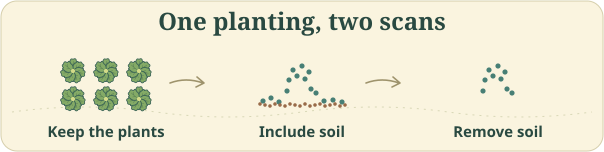
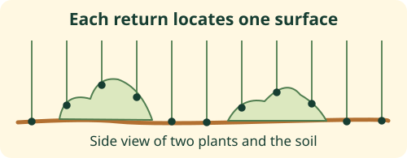

# Which tomato examples should a detector practise on?

Giving small plants more places in a 600-example training run helped the detector find **24 of 620 seedlings on ring scans**, up from nine. On grids it found one, up from zero. The model also placed more wrong pins near larger plants on ring scans. This tradeoff appeared again after changing both the training seed and the test plantings. [Try the paired comparison](https://mvalancy.github.io/crop-trainer/benchmark/?comparison=sampling&sampleLimit=600&crop=tomato&plantArchitecture=2&plantForm=mixed&validationPlantForm=seedling&plantCondition=healthy&seed=687139&sensor=reference&validationSensor=os1-64&trainingRayBudget=60000&validationRayBudget=60000&featureMode=local-ground&minimumHeight=0.035&epochs=40)

## What goes into the lesson?


A practice field contains seedlings, transplants and branching tomatoes. The generator scans each field with soil present and then removes the soil returns to make a second view. A candidate peak within 9.5 cm of a planted center qualifies as a positive example. A nearby clod can qualify by proximity. A peak farther than 15 cm from every plant qualifies as background. Ambiguous peaks between those distances stay out of training.

Each fit got 300 positive peaks and **the same 300 background peaks in the same order**. The standard sampler takes the first 300 positives after a seeded shuffle. The joint sampler divides those places as evenly as the supply allows among six groups covering three plant forms, each viewed with and without soil. It draws distinct peaks from the same pool. In the development fit, this changed the number of soil-present seedling examples from 35 to 50. The illustration shows that draw. A model receives 13 measurements from the scan. The crop stage and soil flag guide training selection only.

## What happened on fresh fields?


Before running the experiment we set a precision requirement. At a 15 cm match distance, the joint sampler could lose at most one percentage point of branching-plant precision on either layout. The first fit scored four development plantings with 457 targets per stage. On rings, joint sampling found three seedlings where the standard draw found none, but branching precision fell from 96.5% to 93.8%. Both draws missed every grid seedling.

For confirmation, we used a fresh training seed and six further plantings. Each row below contains 620 target positions. Both scanners viewed the same plantings. Every scan included soil. **Reachable** counts plants with a candidate that could match at 15 cm. The remaining columns show **matched plants / extra pins** after scoring and spacing.

| Crop stage and layout | Reachable | Height rule | Standard draw | Balanced by form and soil | Balanced by form alone |
| --- | ---: | ---: | ---: | ---: | ---: |
| Seedlings · grid | 436 | 431 / 1,418 | 0 / 1 | 1 / 0 | 5 / 0 |
| Seedlings · rings | 367 | 360 / 839 | 9 / 0 | 24 / 1 | 38 / 1 |
| Branching · grid | 620 | 619 / 1,373 | 617 / 88 | 617 / 77 | 617 / 93 |
| Branching · rings | 605 | 602 / 948 | 604 / 154 | 604 / 167 | 604 / 177 |

The joint sampler raised branching precision on grids from 87.52% to 88.90%. On rings the 13 extra pins lowered it from **79.68% to 78.34%**, a 1.34 percentage point loss. The ring result missed the precision requirement on both cohorts.

On confirmation rings, the joint model’s seedling recall at 15 cm was 3.87%. For comparison, simply keeping the highest peaks found 58.06% of seedlings, while only 30.03% of its pins matched plants. A height rule that finds hundreds of seedlings can also mistake hundreds of clods for plants.

| Allowed distance on ring scans | Standard seedling matches / extras | Joint seedling matches / extras | Standard branching F1 | Joint branching F1 |
| --- | ---: | ---: | ---: | ---: |
| 7.5 cm | 9 / 0 | 20 / 5 | .639 | .633 |
| 10 cm | 9 / 0 | 24 / 1 | .792 | .784 |
| 15 cm | 9 / 0 | 24 / 1 | .877 | .868 |

## Did the soil split itself help?


A third fit kept the joint sampler’s exact total of 100 positives for each form. Within each form, the ordinary shuffle determined which soil variants it received. On the confirmation training seed it selected **64 soil-present seedling peaks**, compared with 50 for joint sampling and 35 for the standard draw. This form-only fit recovered 38 ring seedlings and added one extra pin. Its branching precision on rings fell further, to 77.34%. Equal representation by soil setting gave no additional seedling gain over this stage-matched control. These two training seeds cover one crop, feature set, cutoff and training budget.

## What did the laser hit at a positive training peak?



A peak can fall within 9.5 cm of a planted center even when the scanner misses that plant. We traced the simulated returns for every eligible positive in the two training pools, before either sampler chose its 300 examples. For each peak, we inspected the detector’s central nine 5 cm cells, a 15 × 15 cm square. The simulator records which plant each return came from. The detector receives only XYZ coordinates.

| Labeled plant | Soil returns | Eligible peaks | Plant had zero returns anywhere | Central patch had zero returns from this plant | Tallest return in patch came from this plant |
| --- | --- | ---: | ---: | ---: | ---: |
| Seedling | Present | 290 | 8 | 13 | 273 |
| Seedling | Removed | 177 | 4 | 4 | 170 |
| Transplant | Present | 541 | 0 | 2 | 535 |
| Transplant | Removed | 550 | 0 | 2 | 544 |
| Branching | Present | 549 | 0 | 0 | 547 |
| Branching | Removed | 560 | 0 | 0 | 557 |

In the soil-present seedling pools, 3 of 146 development peaks and 10 of 144 confirmation peaks had no return from the labeled seedling in the central patch. All 13 of those patches also lacked a return from any neighboring crop. Across the two pools, only 10 of the 290 soil-present seedling patches had soil as their tallest return. Most eligible peaks contained a measured seedling, even though the trained detector missed many seedlings on fresh plantings. This check counts peaks that passed the height gate. It leaves open how many *plants* produced no peak and how strongly the 13 XYZ features distinguish leaves from nearby ground.

Run `node benchmark/studies/tomato-label-support.mjs` for the separate counts and training scan IDs. The audit uses the same two frozen training seeds and checks every group total against the production sampler. [Return audit](../benchmark/studies/tomato-label-support.mjs)

## Replay one of the fields


1. Open the confirmation preset in Training Shed. Run it and download the weights. The preset uses a 600-example limit and balances positives by plant form and soil. [Train the confirmation model](https://mvalancy.github.io/crop-trainer/trainer/?plan=quick&engine=cpu&crop=tomato&plantArchitecture=2&plantForm=mixed&plantCondition=healthy&trainFields=6&valFields=1&seed=687139&sensor=reference&trainingRayBudget=60000&validationRayBudget=60000&featureMode=local-ground&minimumHeight=0.035&epochs=40&sampleLimit=600&positiveSampling=form-soil)
2. Open the 111-seedling ring scan. Download the PLY and labels and load them with the weights in **Field Test**. At the saved cutoff of 0.50 the joint model matched ten plants within 15 cm and produced zero extra pins. Switching the training draw back to the standard shuffle and repeating the fit gives four matches and zero extras. [Open ring scan 37259107](https://mvalancy.github.io/crop-trainer/?crop=tomato&plantArchitecture=2&plantForm=seedling&plantCondition=healthy&sensor=os1-64&seed=37259107&budget=60000&ground=true&weeds=off&sticks=off&boards=off&noise=clean&tile=65628629f65a7902) · [Open Field Test](https://mvalancy.github.io/crop-trainer/trainer/#field-test)

## What if the training budget is larger?


We kept a third training seed (`883711`) and four additional test plantings for this question. Each scan layout saw the same 449 targets per stage. Each row below uses the same candidate pool, 40 training passes, a score cutoff of 0.50 and a 15 cm matching distance. Each cell gives **matches / extra pins**.

| Training draw | Examples used | Grid seedlings | Ring seedlings | Grid branching plants | Ring branching plants |
| --- | ---: | ---: | ---: | ---: | ---: |
| Ordinary | 600 | 2 / 2 | 17 / 0 | 446 / 128 | 436 / 189 |
| By form and ground | 600 | 4 / 0 | 55 / 0 | 444 / 114 | 435 / 201 |
| Ordinary | 1,200 | 1 / 6 | 8 / 1 | 445 / 135 | 435 / 177 |
| By form and ground | 1,200 | 1 / 2 | 22 / 1 | 445 / 114 | 436 / 196 |
| Either draw, limit 48,000 | 2,300 | 1 / 5 | 10 / 0 | 444 / 135 | 435 / 180 |
| Height rule | — | 336 / 952 | 282 / 530 | 446 / 923 | 432 / 661 |

The seedling gain on rings shrank from 38 extra matches at 600 examples to 14 at 1,200. At the largest limit, both fits used all 1,150 eligible positive peaks and the same 1,150 background peaks. Their weights and input scaling were identical. For this training seed the number of examples actually available explains why increasing the limit past 2,300 has no effect.

Across the six fits, preparing the data took 6.46 s and training took 0.37 s on one CPU run. Generating the 16 held-out scans took 0.40 s and scoring them with all six fits took 1.48 s. The replay includes all three match distances, timings and per-scan counts. Run `node benchmark/studies/tomato-soil-budget.mjs > tomato-budget.json`. [Budget experiment](../benchmark/studies/tomato-soil-budget.mjs)

## Reproduce all three fits


All fits used six mixed-form healthy v2 tomato fields with seeded clutter and noise, a 60,000-ray reference grid, local-ground features, a 3.5 cm minimum height and 22 cm pin spacing. The four-unit tanh network used full-batch SGD, learning rate 0.25, initialization seed 12345 and 40 epochs. The held-out scans used 60,000 rays, visible soil and healthy plants without added clutter or noise. Growth stages use the center of the modeled plant box. Development used training seed `443731` and confirmation used `687139`. Training, development and confirmation planting seeds are disjoint.

```sh
node benchmark/studies/tomato-soil-sampling.mjs development > tomato-draw-dev.json
node benchmark/studies/tomato-soil-sampling.mjs confirmation > tomato-draw-confirmation.json
```

The JSON records field seeds, tile IDs, training recipes, available and drawn group counts, weight hashes, timings and all three tolerance scores. The browser Benchmark grows its own validation fields for each pair. On one AMD EPYC 7763 CPU with Node 24.22.1, building the three confirmation datasets took 4.97 seconds total. The three fits took 0.13 seconds. Generating the 24 test scans took 0.63 seconds and running all three models through Field Test took 1.32 seconds. Performance on surveyed physical tomatoes remains unknown. [Study source](../benchmark/studies/tomato-soil-sampling.mjs) · [Where the original model lost seedlings](tomato-local-ground.md) · [Changing the cutoff with frozen weights](tomato-terrain-cutoffs.md)
