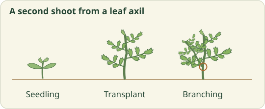

# Can one detector find tomatoes at three growth stages?



In four fresh synthetic plantings, training on a mix of tomato stages cut false detections among branching plants and missed nearly every seedling. On the reference grid, one mixed-stage fit located **415 of 439 branching plants with 19 extra pins**. The seedling-only fit located 98 with 185 extra pins. On the same plantings rendered as seedlings, those models located **0 and 82**, respectively. A single score pooled across stages would hide that tradeoff. [Try the branching-plant comparison](https://mvalancy.github.io/crop-trainer/benchmark/?comparison=forms&crop=tomato&plantArchitecture=2&plantForm=seedling&validationPlantForm=branching&seed=82173&sensor=reference&trainingRayBudget=60000&validationRayBudget=60000)

## Which stage benefits?

Each row pools four confirmation plantings containing 439 labeled plants in total. F1 counts a pin as correct when it matches a plant within 15 cm. Each pair of scores shows the two training seeds, `82173` then `379331`. The height rule ranks the same peaks and uses the same spacing as the trained nets.

| Growth stage | Test scan | Seedling-only training | Mixed-stage training | Height alone |
| --- | --- | ---: | ---: | ---: |
| Seedling | Grid | .270 / .270 | .000 / .000 | .283 |
| Transplant | Grid | .478 / .488 | .731 / .822 | .833 |
| Branching | Grid | .271 / .317 | .951 / .955 | .873 |
| Seedling | Rings | .178 / .175 | .000 / .009 | .182 |
| Transplant | Rings | .557 / .560 | .641 / .710 | .870 |
| Branching | Rings | .352 / .367 | .894 / .907 | .889 |

The initial six plantings (629 plants per stage) showed the same direction for both fits and layouts. Of the 439 confirmation seedlings, only 86 on the grid and 44 on rings had a candidate peak within 15 cm. Both mixed-stage nets rejected nearly all of those peaks. On grid transplants, mixing stages helped relative to seedling-only training, yet height alone scored higher than either fit.

## What went into training?

Each model saw the same six planting seeds and both soil variants at 60,000 reference-grid rays per scan. Each used 13 XYZ features, a standard 6.5 cm peak gate, four tanh hidden units, full-batch SGD at learning rate 0.25, 40 epochs from initialization seed 12345, a 0.5 score cutoff and 22 cm pin spacing. Each training pair used matching recipes for clutter and scan noise. Labels supplied training targets. Each model fitted its feature scale on its own retained training rows.

The normal sampler balances plant and background examples. In the two seedling-only runs it retained 346 and 264 examples. On the mixed plantings it retained 1,974 and 1,878. Repeating each comparison with **exactly 128 positive and 128 negative examples** gave the same direction on all six confirmation conditions for both training seeds.

The mixed fields contained roughly one-third seedlings, but a small seedling seldom produced an eligible training peak. For seed `82173`, seedlings accounted for **197 of 598 plants and 58 of 987 eligible positive peaks**. For seed `379331` the counts were **200 of 631 plants and 51 of 1,042 peaks**. Plant counts use one soil-present scan per planting. Training peak counts include both soil variants and can include multiple peaks near one plant.

## Can equal representation among positive examples rescue seedlings?

We kept the same mixed training scans and fixed four more test fields before fitting again. The ordinary draw of 128 positive peaks contained only eight seedlings with the first training seed and three with the second. We changed that draw to **43 seedling, 43 transplant and 42 branching peaks**. Both fits kept the same 128 background peaks. We chose distinct candidate rows without replacement and fitted the normalization again. The unmodified draws reproduced the weight hashes of the earlier 256-example controls.

Four new plantings contained 408 plants at each stage. The table gives each stage-balanced model's 15 cm result, in training-seed order. A dash means a model emitted no pins.

| Stage and scan | True matches | Extra pins | Precision | Recall |
| --- | ---: | ---: | ---: | ---: |
| Seedling, grid | 0 / 5 | 0 / 1 | — / 83.3% | 0.0% / 1.2% |
| Seedling, rings | 0 / 7 | 0 / 0 | — / 100% | 0.0% / 1.7% |
| Branching, grid | 388 / 402 | 4 / 15 | 99.0% / 96.4% | 95.1% / 98.5% |
| Branching, rings | 353 / 366 | 10 / 20 | 97.2% / 94.8% | 86.5% / 89.7% |

The ordinary fits found zero seedlings on either layout. Height alone found 83 on the grid and 43 on rings. Changing the positive mix recovered only a handful for one training seed. Its clearest benefit was on larger plants. Grid branching F1 rose from .954 / .956 to .970 / .975, ring branching F1 from .902 / .897 to .916 / .922. Transplant F1 also rose for both training seeds on both layouts. These findings use the existing fixed score cutoff and a small network. They leave open whether other learned representations can separate a faint seedling from the terrain.

## Reproduce the measurements

```sh
node benchmark/studies/tomato-stage-training.mjs > tomato-stage-training.json
node benchmark/studies/tomato-stage-training.mjs --balance > tomato-stage-balance.json
```

All models were frozen before either evaluation. The initial field seeds were `4831799, 4942921, 5054027, 5165173, 5276299, 5387437`. The independent confirmation used `5498591, 5609719, 5720839, 5831963`. The separate stage-balanced follow-up used `5943079, 6054211, 6165361, 6276481`. Each field was rendered at all three stages using the reference grid and the OS1-64-inspired ring layout, both with exactly 60,000 rays. Test plots included soil and omitted added clutter and sensor noise. The script checks identical XY samples across stages within a layout and identical boxes across layouts within a stage. Each stage uses the midpoint of its own modeled canopy as the target. The browser demonstration uses the benchmark’s own validation recipes and seeds.

The JSON includes per-field counts and pooled F1 at 7.5, 10 and 15 cm, soil and no-soil training tile IDs, hashes of the frozen weight exports, proposal coverage and wall time. One Node.js 24.22.1 AMD EPYC 7763 CPU run spent 3.78 s preparing training data, 0.16 s auditing training examples, 0.25 s fitting, 1.69 s generating the held-out scans and 2.63 s validating. The follow-up took 2.62 s to prepare the training sets, 0.11 s for the audit, 0.07 s to fit, 0.71 s for the held-out scans and 0.53 s to validate. All evaluation uses the same code as Field Test. This experiment measures synthetic overhead scans. An independent field survey is needed to measure physical performance. [Experiment source](../benchmark/studies/tomato-stage-training.mjs) · [Earlier growth-stage transfer tests](seedling-density.md)
