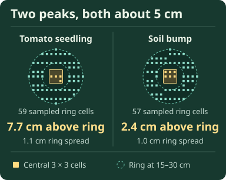

# Can a lower cutoff find small tomatoes on visible soil?

On six new synthetic fields, the local-ground model found **495 of 1,316 seedling appearances** at a score cutoff of 0.20, with 198 extra pins. Its branching-plant precision on rings fell from 83.6% for the standard detector to 68.2%. A cutoff selected to protect branching precision found only **11 seedlings**, all on rings. The six fields contained 658 distinct seedling positions, each viewed twice. [How the local-ground model works](tomato-local-ground.md)

## Choose a cutoff before opening the test fields



We fitted the standard and local-ground models on the same 2,378 examples. Each used mixed-stage v2 tomatoes, seed 181381, six training fields, one validation field, 60,000 rays and a four-unit tanh layer with 40 epochs. A separate development set contained four new plantings, each scanned as seedlings and as branching plants on a reference grid and an OS1-64-inspired ring layout. These scans retained soil and used healthy plants without weeds, boards, sticks or scan noise.

We tested 19 score cutoffs per model, from 0.05 through 0.95. We selected the highest pooled seedling F1 at 15 cm among cutoffs that lost at most one percentage point of branching precision against the standard model at 0.50 **on each layout**. Each layout had to produce at least one branching prediction for its precision to count. A second selection simply maximized seedling F1. Ties favored the cutoff nearest 0.50, then the higher cutoff, then the standard feature set.

With the precision requirement, development selected local-ground at 0.55. It matched six of 824 seedling appearances. With seedling F1 as the sole objective, development selected local-ground at 0.20 and matched 297. We froze both choices before evaluating six more fields.

## What happened on the six new fields?


Each column below uses a 15 cm match. Seedling reference-grid and ring counts are pooled. Branching precision is reported for each layout because a pooled value can hide extra pins on one scanner.

| Detector and cutoff | Seedling matches / extra / missed | Seedling precision | Seedling recall | Seedling F1 | Branching precision, grid | Branching precision, rings |
| --- | ---: | ---: | ---: | ---: | ---: | ---: |
| Standard 0.50, reference result | 6 / 5 / 1,310 | .545 | .005 | .009 | .879 | .836 |
| Local ground 0.55, selected with branching requirement | 11 / 0 / 1,305 | 1.000 | .008 | .017 | .893 | .830 |
| Local ground 0.20, selected for seedlings | 495 / 198 / 821 | .714 | .376 | .493 | .797 | .682 |
| Standard 0.15, best standard cutoff for seedlings | 707 / 953 / 609 | .426 | .537 | .475 | .734 | .417 |

At 0.55 the local-ground model produced zero pins on the seedling grid scans. At 0.20 the same weights found 183 grid seedlings and 312 ring seedlings. Lowering the cutoff lets more of the original candidate peaks through. It also admitted extra branching pins on rings, from 130 at 0.55 to 296 at 0.20, while correct branching matches rose by only two (633 to 635).

| Seedling counts, matches / extra / missed | 7.5 cm | 10 cm | 15 cm |
| --- | ---: | ---: | ---: |
| Standard 0.50 | 4 / 7 / 1,312 | 6 / 5 / 1,310 | 6 / 5 / 1,310 |
| Local ground 0.55 | 7 / 4 / 1,309 | 11 / 0 / 1,305 | 11 / 0 / 1,305 |
| Local ground 0.20 | 414 / 279 / 902 | 475 / 218 / 841 | 495 / 198 / 821 |
| Standard 0.15 | 594 / 1,066 / 722 | 675 / 985 / 641 | 707 / 953 / 609 |

## Try one field in a browser


1. Open the Training Shed preset and run the fit once. It uses six training fields and one validation field. Download its weights. [Train at 0.55](https://mvalancy.github.io/crop-trainer/trainer/?plan=quick&engine=cpu&crop=tomato&plantArchitecture=2&plantForm=mixed&seed=181381&sensor=reference&epochs=40&minimumHeight=0.035&trainingRayBudget=60000&validationRayBudget=60000&featureMode=local-ground&threshold=0.55&valFields=1)
2. Download the PLY and labels from the 108-plant ring scan. In **Field test**, load the weights, scan and labels, then select **Find plants**. The saved cutoff of 0.55 matches five seedlings with zero extra pins at 15 cm. [Open field 32077547](https://mvalancy.github.io/crop-trainer/?crop=tomato&plantArchitecture=2&plantForm=seedling&plantCondition=healthy&seed=32077547&sensor=os1-64&budget=60000&ground=true&noise=clean&weeds=off&sticks=off&boards=off&tile=99e35bba32926b5d)
3. Expand **Try a different model cutoff**, enter **0.20**, and select **Find plants** again. On the same scan, the same weights now match 63 seedlings with 23 extra pins. Select **Use saved cutoff**, then **Find plants** to return to the original result.

The trial download records the cutoff used in `detector.threshold` and the original in `detector.savedThreshold`. Both runs identify the weights and scan by their SHA-256 hashes. The Node replay below covers the full development and confirmation fields.

```sh
node benchmark/studies/tomato-terrain-cutoffs.mjs development > development.json
node benchmark/studies/tomato-terrain-cutoffs.mjs > confirmation.json
```

The JSON records the training fields, each scan ID, development cutoff grid, frozen choices, precision, recall, F1 and timings. On one AMD EPYC 7763 CPU with Node 24.22.1, dataset preparation took 3.41 s and the two fits took 0.24 s together. On the 24 confirmation scans, generation took 0.61 s, feature extraction and model scoring took 0.39 s, and spacing plus one-to-one matching took 0.31 s. The models shared a generator, a training seed and the same six held-out plantings. Physical fields, other growth stages and different capture conditions remain open tests. [Study source](../benchmark/studies/tomato-terrain-cutoffs.mjs)
