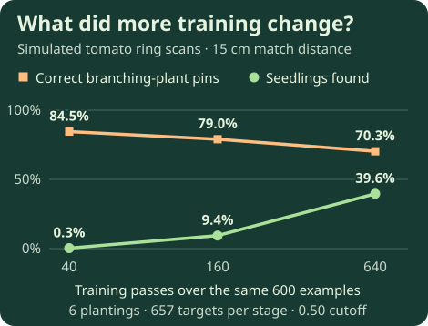
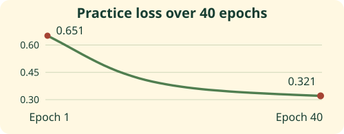
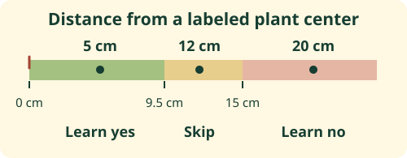
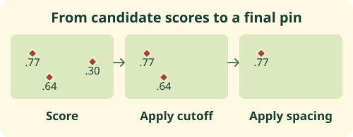
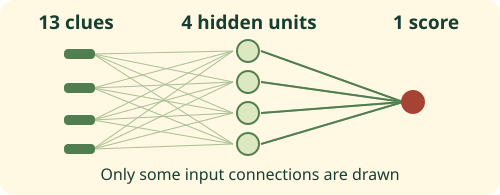
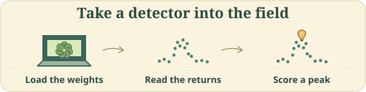

# Will more practice help tomatoes show up?

On six new ring-scanned plantings, the detector found **2 of 657 seedlings after 40 epochs and 260 after 640**. The 640-epoch fit also placed 131 extra seedling pins, up from 16 at 40 epochs. On the same plantings grown to branching size, extra pins rose from 115 to 263. Both longer runs exceeded the loss in branching-plant precision we had agreed to accept. We kept 40 epochs for this comparison. [Explore 40 and 640 epochs in Benchmark](https://mvalancy.github.io/crop-trainer/benchmark/?comparison=epochs&shortEpochs=40&longEpochs=640&scoreGround=present&scoreDistance=15&sampleLimit=600&crop=tomato&plantArchitecture=2&plantForm=mixed&validationPlantForm=seedling&plantCondition=healthy&seed=987149&sensor=reference&validationSensor=os1-64&trainingRayBudget=60000&validationRayBudget=60000&featureMode=local-ground&minimumHeight=0.035)

## What does one more epoch buy?



An **epoch** is one pass over the training examples. We drew 300 peaks near labeled tomato plants and 300 background peaks from six mixed-stage plantings. The same six plantings supplied every run within a comparison. At 40 epochs the network had seen those 600 examples 24,000 times in total. At 640 epochs it had made 384,000 example visits. It had the same training scans, the same 13 measurements per peak and the same 61 adjustable weights and biases.

The network ranks peaks. A score of at least 0.50 admits a peak, then a spacing rule keeps the higher-scoring pin within 22 cm. More training can change which peaks pass and which neighboring peak wins. Tiny seedlings with no candidate within reach cannot get a matching pin at any epoch count.

## How did we choose a training length?


We first reserved four development field seeds, a second set of six confirmation seeds and a separate training seed for each group. On development we compared 160 and 640 epochs to the 40-epoch starter. At a 15 cm matching distance, each longer fit had to improve seedling F1 on **both** the reference grid and OS1-64 ring layout. It also had to keep branching precision within one percentage point of the starter or improve it on **each** layout. F1 rewards finding plants while limiting extra pins. Precision measures the share of pins that actually match a plant.

If both lengths qualified, the larger of their smaller seedling F1 gains would win, with the shorter fit winning a tie. If neither qualified, we would keep 40 epochs. The development cohort contained 419 plants per stage. The layouts shared the same labels within a stage.

| Development comparison with 40 epochs | Seedling F1 change on grids | Seedling F1 change on rings | Branching precision change on grids | Branching precision change on rings |
| --- | ---: | ---: | ---: | ---: |
| 160 epochs | +0.023 | +0.111 | −1.14 points | −2.60 points |
| 640 epochs | +0.060 | +0.365 | −2.62 points | −4.53 points |

We froze the 40-epoch decision before scoring confirmation fields. The 160- and 640-epoch results below show what the longer fits did on fresh plantings and a fresh training seed.

## What did the pins land on?


Each row covers **657 plants across six confirmation fields**. The layouts share identical reference centers within each stage. Growing a plant changes its box, so its scored center can shift between the seedling and branching versions of a planting. Every scan included soil and used 60,000 rays. Cells show **matched plants / extra pins** within 15 cm. The simple height rule ranks the same peaks by height and enforces the same spacing. The reachable count uses one-to-one matching on all proposed peaks before either detector filters them.

| Plant stage and layout | Reachable | Height rule | 40 epochs | 160 epochs | 640 epochs |
| --- | ---: | ---: | ---: | ---: | ---: |
| Seedlings · grid | 443 | 431 / 1,430 | 1 / 28 | 8 / 19 | 58 / 1 |
| Seedlings · rings | 368 | 358 / 822 | 2 / 16 | 62 / 23 | 260 / 131 |
| Branching · grid | 657 | 656 / 1,331 | 652 / 89 | 652 / 96 | 647 / 77 |
| Branching · rings | 638 | 636 / 890 | 628 / 115 | 628 / 167 | 624 / 263 |

The 640-epoch fit found more seedlings on every confirmation field on both layouts. On rings it found 39.6% of planted seedlings, with 66.5% precision. On branching ring scans its precision fell from 84.5% to 70.3%, with additional extra pins on every field. The branching-grid result went the other way. Precision rose from 88.0% to 89.4% while the model missed five more plants.

A closer match matters when locating the center. These are the same frozen ring-scan predictions at three allowed distances. The counts show why the matching tolerance belongs next to the score.

| Maximum distance | Seedling matches / extras · 40 epochs | Seedling matches / extras · 160 | Seedling matches / extras · 640 | Branching F1 · 40 / 160 / 640 |
| --- | ---: | ---: | ---: | ---: |
| 7.5 cm | 2 / 16 | 58 / 27 | 222 / 169 | .709 / .663 / .609 |
| 10 cm | 2 / 16 | 61 / 24 | 252 / 139 | .849 / .799 / .728 |
| 15 cm | 2 / 16 | 62 / 23 | 260 / 131 | .897 / .865 / .808 |

## Did plant peaks rise in the ranking?



Changing the cutoff can put more pins on a field without teaching a detector to tell plants and soil apart. We tested the ordering of the scores themselves. On a third training seed, we fitted the same 600 examples for 40, 160 and 640 epochs. We ranked the peaks from six fresh soil-present plantings, before the cutoff or pin-spacing step.

A **positive** peak lay within 9.5 cm of a planted center. A **background** peak lay farther than 15 cm from every center. We left the intervening band out. **Average precision (AP)** measures how reliably the detector puts the positive peaks first as you work down the ranked list. A perfect ordering scores 1. Each result pools the same six plantings for one stage and layout.

| Crop and scan | Positive / background peaks | Ambiguous peaks omitted | Height AP | 40 epochs AP | 160 epochs AP | 640 epochs AP |
| --- | ---: | ---: | ---: | ---: | ---: | ---: |
| Seedling · grid | 430 / 2,848 | 81 | .365 | .498 | .642 | .847 |
| Seedling · rings | 348 / 1,902 | 67 | .510 | .520 | .648 | .847 |
| Branching · grid | 766 / 2,536 | 281 | .946 | .974 | .976 | .975 |
| Branching · rings | 834 / 1,931 | 421 | .925 | .968 | .964 | .948 |

Both longer fits ranked seedling peaks better than the 40-epoch fit on **each of the six plantings**, on both layouts. Limiting every method to its top fifth of peaks gave another check at the same count. From 40 to 640 epochs, the share of those peaks labeled positive rose from 54.1% to 57.9% on seedling grids and from 56.0% to 64.0% on seedling rings. For a fixed inspection budget of 656 seedling-grid peaks, 160 epochs yielded 385 positives and 640 yielded 380. On branching rings, top-fifth precision fell from 98.0% to 94.9% between 40 and 640 epochs. All six branching ring fields lost AP.



The ordering and the cutoff tell different parts of the story. At 640 epochs, grids and rings had nearly identical seedling AP, yet the 0.50 cutoff accepted only **30 of 430** labeled seedling peaks on grids, versus **259 of 348** on rings. It also accepted one background peak on grids and 48 on rings. A single cutoff gave very different results on the two layouts. Several peaks may belong to one plant, and a plant with no peak cannot enter this ranking. The preceding detection scores include those plant-level effects.

Run `node benchmark/studies/tomato-epoch-ranking.mjs` for counts at each cutoff, per-field AP, scan IDs, fit times and weight hashes. The calculation treats equal scores as one threshold in AP. If tied scores cross the top-fifth boundary, their positive fraction contributes in proportion to the available places. [Candidate-ranking study](../benchmark/studies/tomato-epoch-ranking.mjs)

## Why was 640 epochs still fast?



On one AMD EPYC 7763 CPU with Node 24.22.1, the confirmation training rows took **1.40 seconds** to generate and prepare. The three separate fits took **0.063, 0.083 and 0.267 seconds**. Training loss fell from 0.475 to 0.405 to 0.324. Generating the 24 confirmation scans took another 0.71 seconds, and scoring all three models took 1.36 seconds. Device, runtime warm-up and the number of examples affect these timings. This small network reuses a prepared table of peaks for each pass. How long training takes depends on the work per pass as well as the number of passes.

## Try one planting in Field Test



Open either saved fit below and click **Run example**. Your browser grows the same 110 seedlings, scans them and scores the selected weights. Switch the fit and run again. At 15 cm the map changes from one matched plant to 53. You can also replace the example weights or scan with your own files. [Try 40 epochs](https://mvalancy.github.io/crop-trainer/trainer/?fieldExample=tomato-40#field-test) · [Try 640 epochs](https://mvalancy.github.io/crop-trainer/trainer/?fieldExample=tomato-640#field-test)

### Recreate the files yourself


1. Open the 40-epoch preset, run Training Shed and download the model weights. Repeat with the same settings at 640 epochs. [Train for 40 epochs](https://mvalancy.github.io/crop-trainer/trainer/?plan=quick&engine=cpu&crop=tomato&plantArchitecture=2&plantForm=mixed&plantCondition=healthy&trainFields=6&valFields=1&seed=987149&sensor=reference&trainingRayBudget=60000&validationRayBudget=60000&featureMode=local-ground&minimumHeight=0.035&sampleLimit=600&positiveSampling=ordinary&epochs=40) · [Train for 640 epochs](https://mvalancy.github.io/crop-trainer/trainer/?plan=quick&engine=cpu&crop=tomato&plantArchitecture=2&plantForm=mixed&plantCondition=healthy&trainFields=6&valFields=1&seed=987149&sensor=reference&trainingRayBudget=60000&validationRayBudget=60000&featureMode=local-ground&minimumHeight=0.035&sampleLimit=600&positiveSampling=ordinary&epochs=640)
2. Open the first confirmation planting and download its scan and labels. Seed `40117063` contains 110 seedlings on the ring layout. The scan ID is `56b872a50fcac3ab`. [Open this planting](https://mvalancy.github.io/crop-trainer/?crop=tomato&plantArchitecture=2&plantForm=seedling&plantCondition=healthy&sensor=os1-64&seed=40117063&budget=60000&ground=true&weeds=off&sticks=off&boards=off&noise=clean&tile=56b872a50fcac3ab)
3. In Field Test, choose the scan, labels and each model in turn. At the saved cutoff, the starter matches one plant with four extra pins at 15 cm. The longer fit matches 53 with 23 extra pins. Change **Match distance** to 7.5 cm on the same map. Now 44 pins match and 32 are extra. The Benchmark link above runs a separate paired comparison with its own seeded validation fields. [Open Field Test](https://mvalancy.github.io/crop-trainer/trainer/#field-test)

## Can a higher cutoff protect branching precision?


At a fixed cutoff of 0.50, longer training placed extra pins on branching tomatoes. We revisited the original four development fields with **one global cutoff for both stages and both scanners**. We tried 0.05 through 0.95 in steps of 0.05 for each of the three existing fits. Candidates had to keep branching precision within one percentage point of the 40-epoch starter on *each* layout at 15 cm. Among those candidates, we chose the largest seedling F1 gain on the weaker layout. Ties favored a cutoff closest to 0.50, then fewer epochs, then a higher cutoff.

We chose the best cutoff for 40 epochs independently. It stayed at **0.50**. The best longer fit used **640 epochs at 0.70**. On development fields this recovered six grid seedlings and 34 ring seedlings, up from zero and one respectively. We saved a hash of the development scores, decision and model receipts before opening six new plantings and fitting on a new training seed.

Each confirmation row covers 663 plants. The cells show **matched plants / extra pins**, first for 40 epochs at 0.50, then for 640 at 0.70.

| Crop and scan | 7.5 cm match | 10 cm match | 15 cm match |
| --- | ---: | ---: | ---: |
| Seedling · grid | 1 / 25 → 4 / 1 | 1 / 25 → 4 / 1 | 1 / 25 → 5 / 0 |
| Seedling · rings | 2 / 15 → 3 / 1 | 2 / 15 → 4 / 0 | 2 / 15 → 4 / 0 |
| Branching · grid | 570 / 188 → 540 / 139 | 636 / 122 → 610 / 69 | 662 / 96 → 641 / 38 |
| Branching · rings | 516 / 226 → 458 / 203 | 600 / 142 → 553 / 108 | 641 / 101 → 608 / 53 |

The frozen pair met the requirement again. At 15 cm it found **five of 663 grid seedlings and four of 663 ring seedlings**, with zero extra seedling pins. The height rule found 435 and 345, alongside 1,430 and 818 extras. The longer fit raised branching precision from 87.3% to 94.4% on grids and from 86.4% to 92.0% on rings. It also missed 21 more branching plants on grids and 33 more on rings. A rule that protects precision can still lose plants the starter found.


In one CPU run, confirmation data preparation took 2.06 s. Training took 0.06 s and 0.32 s for the selected schedules. Generating 24 test scans took 0.72 s and replaying their weights through Field Test took 1.04 s. To repeat the selection, create `duration-dev.json` with the command below, then run these two commands.

```sh
node benchmark/studies/tomato-duration-cutoffs.mjs development duration-dev.json > cutoffs-dev.json
node benchmark/studies/tomato-duration-cutoffs.mjs confirmation cutoffs-dev.json > cutoffs-check.json
```

Both commands record the same decision hash, `97cdc42c77f0199325db8c22e6d00faed3ec062452d455dfe026ca5b2f023963`. The output includes trained-weight hashes, scan IDs, per-field counts at each distance and hardware-specific timings. [Duration and cutoff study](../benchmark/studies/tomato-duration-cutoffs.mjs)

## Was it the planting or the trained model?


We replayed the two confirmation fits on **both** sets of six previously scored plantings. Each model saw the same scan IDs and candidate peaks at both cutoffs. This retrospective comparison changes one factor at a time. The duration cohort has 657 plants per stage, the cutoff cohort 663.

The seedling columns show how many plants the **640-epoch** model found as the cutoff rose from 0.50 to 0.70. The branching columns compare **640 at 0.70** with the **40-epoch, 0.50 starter trained on the same seed**. Each cell gives the precision change in percentage points and the number of additional plants missed. All matches use 15 cm.

| Training seed | Test plantings | Grid seedlings | Ring seedlings | Branching grid · precision / extra misses | Branching rings · precision / extra misses |
| --- | --- | ---: | ---: | ---: | ---: |
| 987149 | Duration | 58 → 10 | 260 → 107 | +6.39 / 14 | −3.29 / 9 |
| 987149 | Cutoff | 65 → 16 | 232 → 105 | +7.70 / 12 | −3.97 / 14 |
| 1273187 | Duration | 84 → 2 | 101 → 5 | +3.26 / 6 | +6.78 / 33 |
| 1273187 | Cutoff | 77 → 5 | 96 → 4 | +7.07 / 21 | +5.59 / 33 |

Changing the test plantings kept the same pattern. One 640-epoch fit found over 100 ring seedlings at 0.70 and exceeded the branching precision cost on both cohorts. The other fit found four or five and met the branching precision requirement on both. Neither 40-epoch fit detected any seedlings at 0.70.

The fit that produced fewer pins actually **ranked ring seedling peaks better**. For the duration and cutoff cohorts respectively, its AP was .896 and .896, versus .619 and .602 for the fit trained with seed 987149. Its median score on labeled positive peaks was lower, .403 and .392 versus .601 and .575. A model can put true peaks nearer the top of its list and still put many of them below a shared cutoff. These results cover two synthetic training draws. Measuring probability calibration in a physical field would require independently labeled scans.


This ranking used the original distance labels. The duration ring scans contained 405 positive and 1,905 background peaks, with 60 ambiguous peaks omitted. The cutoff ring scans contained 366 positive and 1,923 background peaks, with 63 omitted. The command below verifies both sets of weights, checks the scan IDs and proposal counts, and reproduces the previously published operating points before reporting the crossed results.

```sh
node benchmark/studies/tomato-duration-cutoffs.mjs crossed duration-check.json cutoffs-dev.json cutoffs-check.json > crossed.json
```

## Reproduce the whole experiment


Run these commands in order with Node.js 22 or later from the repository root. The second command reads the development decision before generating confirmation data.

```sh
node benchmark/studies/tomato-training-duration.mjs development > duration-dev.json
node benchmark/studies/tomato-training-duration.mjs confirmation duration-dev.json > duration-check.json
```

Training used six healthy mixed-form v2 tomato plantings, both soil variants, seeded clutter and noise, a 60,000-ray reference grid, a 3.5 cm minimum peak, zero-filled averaging and local-ground features. Each fit began with initialization seed 12345 and used four tanh hidden units and full-batch SGD at a learning rate of 0.25. The study checks the digest of the ordered training rows and scaling and verifies that the longer CPU fits reproduce every earlier training loss. The distinct dataset seeds were `914731` for development and `987149` for confirmation. Each cohort evaluated separate soil-present plantings without added clutter or noise. The reports contain scan IDs, labels by training group, full frozen weight artifacts, timings and per-field scores for all three match distances.

These results describe healthy synthetic tomatoes at a 3.5 cm minimum candidate height. The two scan layouts behaved differently, even with identical plantings and requested ray counts. Performance on physical tomato scans still needs an independent test. [Study code](../benchmark/studies/tomato-training-duration.mjs) · [What changing the training examples did](tomato-soil-sampling.md)
