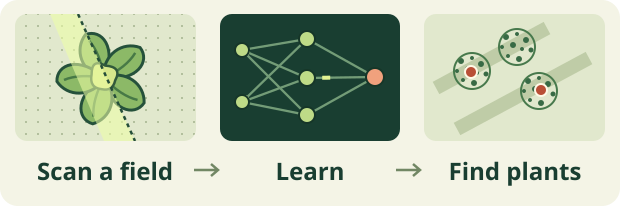

# How a crop detector learns

A LiDAR return is a 3D point. A cluster of tall returns might be lettuce, a weed or clutter. The generator knows where it planted each plant, so it can provide an answer key. Training adjusts numerical weights to give likely plant centers a higher score. One epoch is one pass over the balanced set of training candidates.

## Follow one plant through training

1. **Scan it.** The generator records a cloud of XYZ points and saves the planted centers separately. It divides the scan into 5 cm squares and looks for local height peaks.
2. **Teach from examples.** Each peak gets 13 measurements from the nearby points. During practice, peaks close to a planted center are positive examples and distant peaks are negatives. Getting an example wrong nudges the model’s weights.
3. **Try a fresh field.** The trained model scores peaks using only their measurements. Peaks above or at the cutoff can become pins. When two pins are too close, the higher-scoring one wins.
4. **Check its work.** The scorer compares the final pins with the hidden planting map. Each plant can match at most one pin. A misplaced pin can leave both an extra detection and a missed plant.

The neural model learns all weights in a four-unit tanh hidden layer and a sigmoid output. A logistic baseline uses the same inputs and validation split. Precision measures how many pins match plants. Recall measures how many plants received a pin. Mean F1 combines both over three matching distances. Each run learns a detector for the selected crop and estimates how well it locates whole plants on new synthetic fields.

[Back to the field guide](README.md)
