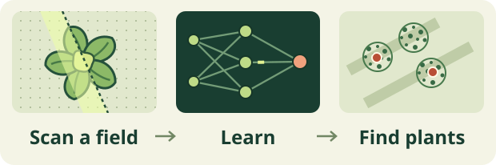

# Inside the training shed

**Can your model find a lettuce it has never seen?** Choose **Generate, train & score** in the shed. The generator knows where it planted each crop. The detector learns which peaks in the scan tend to sit near those positions. Look at a fresh validation field to see which plants it found. [Open the training shed →](https://mvalancy.github.io/crop-trainer/trainer/)

For a second run, keep the field seed fixed and change the number of hidden layers. Compare the missed plants, then use **Download model weights** to take the detector with you. [Training settings](../docs/training.md) · [Try saved weights on a local scan](https://mvalancy.github.io/crop-trainer/trainer/#field-test)

| Follow a plant through the code | Start here |
| --- | --- |
| Grow the canopy and sample its surface | [Field generator](field.js) · [Growing systems](growing-systems.js) · [Scanner layouts](sensors.js) |
| Find candidate peaks, extract features and score pins | [Training data and scoring](data.js) |
| Change what the model can learn | [Logistic model](model.js) · [Neural training](neural.js) · [Network and weight format](network.js) |
| Connect a setting to the browser | [Training form](index.html) · [Run controls](main.js) · [Network editor](sandbox.js) |

[Crop Trainer home](../README.md) · [Compare two runs](../benchmark/README.md)
