# Test a saved detector on a plot

Load a saved Crop Trainer weights file and a Z-up PLY covering one plot up to 10 m on each side. Set the file units, plot origin and ground elevation. Add surveyed plant centers to measure accuracy. With only the scan, you can inspect predicted locations. [Open Field test](https://mvalancy.github.io/crop-trainer/trainer/#field-test)

| To inspect | Open |
| --- | --- |
| PLY decoding and input limits | [Point-cloud reader](ply.js) |
| Coordinate conversion, saved detector and baseline predictions | [Inference](inference.js) |
| Optional survey loading and one-to-one matches | [Reference centers](references.js) |
| The shared browser and command-line scoring pipeline | [Score a scan](score-scan.js) |
| File inputs, map overlays and the processing worker | [Field test controls](field-test-ui.js) · [Worker](field-test-worker.js) |

The supplied centers are an independent evaluation reference. To reproduce a scored plot outside the browser, use the same inputs and frame with the [field-test CLI](../../docs/scan-cli.md).
