# Try Field test with lettuce



Can a saved detector find the centers in a new lettuce plot? Download the scan and weights below, open **Field test**, and choose **Saved weights JSON**. Add either reference file to count matches, extra pins and missed plants. Use metres, zero for the three origin coordinates and zero grade. [Open Field test](https://mvalancy.github.io/crop-trainer/trainer/#field-test)

| File | What it contains |
| --- | --- |
| [Scan (.ply)](c0545a3786c57a89.ply) | 11,178 XYZ returns in binary little-endian PLY, including soil and clutter |
| [Model weights (.json)](weights.json) | A CPU-trained detector with 13 inputs, four tanh units and one output |
| [Reference centers (.csv)](centers.csv) | One row per planted lettuce, in the same coordinate system as the scan |
| [Generator labels (.json)](labels.json) | Bounding boxes for the same 217 plants, including their per-plant return counts |

Field test reads each lettuce center from the horizontal midpoint of its box. Both reference files give the same result. At 15 cm, the model places 188 pins and matches 137 of the 217 synthetic plants. The other 51 pins are extras and 80 plants are missed. [Inspect this planting in the generator](https://mvalancy.github.io/crop-trainer/?crop=lettuce&plantArchitecture=3&plantForm=mixed&plantCondition=healthy&seed=66696975&sensor=reference&ground=true&budget=12000&tile=c0545a3786c57a89#field)

## Reproduce the example

Run these commands from the repository root with Node.js 22 or later. The settings fix eight training plantings, three validation plantings and 160 CPU training epochs. Each epoch revisits 1,316 labeled training examples. The example scan is the first validation planting with soil included, generated from seed 66696975 with a reference grid and a budget of 12,000 rays. [Training settings](settings.json)

```sh
node cli/run.mjs train lettuce-run.json trainer/field-test/example/settings.json --weights lettuce-weights.json
node cli/score-scan.mjs lettuce-weights.json trainer/field-test/example/c0545a3786c57a89.ply lettuce-score.json --labels trainer/field-test/example/centers.csv
```

To replay the original export in a browser, open the planting link above, check that its tile ID is `c0545a3786c57a89`, then use the generator’s scan and label download buttons.
