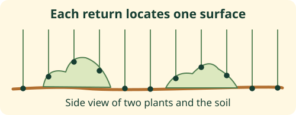

# From a planted field to a scan

A recipe fixes the crop, seed, soil, scanner and ray budget. The generator grows the field, samples its visible surfaces and records the XYZ returns. Given the same recipe and generator version, it produces the same scan ID. [Try the field generator](https://mvalancy.github.io/crop-trainer/)

| To change | Open |
| --- | --- |
| How the plot becomes measured points and reference boxes | [Field simulation](field.js) |
| A crop profile or scanner layout | [Crops](crops.js) · [Sensors](sensors.js) |
| Orchard, vineyard or greenhouse infrastructure | [Growing systems](growing-systems.js) |
| How a seed becomes a particular plant | [Plant architecture controls](plant-version.js) · [Illustrated crop guides](../plants/README.md) |
| Worker progress, cancellation or scan handoff | [Scan session](scan-session.js) · [Generator worker](generate-worker.js) |

Use the field’s PLY download for XYZ and its labels JSON for the simulator’s answer key. The scanner presets approximate sampling layouts. [Scanner assumptions](../../docs/scanners.md)
