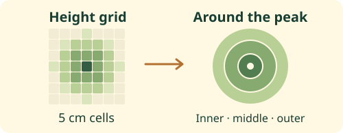

# From a height peak to a plant score

The detector first looks for height peaks in a scan. For each candidate it measures 13 features, including the peak height, surrounding heights and local return counts. The fit learns to score candidates using labeled practice fields. Scoring a fresh field uses the training split’s saved input scaling. [Try a quick fit](https://mvalancy.github.io/crop-trainer/trainer/?plan=quick)

| To inspect | Open |
| --- | --- |
| Split seeds, label candidates, normalize inputs, space detections and match references | [Dataset and scoring](data.js) |
| Measure a peak above nearby low returns and estimate local surface variation | [Local-ground features](terrain-features.js) · [Paired tomato experiment](../../docs/tomato-local-ground.md) |
| Model shapes, activations, exported weights and inference | [Network](network.js) |
| Training on CPU and WebGPU | [Dense network training](neural.js) · [Logistic baseline](model.js) |
| Fitting in a browser worker on CPU | [Fit worker](fit-worker.js) |
| Estimate apple tree bases directly from XYZ height bands | [Orchard locator](orchard.js) |

To compare a model change fairly, keep the seeds, field counts, input settings and epoch budget fixed. Check missed plants and extra pins on held-out fields. [Training guide](../../docs/training.md)
