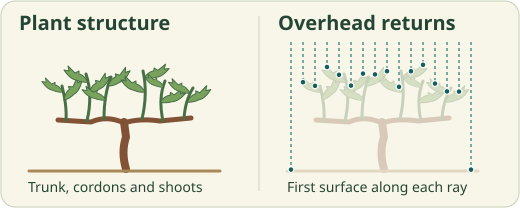
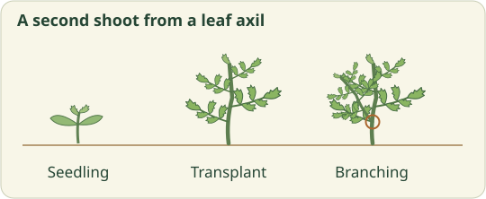
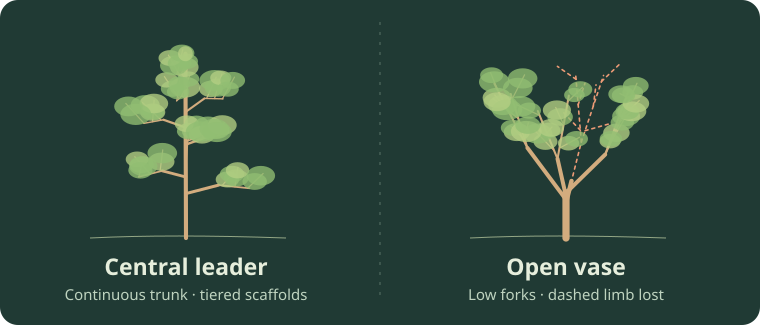
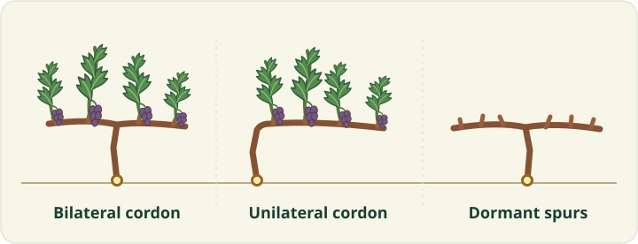
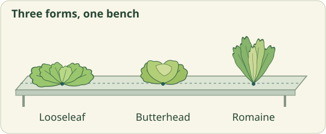
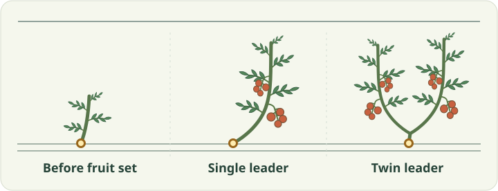

# Grow a plant from parts

Start with one planting position. Grow a stem from that point, attach shoots to the stem, and put leaves or fruit on those shoots. The field scanner samples the plant alongside its neighbors, soil and farm hardware. The result is a synthetic point cloud with a known planting identity. [Photographic references for all seven crops](../../docs/crop-architecture.md)

## Explore one crop

Choose a picture to see how that plant grows and open a field you can scan.

| Plant guide | Inside the generator |
| --- | --- |
| [<br>Field lettuce](lettuce.md) | Outer blades spread<br>or rise into a head.<br>[Lettuce code](lettuce.js) |
| [<br>Globe artichoke](artichoke.md) | A rosette can send up<br>a stalk with buds.<br>[Artichoke code](artichoke.js) |
| [<br>Young tomato](young-tomato.md) | A second shoot grows<br>from a leaf axil.<br>[Young tomato code](young-tomato.js) |
| [<br>Apple orchard](apple.md) | Branches form tiers<br>or split into low forks.<br>[Apple code](apple.js) |
| [<br>Trellised grapevine](grapevine.md) | Woody arms follow<br>the trellis wire.<br>[Grapevine code](grapevine.js) |
| [<br>Greenhouse bench lettuce](bench-lettuce.md) | The rosettes grow<br>on a raised bench.<br>[Lettuce code](lettuce.js) |
| [<br>High-wire tomato](high-wire-tomato.md) | Fruit trusses hang<br>below the leaf canopy.<br>[High-wire tomato code](high-wire-tomato.js) |

## Place an organ

Each crop function receives its base `x, y, z`, a plant-size parameter called `radius`, the seeded `random()` function and three drawing functions. Coordinates and lengths are in **metres**. For greenhouse crops the registry raises the base to the bench or trough. The following fragment builds one leaf at a node 12 cm above a plant’s base.

```js
const nodeZ = z + 0.12;
stem(x, y, z, x, y, nodeZ, 0.004, 0.002);
leaf(x, y, nodeZ, x + 0.08, y, nodeZ + 0.015, 0.022, 0.009);
```

- `stem(ax, ay, az, bx, by, bz, baseRadius, tipRadius)` joins two endpoints with a tapered segment. It also records the centerline for the structure overlay.
- `leaf(ax, ay, az, bx, by, bz, halfWidth, arch, lobes)` creates a blade from its base to its tip. Give it a horizontal span. The optional arch raises its middle, and the optional lobe count changes its outline.
- `ellipsoid(x, y, z, rx, ry, rz, angle)` places a rounded organ or foliage cluster at its center. The last argument rotates its horizontal axes in radians.

These routines update the plant bounds and send candidate intersections to the field’s shared first-return sampler. A hidden branch still contributes a centerline, while the scan records only the first surface encountered along each vertical ray. [Surface implementation](surfaces.js) · [Field sampler](../generator/field.js)

## Add a form to an existing crop

Begin with a horticultural distinction a scan could reveal. For example, romaine and looseleaf lettuce differ in leaf habit. Both can share the same rosette function and planting target. An apple’s pruning system changes how its woody branches connect, so a width multiplier alone cannot describe it.

1. Add a stable ID and a short label to that crop’s list in the shared form catalog. The entry supplies the valid choices to the rest of the app. [Form catalog](forms.js)
2. Read `ctx.form` in the crop renderer. Use it to choose attachment points, organ counts, orientation or a new branching pattern. The renderer receives a resolved form for each plant in a mixed field. `ctx.damaged` is a separate boolean that the crop can use to omit or shorten an organ. [Example lettuce forms](lettuce.js) · [Crop registry](index.js)
3. Check a fixed form on several seeds, then compare the seeded mixed population. Count labeled plants, inspect the returns, and confirm the exported recipe replays. Forms in a mixed planting have equal selection probability. Mixed condition independently selects damage with a 25% probability per planting position. These synthetic stress settings impose no field prevalence. [Per-plant trait selection](traits.js)

## Inspect one plant before scanning

Below the scan summary, open **Advanced scan settings → Plant form and condition**. Pick a form and turn its intact and damaged views together. Both come from the first plant on that seed, at its generated size. **Damage close-up** frames the area where the silhouette changed. Orbit the plant to see a break that another branch hides from the front. This view shows the modeled stems and leaves. The field scanner records the surfaces its rays reach. [Explore a damaged open-vase apple](https://mvalancy.github.io/crop-trainer/?crop=apple&plantArchitecture=3&plantForm=open-vase&plantCondition=damaged&seed=27#anatomySettings)

## Add a crop or growing system

1. Choose the stage, growing system and detection target. A young field tomato and a fruiting high-wire tomato need different geometry even though they belong to the same species. Link to a source photo and record the assumptions beside the implementation.
2. Add a crop function here, a form list in the catalog, and register the function under its crop key. Use the supplied random stream when choosing organ lengths and angles. For a paired change such as apple leaf cover, keep drawing the same structural parameters so switching the treatment preserves the planting. [Crop registry](index.js)
3. Add a crop profile for row layout, spacing, size and detector defaults. Connect the choice to the generator, Training Shed and benchmark. Keep benches, support wires and posts in the fixture layer so their returns remain distinguishable from plant parts. [Crop profiles](../generator/crops.js) · [Growing systems and fixtures](../generator/growing-systems.js)
4. Generate a field with the new architecture. Repeat the identical recipe and compare tile ID, XYZ and labels. Check that reducing the ray budget can hide small organs without moving the planting bases. Preserve previous geometry when replaying an older architecture version. [Architecture tests](../../test/crop-architecture.test.js)

Run `node --test test/crop-architecture.test.js test/plant-attachments.test.js` from the repository root for the geometry and replay checks. Then run `node --test` and try the crop through the browser. Compare detections on fresh field seeds before drawing conclusions about the detector. [Agent quickstart](../../AGENTS.md) · [Field validation](../../docs/field-validation.md)
