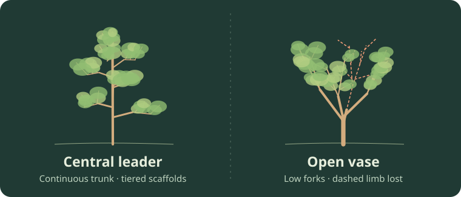
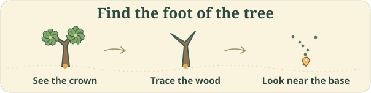
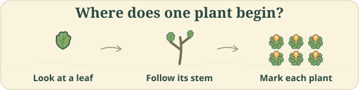
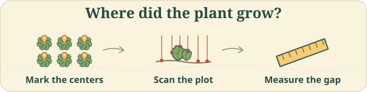

# Inside the apple orchard

Stand beside a leafless apple tree and you can usually trace a limb back to the trunk. A canopy seen from above can conceal that entire connection. Crop Trainer builds the connected wood first so the orchard can answer both questions. Where does a tree grow? Which parts would an overhead scan actually see? [Explore the central-leader orchard](https://mvalancy.github.io/crop-trainer/?crop=apple&plantArchitecture=3&plantForm=central-leader&seed=39061&sensor=reference&budget=100000&noise=clean#field)

## Read the silhouette

In a **central-leader** tree, a tapering main axis continues to the top. Lower scaffold branches typically reach farther than upper ones. The young tree shown on page 35 of the UC training handbook is a reference for this scaffold arrangement. In an **open-vase** tree the main axis ends low and several limbs rise around a relatively open center. See the photographed training examples on pages 42 and 44. Open-center apples are a useful contrast in heritage and home orchards. Commercial orchards also include spindle and planar systems that differ from both examples. [UC orchard training photographs](https://ucanr.edu/sites/default/files/2016-10/249531.pdf#page=35) · [UC IPM apple training](https://ipm.ucanr.edu/home-and-landscape/apple-training/) · [Montana State heritage apple pruning](https://agresearch.montana.edu/warc/guides/apples/heritage_orchard_management_guide/caring-for-heritage-trees/pruning.html)

## Follow a bud out from the trunk

1. The field chooses a planting position, size and organ seed. Selecting a single form grows one management system across the plot. A seeded mix assigns a form to each tree for a controlled challenge.
2. The central leader sprouts **7–9 scaffolds**, staggered around the trunk at different heights. Each scaffold bends once and tapers. The vase forks into **3–4 primary limbs** low on the trunk. Those limbs fork again near the outside of the crown.
3. Lateral shoots grow from positions on each scaffold. Their foliage is a group of rotated ellipsoids attached to those shoots. The seed varies the orientation, reach, bend, height and cluster size. Numbers in this rule are synthetic design choices.
4. The overhead scanner intersects those volumes and tapered woody surfaces. The nearest visible surface produces the return. The label marks the planting base even when leaves hide the trunk completely. Use **Plant tissue** coloring to distinguish woody returns. The optional structure overlay shows the complete modeled centerlines. [Apple generator](apple.js) · [Surface sampler](surfaces.js)

## What does a dot above the tree tell you?

An overhead laser can hit a branch tip half a metre to the side of the trunk. A detector that follows tall patches can put its pin there. To locate a planting for a survey, we need the horizontal position where the trunk meets the ground.

The side view groups the **same scan dots by height**. Each row counts returns from its band floor up to the next floor, within 1.05 m horizontally of the labeled base. The top band extends upward. The locator works with smaller groups of occupied cells around each possible pin and checks whether the crown surrounds that spot on several sides. A location can have support even when a whole band is empty.

The top view looks straight down on the same dots. The nearest height-only pin landed **55.8 cm** from the trunk. The orchard locator placed its nearest pin **10.6 cm** away, inside the **15 cm** matching circle. The cross and circle use the simulator’s planting record to score the predictions afterward.

To inspect tree 0 yourself, open the comparison and choose **Compare scans**. The second map uses v4 scaffold widths. Change **Mark plants by** between **Height-only pin · 15 cm** and **Orchard base pin · 15 cm**. This example uses a dormant tree from one synthetic plot. The orchard study includes the misses across many trees and canopy states. [Replay this tree](https://mvalancy.github.io/crop-trainer/?crop=apple&plantArchitecture=4&plantForm=open-vase&plantCondition=healthy&appleCanopy=dormant&seed=11043331&sensor=reference&budget=60000&ground=true&noise=clean&weeds=off&sticks=off&boards=off&studyMode=scaffolds&studyMetric=orchard&studyBox=0#scan-study) · [Compare the detectors across whole plots](../../docs/orchard-bases.md#what-changed-on-held-out-synthetic-trees)

## Why does the locator discard a promising spot?

Several positions on the ground can look like the center of one tree. The locator scores a grid of 5 cm cells using returns at different heights. It keeps the highest-scoring candidate first and skips candidates within 1.05 m of a cell it already kept. It then centers each final pin using the strongest cells immediately around that survivor.

Tree 2 on field `14151223` shows what can go wrong. With the original scaffold widths (v3), one of the 20 qualifying cells inside the 15 cm circle survived. Its final pin was **7.7 cm** from the trunk. With variable widths (v4), the same tree still had three qualifying cells inside the circle. A stronger cell **82.2 cm** from the trunk ruled out all three. Centering moved its pin to **79.2 cm** from the trunk. Open the two scans and select **Compare scans** to see the match change on tree 2. [Replay tree 2 on both maps](https://mvalancy.github.io/crop-trainer/?crop=apple&plantArchitecture=4&plantForm=central-leader&plantCondition=healthy&appleCanopy=leafy&seed=14151223&sensor=reference&budget=60000&ground=true&noise=clean&weeds=off&sticks=off&boards=off&studyMode=scaffolds&studyMetric=orchard&studyBox=2#scan-study)

**Would keeping all three guesses help?** We added those three cell centers as pins to the v4 scan and scored the plot again at 15 cm. Matches rose from **8 to 9** and extra pins rose from **4 to 6**. Only one guess could claim tree 2. This illustration uses the known trunk position to pick the three cells.

Try a change the locator can apply from the scan alone. Reduce minimum spacing to **0.75 m** for the whole v4 plot. Tree 2 now has a pin **4.7 cm** away. The plot gains two matches and four extra pins compared with standard spacing. Both scans use identical laser returns and the same 15 cm matching circle. [Compare 1.05 m and 0.75 m on this scan](https://mvalancy.github.io/crop-trainer/?crop=apple&plantArchitecture=4&plantForm=central-leader&plantCondition=healthy&appleCanopy=leafy&seed=14151223&sensor=reference&budget=60000&ground=true&noise=clean&weeds=off&sticks=off&boards=off&studyMode=spacing&studySpacing=0.75&studyMetric=orchard&studyBox=2#scan-study)

**Does the change help a new planting?** On six fresh synthetic plantings, the 0.75 m rule recovered **none of the 225** missed tree appearances whose nearby qualifying cells had all been discarded by standard spacing. It also produced **134 additional extra pins** across the scans. The smaller spacing helped the tree in this illustration, but that result did not carry over to the held-out plantings. [Replay the held-out spacing study](../../docs/orchard-bases.md#does-shorter-pin-spacing-recover-the-missed-bases)

## Can a low return give the trunk a head start?

A laser return close to the ground can come from the lower trunk, a drooping limb or a weed. The ranking trial asks whether giving these returns a small vote helps the locator try the right spot first.

Start with the cells that already qualify on their usual support score. Around each candidate, draw a **3 × 3 square of 5 cm cells**, with the candidate in the middle. Count how many of those nine cells contain a return **at least 15 cm and below 48 cm on the plot’s vertical axis**. Every cell uses the same height reference even where the soil rises or falls. Several returns in one cell earn one vote. Add up to two votes to the original score when deciding which candidate to try first. The locator still keeps **1.05 m** between surviving candidates and uses the original support scores to center each final pin. [Orchard locator](../models/orchard.js) · [Results on held-out orchards](../../docs/orchard-ranking.md)

**Try the same tree on two scanners.** On development field `18101637`, select **Compare ranking rules** and inspect tree 0. On simulated rings, one occupied low cell raised a candidate’s score from 5.45 to 6.45. The nearest pin moved from **48.8 cm to 5.6 cm** from the planted base. On the reference grid, a nearby candidate also gained one point. Its score reached 6.63 and a competitor scored 6.71, so the nearest pin stayed **44.8 cm** away. Both layouts sampled 60,000 rays over the same healthy, leafy planting. [Try the ring scan](https://mvalancy.github.io/crop-trainer/?crop=apple&plantArchitecture=4&plantForm=central-leader&plantCondition=healthy&appleCanopy=leafy&seed=18101637&budget=60000&ground=true&noise=clean&weeds=off&sticks=off&boards=off&studyMode=ranking&studyMetric=orchard&studyZoom=tree&studyCloud=on&studyBox=0&sensor=os1-64&tile=f89d8eafa9371fd6#scan-study) · [Try the reference grid](https://mvalancy.github.io/crop-trainer/?crop=apple&plantArchitecture=4&plantForm=central-leader&plantCondition=healthy&appleCanopy=leafy&seed=18101637&budget=60000&ground=true&noise=clean&weeds=off&sticks=off&boards=off&studyMode=ranking&studyMetric=orchard&studyZoom=tree&studyCloud=on&studyBox=0&sensor=reference&tile=edfc7257e8fa2674#scan-study)

## Could a board look like part of a tree?

A raised board can reflect the laser at a height the locator also sees around a trunk. What happens if the generator always puts boards at trees? Compare the same orchard twice. Keep the trees and the boards’ sizes and angles fixed, then change where the boards land.

The generator places nine boards when boards are enabled on a planted plot. In the first layout it picks a tree base for each board, so a tree may be picked twice. In the second it draws each board’s position independently across the plot. The tree bases stay fixed for scoring in both layouts. [See how board placement affects the locator](../../docs/orchard-boards.md)

## Break a branch or take away its leaves

Choose **All plants damaged** to shorten one scaffold into a woody stub. Its distal shoots and their clusters disappear. The other scaffolds use the same random draws as in the intact tree. On a vase, losing one of three main limbs can open a large gap. On a central leader the same type of break can be much less conspicuous. **About one in four damaged** selects a reproducible subset by planting ID. [Inspect a broken vase orchard](https://mvalancy.github.io/crop-trainer/?crop=apple&plantArchitecture=3&plantForm=open-vase&plantCondition=damaged&seed=39061&sensor=reference&budget=100000&noise=clean#field)

For a second experiment, keep the same seed, form, condition, ground and ray budget. Switch **Apple foliage** from **Leaf on** to **Dormant · leaf off** and generate again. The wood and tree bases stay paired. Compare the number of woody returns, then orbit the scan to inspect which surfaces remain hidden. A vertical trunk can produce very few returns from above even in winter. [Inspect a dormant vase orchard](https://mvalancy.github.io/crop-trainer/?crop=apple&plantArchitecture=3&plantForm=open-vase&plantCondition=damaged&appleCanopy=dormant&seed=39061&sensor=reference&budget=100000&noise=clean#field)

## What would make it representative of a particular orchard?

These rules reproduce a branching relationship you can check visually. Foliage clusters approximate the occupied crown. Individual leaves, apples, bark, regrowth after injury, complex bends and row-side acquisition would need additional geometry or sensing work. A single broken scaffold is a controlled damage case. It cannot establish how often a storm produces that injury. For a particular block, record age, rootstock, cultivar, spacing and training system. Measure trunk diameter, first fork height, scaffold angles and crown widths on a calibration row. Independently survey tree bases on another row and compare predicted pin locations against that survey. AppleQSM is an example of working quantitatively with laser scans of actual apple tree branches. [AppleQSM](https://pmc.ncbi.nlm.nih.gov/articles/PMC11077705/) · [Field validation guide](../../docs/field-validation.md)

The same tree can produce a dense crown and almost no returns low on its trunk. Inspect a paired profile, then compare two ways of predicting the planting position. [Can a scan locate the base of an apple tree?](../../docs/orchard-bases.md)

## How do the modeled dimensions compare with measured trees?

Cornell’s AppleQSM study reports ground-to-top heights for 84 twelve-year-old tall-spindle apple trees. The three row means were **3.55, 3.13 and 3.12 m**, with individual trees spanning **2.41–3.86 m**. The authors scanned the orchard in the February–April 2022 offseason. We measured the highest dormant organ surface above ground at the trunk of the first modeled tree on each of eight fresh planting seeds. [AppleQSM, orchard and ground-truth protocols, Tables 1–2](https://pmc.ncbi.nlm.nih.gov/articles/PMC11077705/)

| v3 dormant form | Trees | Ground-to-top height | Mean height | Primary branches measured |
| --- | ---: | ---: | ---: | ---: |
| Central leader | 8 | 2.37–2.74 m | 2.58 m | 62 |
| Open vase | 8 | 2.13–2.49 m | 2.32 m | 26 |

The modeled trees overlap the shorter end of the Cornell sample. Both model means fall below every measured row mean. Crop Trainer’s two forms have no assigned age, rootstock or cultivar. Reproducing that tall-spindle orchard would require those growing conditions and measurements from additional trees.

**Branch thickness varies too little within the modeled vase.** Purdue measured the diameter of primary branches attached directly to the trunk, about 2.5 inches (6.35 cm) along each branch from its origin. In Figure 4 the shortest blue caliper bar is about **35%** of the tallest for Tree1 and **29%** for Tree3. The vertical axes have no unit label, so the comparison uses within-chart ratios. The authors plotted the reconstructed branches from the front, lower portion of each tree. Including more branches could widen that within-tree spread. [Akbar et al., measurement protocol and Figure 4](https://openaccess.thecvf.com/content_cvpr_2016_workshops/w9/papers/Akbar_A_Novel_Benchmark_CVPR_2016_paper.pdf#page=7)

We took a cross section perpendicular to each simulated primary branch, 6.35 cm along its axis from the trunk centerline attachment. For each tree we divided its thinnest branch diameter by its thickest. The eight central-leader ratios were **52–54%**. The open-vase ratios were **99.6–100%**. Starting at the outer trunk surface instead gave **52–54%** and **96–98%**, respectively. Purdue’s published comparison does not match these simulated trees by age or pruning system. Detector accuracy requires separate scan-and-survey trials.

Run `node benchmark/studies/orchard-branch-caliber.mjs` from the repository root to see the first-tree seed, height, individual synthetic diameters and ratios for each form. The script reads the same organs used in the paired browser portraits. [Reproduce the measurement](../../benchmark/studies/orchard-branch-caliber.mjs)

## What changes with variable scaffold thickness?

The optional **v4** apple geometry keeps the same limbs but gives them different diameters. In each tree, one scaffold keeps its v3 thickness. Another retains 35–80% of its own v3 thickness, and the remaining scaffolds retain intermediate fractions. A seeded shuffle assigns those sizes to limbs. Upper tiers of central leaders still taper. Attached shoots scale with the supporting limb, and a broken scaffold ends at the diameter of the surviving stub. Try the paired scan on field `11043331`. With the same 60,000 rays over 12 dormant open-vase trees, the trunk locator matched 11 bases in v3 and nine in v4. Select **Compare scans** to see the two maps. [Compare scaffold widths on the same trees](https://mvalancy.github.io/crop-trainer/?crop=apple&plantArchitecture=3&plantForm=open-vase&plantCondition=healthy&appleCanopy=dormant&seed=11043331&sensor=reference&budget=60000&ground=true&noise=clean&weeds=off&sticks=off&boards=off&studyMode=scaffolds&studyMetric=orchard#scan-study)

Eight fresh field seeds contained 91 planting positions. We grew both tree forms at every position and measured all 732 central-leader scaffolds and 323 open-vase scaffolds in each version. We measured intact, dormant wood 6.35 cm along each branch from the trunk centerline. Each percentage below divides one tree’s thinnest branch diameter by its thickest. Lower percentages mean the same tree carries a wider spread of branch sizes.

| Form | v3 median (range) | v4 median (range) | Mean dormant height, v3 → v4 |
| --- | ---: | ---: | ---: |
| Central leader | 52.6% (49.9–54.3%) | 42.9% (25.8–63.2%) | 2.566 → 2.566 m |
| Open vase | 99.6% (99.3–99.9%) | 59.1% (35.2–79.5%) | 2.355 → 2.354 m |

Measuring from the outside of the bark gave v4 medians of 42.7% and 59.3%. Every matched tree kept the same woody centerlines. The highest surface of a dormant tree moved by at most 2.5 mm. The two published Purdue trees illustrate how much branch thickness can vary. A representative distribution for either form requires measurements of more trees of known age and training system.

### Can the locator still find the trunk?

We scanned both forms with foliage on and off, with scaffolds intact and damaged. A reference grid and simulated OS1-64 rings each sampled 60,000 rays over a clean 10 × 10 m plot with soil. Each v3/v4 pair used identical ray XY coordinates and planted bases. Across 128 scans per version, thinner modeled wood returned fewer points. Woody hits fell from **140,638** in v3 to **109,075** in v4. Repeated scans of the same trees contributed to these totals.

| Base detector | Geometry | F1 at 7.5 cm | F1 at 10 cm | F1 at 15 cm |
| --- | --- | ---: | ---: | ---: |
| Orchard locator | v3 | 0.497 | 0.646 | 0.789 |
| Orchard locator | v4 | 0.473 | 0.622 | 0.758 |
| Height-only pins | v3 | 0.087 | 0.110 | 0.132 |
| Height-only pins | v4 | 0.120 | 0.142 | 0.161 |

At 15 cm, the orchard locator found **1,150 of 1,456** base appearances in v3 and **1,094** in v4. Extra pins rose from 309 to 335. Its F1 on intact trees went from 0.882 to 0.830, and on damaged trees from 0.696 to 0.685. The scores pool one-to-one matches at each distance. Actual tree dimensions, ground clutter and sensor viewpoints require independent field measurements before drawing conclusions about a physical orchard.

Run `node benchmark/studies/orchard-architecture.mjs > orchard-architecture.json` to repeat the check. On a Linux x64 AMD EPYC 7763 CPU with Node 24.22.1, measuring the branches took 0.07 s. Generating 256 scans took 6.24 s, running the orchard locator took 1.81 s, the height-only method took 0.77 s and matching the pins took 0.06 s. The JSON includes field seeds, tile IDs, measurements and per-field scores. [Experiment code](../../benchmark/studies/orchard-architecture.mjs)
