# One artichoke, several peaks

A young globe artichoke can be all leaves. Later it can raise several heads on one plant. In NC State’s gallery, compare the spring rosette with the June photograph of a flowering head flanked by smaller buds. Look at how the long leaves divide on either side of a midrib and how the thick scales, called bracts, overlap on the head. [NC State globe artichoke photographs](https://plants.ces.ncsu.edu/plants/cynara-cardunculus-scolymus-group/)

## How the plant is drawn

Version 3 grows the vegetative rosette from a short axis connected to the soil. Long arching midribs attach at different heights around it. Each one carries three pairs of tapered side lobes. Varying their spread gives the scan a jagged outline with gaps between leaves. If the selected stage bears a bud, a tapered stalk ends in a rounded core. Fifteen bracts rise around the core at staggered heights, each collar seated inside the core’s curved surface. The branching form also grows two side stalks with smaller heads. One whole plant supplies one detection label. [Artichoke generator](artichoke.js) · [Surface sampler](surfaces.js)

| Form | What reaches the scanner |
| --- | --- |
| Vegetative rosette | Divided basal leaves. Several leaf arches can compete as the tallest point. |
| Terminal bud | One compact head projects above the surrounding canopy. |
| Branching buds | Lateral heads sit below and to either side of the main head. A peak finder can propose multiple centers on one plant. |

## Take away the top bud

Start with two branching plants at the same seed and scan settings. On the damaged version, a sector of leaves and the terminal head have been removed. The stalk remains and the two lateral heads survive. Compare them from above, then choose a side view. Where would you place one pin for the whole plant? [Healthy branching artichoke](https://mvalancy.github.io/crop-trainer/?crop=artichoke&plantArchitecture=3&plantForm=branched-buds&plantCondition=healthy&seed=31907&sensor=reference&noise=clean&box=3#field) · [Damaged branching artichoke](https://mvalancy.github.io/crop-trainer/?crop=artichoke&plantArchitecture=3&plantForm=branched-buds&plantCondition=damaged&seed=31907&sensor=reference&noise=clean&box=3#field)

The reference target is the center of the plant’s horizontal bounding box, so a strongly asymmetric canopy can shift it. Bract counts, leaf proportions and the two-branch arrangement are modeling assumptions. Real plants can grow additional heads, carry open flowers and senesce unevenly. Estimating harvestable head count would require labels for the individual heads.
